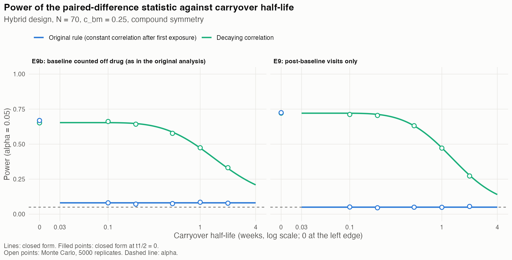
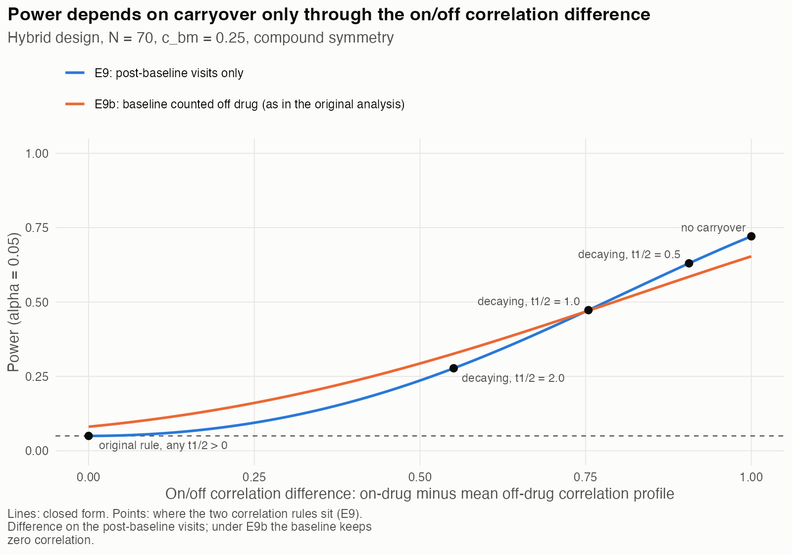
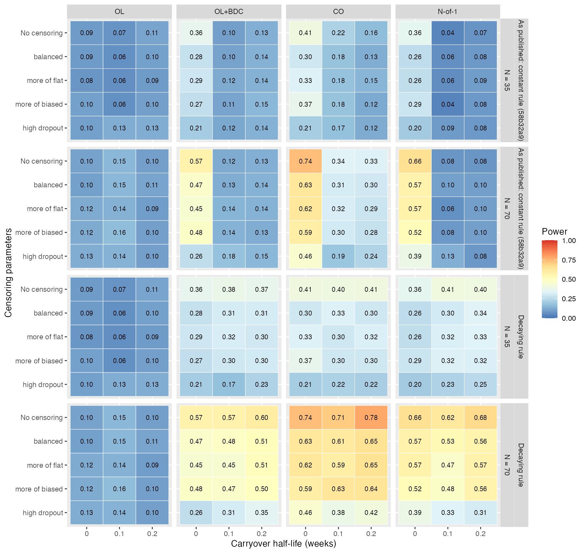
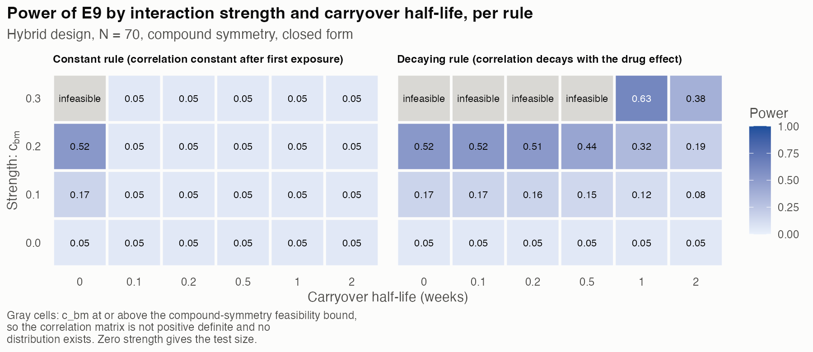
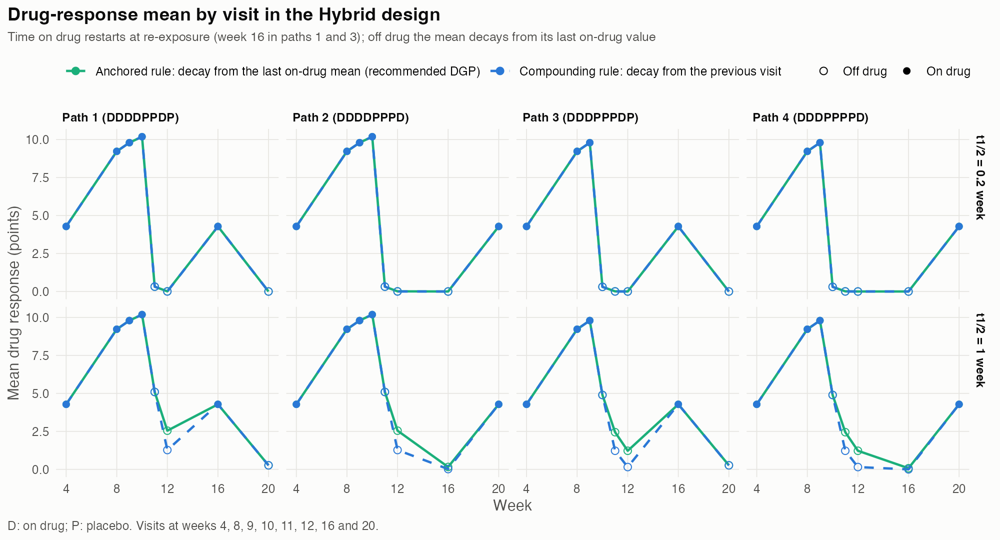

```{r setup, include = FALSE}
knitr::opts_chunk$set(echo = FALSE, warning = FALSE, message = FALSE)
## The starting code under the constant rule at 0.1 week, 4,000
## replicates (referee report 2026-11-01, M6); quoted in the Abstract
## and Stage 2.
m6a <- read.csv(file.path('..', '..', 'data', 'quick-sim',
                          'hendrickson-problems', 'graded-patch',
                          'published-th0.1-reps4000.csv'))
m6a_p <- sum(m6a$rej) / sum(m6a$reps)
## Commit cited in Availability of data and materials.
render_sha <- tryCatch(
  system2('git', c('describe', '--always', '--dirty', '--abbrev=9'),
          stdout = TRUE,
          stderr = FALSE),
  error = function(e) 'unknown', warning = function(w) 'unknown')
```

# Abstract {-}

**Background.** A predictive biomarker is validated by an interaction
test. Unfortunately, such tests are expensive. With two equal subgroups
and an interaction as large as the main effect, the test needs about
four times the sample of a main-effect test (Brookes et al. 2004).
Aggregated N-of-1 designs have been proposed as a way to afford it.
Their power must be estimated by simulation. A simulation can only
show what its data-generating process (DGP) allows. But what should
that process be? We set out five criteria for a DGP for these trials.
We then take its elements one at a time and compare the candidate
choices. We start from the one DGP we found that encodes a predictive
biomarker (Hendrickson et al. 2020). It draws the biomarker and three
latent response components from one multivariate normal distribution.
The biomarker enters as a correlation with the drug response.

**Methods.** We derive the closed-form moments and power of a
paired-difference interaction statistic. We also derive a
Schur-complement bound on the largest feasible interaction. We check
these results by Monte Carlo simulation. Lastly, we fit fourteen
analyses against a prognostic biomarker and report ten of them. The
Hybrid design is the primary case.

**Results.** The first element is the correlation at off-drug visits.
If it stays constant after first exposure, on-drug and off-drug visits
carry the same moderation under any carryover. Power then falls nearly
to the test size. If it decays at the carryover half-life, power
returns to its no-carryover value at half-lives of 0.1 to 0.2 week. It
declines at longer half-lives. The decline is proved monotone for the
paired-difference statistic within each design path. In simulations of
the starting code at 0.1 week, power was `r sprintf('%.2f', m6a_p)`
with the constant correlation (4,000 replicates). It was 0.64 with the
decaying one, against 0.67 without carryover. The second element is
the serial correlation structure. It sets the largest interaction the
DGP can hold. Under compound symmetry no joint distribution exists for
correlations above 0.256. A separable AR(1) structure raises the bound
to 0.474 at a serial correlation of 0.7, a conventional value. A PTSD
symptom series suggests a slower decay, however. At a serial
correlation of 0.9 the bound falls to 0.34, and the Hybrid design needs
about half the sample it needs at 0.7. Finally, a prognostic biomarker
may act through a pathway absent at baseline. Analyses that share the
biomarker effect with baseline are then anticonservative.

**Conclusions.** We recommend a DGP with three features: a
biomarker-response correlation that decays after discontinuation, a
separable AR(1) structure, and a check that refuses infeasible effect
sizes. We give closed-form results, code and planning sample sizes
under it. Its parameter values are not yet calibrated. The
recommendation is therefore a step toward an optimal DGP, not the end
point.

**Trial registration.** Not applicable.

**Keywords:** N-of-1 trials; predictive biomarker; simulation;
carryover; data-generating process; power; prazosin.

# Background

Validating a predictive biomarker requires a biomarker-by-treatment
interaction test [@sargent2005]. Unfortunately, such a test is
expensive. When the interaction is as large as the main effect and
divides the sample into two equal subgroups, it needs about four times
the sample of the main-effect test [@brookes2004]. Aggregated N-of-1
designs have been proposed as a way to afford it. Their power must be
estimated by simulation.

A simulation can show only what its data-generating process (DGP)
allows. The DGP decides how the biomarker acts, how the drug effect
builds and wanes, and how one period carries into the next. Yet there
is little guidance on what a DGP for these trials should be. In this
paper we explore that question. We set out five criteria a DGP should
meet. We then take its elements one at a time. For each element we
compare candidate choices against the criteria and keep the better
one. The result is a recommended DGP. We do not claim it is optimal.
We claim it is closer to optimal than its starting point, and we say
which of its parts remain uncalibrated.

The starting point is the DGP of Hendrickson et al.
[@hendrickson2020], which we call the starting DGP. It is the only DGP
we found that encodes a predictive biomarker for these designs. It
draws the baseline biomarker and three latent response components at
every visit from one multivariate normal distribution. The trial
design assembles the correlation matrix from each participant's
exposure state. The biomarker enters as a correlation with the drug
response. The primary case is the Hybrid design. It combines
open-label titration, blinded discontinuation and a brief crossover,
with carryover between phases.

## Aggregated N-of-1 trials and predictive biomarkers

In an aggregated N-of-1 trial each participant moves between drug and
placebo, or between drug and no drug, several times. The individual
series are analyzed together [@nikles2011; @vohra2016cent; @punja2016].
Every participant contributes both an on-drug and an off-drug
response. The design can therefore estimate how the drug effect varies
between people. It can then test whether a baseline measurement
predicts who benefits [@senn2016mastering; @schork2015]. The motivating
example is prazosin for post-traumatic stress disorder (PTSD).
Prazosin has been tested in several randomized trials
[@raskind2003; @raskind2013; @raskind2018]. The largest, the VA
Cooperative Studies Program trial CSP 563 (304 veterans), found no
benefit on its primary outcomes [@raskind2018]. In a secondary
analysis of an earlier trial in 67 soldiers, higher pretreatment
standing systolic blood pressure was associated with greater symptom
reduction on prazosin but not on placebo, about 14 points on the
Clinician-Administered PTSD Scale per 10 mm Hg [@raskind2016bp].
Blood pressure was therefore proposed as a candidate predictive
biomarker. That association did not replicate in our reanalysis of
CSP 563 (Additional file 1; participant-level data not public). In 279 participants the arm-by-blood-pressure interaction was
+0.25 points per 10 mm Hg (95% CI $-2.72$ to 3.21), which excludes
the published value. Prazosin and blood pressure therefore serve here
as a worked example for the units of the planning section, not as an
established predictive biomarker.

Recent reviews cover the design and analysis of N-of-1 trials,
including Bayesian models for series of trials
[@duan2022personalized; @schmid2022bayesian]. Closed-form power
calculations exist only for simplified versions of these designs
[@wang2019; @senn2002]. Power is therefore estimated by
simulating trials from a data-generating process (DGP) and analyzing
each simulated trial [@morris2019simulation]. Several simulators of
N-of-1 and aggregated N-of-1 data exist. Percha et al. [@percha2019]
simulate single series with exponential wash-in and wash-out to choose
block lengths and sampling rates. Chen and Chen [@chen2014] generate
cycles under compound symmetry or AR(1) with a carryover effect to
compare analyses. Blackston et al. [@blackston2019] and Gärtner et al.
[@gartner2023] simulate aggregated series with carryover to compare
designs and estimators. None of these four represents a baseline
biomarker that modifies the drug response. Tueller et al.
[@tueller2022] estimate power for idiographic within-subject trials by
simulation. Grenet et al. [@grenet2020] simulate
crossover and parallel-group trials with a binary predictive biomarker.
They encode it as a mean-term interaction. In single-case research,
multilevel models with moderators of the intervention effect are
established [@vandennoortgate2003; @moeyaert2014], and Moeyaert et al.
[@moeyaert2022power] estimate by simulation the power to detect such a
moderator. There, too, the moderator enters the mean model.

## The starting DGP

The starting DGP has three parts. The first is a component
decomposition of the symptom score. The score is the baseline level
minus three responses. Each response follows a modified Gompertz
curve. The drug-response component (BR) is driven by time since the
current on-drug period began. The placebo-response component (PB) is
driven by time in the trial and scaled by the participant's
expectancy, the probability of receiving drug given the design. The
natural-history component (TV) is driven by time in the trial. The
second part is the design specification for open-label, crossover,
blinded-discontinuation and Hybrid designs. It tracks time on drug,
time since discontinuation and expectancy at each visit. The third
part is open software (the `pmsimstats` R package).

The starting DGP also encodes the predictive biomarker in a
distinctive way. Statistical models and sample-size methods for N-of-1
and crossover designs usually represent treatment-effect heterogeneity
as random participant-by-treatment variation
[@senn2004individual; @senn2016mastering; @araujo2016;
@senn2011individual; @senn2019samplesize; @zucker1997].
The starting DGP instead places the biomarker in the same multivariate
normal distribution as the response components. The biomarker has a
nonzero correlation $c_{bm}$ with the drug response at on-drug visits.
Without carryover it has zero correlation elsewhere. We call $c_{bm}$
the biomarker-response correlation. A predictive biomarker, a
moderator of the treatment effect [@kraemer2002moderators], is then
one whose association with the outcome differs between on-drug and
off-drug visits. The parameterization keeps the marginal distribution
of the drug response fixed. It expresses the strength of the
interaction as a correlation. We call this the correlation encoding of
the interaction.

The statement that the encoding has no precedent rests on three
database searches. On 2026-10-27 we searched PubMed for (N-of-1 OR
single patient OR aggregated N-of-1) AND simulation AND (biomarker OR
effect modifier OR treatment-by-covariate) AND (power OR sample size).
It returned one record, the study that proposed the starting DGP. On 2026-11-03 we searched
PubMed titles and abstracts for ("N-of-1" OR "single-patient" OR
"single-case" OR "aggregated N-of-1" OR crossover) AND (simulation OR
simulated OR "Monte Carlo") AND (biomarker OR moderator OR "effect
modifier" OR "treatment-by-covariate") AND (power OR "sample size").
We ran the same terms, without "Monte Carlo", against abstracts in
Europe PMC. Both returned two records: that study and a simulation of moderator power in single-case multilevel models
[@moeyaert2022power]. Neither search retrieved Grenet et al.
[@grenet2020], which we identified otherwise, so the searches are not
exhaustive. Web of Science and Scopus were not searched.
The searches cover the N-of-1, crossover and single-case literature
indexed in these two databases. They do not cover the wider
literature on joint simulation of covariates and outcomes, such as
copula methods. In that literature, generating variables jointly from
a specified correlation matrix, and checking that the matrix is
feasible, is standard [@ghosh2003norta; @joe2006generating]. What we
found no precedent for is a biomarker-by-treatment interaction encoded
as a correlation whose value depends on the design and the exposure
state. The claim is therefore limited to the N-of-1 literature we
searched.

## Why the joint distribution is built from the design

The simplest DGP that could serve would generate one symptom score per
visit. Its mean would carry the design effects and an interaction term
$\beta\, B_i D_{it}$. Its residual would be compound symmetric or
AR(1). Most simulators of crossover and N-of-1 data use that form
[@chen2014; @wang2019], and the analysis model
assumes it. It is adequate when the question is the main effect. For
the questions this series asks, the joint-distribution form of the
starting DGP differs from it in four ways. The simple form stays
usable: a mean model with a random participant-by-treatment slope
[@senn2016mastering; @araujo2016] is the conditional equivalent of the
joint-distribution form (Discussion).

1. **How the moderation persists after discontinuation is stated
   separately from the mean carryover.** Carryover in crossover trials
   is usually modeled as a mean effect [@jones2014crossover], a model
   whose usefulness has been questioned [@senn1992carryover;
   @senn1998robust]. In the
   simple form the
   analyst adds it as a term such as $\beta B_i D_{bc,it}$. In the
   joint-distribution form it is the correlation profile $g_t$. Either
   is a modeling choice. The joint-distribution form makes the choice
   visible in the same quantity that sets the effect size.
2. **The interaction is expressed as a share of between-person
   variation.** With the marginal variance of the drug response held
   fixed, $c_{bm}^2$ is the share of the on-drug drug-response
   variance that the biomarker explains linearly. Appendix A.6 relates
   it to a responder-class model. A mean model with a random
   participant-by-treatment slope implies the same kind of quantity
   through the ratio of the fixed slope to the slope variance. Neither
   form makes the residual variance depend on the biomarker.
3. **Prognostic pathways are correlations in the same matrix.** A
   biomarker may also be associated with the placebo response or with
   the natural history of the condition. In the joint-distribution
   form such a pathway is a further correlation in the biomarker row,
   and it shares one feasibility condition with $c_{bm}$ (Stage 6). A
   pathway can also be generated as a mean shift, as the stress test
   does for the growing natural-history pathway (Appendix B.5).
4. **Existence becomes a question with an answer.** In the simple form
   every parameter combination yields a valid distribution. In the
   joint-distribution form, with the marginal variances fixed, it does
   not. Whether the simulated effect sizes are jointly possible, and
   how much of the interaction the design can see, then have
   closed-form answers.

The starting DGP specifies it. The biomarker and the three response
components at every visit form one multivariate normal vector. The
design assembles its correlation matrix. The biomarker is correlated
with the drug response at on-drug visits, and at a value set by the
exposure state at off-drug visits. The components are serially
correlated in calendar weeks. The components are cross-correlated
through a common block. Three results follow. The largest feasible
interaction has a closed form. It depends
on the design and on two modeling choices: the marginal drug-response
variance is held fixed, and the drug-response component keeps its
full variance and serial correlation at off-drug and pre-exposure
visits. We call it the feasibility bound. The power of a
paired-difference statistic has a closed form. The design enters it
through the on/off correlation difference, the on-drug correlation
minus the mean off-drug correlation. The residual structure the
analysis model should assume can be derived from the DGP. Three
requirements come with this form. The marginal
covariance of the outcome is implied rather than chosen. The joint
distribution must exist. Every entry must be calibrated or declared
uncalibrated. The Discussion shows that, conditional on the biomarker,
the correlation encoding reduces to the mean-term form with a smaller
residual variance, so the standard form remains available within it.
We keep the correlation encoding because it is the starting point. We
do not claim it is preferable to a mean-term or random-coefficient
form.

The DGP is not new in its parts. Simulating repeated measures from a
multivariate normal with compound symmetry or AR(1) and a carryover
term is routine [@chen2014; @wang2019]. Decomposing a clinical
trajectory into disease progression, placebo response and drug action
is the pharmacometric convention [@holford2015]. Separable (Kronecker)
covariances for several response variables measured repeatedly are an
established model [@galecki1994; @naik2001kronecker]. The starting DGP combined these
parts. It placed a baseline variable in the joint distribution of the
latent response components, with a correlation indexed by each visit's
exposure state. Designs for heterogeneity analyses in cluster
randomized trials also use correlations of an effect modifier, but
these are intraclass correlations of the modifier and of the outcome,
and the modification itself is a term in the mean model [@li2023].
This paper refines that combination. We found no other instance of it in the N-of-1
literature we searched (above).

## What a data-generating process for these trials must satisfy

To compare candidate choices we need a criterion for "better". We use
five. Each stage of the Results takes one element of the DGP. It
compares the candidates and ends with the choice and the criterion it
rests on.

1. **Existence.** The joint distribution must exist for the effect
   sizes a study simulates. The correlation matrix must be positive
   definite. We measure this by the largest feasible $c_{bm}$, the
   feasibility bound.
2. **Identifiability under carryover.** The biomarker-by-treatment
   interaction must remain a contrast between on-drug and off-drug
   visits when carryover is present. We measure this by the on/off
   correlation difference. The closed form shows that this difference
   governs power.
3. **Fidelity to the pharmacology.** The time course of the drug
   effect, its decay after discontinuation and its behavior at
   re-exposure should be consistent with a short-half-life, titrated
   drug such as prazosin. This is a judgment. We state it as such
   where it decides a stage.
4. **Analyzability.** The residual structure the DGP generates should
   be one the analysis model can represent. The DGP should also be
   able to generate the features that decide which analyses are valid,
   such as a prognostic biomarker. We measure this by the agreement of
   the generated residual structure with the analysis model's, and by
   null rejection rates under those features.
5. **Calibration status.** Every parameter should be labeled as the
   starting value, a choice made here, or uncalibrated. The DGP's
   values have not been re-estimated for this paper. A reanalysis of
   CSP 563 (planning section) estimates some quantities on the total
   symptom score and shows that others are not identifiable from a
   parallel-group trial. This criterion is therefore reported, not
   met.

A DGP meeting criteria 1 to 4, with criterion 5 reported, is what we
call the recommended DGP. Its label in the repository's code and data is
`refined`.

**The reference drug.** Prazosin's plasma half-life is about 2.3 hours
[@hobbs1978], against weekly visits. The plasma concentration
therefore falls by orders of magnitude within a day of the last dose.
We assume a symptom-level half-life of 0.1 to 0.2 week (17 to 34
hours), or 7 to 15 plasma half-lives, as the pharmacological range.
No symptom-response half-life for prazosin in PTSD has been reported,
so the range is an assumption. A drug's effect need not decline with
its plasma concentration [@holford1981dose], so the plasma half-life
is only a starting point. The Results
therefore cover 0 to 2 weeks and label half-lives of 0.5 week and
above as behavioral scenarios. The drug is re-titrated after an
interruption, which bears on how the DGP treats re-exposure (Stage 3).

## Aims

We have three aims. First, we judge the elements of a DGP for these
trials against the five criteria, one element at a time. The elements
are the handling of infeasible matrices, the biomarker-response
correlation off drug, carryover on the
mean, the serial correlation, the cross-component structure, and the
optional features that decide which analyses are valid. Second, we
derive in closed form what each candidate does to feasibility and to
power. Third, we collect the choices as a recommended DGP and give the
sample sizes a trialist needs to plan under it. The Hybrid design is
the primary case. The open-label, blinded-discontinuation and
crossover designs are comparators.

# Methods

The Methods describe the starting DGP and the tools used to compare
candidate choices: the estimands, a statistic with a closed-form distribution,
the feasibility bound and the simulation studies. Every choice about
the DGP is made in the Results.

## The starting data-generating process

We use the starting DGP's notation, with a few additions. Participant
$i$ is observed at a baseline visit $t = 0$ and at post-baseline visits
$t = 1, \ldots, T$, at calendar weeks $w_t$ (4, 8, 9, 10, 11, 12, 16
and 20 in the Hybrid design). The symptom score is

$$
Y_{it} = \mathrm{BL}_i - \left(TV_{it} + PB_{it} + BR_{it}\right),
$$

so a larger response lowers the score. Each component has a mean given
by the modified Gompertz curve

$$
G(x;\, m, d, r) = m\,\frac{\exp(-d e^{-rx}) - e^{-d}}{1 - e^{-d}},
$$

which the code obtains by subtracting the offset $m e^{-d}$ from
$m\exp(-d e^{-rx})$ and rescaling, so that $G(0) = 0$ and
$G(\infty) = m$. It is evaluated at a component-specific clock:

- The drug-response component (BR) at time on drug $t_{od}$, the time
  since the current on-drug period began, with $m = 10.99$, $d = 5$,
  $r = 0.42$ and SD 8. The curve reaches its inflection at 3.8 weeks,
  half its maximum at 4.7 weeks and 90% at 9.2 weeks.
- The placebo-response component (PB) at time in the trial, scaled by
  the expectancy $\eta_t$ (1 in the open-label phase, 0.5 when
  blinded), with $m = 6.51$, $d = 5$, $r = 0.35$ and SD $10\eta_t$.
- The natural-history component (TV) at time in the trial, with the
  same curve as PB and SD 10.

The biomarker has mean 124.3 and SD 15.4, and baseline severity has
mean 83.1 and SD 18.5. These are the values of the starting code's
parameter objects at commit 58b32a9, stored in the package as
`extracted_rp` and `extracted_bp`. Every simulation and closed-form
calculation in this paper uses them, including the simulations of the
analysis G10 in the planning section and the paired rerun of Appendix
B.4. In those two, the biomarker enters the analysis standardized to
mean 0 and SD 1, so their interaction coefficients are per SD of
biomarker. The standardization is linear and does not change the test.

Off drug, the drug-response mean decays from its previous value with
half-life $t_{1/2}$:
$\mu_{BR,t} = \mu_{BR,t-1}\, 2^{-t_{sd,t}/t_{1/2}}$, where $t_{sd}$ is
the time since discontinuation. We call this the compounding carryover
rule. When the drug is resumed, time on drug restarts at zero.

The vector (biomarker, baseline, $TV_{i\cdot}$, $PB_{i\cdot}$,
$BR_{i\cdot}$) is multivariate normal. Within each component the
correlation between any two visits is $\rho_{cs} = 0.8$ (compound
symmetry). We write $\rho_{cs}$ to keep $\rho$ for the AR(1)
correlation per week. Between components the correlation is
$c_1 = 0.2$ at the same visit and $c_\times = 0.1$ otherwise. The
biomarker's correlation with $BR_{it}$ is $c_{bm}\,g_t$, where $g_t$
is the correlation profile, the fraction of $c_{bm}$ present at visit
$t$. The constant rule sets $g_t = 1$ wherever the drug-response mean
is nonzero and 0 elsewhere. The correlation is therefore constant
after first exposure. When the correlation matrix is not positive
definite, the starting code replaces it with a nearby valid matrix,
without a warning (Appendix B.2).

The binary-indicator analysis is the linear mixed model

$$
Y_{it} = \beta_0 + \beta_B B_i + \beta_D D_{it} + \beta_T w_t
  + \beta_{bm:D} B_i D_{it} + u_i + \varepsilon_{it},
$$

with a random intercept $u_i$, the binary drug indicator $D_{it}$, and
baseline included as a row with $D_{i0} = 0$. The interaction
$\beta_{bm:D}$ is tested with Satterthwaite degrees of freedom
[@kuznetsova2017]. Participants are assigned to the design's paths in
fixed numbers (18, 18, 17 and 17 in the Hybrid design at $N = 70$),
not at random.

## Estimands

The target is the on-drug biomarker moderation of the drug response.
This is the change in the drug effect per unit of biomarker while the
drug is fully present. Without carryover it equals
$\beta_{bm:D} = -c_{bm}\sigma_{BR}/\sigma_{bm}$.

Analyses that contrast on-drug with off-drug visits through a binary
drug indicator estimate this quantity only when no moderation remains
off drug. Under carryover they estimate an attenuated on-minus-off
contrast. Analyses with an exposure-decayed indicator $D_{bc,it}$ at
the true half-life recover the on-drug moderation, because the
decaying correlation and $D_{bc,it}$ share one exponential decay. Under
the Weibull decay option, or with a correlation half-life that differs
from the carryover half-life, they do not. At another analysis
half-life, fixed or chosen from the data, they recover it only
approximately. Table
\@ref(tab:estimands) states which analysis in this paper targets which
quantity. The three sets of results are compared only where their
targets coincide (no carryover) or where the attenuation is the object
of study (Stage 2).

Table: (\#tab:estimands) The analyses used in this paper and the quantity each estimates.

| Analysis | Drug indicator | Estimates | Used in |
|----------------------------|------------------|--------------------------------------|--------------|
| Paired-difference statistic E9, E9b (closed form) | binary | on-minus-off contrast, $\beta_{bm:D}$ times the on/off correlation difference | Stages 1, 2, 4, 5; planning |
| The binary-indicator analysis (mixed model) | binary | the same contrast | Stage 2 (starting code) |
| Stress test: the binary-indicator analysis | binary | the on-minus-off contrast | Stage 6 |
| Stress test: fixed-half-life analyses | $D_{bc,it}$ at an analysis half-life of 0.5 week, the true half-life except in the cells that vary it | on-drug moderation $\beta_{bm:D}$ where the half-lives match | Stage 6 |
| Stress test: analyses with the half-life chosen by AIC | $D_{bc,it}$ at the AIC-chosen half-life (0, 0.25, 0.5, 1 or 2 weeks) | on-drug moderation $\beta_{bm:D}$ where the chosen half-life is the true one | Stage 6 |

## The paired-difference statistic

To isolate how carryover acts, we use a summary statistic whose
distribution can be derived exactly (Appendix A). For each participant,

$$
\Delta_i = \bar Y_i^{\text{on}} - \bar Y_i^{\text{off}}
  = \sum_t a_t Y_{it},
$$

the difference between the mean on-drug and mean off-drug scores. It
is regressed on $B_i$ by least squares. We call it E9 when it uses
post-baseline visits only. We call it E9b when baseline is counted as
one more off-drug visit, as in the binary-indicator analysis. In the Hybrid
design, Monte Carlo simulation of the binary-indicator mixed model shows that
E9b reproduces its mean estimates to within 0.004. It reproduces its
power closely (0.654 against 0.632 without carryover). In the
crossover design the closed form understates the mixed model's power
(0.645 against 0.708 without carryover, and 0.279 against 0.31 to 0.35
under the constant rule). The mixed model's time term uses the
between-path contrast that the paired difference discards. The
derivation gives three results.

- **Proposition 1.** The variance of $\Delta$ does not depend on the
  carryover half-life. The half-life enters only through the response
  means and the correlation profile. Neither appears in the variance.
- **Proposition 2.** The population slope is
  $$
  \beta_{bm:D}^{\text{E9}}
    = -c_{bm}\frac{\sigma_{BR}}{\sigma_{bm}}\left(1 - \bar g_{\text{off}}\right),
  \qquad
  \beta_{bm:D}^{\text{E9b}}
    = -c_{bm}\frac{\sigma_{BR}}{\sigma_{bm}}
      \left(1 - \frac{n_{\text{off}}}{n_{\text{off}} + 1}\,
      \bar g_{\text{off}}\right),
  $$
  where $\bar g_{\text{off}}$ is the mean of $g_t$ over the
  $n_{\text{off}}$ post-baseline off-drug visits. The slopes are
  specific to each path. In the Hybrid design $n_{\text{off}}$ is 3 in
  two paths and 4 in the other two. The pooled slope is their
  allocation-weighted average.
- **Power** is a noncentral-$t$ probability governed by the correlation
  $r_{\Delta B}$ between $\Delta$ and $B$. For E9 that correlation is
  proportional to the on/off correlation difference
  $\mathcal G = 1 - \bar g_{\text{off}}$. For E9b it is proportional to
  $1 - \frac{n_{\text{off}}}{n_{\text{off}}+1}\bar g_{\text{off}}$.

So carryover can affect power only through the on/off correlation
difference. The propositions reduce the question of why power falls
to the question of what the correlation rule does to
$\bar g_{\text{off}}$.

## The feasibility bound

Write the response block of the correlation matrix as $M$ and the
biomarker's correlations with the response components as
$c_{bm}\tilde g$, with $\tilde g$ the correlation profile padded with
zeros at the $TV$ and $PB$ entries. The full matrix is positive
definite if and only if $M$ is, and

$$
c_{bm}^2\, \tilde g^\top M^{-1} \tilde g < 1 .
$$

The left side is the squared multiple correlation of the biomarker on
the whole response trajectory. The largest feasible $c_{bm}$, the
feasibility bound, is therefore
$c_{bm}^{\ast} = (\tilde g^\top M^{-1} \tilde g)^{-1/2}$ (Appendix A.4).
It depends on the correlation structure, the design and the
correlation profile. It is a bound on the DGP, not on any analysis.

## Simulation studies

We designed and report the simulations following the ADEMP structure
of Morris et al. [@morris2019simulation; @siepe2024simulation]: aims,
data-generating
mechanisms, estimands, methods and performance measures. There are
three studies (Table \@ref(tab:ademp)). The scripts are listed under
Availability of data and materials. The closed-form calculations of
Stages 4 and 5 and of the planning section use the same code as study
1 with $\rho$ varied. A fourth run, described in the planning section,
simulates the analysis G10 of the companion paper
[@pmsimstats-paper02] under the recommended DGP with the starting
parameters. It supplies the G10 columns of the planning tables, the
G10 sample sizes for 80 percent power and the G10 panel of Figure 4B
(Figure \@ref(fig:fig4bg10)). Its generator reproduces the closed-form
power of E9 within two Monte Carlo SEs in the Hybrid, OL+BDC and
crossover designs ($N = 70$, $c_{bm} = 0.25$, $t_{1/2} = 0.2$ week,
1,000 replicates; `42-check-param-sets.R`).

Table: (\#tab:ademp) Design of the three simulation studies in the
ADEMP structure. MCSE: Monte Carlo standard error of a rejection rate,
$\sqrt{p(1-p)/R}$ for $R$ replicates.

| | 1. Closed-form verification | 2. The starting code | 3. Stress test under a prognostic biomarker |
|--------------|------------------------------|------------------------------|------------------------------|
| **Aim** | Check the closed-form moments and power of Appendix A, and the loss of power under the constant rule | Show on the starting code that the correlation rule alone determines the loss of power | Find which analyses keep their nominal size under features the recommended DGP adds |
| **Data-generating mechanisms** | The correlation encoding with the constant rule and with the decaying correlation; compound symmetry and the separable AR(1) form; carryover on the drug-response mean decaying from the last on-drug value; Hybrid, crossover and OL+BDC designs; $N = 70$; grids of $c_{bm}$ and $t_{1/2}$ | The original `generateData()` at commit 58b32a9, as published and with the decaying correlation only (Appendix B.1); $c_{bm} = 0.25$. (a) Hybrid, $N = 70$, no censoring, $t_{1/2} \in \{0, 0.1, 0.2, 1\}$; (b) four designs, $N \in \{35, 70\}$, $t_{1/2} \in \{0, 0.1, 0.2\}$, the starting censoring patterns | The recommended DGP (Table \@ref(tab:spec)), run three times: the reported run as defined, the first with the compounding carryover rule and the second with randomized allocation; base cell separable AR(1), $\rho = 0.7$, $N = 70$, $t_{1/2} = 0.5$ week; 15 null cells (11 without and 4 with a prognostic pathway of strength 0.3) and 26 alternative cells: power curves under the separable form ($c_{bm}$ from $-0.30$ to 0.45, 7 cells) and under compound symmetry ($\rho_{cs} = 0.8$, $c_{bm}$ from $-0.20$ to 0.25, 6 cells), and 13 cells at $c_{bm} = 0.30$ that each vary one feature ($N$, half-life, decay form, dropout, measurement error or a prognostic pathway) |
| **Estimand** | $\beta_{bm:D}$, and the mean of the paired-difference statistic | $\beta_{bm:D}$ | $\beta_{bm:D}$ |
| **Methods** | Paired-difference statistics E9 and E9b, closed form and simulated; the binary-indicator mixed model fitted with `lmer` | The binary-indicator analysis pipeline (`lmer`, model-based test) on both versions | Fourteen analyses fitted to the same simulated trials, of which the ten in Table \@ref(tab:prognostic) are reported; two-sided tests at $\alpha = 0.05$ |
| **Performance measures** | Mean, SD and power of the statistic; agreement as (simulated $-$ closed form)/MCSE | Power; mean interaction estimate; number of repaired correlation matrices | Null rejection rate; power; failed fits |
| **Replicates** | 5,000 per cell (MCSE of power at most 0.007); 500 to 1,000 for `lmer` | (a) 500 per cell (MCSE at most 0.022); (b) 250 per cell (at most 0.032) | 1,000 per null cell (MCSE 0.0069 at a rate of 0.05), 500 per alternative cell (at most 0.022) |

```{r cfcount}
## Study 1 agreement count: every cell-variant of the closed-form
## check (01-e9-closed-form.R), all designs and structures.
cfz <- read.csv(file.path('..', '..', 'data', 'quick-sim',
                          'carryover-closed-form', 'e9-closed-form-vs-mc.csv'))
cf_n <- nrow(cfz)
cf_beyond <- sum(abs(cfz$power_z) > 2)
cf_expect <- round(cf_n * 2 * pnorm(-2))
```

**Number of replicates.** Replicate counts were set by the precision
each comparison needs. In study 3, 1,000 null replicates give a
two-MCSE band of 0.036 to 0.064 for a single cell. Pooling 11
non-prognostic null cells gives the band of 0.046 to 0.054 used in
Stage 6. In study 1, a cell is flagged when the simulated and
closed-form values differ by more than 2 MCSE. Chance alone produces
this in about 4.6% of cells, or about `r cf_expect` of the `r cf_n`
cell-variants (three designs, three correlation structures, two
statistics); `r cf_beyond` were flagged. The cell-variants are not
independent, since each uses its own draws but the same designs.

**Random numbers.** Every cell, or chunk of a cell, sets its own seed
from a fixed rule: a function of the cell's parameters in study 1, a
shared seed per half-life (study 2a) or per design, sample size and
half-life (study 2b), and $20261007 + 1000 \times \text{cell} +
\text{chunk}$ in study 3. Results therefore do not depend on the
number of cores or the order in which chunks run. Both versions of the
starting code in study 2 use the same seeds. All analyses in study 3
are fitted to the same trials. The comparisons are therefore paired.
R's default Mersenne-Twister generator was used throughout.

**Failed fits.** In study 3, a fit that returned
an error was recorded as missing. In the reported run, failures
numbered 0 to 10 per analysis over 28,000 trials, and at most 0.3% in
any cell. In the first and second runs they numbered 0 to 12 and 0 to
7, and at most 0.6% and 0.4% in any cell.
In study 2
the starting pipeline returned an estimate for every replicate. No
correlation matrix was repaired in either version, because
$c_{bm} = 0.25$ lies below the compound-symmetry feasibility bound of
0.256. Study 1 does not fit models for the paired-difference
statistic, so it has no failures.

**Which form of the DGP each study used.** Study 1 and the closed-form
calculations build the cross-component correlation as
$c_1\rho^{\lvert w_t - w_s\rvert}$ (the separable form) where the
separable structure is named, and as the starting constants where
compound symmetry is named. Study 2 is the starting code and so the
starting structure. Study 3 was run three times, with the separable
form in every cell except the compound-symmetry curve and an analysis
half-life of 0.5 week. The first run used fixed path allocation (18,
18, 17, 17) and the compounding carryover rule on the mean. The second
run used carryover decaying from the last on-drug mean, the rule of
the recommended DGP, and also assigned each participant to a path at
random in every trial. Randomized allocation is a driver option, not
part of the recommended DGP as defined (Table \@ref(tab:spec)). The third
run is the recommended DGP as defined: the anchored carryover rule with
fixed allocation. It differs from the first run only in the carryover
rule and from the second only in the allocation, so the two effects
can be separated. The tables in Stage 6 are from the third run. The
first run is in Appendix C, Table \@ref(tab:prognosticfirst).

**Software.** R 4.6.1, with lme4 2.0.1 and lmerTest 3.2.1 for the
starting pipeline, nlme 3.1-169, mmrm 0.3.17, clubSandwich 0.7.0 and
MASS 7.3-65. In study 3 the binary-indicator analysis is fitted with `mmrm`
and a compound-symmetry covariance with Satterthwaite inference, not
with `lmer`. The two coincide when the within-person correlation is
non-negative.

**Exploratory status.** The stress test is exploratory. Its cells and
analyses were written down as a working protocol (Additional file 2). No analysis plan was fixed in advance, and the protocol
was revised as results came in. Two cells with a prognostic
association between the biomarker and baseline severity, and three
analyses, were added after the first results. Failed fits were first
counted as non-rejections and are now excluded from the denominator,
a change of at most 0.0025 in any rate. The study also compared the
analyses' power and selected one by a decision rule. That selection
was revised after results, is post hoc, and is reported in
Additional file 3, not here. Such post hoc changes
can favor one method in comparative simulation studies
[@pawel2024pitfalls], which is a further reason not to rank the
analyses here. This paper uses the
stress test only for what it shows about the DGP: which analyses are
valid under a prognostic biomarker, and what the optional features do
to size and power.

# Results

The Results are organized as stages. Each stage takes one element of
the DGP. It states the candidate choices and the evidence. It ends
with the choice made and the criterion it rests on. Table \@ref(tab:spec), at
the end, collects the choices.

## Stage 1. Feasibility of the joint distribution

The first question is whether the joint distribution exists for the
effect sizes a study simulates. Under compound symmetry the
correlation matrix is positive definite only for $c_{bm}$ below a
bound. Without carryover the bound is 0.256 in the Hybrid design. It
is 0.256 in the crossover and 0.262 in the
open-label-plus-blinded-discontinuation design. These values follow
from the feasibility bound with $M$ the starting response block.

But why is the bound so low? It is the condition that the biomarker's
squared multiple correlation on the whole response trajectory stays
below one. Under compound symmetry every visit's drug response shares
the same person-level factor. The biomarker therefore cannot be
correlated with the on-drug visits alone. Through that factor it is
correlated with the off-drug visits as well. The bound is low for two
reasons. The correlation profile switches between visits that the
structure ties together. The drug-response component also keeps its
full variance at off-drug visits. Stages 4 and 5 show how far a
serial correlation that decays with lag raises the bound. Even then,
an effect size of 0.6 is infeasible in 75% of the extended grid and
in every Hybrid cell (Appendix B.2, Table \@ref(tab:nonpd)).

When a matrix is infeasible, a DGP can either repair it or refuse it.
The starting code repairs it without a warning (Appendix B.2). A
repaired matrix simulates a different DGP from the one stated, and it
does not report which correlation changed. The recommended DGP
therefore stops and reports the cell as infeasible. The package
function `buildSigma()` does so by default (Appendix B.5). The choice
rests on the existence criterion. What the bound means in outcome
units, and what to do above it, are taken up in the planning section
and the Discussion.

## Stage 2. The biomarker-response correlation under carryover

This stage takes the correlation at off-drug visits. Power to
detect the interaction falls sharply under the constant rule once
carryover is introduced [@hendrickson2020]. In our 500-replicate rerun of
the starting code in the Hybrid design at $N = 70$ and
$c_{bm} = 0.25$ (Table \@ref(tab:patch)), power fell from 0.668 without
carryover to 0.126 at a half-life of 0.1 week. A 4,000-replicate rerun
of that cell gives `r sprintf('%.3f', m6a_p)` (below). No correlation
matrix
was repaired in that run, because 0.25 lies below the
compound-symmetry feasibility bound of 0.256. At that half-life only
0.1% of the drug effect remains a week after stopping.

Under the constant rule every off-drug visit in the Hybrid design
follows an exposure. With any positive half-life its drug-response
mean is positive, so $g_t = 1$. Hence $\bar g_{\text{off}} = 1$ and,
by Proposition 2,

$$
\beta_{bm:D}^{\text{E9}} = 0, \qquad
\beta_{bm:D}^{\text{E9b}} = -c_{bm}\frac{\sigma_{BR}}{\sigma_{bm}}\,
  \frac{1}{n_{\text{off}} + 1}
\qquad \text{for every } t_{1/2} > 0 .
$$

Power is a step function of the half-life (Table
\@ref(tab:closedform), Figure \@ref(fig:powerfig)). It takes its
no-carryover value at $t_{1/2} = 0$. It takes a constant value at
every positive half-life of practical interest, whether 0.1 week or
10. The exception below about 0.007 week is an artifact of
double-precision arithmetic in the starting code, not a property of
the DGP (Appendix B.1). For E9b the constant is 0.081. This value
comes from the baseline row, which alone keeps $g_t = 0$.

```{r m6data}
m6 <- read.csv(file.path('..', '..', 'data', 'quick-sim',
                         'hendrickson-problems', 'graded-patch',
                         'published-th0.1-reps4000.csv'))
m6_R <- sum(m6$reps)
m6_p <- sum(m6$rej) / m6_R
m6_se <- sqrt(m6_p * (1 - m6_p) / m6_R)
stopifnot(m6_R == 4000, all(m6$t_half == 0.1), sum(m6$repairs) == 0)
```

The binary-indicator analysis behaves the same way. In our reconstruction of
the starting DGP, the mean estimate falls from $-0.126$ to between
$-0.026$ and $-0.032$ at every positive half-life. Power falls from
0.63 to between 0.08 and 0.11 (500 replicates per cell). The
separately seeded run of the starting code reported above gives 0.126
at 0.1 week, against 0.080 for the reconstruction. The difference is
2.4 combined Monte Carlo SE (two-sided $p = 0.016$). The two
implementations share the parameters, the path allocation and the
analysis model. They differ in the random-number stream and in the
carryover rule on the mean. At 0.1 week the carryover rule leaves an
off-drug drug-response mean below 0.011 points under either rule, so
it cannot account for a difference of this size. We therefore reran
the starting code at 0.1 week with 4,000 new replicates (16 seeds not
used before). Power was
`r sprintf('%.3f', m6_p)` (MCSE `r sprintf('%.4f', m6_se)`), within
`r sprintf('%.1f', abs(m6_p - 0.080) / sqrt(m6_se^2 + 0.080 * 0.920 / 500))`
combined Monte Carlo SE of the reconstruction. Rerunning the stored
cell with its stored seed reproduces 0.126 exactly. The rerun is
therefore consistent with the reconstruction, and the value of 0.126
is consistent with a high draw of a 500-replicate run. We found no
difference between the two implementations that would explain it.

With a constant correlation, the biomarker moderates the on-drug and
post-baseline off-drug responses equally. No interaction remains among
the post-baseline visits. Only the baseline visit, where the
correlation is zero, still contrasts with the on-drug visits, which is
why E9b and the binary-indicator analysis keep a little power. The loss
of power under small carryover is therefore a property of the
correlation rule, not of carryover or of the designs.

```{r closedform}
cfv <- read.csv(file.path('..', '..', 'data', 'quick-sim',
                          'carryover-closed-form', 'e9-closed-form-vs-mc.csv'))
cfv <- cfv[cfv$design == 'Hybrid' & cfv$construct == 'CS' & cfv$c.bm == 0.25, ]
cf_th <- c(0, 0.1, 0.2, 0.5, 1, 2)
cfv_shown <- cfv[cfv$rule %in% c('step', 'graded') & cfv$t_half %in% cf_th, ]
stopifnot(nrow(cfv_shown) == 24)
cf_row <- function(rule, v) {
  sapply(cf_th, function(h) {
    x <- cfv$power[cfv$rule == rule & cfv$variant == v & cfv$t_half == h]
    stopifnot(length(x) == 1)
    x
  })
}
tab <- data.frame(
  Rule = c('Constant', '', 'Decaying', ''),
  Statistic = rep(c('E9', 'E9b'), 2),
  rbind(cf_row('step', 'E9'), cf_row('step', 'E9b'),
        cf_row('graded', 'E9'), cf_row('graded', 'E9b')))
knitr::kable(tab, booktabs = TRUE, digits = 3,
  col.names = c('Correlation rule', 'Statistic', '0', '0.1', '0.2', '0.5', '1', '2'),
  caption = paste0('Closed-form power by carryover half-life (weeks). Hybrid design, $N = 70$, $c_{bm} = 0.25$, compound symmetry. Constant: the constant rule (constant correlation after first exposure). Decaying: the decaying rule (correlation decaying at the carryover half-life). E9: paired-difference statistic on post-baseline visits; E9b: the same with baseline counted as an off-drug visit, as in the binary-indicator analysis. Against Monte Carlo estimates (5,000 replicates per cell), ', sum(abs(cfv_shown$power_z) > 2), ' of the ', nrow(cfv_shown), ' cell-variants in this table differ by more than 2 Monte Carlo SE, and ', cf_beyond, ' of all ', cf_n, ' cell-variants of study 1 (about ', cf_expect, ' expected by chance).'))
```

```{r powerfig, fig.cap = 'Closed-form power (lines) against carryover half-life, with Monte Carlo estimates (points; 5,000 replicates per cell), under the constant rule (constant correlation after first exposure) and the decaying rule (correlation decaying at the carryover half-life). Hybrid design, $N = 70$, $c_{bm} = 0.25$, compound symmetry; left panel E9b, right panel E9.', out.width = '85%', fig.align = 'center'}

```

The candidate is a correlation that decays after discontinuation at
the carryover half-life: $g_t = 1$ on drug, $2^{-t_{sd,t}/t_{1/2}}$
off drug after exposure, and 0 before any exposure. This is the
pharmacological reading of a predictive biomarker. The biomarker
predicts the size of the drug effect, so it cannot predict a drug
effect that is no longer present. Under the decaying rule the mean of
$g_t$ over the off-drug visits is

$$
\bar g_{\text{off}}(t_{1/2}) = \frac{1}{n_{\text{off}}}
  \sum_{t\,\text{off}} 2^{-t_{sd,t}/t_{1/2}},
$$

which is strictly increasing in $t_{1/2}$, because every off-drug visit
has $t_{sd} \ge 1$ week. Two consequences follow.

- **Power is strictly decreasing in the half-life** for the
  path-stratified paired-difference statistic. This holds on every
  path with at least one off-drug visit after an exposure (Proposition
  3, Appendix A.3). The placebo-first crossover path, whose off-drug
  visits all precede exposure, has constant power. For the pooled
  statistic power is non-increasing at every step of a 120-point grid
  from 0.03 to 4 weeks. For the binary-indicator mixed model only the
  simulated half-lives are available, and its values there are
  consistent with a monotone decline within Monte Carlo error (Table
  \@ref(tab:patch)).
- **The loss vanishes faster than any power of the half-life as
  $t_{1/2} \to 0$.** At 0.1 week, $\bar g_{\text{off}} \le 2^{-10}$
  and power is unchanged to within 0.001.

The constant rule is the limit of the decaying rule as
$t_{1/2} \to \infty$, applied at every positive half-life.

Power depends on the correlation profile only through the on/off
correlation difference $\mathcal G = 1 - \bar g_{\text{off}}$ (Figure
\@ref(fig:gapfig)). The difference is 1 without carryover. Under the
decaying rule in the Hybrid design it is 0.9997 at 0.1 week, 0.991 at
0.2, 0.906 at 0.5, 0.754 at 1 and 0.551 at 2. Under the constant rule
it is 0 at every positive half-life. The noncentrality is proportional
to $r_{\Delta B}/\sqrt{1 - r_{\Delta B}^2}$, and $r_{\Delta B}$ is
proportional to the difference. For small $r_{\Delta B}$ the sample
size needed for a given power therefore scales approximately as
$1/\mathcal G^2$. At 1 week this is about 1.8 times the no-carryover
sample. At 2 weeks it is about 3.3 times.

```{r gapfig, fig.cap = 'Closed-form power against the on/off correlation difference, with the positions of the two correlation rules. Hybrid design, $N = 70$, $c_{bm} = 0.25$, E9.', out.width = '75%', fig.align = 'center'}

```

Replacing only the correlation lines of the starting code with the
decaying rule (Appendix B.1) and running the pipeline unchanged gave
the results in Table \@ref(tab:patch). The two versions coincide
without carryover, as they must. At 0.1 and 0.2 week the
decaying version keeps the full interaction, within Monte Carlo error
of the no-carryover value of 0.668. At 1 week it shows a gradual
decline. No matrix was repaired in either version, because
$c_{bm} = 0.25$ is below the feasibility bound.

```{r patch}
gp <- read.csv(file.path('..', '..', 'data', 'quick-sim',
                         'hendrickson-problems', 'graded-patch',
                         'graded-patch-reps500.csv'))
stopifnot(all(gp$reps == 500), all(gp$repairs == 0))
gp_pub <- gp[gp$version == 'published', ][order(gp$t_half[gp$version == 'published']), ]
gp_gr <- gp[gp$version == 'graded', ][order(gp$t_half[gp$version == 'graded']), ]
stopifnot(identical(gp_pub$t_half, gp_gr$t_half))
tab <- data.frame(th = as.character(gp_pub$t_half),
  pm = gp_pub$mean_beta, gm = gp_gr$mean_beta,
  pp = gp_pub$power, gp = gp_gr$power)
knitr::kable(tab, booktabs = TRUE, digits = 3,
  col.names = c('$t_{1/2}$ (weeks)', 'Mean estimate, constant', 'Mean estimate, decaying',
                'Power, constant', 'Power, decaying'), escape = FALSE,
  caption = paste0('The starting code at commit 58b32a9, as published (constant) and with the decaying correlation (decaying): Hybrid design, $N = 70$, $c_{bm} = 0.25$, 500 replicates per cell, same seeds. Monte Carlo SE of power at most 0.022. ', sprintf('A rerun of the original version at 0.1 week with 4,000 new replicates gave power %.3f (Stage 2 text).', m6_p)))
```

Figure \@ref(fig:fig4bmc) repeats the layout of Figure 4B of the earlier study on
the starting code, for all four designs, both sample sizes and the
five censoring patterns, as published and with the decaying
correlation. It uses $c_{bm} = 0.25$ instead of the earlier 0.6. The
value 0.6 lies above the feasibility bound of the Hybrid design and of
most cells of the other designs, so it would confound the comparison
with the repair. At 0.25 neither version
repaired a matrix, so the correlation rule is the only difference.
With 250 replicates per cell the Monte Carlo SE reaches 0.032, so a
difference of 0.05 between adjacent cells is within Monte Carlo error.
Only the pattern across cells should be read. Results at $N = 70$
without censoring:

- **Hybrid design.** Power under the constant rule falls from 0.66 to
  0.08 at both positive half-lives. Power under the decaying rule
  stays at 0.62 and 0.68.
- **Open label plus blinded discontinuation.** Power under the
  constant rule falls from 0.57 to 0.12 and 0.13. Power under the
  decaying rule stays at 0.57 and 0.60.
- **Crossover.** Power under the constant rule falls only to 0.34 and
  0.33. The placebo-first path's off-drug visits precede any exposure
  and so keep zero correlation under both rules. Power under the
  decaying rule stays at 0.71 and 0.78.
- **Open label.** There are no off-drug visits. The two rules coincide
  and power is low throughout.

The same pattern holds at $N = 35$ and under every censoring pattern.

```{r fig4bmc, fig.cap = 'Power to detect the biomarker-by-treatment interaction, in the layout of Figure 4B of the earlier study, from the starting code at commit 58b32a9 as published (upper two panel rows) and with the decaying correlation (lower two panel rows). Rows within panels: censoring patterns; columns: carryover half-life; panels: trial design (N-of-1 is the Hybrid design) and total sample size. $c_{bm} = 0.25$, 250 replicates per cell (Monte Carlo SE at most 0.032), the same seeds for both versions. No matrix was repaired in either version.', out.width = '100%', fig.align = 'center'}

```

```{r fig4bg10data}
## G10 and G9 under the starting parameters: driver 19 with
## --params published (referee report 2026-11-01, M1). The stored
## g10-planning/ and g9-planning/ runs used other response SDs and are
## not read. Until the published-set output is in place, every number
## that depends on it prints as [pending].
pub_dir <- file.path('..', '..', 'data', 'quick-sim',
                     'carryover-closed-form', 'published-planning')
pub_ok <- function(f, dir = pub_dir) {
  p <- file.path(dir, f)
  m <- file.path(dir, 'PARAM_SET')
  if (file.exists(p) && file.exists(m) &&
      identical(readLines(m, n = 1L), 'published')) p else NA_character_
}
PENDING <- '\\textbf{[pending]}'
pend <- function(have, expr) if (have) expr else PENDING
## Two rates differ when they are more than two combined Monte Carlo
## SEs apart.
rate_cmp <- function(p1, n1, p0, n0) {
  se <- sqrt(p1 * (1 - p1) / n1 + p0 * (1 - p0) / n0)
  if (abs(p1 - p0) <= 2 * se) 0L else as.integer(sign(p1 - p0))
}

f4_file <- pub_ok('fig4b-g10-cbm0.25.csv')
have_f4 <- !is.na(f4_file)
if (have_f4) g9f <- read.csv(f4_file)
f4_row <- function(d, N, th, cens = 'No censoring')
  g9f[g9f$design == d & g9f$N == N & g9f$t_half == th &
      g9f$censoring == cens, ]
g9f_pick <- function(d, N, th, cens = 'No censoring') pend(have_f4, {
  r <- f4_row(d, N, th, cens)
  stopifnot(nrow(r) == 1)
  sprintf('%.2f', r$power)
})
g9f_mcse_max <- pend(have_f4, sprintf('%.3f',
  max(sqrt(g9f$power * (1 - g9f$power) / g9f$n_conv), na.rm = TRUE)))
## Power at 0.1 and 0.2 week against the no-carryover value, N = 70,
## no censoring.
f4_cmp <- function(d) pend(have_f4, {
  r0 <- f4_row(d, 70, 0)
  s <- vapply(c(0.1, 0.2), function(th) {
    r1 <- f4_row(d, 70, th)
    k <- rate_cmp(r1$power, r1$n_conv, r0$power, r0$n_conv)
    if (k == 0L) 'within Monte Carlo error of its no-carryover value' else
      sprintf('%s (%.2f)', if (k < 0L) 'lower' else 'higher', r1$power)
  }, '')
  if (s[1] == s[2]) paste(s[1], 'at both half-lives') else
    sprintf('%s at 0.1 week and %s at 0.2 week', s[1], s[2])
})
## The censoring pattern with the lowest power, Hybrid, N = 70, 0.2 week.
f4_low <- if (have_f4) {
  r <- g9f[g9f$design == 'N-of-1' & g9f$N == 70 & g9f$t_half == 0.2 &
           g9f$censoring != 'No censoring', ]
  r[which.min(r$power), ]
} else NULL
f4_low_name <- pend(have_f4, sprintf("the '%s' pattern", f4_low$censoring))
f4_low_pow <- pend(have_f4, sprintf('%.2f', f4_low$power))
## G10 against the starting code with the decaying correlation (lower
## panels of the preceding figure) and against closed-form E9 under the
## recommended DGP, N = 70, no censoring, no carryover. Without carryover
## the two carryover rules on the mean coincide, so the figures differ
## there only in the correlation structure and the analysis.
orig_f4 <- read.csv(file.path('..', '..', 'data', 'quick-sim',
                              'hendrickson-problems', 'fig4b-graded',
                              'fig4b-graded-cbm0.25-reps250.csv'))
e9_70 <- read.csv(file.path('..', '..', 'data', 'quick-sim',
                            'carryover-closed-form', 'rho-stage',
                            'planning-n80.csv'))
f4_des <- c(`N-of-1` = 'Hybrid', `OL+BDC` = 'OL+BDC', CO = 'CO')
f4_orig <- function(d) {
  o <- orig_f4[orig_f4$version == 'graded' & orig_f4$design == d &
               orig_f4$N == 70 & orig_f4$t_half == 0 &
               orig_f4$censoring == 'No censoring', ]
  stopifnot(nrow(o) == 1)
  o
}
f4_e9 <- function(d) {
  v <- e9_70$power_N70[e9_70$design == f4_des[[d]] &
                       e9_70$c_bm == 0.25 & e9_70$t_half == 0]
  stopifnot(length(v) == 1)
  v
}
f4_trio <- function(f) pend(have_f4, sprintf('%.2f, %.2f and %.2f',
  f('N-of-1'), f('OL+BDC'), f('CO')))
f4_g10_0 <- f4_trio(function(d) f4_row(d, 70, 0)$power)
f4_orig_0 <- f4_trio(function(d) f4_orig(d)$power)
f4_e9_0 <- f4_trio(f4_e9)
## G10 below the starting code in every design, and E9 no higher than
## G10 plus two Monte Carlo SEs: the conditions the text states.
f4_all_lower <- have_f4 && all(vapply(names(f4_des), function(d) {
  g <- f4_row(d, 70, 0)
  o <- f4_orig(d)
  rate_cmp(g$power, g$n_conv, o$power, o$n) < 0
}, TRUE))
f4_e9_low <- have_f4 && all(vapply(names(f4_des), function(d) {
  g <- f4_row(d, 70, 0)
  f4_e9(d) <= g$power + 2 * sqrt(g$power * (1 - g$power) / g$n_conv)
}, TRUE))
stopifnot(!have_f4 || (f4_all_lower && f4_e9_low))
## The OL+BDC comparison at 0.2 week in the 1,000-replicate planning
## run of the same DGP and analysis.
pl_file <- pub_ok('planning-g10.csv')
f4_pl <- if (!is.na(pl_file)) {
  pl <- read.csv(pl_file)
  sapply(c(0, 0.2), function(th) {
    r <- pl[pl$design == 'OL+BDC' & pl$c_bm == 0.25 & pl$t_half == th &
            pl$N_label == '70', ]
    stopifnot(nrow(r) == 1)
    c(power = r$power, n = r$n_reps)
  })
} else NULL
f4_pl_txt <- pend(!is.null(f4_pl), {
  k <- rate_cmp(f4_pl['power', 2], f4_pl['n', 2], f4_pl['power', 1],
                f4_pl['n', 1])
  sprintf(paste('In the planning run of the same DGP and analysis, with',
                '%s replicates per cell (Table \\@ref(tab:planningg10)),',
                'OL+BDC power is %.3f without carryover and %.3f at 0.2',
                'week, %s.'),
          format(f4_pl['n', 1], big.mark = ','), f4_pl['power', 1],
          f4_pl['power', 2],
          if (k == 0) 'within Monte Carlo error of each other' else
            'a difference of more than two Monte Carlo SEs')
})
```

Figure \@ref(fig:fig4bg10) repeats the grid of Figure \@ref(fig:fig4bmc)
under the recommended DGP of Stage 7 with the analysis G10 that the
companion paper recommends [@pmsimstats-paper02]. G10 is a
random-intercept model with CAR(1) residual correlation and an
exposure-decayed drug indicator whose half-life is chosen by AIC on
the model without the interaction, with CR2 cluster-robust standard
errors (planning section). Both figures use the starting response and
baseline parameters (Methods). The data-generating process differs
from that of Figure \@ref(fig:fig4bmc) in its correlation structure
(separable AR(1) at $\rho = 0.7$ instead of compound symmetry) and in
its carryover rule on the mean, and the analysis differs, so the two
figures are not matched cell by cell. Each cell has 250 replicates and
a Monte Carlo SE of at most `r g9f_mcse_max`. The open-label design is not
estimable under G10: every visit is on drug, so the exposure-decayed
indicator is constant at 1 and the interaction term is collinear with
the biomarker. The binary-indicator analysis replaces the interaction with a
biomarker-by-time term in that case. G10 has no such substitute, and
the cells are marked as not estimable rather than simulated. The
censoring patterns in this figure use the corrected dropout rule.
The starting `censordata()` raised dropout with improvement, the
reverse of the intended mechanism, through a sign error in its biased
term (Appendix B.5). Under the corrected rule, dropout rises with
worsening. Figure \@ref(fig:fig4bmc) keeps the published rule, because
it reproduces the starting code. Results at $N = 70$ without
censoring:

- **Hybrid design.** Power is `r g9f_pick('N-of-1', 70, 0)`,
  `r g9f_pick('N-of-1', 70, 0.1)` and `r g9f_pick('N-of-1', 70, 0.2)`
  at half-lives of 0, 0.1 and 0.2 week.
- **Open label plus blinded discontinuation.** Power is
  `r g9f_pick('OL+BDC', 70, 0)`, `r g9f_pick('OL+BDC', 70, 0.1)` and
  `r g9f_pick('OL+BDC', 70, 0.2)`.
- **Crossover.** Power is `r g9f_pick('CO', 70, 0)`,
  `r g9f_pick('CO', 70, 0.1)` and `r g9f_pick('CO', 70, 0.2)`.

We compare G10 power at the pharmacological half-lives with its
no-carryover value. Two rates differ when they are more than two
combined Monte Carlo SEs apart. In the Hybrid design, power is
`r f4_cmp('N-of-1')`. In the OL+BDC design it is `r f4_cmp('OL+BDC')`.
In the crossover design it is `r f4_cmp('CO')`. Each comparison rests
on one cell of 250 replicates. `r f4_pl_txt` Of the censoring
patterns, `r f4_low_name` gives the lowest power in the Hybrid design
at 0.2 week, `r f4_low_pow`.

G10 power is lower than in the starting code with the decaying
correlation (Figure \@ref(fig:fig4bmc), lower two panel rows) in every
design. Without carryover it is `r f4_g10_0` in the Hybrid, OL+BDC and
crossover designs, against `r f4_orig_0` in the starting code. The
analysis does not account for the difference. Under the recommended DGP
the closed-form power of the paired-difference statistic E9 at the
same $N$ and $c_{bm}$ is `r f4_e9_0`, computed as for Table
\@ref(tab:planning), no higher than G10. Without carryover the two carryover rules on the mean
coincide, so the difference comes from the correlation structure. The
starting code uses compound symmetry at $\rho_{cs} = 0.8$, and the
recommended DGP uses the separable AR(1) form at $\rho = 0.7$. Table
\@ref(tab:rhostage) shows the effect of that change on closed-form E9
power in the Hybrid design. The drop is largest in the crossover
design. We have not established why.

```{r fig4bg10, eval = have_f4, fig.cap = paste0('Power of the analysis G10 to detect the biomarker-by-treatment interaction under the recommended DGP (separable AR(1), $\\rho = 0.7$, $c_1 = 0.2$, decaying correlation, carryover decaying from the last on-drug mean, original response parameters), in the layout of Figure 4B of the original study. Rows within panels: censoring patterns; columns: carryover half-life; panels: trial design (N-of-1 is the Hybrid design) and total sample size. $c_{bm} = 0.25$, 250 replicates per cell (Monte Carlo SE at most ', g9f_mcse_max, '). Censoring patterns use the corrected dropout rule, under which dropout rises with worsening; the original-code figure uses the published rule of commit 58b32a9. Gray cells (n/e): the open-label design, in which every visit is on drug and the interaction is not estimable under G10.'), out.width = '100%', fig.align = 'center', fig.width = 9, fig.height = 5.2}
library(ggplot2)
fd <- g9f
fd$design <- factor(fd$design, levels = c('OL', 'OL+BDC', 'CO', 'N-of-1'))
fd$censoring <- factor(fd$censoring,
  levels = c('high dropout', 'more of biased', 'more of flat', 'balanced',
             'No censoring'))
fd$N <- factor(paste0('N = ', fd$N), levels = c('N = 35', 'N = 70'))
fd$label <- ifelse(is.na(fd$power), 'n/e', sprintf('%.2f', fd$power))
ggplot(fd, aes(factor(t_half), censoring, fill = power)) +
  geom_tile(color = 'white') +
  geom_text(aes(label = label), size = 2.8) +
  facet_grid(N ~ design) +
  scale_fill_distiller(palette = 'RdYlBu', limits = c(0, 1),
                       name = 'Power', na.value = 'grey85') +
  labs(x = 'Carryover half-life (weeks)', y = 'Censoring parameters') +
  theme_grey(base_size = 10)
```

```{r fig4bg10pending, eval = !have_f4, results = 'asis'}
cat('\\begin{center}\\textbf{[Figure pending: the published-set run of',
    '19-g9-planning-and-fig4b.R, block F]}\\end{center}\n')
```

Figure \@ref(fig:fig4b) extends the comparison over interaction
strengths and longer half-lives. It shows closed-form power in the
Hybrid design for each correlation rule.

- **The constant rule.** Every column after $t_{1/2} = 0$ falls to the
  test size or just above it, at every strength. For example, at
  $c_{bm} = 0.2$ power under E9b falls from 0.46 to 0.07.
- **The decaying rule.** Power declines smoothly: 0.46, 0.46, 0.46,
  0.41, 0.32 and 0.23 at the same strength over half-lives of 0 to 2
  weeks.
- **Feasibility.** Gray cells mark effect sizes at or above the
  compound-symmetry feasibility bound, where no joint distribution
  exists. Under the decaying rule, $c_{bm} = 0.3$ becomes feasible
  only from $t_{1/2} = 1$ week. A correlation that decays instead of
  switching places a smaller demand on the structure (Appendix A.5).

```{r fig4b, fig.cap = 'Closed-form power of the paired-difference statistic by interaction strength ($c_{bm}$) and carryover half-life, in the layout of Figure 4B of the earlier study: the constant rule and the decaying correlation. Upper row: E9b, which counts baseline as an off-drug visit as the binary-indicator analysis does; lower row: E9. Gray cells: $c_{bm}$ at or above the compound-symmetry feasibility bound, where the correlation matrix is not positive definite. Hybrid design, $N = 70$, compound symmetry.', out.width = '100%', fig.align = 'center'}

```

The recommended DGP uses the decaying correlation. The choice rests on
identifiability under carryover and on fidelity to the pharmacology.
Two limitations of the choice are stated here. First, at the
pharmacological half-lives of 0.1 to 0.2 week the on/off correlation
difference is within 0.01 of 1. The decaying rule therefore returns the
no-carryover result. The recommended DGP at its default half-life is not
a test bed for carryover. The smooth decline is a statement about
half-lives of 0.5 week and above, which we label behavioral. Second,
the decaying correlation is asymmetric. Off drug the moderation fades
with the drug effect. On drug it is the full $c_{bm}\sigma_{BR}b_i$ at
every visit, including the first weeks of titration when the Gompertz
mean is a small fraction of its maximum. A correlation proportional to
the current drug-response mean at every visit, or a correlation
half-life separate from the mean's, would remove the asymmetry.
Neither was tried. The sensitivity model of the Discussion is the form
that addresses it. The mixed-model power of the recommended DGP at
half-lives of 0.5 to 2 weeks, with the half-life fixed in the analysis
or chosen from the data, is the subject of a companion paper
[@pmsimstats-paper02].

## Stage 3. Carryover on the mean

The compounding carryover rule decays the previous visit's mean by the
total time since discontinuation. At the second and later off-drug
visits that mean has already been decayed, so the decay compounds.
Consider two off-drug visits at weeks 11 and 12 following
discontinuation at week 10. The starting code decays the week-10 value
by $2^{-1/t_{1/2}}$ and then by $2^{-2/t_{1/2}}$, a total exponent of
3 weeks for 2 weeks elapsed. We treat the two forms as two
specifications.

The recommended DGP decays the mean from the last on-drug value,
$\mu_{BR,\text{last}}\,2^{-t_{sd}/t_{1/2}}$. The mean at any off-drug
visit then depends only on the elapsed time (Appendix B.3).

The choice changes no slope, variance or feasibility bound. It changes
only the path means. It therefore changes the closed-form power of
study 1 by at most 0.002 in the Hybrid design. In the starting
pipeline it changes power by at most 0.006. Figure \@ref(fig:trajfig)
shows the drug-response mean by visit for the four Hybrid paths under
both forms. Two features are visible. At $t_{1/2} = 1$ week the
constant rule lies below the decaying rule at the second off-drug
visit, as expected. At 0.2 week both are indistinguishable from zero
one week after discontinuation. At re-exposure (week 16 in paths 1 and
3) time on drug restarts at zero. The mean then rises along a fresh
Gompertz curve to 4.3 points at the week-16 visit, four weeks into the
restarted curve. The residual from the earlier exposure has decayed to
0.16 points by then even at a 1-week half-life. No downward step
therefore appears on the Hybrid schedule. A step would appear only if
a visit fell within about a week of re-exposure at a half-life of a
week or more.

```{r trajfig, fig.cap = 'Drug-response mean by visit in the Hybrid design, by path, under the anchored carryover rule (decay from the last on-drug mean, the recommended DGP) and the compounding carryover rule (compounded decay), at carryover half-lives of 0.2 and 1 week. Filled points: on-drug visits; open points: off-drug visits. D: drug; P: placebo.', out.width = '100%', fig.align = 'center'}

```

The recommended DGP decays carryover from the last on-drug mean. It keeps
the starting DGP's restart of time on drug at re-exposure, which for
prazosin matches re-titration after an interruption. For drugs without
titration the response should instead rebuild from its residual level.
That is an option, not the default. The choice rests on fidelity to
the pharmacology, as a judgment. The numerical consequence is at most
0.006 in power either way.

## Stage 4. Serial correlation

The starting DGP uses compound symmetry. Visits one week apart and
sixteen weeks apart have the same correlation of 0.8. The one PTSD
symptom series available to us, the total CAPS score in CSP 563
(planning section), has a correlation that decays slowly with lag.
Matching its 4- and 20-week correlations within this DGP's structure
would need $\rho$ of about 0.87 to 0.91 per week (Additional file 1). That
series is a total score, so it constrains the component-level $\rho$
without determining it. Both compound symmetry
and AR(1) are used in N-of-1 simulation [@chen2014]. Serial
correlation has been discussed as a design consideration for
personalized studies [@schork2022]. Two elements are open: the form of
the within-component correlation, and its value.

```{r rhobounddata}
## 24-rho-sweep.R: separable AR(1), bound by design and half-life, and
## the E9 sample size for 80 percent power by rho.
rb_dir <- file.path('..', '..', 'data', 'quick-sim', 'carryover-closed-form',
                    'rho-stage', 'rho-sweep')
rb <- read.csv(file.path(rb_dir, 'ceilings-sep.csv'))
rb_n <- read.csv(file.path(rb_dir, 'planning-n80-by-rho.csv'))
rb_min <- function(r, th) min(rb$ceiling[rb$rho == r & rb$t_half == th])
rb_bind <- function(r, th) {
  k <- rb$rho == r & rb$t_half == th
  rb$design[k][which.min(rb$ceiling[k])]
}
rb_f <- function(v) sprintf('%.3f', v)
rb_rho <- sort(unique(rb$rho))
## The Stage 4 text states these.
stopifnot(rb_rho[which.max(sapply(rb_rho, rb_min, 0))] == 0.7,
          all(sapply(rb_rho[rb_rho > 0.7], rb_bind, 0) == 'Hybrid'),
          all(diff(sapply(rb_rho[rb_rho >= 0.7], rb_min, 0)) < 0))
```

The recommended DGP uses AR(1) in calendar weeks,
$\rho^{\lvert w_t - w_s\rvert}$, with one $\rho$ for all three
components. The value of $\rho$ is a parameter. We take $\rho = 0.7$
as a convention only, not an estimate. Under the adopted separable
form an effect size of 0.3 is already feasible at
$\rho = 0.8$ (bound 0.440), so feasibility at 0.3 does not determine
the value. Of the four values in Table \@ref(tab:rhostage), 0.7 has
the largest separable feasibility bound (0.474). That keeps the
planning effect sizes feasible but says nothing about whether 0.7 is
right, and the value lies below the range the CSP 563 series suggests. Above 0.7, a larger $\rho$ lowers the feasibility bound and
raises E9 power (Table \@ref(tab:rhostage), 0.7 against 0.8). If that
continues into the range CSP 563 suggests, the planning results at
$\rho = 0.7$ overstate the largest feasible effect and the sample size
needed. Table \@ref(tab:rhobound) extends the separable form to
$\rho$ from 0.4 to 0.95. The bound is largest at $\rho = 0.7$. It
falls slowly below that value, to `r rb_f(rb_min(0.4, 0))` at 0.4, and
steeply above it, to `r rb_f(rb_min(0.9, 0))` at 0.9 and
`r rb_f(rb_min(0.95, 0))` at 0.95, where the Hybrid design is the
binding one. Above 0.7 the E9 sample size in the Hybrid design falls
as well.
The planning section repeats its calculations at $\rho = 0.5$ and 0.9.

Table \@ref(tab:rhostage) shows what $\rho$ does under compound
symmetry and under the structure adopted in Stage 5, for
$\rho \in \{0.5, 0.6, 0.7, 0.8\}$. Under compound symmetry alone,
lowering $\rho_{cs}$ from 0.8 to 0.7 raises the feasibility bound from
0.256 to 0.346. An effect size of 0.3 then becomes feasible
by the change of $\rho$ alone, with no change of structure. The same
change lowers closed-form power at $c_{bm} = 0.25$ from 0.721 to
0.628. A lower serial correlation leaves more within-person noise in
the on-minus-off contrast. The two criteria pull in opposite
directions. The feasible range widens as $\rho$ falls, and the power
at a matched $c_{bm}$ falls.

```{r rhostage}
rs_dir <- file.path('..', '..', 'data', 'quick-sim', 'carryover-closed-form',
                    'rho-stage')
rs_ceil <- read.csv(file.path(rs_dir, 'ceilings-by-rho-min.csv'))
rs_pow <- read.csv(file.path(rs_dir, 'power-by-rho.csv'))
rs_rho <- c(0.5, 0.6, 0.7, 0.8)
rs_get <- function(d, con, th, col, v = NULL) {
  sapply(rs_rho, function(r) {
    k <- d$rho == r & d$construct == con & d$t_half == th
    if (!is.null(v)) k <- k & d$variant == v
    stopifnot(sum(k) == 1)
    d[[col]][k]
  })
}
tab <- data.frame(
  rho = as.character(rs_rho),
  cs_ceil = rs_get(rs_ceil, 'CS', 0, 'min_ceiling'),
  cs_pow = rs_get(rs_pow, 'CS', 0, 'power', 'E9'),
  sep_ceil = rs_get(rs_ceil, 'sep', 0, 'min_ceiling'),
  sep_pow = rs_get(rs_pow, 'sep', 0, 'power', 'E9'))
rs_drop <- c(tab$cs_pow - rs_get(rs_pow, 'CS', 0.2, 'power', 'E9'),
             tab$sep_pow - rs_get(rs_pow, 'sep', 0.2, 'power', 'E9'))
knitr::kable(tab, booktabs = TRUE, digits = 3,
  col.names = c('$\\rho_{cs}$ or $\\rho$', 'Ceiling', 'Power at $c_{bm} = 0.25$',
                'Ceiling', 'Power at $c_{bm} = 0.25$'), escape = FALSE,
  caption = paste0('Serial correlation: the feasibility bound on $c_{bm}$ (Ceiling; decaying correlation, no carryover, minimum over the Hybrid, crossover and OL+BDC designs) and closed-form E9 power (Hybrid, $N = 70$, no carryover) by $\\rho$, under compound symmetry and under the separable AR(1) form of Stage 5. Under compound symmetry the Hybrid and crossover designs tie for the minimum. Under the separable form the minimum is attained in the Hybrid design at $\\rho = 0.8$ and in the OL+BDC design at $\\rho \\le 0.7$, and the crossover design is never binding. ',
                   sprintf('At $t_{1/2} = 0.2$ week every power value is lower by %.3f to %.3f.',
                           min(rs_drop), max(rs_drop)))) |>
  kableExtra::add_header_above(c(' ' = 1, 'Compound symmetry' = 2, 'Separable AR(1)' = 2))
```

```{r rhobound}
rb_hyb <- function(r, cb) {
  k <- rb_n$rho == r & rb_n$design == 'Hybrid' & rb_n$c_bm == cb &
    rb_n$t_half == 0.2
  stopifnot(sum(k) == 1)
  if (!rb_n$feasible[k]) 'not feasible' else
    if (is.na(rb_n$N80[k])) '> 2000' else as.character(rb_n$N80[k])
}
tab <- data.frame(
  rho = sprintf('%.2f', rb_rho),
  b0 = sapply(rb_rho, rb_min, 0), b02 = sapply(rb_rho, rb_min, 0.2),
  b1 = sapply(rb_rho, rb_min, 1),
  bind = ifelse(sapply(rb_rho, rb_bind, 0) == 'CO', 'Crossover',
                sapply(rb_rho, rb_bind, 0)),
  n25 = sapply(rb_rho, rb_hyb, 0.25), n35 = sapply(rb_rho, rb_hyb, 0.35))
knitr::kable(tab, booktabs = TRUE, digits = 3, escape = FALSE,
  align = 'rrrrlrr', linesep = '',
  col.names = c('$\\rho$', '$t_{1/2} = 0$', '0.2 week', '1 week',
                'Binding design', '$c_{bm} = 0.25$', '$c_{bm} = 0.35$'),
  caption = 'Serial correlation under the separable AR(1) form of the recommended DGP ($c_1 = 0.2$, decaying correlation, carryover decaying from the last on-drug mean): the feasibility bound on $c_{bm}$, minimum over the Hybrid, crossover and OL+BDC designs, by carryover half-life, the design that attains the minimum without carryover, and the closed-form total $N$ for 80 percent power of E9 in the Hybrid design at the 0.2-week half-life. Not feasible: $c_{bm}$ lies above the Hybrid bound.') |>
  kableExtra::add_header_above(c(' ' = 1, 'Feasibility bound' = 4,
                                 'Hybrid N, E9' = 2))
```

The recommended DGP uses AR(1) in weeks at $\rho = 0.7$. The choice rests
on existence, traded against power. The calibration status is open.
The AR(1) form is adopted for the reason given in Stage 5 (it is what
the analysis model assumes), not because compound symmetry has been
shown wrong for these data. Any study using the DGP should report
$\rho$. Where the conclusion could depend on it, the analysis should be
repeated at other values, as the planning section does at 0.5 and 0.9.

## Stage 5. Cross-component structure

The starting DGP has a same-visit cross-component correlation
$c_1 = 0.2$ and an other-visit correlation $c_\times = 0.1$ at every
lag. With AR(1) within components, the direct translation keeps $c_1$
at lag zero and lets the other-visit correlation decay,
$c_\times\rho^{\lvert w_t - w_s\rvert}$. This two-constant form is what
the package's `buildSigma()` builds when its two constants differ
(Appendix B.5). It is not the only choice, and it has a validity
condition.

The recommended DGP uses the separable form,
$c_1\rho^{\lvert w_t - w_s\rvert}$ at every lag including zero. The
response block is then a Kronecker product $M = K \otimes A$ of a
$3 \times 3$ component correlation $K$ (1 on the diagonal, $c_1$ off
it) and one AR(1) kernel $A_{ts} = \rho^{\lvert w_t - w_s\rvert}$. In
words, every component has the same first-order autoregressive
correlation, and the between-component correlation is constant at
every lag. It is the two-constant form with $c_\times = c_1$. The
same-visit value of the starting DGP, $c_1 = 0.2$, is kept. Four properties follow
(Appendix A.5).

1. **Validity for every schedule.** The eigenvalues of $M$ are products
   of those of $K$ and $A$, so $M$ is positive definite for any visit
   times. The two-constant form adds a same-visit cross-component term
   that carries correlation without variance. It is positive definite
   only when the smallest eigenvalue of $A$ exceeds
   $(c_1 - c_\times)/(1 - c_\times) = 0.111$. On the paper's schedules
   the condition holds (smallest eigenvalue 0.122 in the Hybrid and
   OL+BDC designs at $\rho = 0.8$, 0.193 at 0.7; 0.28 and 0.43 in the
   crossover design). On 20 weekly visits at $\rho = 0.8$ it holds by
   less than 0.001. On daily measurement over eight weeks it fails
   (0.016 at $\rho = 0.8$, 0.026 at 0.7). The two-constant form
   therefore cannot be used for the dense schedules that wearable or
   diary outcomes produce.
2. **The starting structure is already of this kind in pieces.** It is
   the sum of a person-level and an occasion-level separable term,
   each valid. This is why its matrices fail only through the
   biomarker row, never in the response block.
3. **An exact, interpretable feasibility bound.** The bound factors
   into a component term and a schedule term,
   $$
   c_{bm}^{*} = \sqrt{1 - R^2}\;\bigl(g^\top A^{-1} g\bigr)^{-1/2},
   \qquad R^2 = \frac{2c_1^2}{1 + c_1},
   $$
   where $R^2$ is the squared multiple correlation of the drug response
   on the other two components at one visit. The schedule term is a
   sum of per-step terms of the correlation profile. A profile that
   switches abruptly between closely spaced visits has a large
   per-step term. This is why designs with many on-off switches can
   carry only small effects.
4. **It nearly matches the analysis model.** Under separability the
   summed response has covariance $(s_t^\top K s_s)\,\rho^{\lvert w_t
   - w_s\rvert}$, with $s_t$ the component SDs at visit $t$ (Appendix
   A.5). With constant SDs this is exactly AR(1), the residual
   structure `corCAR1` assumes. In the Hybrid design the
   placebo-response SD is $10\eta_t$, so it halves at blinding. The
   summed-response variance is then 368 at open-label visits and 257
   at blinded visits. The correlation between an open-label and a
   blinded visit is the AR(1) value times 0.976. The summed response is
   therefore AR(1) only within a phase. Under the two-constant form it
   is, in addition, AR(1) plus a white-noise term the analysis model
   omits. These statements follow from the algebra. Their effect on
   test calibration has not been measured separately.

Table \@ref(tab:ceilings) gives the feasibility bounds. At the
starting $\rho = 0.8$ the two-constant form raises the bound only to
0.291. A single same-visit correlation repeated across visits that
share little demands more of the biomarker row. In the open-label
design, where every visit is on drug, it lowers the bound. The
separable form raises the bound to 0.440. At $\rho = 0.7$ the two
forms are close, 0.452 against 0.474. At the recommended $\rho$ the
separable form's gain in feasible range is therefore small, and its
reasons are properties 1 and 4. The bound of 0.474 is attained in the
OL+BDC design (0.480 in the Hybrid design). A correlation of 0.45 is
feasible in every design without carryover. Effects as large as
0.6 exceed every feasibility bound in the Hybrid design.

The wider feasible range has a consequence that does not depend on
the form. At the same $c_{bm}$, AR(1) data carry less information
about the interaction than compound-symmetric data. The closed-form
power of the paired-difference statistic in the Hybrid design at
$c_{bm} = 0.25$ falls from 0.721 under the starting structure to 0.335
under the separable form at $\rho = 0.8$ and 0.290 at $\rho = 0.7$. A
larger feasible correlation does not by itself mean more power. Effect
sizes under different structures should therefore be compared on the
scale of the implied slope, not of $c_{bm}$.

```{r ceilings}
cl_ceil <- read.csv(file.path('..', '..', 'data', 'quick-sim',
                              'carryover-closed-form', 'rho-stage',
                              'ceilings-by-rho-min.csv'))
cl_get <- function(r, con) {
  x <- cl_ceil$min_ceiling[cl_ceil$rho == r & cl_ceil$construct == con &
                           cl_ceil$t_half == 0]
  stopifnot(length(x) == 1)
  x
}
tab <- data.frame(rho = c('0.8', '0.7'),
                  cs = c(cl_get(0.8, 'CS'), cl_get(0.7, 'CS')),
                  f = c(cl_get(0.8, 'two'), cl_get(0.7, 'two')),
                  c = c(cl_get(0.8, 'sep'), cl_get(0.7, 'sep')))
knitr::kable(tab, booktabs = TRUE, digits = 3,
  col.names = c('$\\rho_{cs}$ or $\\rho$', 'Compound symmetry', 'AR(1), two-constant cross-component', 'Separable AR(1)'),
  escape = FALSE,
  caption = 'Largest feasible biomarker-response correlation $c_{bm}$ under the decaying correlation, without carryover, minimum over the Hybrid, crossover and OL+BDC designs. Under compound symmetry the Hybrid and crossover designs tie for the minimum. Under the two AR(1) forms the minimum is attained in the Hybrid design at $\\rho = 0.8$ and in the OL+BDC design at $\\rho = 0.7$ (separable form: Hybrid 0.480), and the crossover design is never binding.')
```

The recommended DGP uses the separable form with $c_1 = 0.2$. The choice
rests on analyzability (property 4) and existence (properties 1 and
3). The value $c_1 = 0.2$ is the starting value and is uncalibrated.

## Stage 6. Features the recommended DGP adds

The starting DGP correlates the biomarker with the drug response only.
A biomarker that is also prognostic, through an association with the
natural history, the placebo response or baseline severity, cannot be
represented. A simulation built on the starting DGP therefore cannot
show whether an analysis stays valid under such a biomarker. A
prognostic effect of the biomarker is known to bias tests of a
biomarker-by-treatment interaction when the analysis model omits or
misrepresents it [@haller2018; @kent2020path].

The recommended DGP adds optional correlations of the biomarker with the
natural-history component (constant over visits) or the
placebo-response component, a mean shift of the natural-history
component that grows along its curve, and a correlation with baseline
severity. It adds phase-specific measurement error, a Weibull
decay form and monotone dropout as further options.

**A prognostic biomarker.** We simulated a correlation of 0.3 between
the biomarker and the natural-history component, the
placebo-response component or baseline severity, and a growing mean
shift of the natural-history component of 0.3 of its SD per SD of
biomarker, with no interaction. Analyses that keep baseline as an
outcome row use one biomarker main effect $\beta_B$ for baseline and
for the off-drug visits. When the biomarker is prognostic through a
pathway that is absent at baseline, those two associations differ.
Part of the difference is attributed to the interaction (Appendix
A.4). Every analysis that shares the biomarker effect with baseline
exceeded the nominal level in at least one such cell (Table
\@ref(tab:prognostic)).

```{r stressdata}
ss_dir <- file.path('..', '..', 'data', 'quick-sim', 'carryover-closed-form',
                    'strawman-stress')
## Main run plus the two post hoc files fitted to the same trials; S is
## refitted in each post hoc file as a pairing check and dropped there.
ss_read <- function(tag) {
  x <- lapply(c('summary-full', 'summary-full-extra', 'summary-full-extra2'),
              function(b) {
    d <- read.csv(file.path(ss_dir, paste0(b, tag, '.csv')))
    if (b != 'summary-full') d <- d[d$analysis != 'S', ]
    d[, c('label', 'cbm', 'analysis', 'reject', 'fits')]
  })
  do.call(rbind, x)
}
## Third run (the reported one): the recommended DGP with fixed allocation.
## Second run: randomized allocation. First run: compounding carryover rule.
ss3 <- ss_read('-anchored-fixed-ha0.5')
ss2 <- ss_read('-anchored')
ss1 <- ss_read('')
ss_r <- function(d, lab, an, cbm = 0) {
  v <- d$reject[d$label == lab & d$cbm == cbm & d$analysis == an]
  stopifnot(length(v) == 1)
  v
}
ss_f <- function(v) sprintf('%.3f', v)
ss_list <- function(x) {
  if (length(x) < 2) return(paste(x, collapse = ''))
  paste0(paste(x[-length(x)], collapse = ', '), ' and ', x[length(x)])
}
ss_an <- c(
  R = 'Binary-indicator analysis (random intercept, model-based)',
  S = 'Random intercept + CAR(1), CR2',
  DS = 'The same, half-life chosen by AIC',
  A = 'Unstructured covariance, Kenward-Roger',
  DA = 'The same, half-life chosen by AIC',
  F1 = 'Random intercept + CAR(1) with expectancy terms, CR2',
  G1 = 'The same, with phase-specific residual variances, CR2',
  G2 = 'The same, with phase-specific residual variances, model-based',
  F1A = 'Expectancy terms, half-life chosen by AIC, CR2',
  ES = 'Random intercept + CAR(1) with free baseline slope, CR2')
ss_short <- c(R = 'the binary-indicator analysis', S = 'the CAR(1) model with CR2',
              DS = 'the CAR(1) model with AIC-chosen half-life',
              A = 'the unstructured model',
              DA = 'the unstructured model with AIC-chosen half-life',
              F1 = 'the expectancy-term model',
              G1 = 'the expectancy-term model with phase-specific variances (CR2)',
              G2 = 'the expectancy-term model with phase-specific variances (model-based)',
              F1A = 'the expectancy-term model with AIC-chosen half-life',
              ES = 'the free-baseline model')
ss_prog <- c('prog-TV-const', 'prog-TV-grow', 'prog-PB', 'prog-BL')
ss_cell <- c(`prog-TV-const` = 'the constant natural-history pathway',
             `prog-TV-grow` = 'the growing natural-history pathway',
             `prog-PB` = 'the placebo pathway',
             `prog-BL` = 'the baseline-severity pathway',
             `curve-C07` = 'the base cell', `curve-CS` = 'compound symmetry',
             `meas-error` = 'measurement error', N35 = '$N = 35$',
             N150 = '$N = 150$', thalf0 = '$t_{1/2} = 0$',
             thalf1 = '$t_{1/2} = 1$ week',
             weibull0.5 = 'Weibull decay with shape 0.5',
             weibull2 = 'Weibull decay with shape 2',
             `dropout-MCAR` = 'dropout completely at random',
             `dropout-MAR` = 'dropout dependent on the last score')
ss_tab <- function(d) {
  sapply(ss_prog, function(l) sapply(names(ss_an), function(a) ss_r(d, l, a)))
}
ss_m3 <- ss_tab(ss3)
ss_m2 <- ss_tab(ss2)
ss_m1 <- ss_tab(ss1)
ss_bold <- function(m) {
  matrix(ifelse(m > 0.075, sprintf('\\textbf{%.3f}', m), sprintf('%.3f', m)),
         nrow(m), dimnames = dimnames(m))
}
ss_band1 <- 0.05 + c(-2, 2) * sqrt(0.05 * 0.95 / 1000)
## Cells of the reported run whose classification differs from an
## earlier run, against the bold threshold (0.075) and the single-cell
## band. The first run isolates the carryover rule, the second the
## allocation.
ss_cross <- function(m, run, thr) {
  k <- which((m > thr) != (ss_m3 > thr), arr.ind = TRUE)
  if (!nrow(k)) return('none')
  paste(sprintf('%s under %s (%s run %s, third run %s)',
                ss_short[rownames(ss_m3)[k[, 1]]],
                ss_cell[colnames(ss_m3)[k[, 2]]], run,
                ss_f(m[k]), ss_f(ss_m3[k])), collapse = '; ')
}
ss_dmax_at <- function(m) {
  d <- abs(ss_m3 - m)
  k <- which(d == max(d), arr.ind = TRUE)[1, ]
  sprintf('%s, for %s under %s', ss_f(max(d)),
          ss_short[rownames(ss_m3)[k[1]]], ss_cell[colnames(ss_m3)[k[2]]])
}
## Pooled size over the 11 non-prognostic null cells.
ss_np <- c('curve-C07', 'curve-CS', 'meas-error', 'N35', 'N150', 'thalf0',
           'thalf1', 'weibull0.5', 'weibull2', 'dropout-MCAR', 'dropout-MAR')
ss_pool <- function(d, an) {
  x <- d[d$cbm == 0 & d$label %in% ss_np & d$analysis == an, ]
  stopifnot(nrow(x) == 11)
  sum(x$reject * x$fits) / sum(x$fits)
}
ss_cmax <- function(d, an) {
  x <- d[d$cbm == 0 & d$label %in% ss_np & d$analysis == an, ]
  x[which.max(x$reject), ]
}
ss_band11 <- 2 * sqrt(0.05 * 0.95 / 11000)
## Only analyses defined in the paper (Table tab:prognostic).
ss_fixed <- c('S', 'F1', 'ES', 'G1')
ss_fixed_pool <- sapply(ss_fixed, function(a) ss_pool(ss3, a))
ss_fixed_max <- max(sapply(ss_fixed, function(a) ss_cmax(ss3, a)$reject))
ss_all <- c('R', 'S', 'C1', 'C2', 'DS', 'A', 'DA', 'F1', 'F2', 'ES', 'EA',
            'G1', 'G2', 'F1A')
ss_above <- ss_all[sapply(ss_all, function(a) ss_pool(ss3, a)) > 0.05 + ss_band11]
## The Changes-between-runs text states these for all three runs.
for (m in list(ss_m1, ss_m2, ss_m3)) {
  stopifnot(all(m[c('F1', 'G1', 'G2', 'F1A'), ] < ss_band1[2]),
            all(apply(m[c('R', 'S', 'DS', 'A', 'DA'), ], 1, max) >
                ss_band1[2]),
            max(m['ES', ]) < ss_band1[2] + 0.015)
}
stopifnot(max(ss_m1['ES', ]) < ss_band1[2],
          which.max(ss_m2['ES', ]) == 2, max(ss_m2['ES', ]) > ss_band1[2],
          which.max(ss_m3['ES', ]) == 2, max(ss_m3['ES', ]) > ss_band1[2])
```

```{r prognostic}
tab <- data.frame(Analysis = unname(ss_an), ss_bold(ss_m3), check.names = FALSE)
knitr::kable(tab, booktabs = TRUE, escape = FALSE, row.names = FALSE,
  linesep = '',
  col.names = c('Analysis', 'Natural history, constant', 'Natural history, growing',
                'Placebo response', 'Baseline severity'),
  caption = 'Null rejection rates under a prognostic biomarker ($c_{bm} = 0$). Each pathway has strength 0.3: a correlation of 0.3 with the natural-history component (constant), the placebo-response component or baseline severity, and for the growing natural-history pathway a mean shift of the natural-history component of 0.3 of its SD (3 points) per SD of biomarker at the end of its curve, growing along the curve. 1,000 replicates per cell (two-MCSE band 0.036 to 0.064 for a single cell). Third run of study 3: the recommended DGP, with carryover decaying from the last on-drug mean and fixed path allocation. Rates above 0.075 in bold. The first run is in Table \\ref{tab:prognosticfirst}; the changes between runs are given in the text.') |>
  kableExtra::kable_styling(font_size = 9) |>
  kableExtra::column_spec(1, width = '5.5cm') |>
  kableExtra::column_spec(2:5, width = '2.1cm')
```

The expectancy-term family stayed within the single-cell two-MCSE band
in every prognostic cell. Its four analyses rejected
`r ss_f(min(ss_m3[c('F1', 'G1', 'G2', 'F1A'), ]))` to
`r ss_f(max(ss_m3[c('F1', 'G1', 'G2', 'F1A'), ]))`. This family adds
the expectancy and a biomarker-by-expectancy term to the mean model,
with or without residual variances that differ by trial phase. The
free-baseline model adds `bmc:bl0`, which gives baseline its own
biomarker slope. It rejected `r ss_f(ss_m3['ES', 'prog-TV-grow'])`
under the growing natural-history pathway, above the single-cell band,
and `r ss_f(ss_m3['ES', 'prog-PB'])` under the placebo pathway.
Appendix A.4 explains why freeing the baseline slope alone is not
sufficient when the prognostic slope grows over time or scales with
the expectancy. A prognostic association with baseline severity alone
did less harm, because baseline severity enters every visit equally.
The binary-indicator analysis rejected `r ss_f(ss_m3['R', 'prog-BL'])` there.
The scenarios in
which the pathway is absent at baseline are the ones that show the
inflation. Whether such a pathway, at a magnitude of 0.3, is realistic
for blood pressure in PTSD is not known, but a DGP that cannot
generate it cannot show the inflation.

**Changes between runs.** Study 3 was run three times (Methods). The
reported run differs from the first only in the carryover rule, and
from the second only in the allocation. Treating two runs as
independent, the difference between them in one cell has a Monte Carlo
SE of about 0.010 at a rate of 0.05. The first and third runs use the
same seeds and allocation, so their differences are paired and that
SE overstates their noise.

The carryover rule changed the prognostic table by at most
`r ss_dmax_at(ss_m1)` (Appendix C, Table \@ref(tab:prognosticfirst)).
Cells that crossed the bold threshold of 0.075:
`r ss_cross(ss_m1, 'first', 0.075)`. Cells that crossed the upper edge
of the single-cell band: `r ss_cross(ss_m1, 'first', ss_band1[2])`.

Randomized allocation changed it by at most `r ss_dmax_at(ss_m2)`.
Cells that crossed the bold threshold:
`r ss_cross(ss_m2, 'second', 0.075)`. Cells that crossed the upper edge
of the single-cell band: `r ss_cross(ss_m2, 'second', ss_band1[2])`.
In all three runs the expectancy-term family stayed within the
single-cell band in every prognostic cell, and the binary-indicator, CAR(1) and
unstructured analyses, with or without an AIC-chosen half-life, exceeded
it in at least one. Taken analysis by analysis, only the free-baseline
model changed its classification. It stayed within the band in the
first run and exceeded it under the growing pathway in the other two,
by at most
`r ss_f(max(ss_m2['ES', ], ss_m3['ES', ]) - ss_band1[2])`.

**Feasibility with a prognostic correlation.** A prognostic
correlation occupies the same biomarker row of the correlation matrix
as $c_{bm}$. The two therefore share one feasibility condition.
Writing the row as a sum of fixed patterns scaled by the correlations,
the existence condition of Stage 1 becomes a quadratic form. The
largest value of one correlation given the others is the positive
root of a quadratic (Appendix A.4). Table \@ref(tab:jointceiling)
gives the bounds for the Hybrid design under the recommended DGP. At the
stress test's half-life of 0.5 week, the prognostic correlation of 0.3
used above lies inside the feasible region at every $c_{bm}$ up to
0.45, by 0.006 at 0.45. At 0.2 week it is feasible only up to
$c_{bm} = 0.42$. A prognostic correlation of 0.6 is
infeasible with any $c_{bm}$. That is the combination the companion
study's two repaired runs had simulated (Stage 1). The correlations
with the placebo-response and the natural-history components have
identical bounds, because their patterns are the same constant on
every visit of one component. A correlation with baseline severity
has a looser bound, since baseline severity is uncorrelated with the
response components and enters only through its square. The OL+BDC
bounds are within 0.035 of the Hybrid values. The crossover bounds are
looser on $c_{bm}$ and $c_{BL}$, and slightly tighter on $c_{PB}$
alone (0.487 against 0.513). We verified the bounds by checking that the
smallest eigenvalue of the full matrix is positive at 0.999 times each
bound and negative at 1.001 times it.

```{r jointceiling}
jc <- read.csv(file.path('..', '..', 'data', 'quick-sim',
                         'carryover-closed-form', 'rho-stage',
                         'prognostic-joint-ceilings.csv'))
hyb <- jc[jc$design == 'Hybrid' & jc$t1half %in% c(0.2, 0.5), ]
rows <- data.frame(
  coupling = c('$c_{PB}$ or $c_{TV}$', '', '', '', '$c_{BL}$', '', '', '',
               '$c_{bm}$', '', ''),
  given = c('alone', '$c_{bm} = 0.25$', '$c_{bm} = 0.30$', '$c_{bm} = 0.45$',
            'alone', '$c_{bm} = 0.25$', '$c_{bm} = 0.30$', '$c_{bm} = 0.45$',
            'alone', '$c_{PB} = 0.3$', '$c_{PB} = 0.6$'),
  key_c = c(rep('c_pb', 4), rep('c_bl', 4), rep('c_bm', 3)),
  key_g = c('alone', 'c_bm = 0.25', 'c_bm = 0.3', 'c_bm = 0.45',
            'alone', 'c_bm = 0.25', 'c_bm = 0.3', 'c_bm = 0.45',
            'alone', 'c_pb = 0.3', 'c_pb = 0.6'))
pick <- function(th) {
  sapply(seq_len(nrow(rows)), function(i) {
    v <- hyb$ceiling[hyb$t1half == th & hyb$coupling == rows$key_c[i] &
                     hyb$given == rows$key_g[i]]
    if (length(v) != 1 || is.na(v)) 'none' else sprintf('%.3f', v)
  })
}
tab <- data.frame(rows$coupling, rows$given, pick(0.2), pick(0.5))
knitr::kable(tab, booktabs = TRUE, escape = FALSE, linesep = '',
  col.names = c('Correlation', 'Given', '$t_{1/2} = 0.2$ week', '$t_{1/2} = 0.5$ week'),
  caption = 'Largest feasible prognostic correlation given the biomarker-response correlation, and the reverse, under the recommended DGP (separable AR(1), $\\rho = 0.7$, $c_1 = 0.2$), Hybrid design, minimum over its four paths. Correlation: the quantity whose bound is given. $c_{PB}$, $c_{TV}$, $c_{BL}$: correlation of the biomarker with the placebo-response component, the natural-history component and baseline severity. None: no value is feasible.')
```

```{r optdata}
op_lab <- c('curve-C07', 'meas-error', 'dropout-MCAR', 'dropout-MAR',
            'weibull0.5', 'weibull2', 'thalf0', 'thalf1', 'N35', 'N150')
op_an <- c('R', 'S', 'F1')
op_get <- function(d, cbm) {
  sapply(op_an, function(a) sapply(op_lab, function(l) ss_r(d, l, a, cbm)))
}
op_n2 <- op_get(ss3, 0)
op_p2 <- op_get(ss3, 0.3)
op_n1 <- op_get(ss1, 0)
op_p1 <- op_get(ss1, 0.3)
## Change in power from the base cell, phrased by its sign.
op_chg <- function(lab) {
  v <- op_p2[lab, ] - op_p2['curve-C07', ]
  r <- sprintf('%.2f to %.2f', min(abs(v)), max(abs(v)))
  if (all(v < 0)) paste('lowered power by', r)
  else if (all(v >= 0)) paste('raised power by', r)
  else sprintf('changed power by %+.2f to %+.2f', min(v), max(v))
}
op_rng <- function(x) sprintf('%.2f to %.2f', min(x), max(x))
op_valid_max <- max(op_n2[, c('S', 'F1')])
op_valid_k <- which(op_n2[, c('S', 'F1')] == op_valid_max, arr.ind = TRUE)[1, ]
op_valid_an <- c('S', 'F1')[op_valid_k[2]]
op_valid_at <- ss_cell[rownames(op_n2)[op_valid_k[1]]]
op_R_max <- max(op_n2[, 'R'])
op_R_at <- ss_cell[rownames(op_n2)[which.max(op_n2[, 'R'])]]
```

**Size more generally.** We pooled the 11 non-prognostic null cells
(11,000 replicates). The nominal band is 0.05 plus or minus two Monte
Carlo SE, $2\sqrt{0.05 \times 0.95 / 11{,}000} = 0.004$, that is
`r ss_f(0.05 - ss_band11)` to `r ss_f(0.05 + ss_band11)`. The binary-indicator
analysis rejected `r ss_f(ss_pool(ss3, 'R'))`, and
`r ss_f(ss_r(ss3, 'N35', 'R'))` at $N = 35$. The unstructured model
with Kenward-Roger inference [@kenward1997] rejected
`r ss_f(ss_pool(ss3, 'A'))`, with `r ss_f(ss_r(ss3, 'N35', 'A'))` at
$N = 35$. Random-intercept models with continuous-time AR(1) residuals
and CR2 cluster-robust standard errors [@bell2002; @pustejovsky2018],
at the fixed analysis half-life, rejected
`r ss_f(min(ss_fixed_pool))` to `r ss_f(max(ss_fixed_pool))`. No single
cell of these models exceeded `r ss_f(ss_fixed_max)`. With the
half-life chosen by AIC, the CAR(1) model rejected
`r ss_f(ss_pool(ss3, 'DS'))` and the expectancy-term model
`r ss_f(ss_pool(ss3, 'F1A'))`. The latter's largest single cell was
`r ss_f(ss_cmax(ss3, 'F1A')$reject)`, under
`r ss_cell[ss_cmax(ss3, 'F1A')$label]`. Of the analyses in this
paragraph, `r ss_list(ss_short[intersect(c('R', 'A', 'DS', 'F1A'), ss_above)])`
lie above the pooled band. Single-cell flags should be judged against
the number of comparisons. With `r length(ss_an)` reported analyses and 15
null cells, about
`r round(length(ss_an) * 15 * 2 * pnorm(-2))` analysis-cell pairs would
fall outside a two-MCSE band by chance at nominal size. The pairs are
not independent, since all analyses share the same trials. A single
exceedance, such as the free-baseline model under the growing pathway,
is therefore weak evidence on its own.

**The options.** Table \@ref(tab:options) shows what each optional
feature did to size and power for three analyses: the binary-indicator
analysis, the random-intercept CAR(1) model with CR2, and the
expectancy-term model that the prognostic cells favor. Measurement
error (SD 3 open label, 6 blinded) `r op_chg('meas-error')`. Dropout
of 20% completely at random `r op_chg('dropout-MCAR')`. Dropout of
20% dependent on the last score `r op_chg('dropout-MAR')`. A Weibull
decay with the same half-life `r op_chg('weibull0.5')` at shape 0.5
(a steep early decay) and `r op_chg('weibull2')` at shape 2. The true
half-life itself moved power from `r op_rng(op_p2['thalf0', ])` at
zero to `r op_rng(op_p2['thalf1', ])` at one week. Halving $N$ gave
power of `r op_rng(op_p2['N35', ])`, against
`r op_rng(op_p2['curve-C07', ])` in the base cell. At $N = 150$ the
CAR(1) model reached `r sprintf('%.2f', op_p2['N150', 'S'])`. In these
null cells the CAR(1) and expectancy-term models rejected at most
`r ss_f(op_valid_max)`, against a single-cell band of
`r ss_f(ss_band1[1])` to `r ss_f(ss_band1[2])``r if (op_valid_max > ss_band1[2]) sprintf(' (the maximum, for %s under %s, lies %s above the upper edge)', ss_short[op_valid_an], op_valid_at, ss_f(op_valid_max - ss_band1[2])) else ''`.
The binary-indicator analysis rejected up to `r ss_f(op_R_max)`, under
`r op_R_at`. The features change power, which the planning section
and the companion paper address.

```{r options}
tab <- data.frame(
  cell = c('Base cell ($N = 70$, $t_{1/2} = 0.5$, exponential, no dropout)',
           'Measurement error (SD 3 and 6)',
           'Dropout 20 percent, completely at random',
           'Dropout 20 percent, dependent on last score',
           'Weibull decay, shape 0.5',
           'Weibull decay, shape 2', '$t_{1/2} = 0$', '$t_{1/2} = 1$ week',
           '$N = 35$', '$N = 150$'),
  n_R = op_n2[, 'R'], n_S = op_n2[, 'S'], n_F = op_n2[, 'F1'],
  p_R = op_p2[, 'R'], p_S = op_p2[, 'S'], p_F = op_p2[, 'F1'])
knitr::kable(tab, booktabs = TRUE, digits = 3, escape = FALSE, row.names = FALSE,
  col.names = c('Cell', 'Binary', 'CAR(1)', 'Expect.',
                'Binary', 'CAR(1)', 'Expect.'),
  linesep = '',
  caption = 'The optional features of the recommended DGP: null rejection rate ($c_{bm} = 0$; 1,000 replicates, MCSE 0.007) and power ($c_{bm} = 0.30$; 500 replicates, MCSE at most 0.022) for the binary-indicator analysis (Binary), the random-intercept CAR(1) model with CR2 and the expectancy-term model with CR2 (Expect.). Hybrid design, third run of study 3 (the recommended DGP: carryover decaying from the last on-drug mean, fixed allocation). Each row changes one feature of the base cell.') |>
  kableExtra::add_header_above(c(' ' = 1, 'Null rejection' = 3, 'Power' = 3)) |>
  kableExtra::kable_styling(font_size = 9) |>
  kableExtra::column_spec(1, width = '4.5cm')
```

**Power and robustness.** The expectancy-term model keeps its size
under every prognostic pathway and has lower power. In the base cell
its power was
`r ss_f(op_p2['curve-C07', 'F1'])` against
`r ss_f(op_p2['curve-C07', 'S'])` for the CAR(1) model. A further
1,500 trials per cell under the second run's DGP (randomized
allocation) were pooled with that run (2,000 per cell). There,
size-adjusted power was 0.431 against 0.496, about 13% less
(Additional file 4). Under compound symmetry at $c_{bm} = 0.25$ the
order reverses. Power was
`r ss_f(ss_r(ss3, 'curve-CS', 'F1', 0.25))` against
`r ss_f(ss_r(ss3, 'curve-CS', 'S', 0.25))`, and in the pooled
second-run trials size-adjusted power was 0.510 against 0.490. A DGP paper can say which analyses are valid
under which features. The choice between power and robustness is the
trialist's. It depends on whether a prognostic pathway absent at
baseline is plausible for the biomarker in hand.

The recommended DGP includes the prognostic correlations as an option for
that reason. The other three features are options whose effect on power is tabulated.
The choice rests on analyzability. Measurement error is implemented in
the stress-test driver and not yet in the package (Appendix B.5).

## Stage 7. The recommended DGP

Table \@ref(tab:spec) collects the choices. Each row is marked as a
change from the starting DGP, a choice among open alternatives, an
option, or a retained element, and names the stage that justifies it.
Values not listed are the starting values.

Table: (\#tab:spec) The recommended data-generating process. The Default column gives the value of each element in the recommended DGP; where the stress test of Stage 6 used another value it is stated. The stress test's reported run uses fixed allocation; its second run assigned participants to paths at random, a driver option outside the recommended DGP (Appendix B.5).

| Element | Specification | Default | Kind | Justified in |
|------------|------------------------------|------------|--------|---------|
| Components | $Y_{it} = \mathrm{BL}_i - (TV_{it} + PB_{it} + BR_{it})$, Gompertz means as in the starting DGP | starting parameters (Methods): BR $m = 10.99$, $r = 0.42$, SD 8; PB and TV $m = 6.51$, $r = 0.35$, SD $10\eta_t$ and 10; $d = 5$; biomarker 124.3 (SD 15.4); baseline 83.1 (SD 18.5) | retained | Methods |
| Feasibility | stop if the correlation matrix is not positive definite | always | change | Stage 1 |
| Biomarker-response correlation | $c_{bm}$ on drug; $c_{bm}2^{-t_{sd}/t_{1/2}}$ off drug after exposure; 0 before exposure | $c_{bm}$ below the feasibility bound of every design in the study | change | Stage 2 |
| Carryover on the mean | decay from the last on-drug value, $\mu_{BR,\text{last}}\,2^{-t_{sd}/t_{1/2}}$ | $t_{1/2} = 0.1$ to 0.2 week (pharmacological, assumed); 0.5 in the stress test | choice | Stage 3 |
| Re-exposure | as in the starting DGP: time on drug restarts at zero | on, for titrated drugs | retained | Stage 3 |
| Within-component correlation | AR(1) in weeks, $\rho^{\lvert w_t-w_s\rvert}$, one $\rho$ for all three components | $\rho = 0.7$ (convention; report and vary) | choice | Stage 4 |
| Cross-component correlation | separable, $c_1\rho^{\lvert w_t-w_s\rvert}$ at every lag; the Kronecker form applies to the correlation, since the PB SD scales with the expectancy | $c_1 = 0.2$ (starting value) | choice | Stage 5 |
| Path allocation | fixed numbers, as in the starting DGP | starting values | retained | Methods |
| Prognostic correlations | correlation of the biomarker with TV or PB, or with baseline severity; or a mean shift of TV growing along its curve | off; 0.3 in the stress test; correlations must lie inside the joint bound with $c_{bm}$ (Table \@ref(tab:jointceiling)) | option | Stage 6 |
| Measurement error | independent, SD by phase | off; 3 open label, 6 blinded in the stress test | option (driver only) | Stage 6 |
| Decay form | exponential or Weibull with the same half-life | exponential | option | Stage 6 |
| Dropout | monotone, completely at random or at random given the last score | off; 20% in the stress test | option | Stage 6 |

## Using the recommended DGP to plan a trial

**What $c_{bm}$ means.** Conditional on the biomarker, the correlation
encoding shifts the on-drug drug-response mean by $c_{bm}\sigma_{BR}$
per standard deviation of biomarker (Discussion). With the starting
$\sigma_{BR} = 8$, $c_{bm} = 0.25$ is a slope of 2.0 symptom points
per SD of biomarker, 0.35 is 2.8 points, 0.45 is 3.6 points, and the
feasibility bound of 0.474 is 3.8 points. The biomarker's SD is 15.4
mm Hg in the starting parameters, so 0.25 is 0.13 points per mm Hg.
The association first reported for prazosin is 14 points on the
Clinician-Administered PTSD Scale per 10 mm Hg [@raskind2016bp], or
21.5 points per SD of biomarker. Representing that slope under the
correlation encoding would need $\sigma_{BR} \ge 45$ at the bound.
That is larger than the SD of the symptom score itself (18.5 at
baseline in the starting parameters). Under the starting parameters
the bound is therefore below the reported association. The comparison
is approximate for two reasons. The observed slope is on the total
symptom change, not the drug-response component. And
$\sigma_{BR} = 8$ is the starting choice, not an estimate.

That association did not replicate in our reanalysis of CSP 563
(Additional file 1). The interaction was +0.25 points per 10 mm Hg (95% CI
$-2.72$ to 3.21). With $\sigma_{BR} = 8$ and the trial's biomarker SD
of 14.2 mm Hg, this interval corresponds to $c_{bm}$ from $-0.57$ to
0.48. The values of $c_{bm}$ used in this paper, 0.25 to 0.45, imply
1.4 to 2.5 points per 10 mm Hg. They lie inside that interval. CSP 563
therefore neither supports nor excludes them, and it gives no reason
to plan for a slope above the feasibility bound. A study that does
need a larger slope should use the sensitivity model of the
Discussion once it is implemented, or raise $\sigma_{BR}$ with a
stated reason.

**What CSP 563 identifies.** The reanalysis estimates some quantities
of the DGP on the total symptom score, all as computed in Additional file 1
and not re-estimated here. The baseline SD is 16.0 (DGP: 18.5) and
the biomarker SD 14.2 mm Hg (DGP: 15.4). The biomarker is not
prognostic for baseline severity ($r = 0.02$, 95% CI $-0.09$ to
0.13), which supports a zero prognostic correlation with baseline. The
placebo-arm improvement has the DGP's time course and is about 1.8
times its size. The SD of change from baseline grows from 17 to 24
points over 26 weeks, where the DGP holds it at 16.0. The total-score
correlation decays by about 0.975 per week with about 10 percent
measurement noise. The DGP's total-score correlation falls faster at
short lags and then flattens. The trial does not identify the split
between the natural-history and placebo-response components, the
expectancy weight, the component-level correlations or the carryover
half-life. All participants were blinded throughout, and no one
stopped drug. A sensitivity arm of the DGP calibrated to these
estimates is future work. A working protocol for it exists in the
repository, and it has not been run.

```{r planningg10data}
## Driver 19, --params published, blocks P and F (published-planning/)
## and block N (published-planning/block-N/); pub_ok(), pend() and
## rate_cmp() are defined in the fig4bg10data chunk.
pg_file <- pub_ok('planning-g10.csv')
pg9_file <- pub_ok('planning-g9.csv')
have_pg <- !is.na(pg_file) && !is.na(pg9_file)
if (have_pg) {
  pg <- read.csv(pg_file)
  pg9 <- read.csv(pg9_file)
  pg_key <- c('design', 'c_bm', 't_half', 'N_label')
  pg_vs9 <- merge(pg, pg9, by = pg_key, suffixes = c('', '_g9'))
  stopifnot(nrow(pg_vs9) == nrow(pg), nrow(pg) == nrow(pg9))
  pg_alt <- pg[pg$c_bm > 0, ]
  pg_n80 <- pg_alt[pg_alt$N_label == 'N80_E9' & !pg_alt$capped, ]
  pg_cap <- pg_alt[pg_alt$N_label == 'N80_E9' & pg_alt$capped, ]
}
pg_design <- c(Hybrid = 'Hybrid', `OL+BDC` = 'OL+BDC', Crossover = 'CO')
pg_cell <- function(d, cbm, th, nlab) {
  pg[pg$design == pg_design[d] & pg$c_bm == cbm & pg$t_half == th &
     pg$N_label == nlab, ]
}
pg_pow <- function(d, cbm, th, nlab = '70', dagger = TRUE) pend(have_pg, {
  r <- pg_cell(d, cbm, th, nlab)
  if (nrow(r) != 1) return('')
  paste0(sprintf('%.3f', r$power), if (dagger && r$capped) '$^\\dagger$' else '')
})
pg_mcse <- function(d, cbm, th, nlab = '70')
  pend(have_pg, sprintf('%.3f', pg_cell(d, cbm, th, nlab)$mcse))
fmt_range <- function(x) sprintf('%.3f to %.3f', min(x), max(x))
pg_vs9_max <- pend(have_pg,
  sprintf('%.3f', max(abs(pg_vs9$power - pg_vs9$power_g9))))
pg_size_range <- pend(have_pg, fmt_range(pg$size[!is.na(pg$size)]))
pg_size_mcse <- pend(have_pg, sprintf('%.3f', max(pg$mcse[pg$c_bm == 0])))
pg_size_reps <- pend(have_pg, format(max(pg$n_reps[pg$c_bm == 0]),
                                     big.mark = ','))
pg_alt_reps <- pend(have_pg, format(max(pg_alt$n_reps), big.mark = ','))
pg_alt_mcse <- pend(have_pg, sprintf('%.3f', max(pg_alt$mcse)))
pg_n80_range <- pend(have_pg, fmt_range(pg_n80$power))
pg_n80_n <- pend(have_pg, nrow(pg_n80))
pg_cap_range <- pend(have_pg, fmt_range(pg_cap$power))
pg_cap_n <- pend(have_pg, nrow(pg_cap))
## Uncapped cells only: a capped cell ran below the E9 sample size.
pg_min_n80 <- pend(have_pg, sprintf('%.3f', min(pg_n80$power)))
pg_nonconv_max <- pend(have_pg, sprintf('%.3f', max(pg$nonconv)))
pg_nonconv_pct <- pend(have_pg, sprintf('%.1f', 100 * max(pg$nonconv)))

## Closed-form E9 power at N = 70 (17-rho-stage.R, planning-n80.csv).
pn80 <- read.csv(file.path('..', '..', 'data', 'quick-sim',
                           'carryover-closed-form', 'rho-stage',
                           'planning-n80.csv'))
e9_pow <- function(d, cbm, th) {
  v <- pn80$power_N70[pn80$design == pg_design[[d]] & pn80$c_bm == cbm &
                      pn80$t_half == th]
  stopifnot(length(v) == 1)
  v
}
e9_fmt <- function(d, cbm, th) sprintf('%.3f', e9_pow(d, cbm, th))
## G10 at N = 70 against closed-form E9, every alternative cell: counts
## of cells where G10 is more than two Monte Carlo SEs above, within,
## and below.
pg_vs_e9 <- if (have_pg) {
  a <- pg_alt[pg_alt$N_label == '70', ]
  e9 <- mapply(function(d, cb, th) {
    e9_pow(names(pg_design)[pg_design == d], cb, th)
  }, a$design, a$c_bm, a$t_half)
  z <- (a$power - e9) / a$mcse
  c(above = sum(z > 2), within = sum(abs(z) <= 2), below = sum(z < -2),
    cells = nrow(a))
} else NULL
pg_vs_e9_txt <- pend(have_pg, {
  k <- pg_vs_e9
  if (k[['above']] == k[['cells']]) {
    sprintf('higher power than E9 in every one of the %d cells', k[['cells']])
  } else {
    cnt <- function(n) if (n == 0) 'none' else as.character(n)
    sprintf(paste('power more than two Monte Carlo SEs above that of E9 in',
                  '%d of the %d cells, within two SEs in %s and below in %s'),
            k[['above']], k[['cells']], cnt(k[['within']]),
            cnt(k[['below']]))
  }
})
## Is the closed-form E9 rule conservative for G10? At the E9 sample
## size, every uncapped cell must reach 0.80 within two Monte Carlo
## SEs.
pg_short <- if (have_pg) pg_n80[pg_n80$power < 0.8 - 2 * pg_n80$mcse, ] else NULL
pg_conservative <- have_pg && nrow(pg_short) == 0
## The text names the crossover design as the one with the smallest
## margin at the E9 sample size.
stopifnot(!have_pg ||
  names(which.min(tapply(pg_n80$power, pg_n80$design, min))) == 'CO')

## Block N: N for 80 percent power of G10 in the Hybrid design.
n80_dir <- file.path(pub_dir, 'block-N')
n80_file <- pub_ok('n80-g10.csv', n80_dir)
n80_meta_file <- pub_ok('meta.rds', n80_dir)
have_n80 <- !is.na(n80_file) && !is.na(n80_meta_file)
if (have_n80) {
  n80 <- read.csv(n80_file)
  n80_meta <- readRDS(n80_meta_file)
  n80_in <- n80[!n80$extrapolated, ]
}
n80_mult_txt <- pend(have_n80, sprintf('%g to %g',
  min(n80_meta$n80_mult), max(n80_meta$n80_mult)))
n80_k <- pend(have_n80, length(n80_meta$n80_mult))
n80_reps <- pend(have_n80, format(n80_meta$reps_n80, big.mark = ','))
n80_ratio_range <- pend(have_n80, if (nrow(n80_in) == 0) 'not estimable' else
  sprintf('%.2f to %.2f', min(n80_in$ratio_to_E9), max(n80_in$ratio_to_E9)))
n80_n_in <- pend(have_n80, nrow(n80_in))
n80_n_ex <- pend(have_n80, sum(n80$extrapolated))
```

**Sample size.** Table \@ref(tab:planning) gives the total $N$ for 80%
power of the paired-difference statistic E9 under the recommended DGP, by
design, $c_{bm}$ and half-life, and the power at
$N = 70$. The sample sizes are closed-form values for E9. In the
Hybrid design E9 tracks the binary-indicator mixed model closely (Methods).
Under compound symmetry it understates the binary-indicator mixed model in
the crossover design. Under the recommended DGP the margin by which G10
exceeds E9 is smallest in the crossover design (below). At
the pharmacological half-life the Hybrid design needs about 280
participants at $c_{bm} = 0.25$ and 84 at 0.45. At a 1-week half-life
those rise to 480 and 146. For comparison, Brookes et al.
[@brookes2004] found that a main-effect test needs about a quarter of
the sample of an interaction test of the same size. Their result is
for a binary subgroup with two equal halves. Carrying the factor to a
continuous biomarker slope of the same standardized size is an
extrapolation.

**The recommended analysis at the planned sample sizes.** The
companion paper [@pmsimstats-paper02] recommends the analysis G10 for
the interaction. G10 is a linear mixed model with a random intercept
and continuous-time AR(1) residual correlation. Its drug indicator is
the exposure-decayed $D_{bc}$ at an analysis half-life chosen by AIC
over 0.25, 0.5, 1 and 2 weeks. The selection uses maximum-likelihood
fits of the model without the interaction, so the choice of half-life
does not depend on the term under test. The model at the chosen
half-life is refitted by REML with the interaction, and the
interaction is tested with CR2 cluster-robust standard errors and
Satterthwaite degrees of freedom. The grid of half-lives does not
include 0 or the pharmacological values of 0.1 to 0.2 week, so at
those true values G10 uses an analysis half-life of at least 0.25
week. The AIC-chosen analyses of the stress test also consider 0
(Table \@ref(tab:estimands)). We simulated G10 under the recommended
DGP with the starting parameters in every cell of Table
\@ref(tab:planning), at $N = 70$ and at the E9 sample size for 80
percent power, with `r pg_alt_reps` replicates per cell. We also
simulated the null ($c_{bm} = 0$) at $N = 70$ for each design and
half-life with `r pg_size_reps` replicates. The last column of Table
\@ref(tab:planning) gives G10 power at $N = 70$ at the 0.2-week
half-life, and Table \@ref(tab:planningg10) gives every cell. Where the
E9 sample size exceeded 400, or was above 800 and not computed, the
cell ran at $N = 400$ and is marked.

Three results follow. First, G10 rejected the null at
`r pg_size_range` across the nine design-by-half-life cells (Monte
Carlo SE at most `r pg_size_mcse`). Second, at $N = 70$ G10 has
`r pg_vs_e9_txt`. In the Hybrid design at $c_{bm} = 0.25$ and the
0.2-week half-life, G10 power is `r pg_pow('Hybrid', 0.25, 0.2)`
(MCSE `r pg_mcse('Hybrid', 0.25, 0.2)`) against
`r e9_fmt('Hybrid', 0.25, 0.2)` for E9. In the crossover design at the
same cell it is `r pg_pow('Crossover', 0.25, 0.2)` (MCSE
`r pg_mcse('Crossover', 0.25, 0.2)`) against
`r e9_fmt('Crossover', 0.25, 0.2)`. Third, at the E9 sample size for
80 percent power, G10 power is `r pg_n80_range` in the `r pg_n80_n`
uncapped cells, and `r pg_cap_range` in the `r pg_cap_n` cells that
ran at $N = 400$. `r if (!have_pg) PENDING else if (pg_conservative) paste0('Under the recommended DGP at $\\rho = 0.7$ with the starting parameters, the closed-form E9 rule is therefore conservative for G10. A trial sized by Table \\@ref(tab:planning) and analyzed with G10 had power of at least ', pg_min_n80, ' in every uncapped cell, with the smallest margin in the crossover design.') else sprintf('The closed-form E9 rule is therefore not conservative for G10 in every cell: in %d of the %d uncapped cells G10 power at the E9 sample size is more than two Monte Carlo SEs below 0.80.', nrow(pg_short), nrow(pg_n80))`
Fits failed to converge in at most `r pg_nonconv_max` of replicates in
any cell, and the rejection rates are computed over converged fits.

The same simulated trials were also analyzed with G9, which chooses
the half-life by AIC with the interaction in the model. In every cell
the G9 and G10 rejection rates differ by at most `r pg_vs9_max`.

**The sample size for G10.** In the nine Hybrid cells we simulated G10
at `r n80_k` multiples of the E9 sample size, from `r n80_mult_txt`
times, with `r n80_reps` replicates at each, and fitted a probit
regression of rejection on $\log N$ in each cell. Table
\@ref(tab:n80g10) gives the $N$ at which the fitted power is 0.80. `r if (have_n80 && sum(n80$extrapolated) == 0) paste0('That $N$ lies inside the simulated range in all ', n80_n_in, ' cells, and it is ', n80_ratio_range, ' times the E9 value.') else paste0('In the ', n80_n_in, ' cells where that $N$ lies inside the simulated range, it is ', n80_ratio_range, ' times the E9 value. In the remaining ', n80_n_ex, ' cells it lies outside the range, and the value is an extrapolation from the fitted curve and is marked.')` The E9 values are
closed form, so this comparison is the measured difference between
the paired-difference approximation and the analysis a trial would
use.

```{r planningrhodata}
## Block P at rho 0.5 and 0.9: driver 19 with --rho and --plan-file
## (athena job 19, joe job 12, commit 644f958), published-planning/
## rho<R>/; closed-form grids from 24-rho-sweep.R.
pr_rhos <- c(0.5, 0.7, 0.9)
pr_cf_dir <- file.path('..', '..', 'data', 'quick-sim',
                       'carryover-closed-form', 'rho-stage')
pr_dir <- function(r) if (r == 0.7) pub_dir else
  file.path(pub_dir, sprintf('rho%g', r))
pr_list <- lapply(pr_rhos, function(r) {
  f <- pub_ok('planning-g10.csv', pr_dir(r))
  if (is.na(f)) NULL else cbind(rho = r, read.csv(f))
})
have_pr <- !any(vapply(pr_list, is.null, logical(1)))
pr_cf <- do.call(rbind, lapply(pr_rhos, function(r) {
  f <- if (r == 0.7) 'planning-n80.csv' else
    sprintf('planning-n80-rho%g.csv', r)
  d <- read.csv(file.path(pr_cf_dir, f))
  if (!'feasible' %in% names(d)) d$feasible <- TRUE
  cbind(rho = r, d[, c('design', 'c_bm', 't_half', 'N80', 'power_N70',
                       'feasible')])
}))
pr_grid <- list(`0.5` = c(0.25, 0.35, 0.45), `0.7` = c(0.25, 0.35, 0.45),
                `0.9` = c(0.20, 0.25, 0.30))
if (have_pr) {
  pr <- do.call(rbind, pr_list)
  pr_new <- pr[pr$rho != 0.7, ]
  pr_null <- pr_new[pr_new$c_bm == 0, ]
  pr_n80 <- pr_new[pr_new$c_bm > 0 & pr_new$N_label == 'N80_E9' &
                   !pr_new$capped, ]
  ## Every feasible closed-form cell was simulated at both sample sizes.
  stopifnot(nrow(pr_new[pr_new$c_bm > 0, ]) ==
              2 * sum(pr_cf$feasible[pr_cf$rho != 0.7]))
  co9 <- pr_new$rho == 0.9 & pr_new$design == 'CO'
  pr_fail_co9 <- pr_new$nonconv[co9 & pr_new$N_label == '70']
  pr_fail_co9_n80 <- pr_new$nonconv[co9 & pr_new$N_label == 'N80_E9' &
                                    !pr_new$capped]
  pr_fail_co9_cap <- pr_new$nonconv[co9 & pr_new$capped]
  pr_fail_other <- pr_new$nonconv[!co9]
}
pr_cell <- function(r, d, cb, th, nlab) {
  pr[pr$rho == r & pr$design == d & abs(pr$c_bm - cb) < 1e-9 &
     pr$t_half == th & pr$N_label == nlab, ]
}
pr_e9n <- function(r, d, cb, th = 0.2) {
  k <- pr_cf$rho == r & pr_cf$design == d & abs(pr_cf$c_bm - cb) < 1e-9 &
    pr_cf$t_half == th
  stopifnot(sum(k) == 1)
  if (!pr_cf$feasible[k]) NA_integer_ else pr_cf$N80[k]
}
pr_rng <- function(x, d = 3) sprintf(paste0('%.', d, 'f to %.', d, 'f'),
                                     min(x), max(x))
pr_pct <- function(x) sprintf('%.0f', 100 * x)
pr_size_txt <- pend(have_pr, pr_rng(pr_null$size))
pr_n80_txt <- function(r) pend(have_pr, pr_rng(pr_n80$power[pr_n80$rho == r]))
pr_g <- function(r, d, cb, th, nlab) pend(have_pr,
  sprintf('%.3f', pr_cell(r, d, cb, th, nlab)$power))
pr_fail_txt <- pend(have_pr, paste(pr_pct(min(pr_fail_co9)), 'to',
                                   pr_pct(max(pr_fail_co9))))
pr_fail_n80_txt <- pend(have_pr, paste(pr_pct(min(pr_fail_co9_n80)), 'to',
                                       pr_pct(max(pr_fail_co9_n80))))
pr_fail_cap_txt <- pend(have_pr, sprintf('%.1f',
                                         100 * max(pr_fail_co9_cap)))
pr_fail_other_txt <- pend(have_pr, sprintf('%.1f',
                                           100 * max(pr_fail_other)))
pr_ratio <- function(r) sprintf('%.1f',
  pr_e9n(r, 'CO', 0.25) / pr_e9n(r, 'Hybrid', 0.25))
## Block N at rho 0.5 and 0.9 (julia job 3, joe job 13, commit
## 4f5b789): G10 sample size for 80 percent power, Hybrid design.
n80_rho <- lapply(c(0.5, 0.9), function(r) {
  f <- pub_ok('n80-g10.csv', file.path(pr_dir(r), 'block-N'))
  if (is.na(f)) NULL else cbind(rho = r, read.csv(f))
})
have_n80r <- have_n80 && !any(vapply(n80_rho, is.null, logical(1)))
n80r_in <- function(r) {
  d <- n80_rho[[match(r, c(0.5, 0.9))]]
  d[!d$extrapolated & !is.na(d$N80_G), ]
}
n80r_ratio <- function(r) pend(have_n80r, {
  d <- n80r_in(r)
  sprintf('%.2f to %.2f', min(d$ratio_to_E9), max(d$ratio_to_E9))
})
n80r_ex <- pend(have_n80r, sum(vapply(n80_rho, function(d)
  sum(d$extrapolated | is.na(d$N80_G)), numeric(1))))
## The text states that G10 power at the E9 sample size exceeds 0.80 in
## every uncapped cell at both new values of rho, and that the
## crossover failures at 0.9 are the only ones above 3 percent.
stopifnot(!have_pr || (all(pr_n80$power > 0.8) &&
                       max(pr_fail_other) < 0.03 && min(pr_fail_co9) > 0.03 &&
                       min(pr_fail_co9_n80) > 0.03 &&
                       max(pr_fail_co9_cap) < 0.01))
## Typed in the Abstract and Limitations: bound 0.34 at rho 0.9, and
## about half the Hybrid sample of rho 0.7.
stopifnot(abs(rb_min(0.9, 0) - 0.34) < 0.005,
          abs(pr_e9n(0.9, 'Hybrid', 0.25) / pr_e9n(0.7, 'Hybrid', 0.25) -
                0.5) < 0.1)
```

**Serial correlation.** The planning results above assume
$\rho = 0.7$, a convention (Stage 4). We repeated the closed-form
calculation and the G10 simulation at $\rho = 0.5$ and 0.9, with the
same seeds and replicate counts. At 0.5 the grid of $c_{bm}$ is
unchanged, and one cell lies above its bound (OL+BDC at 0.45 without
carryover). At 0.9 the Hybrid bound falls to `r rb_f(rb_min(0.9, 0))`,
so the grid moves to 0.20, 0.25 and 0.30. Table
\@ref(tab:planningrho) gives the cells at the 0.2-week half-life.

In the Hybrid design the required sample size depends strongly on
$\rho$ above 0.7 and little below it. At $c_{bm} = 0.25$ the E9 rule
gives `r pr_e9n(0.5, 'Hybrid', 0.25)`, `r pr_e9n(0.7, 'Hybrid', 0.25)`
and `r pr_e9n(0.9, 'Hybrid', 0.25)` participants at $\rho = 0.5$, 0.7
and 0.9. The crossover needs `r pr_ratio(0.7)` times the Hybrid sample
at 0.7 and `r pr_ratio(0.9)` times at 0.9. The likely reason is visit
spacing. The Hybrid design compares on- and off-drug visits one week
apart, where a high serial correlation cancels most of the shared
noise. The crossover compares two blocks of four visits 2.5 weeks
apart, ten weeks apart on average. G10 rejected
the null at `r pr_size_txt` in the 18 design-by-half-life cells at the
two new values. At the E9 sample size its power was
`r pr_n80_txt(0.5)` at $\rho = 0.5$ and `r pr_n80_txt(0.9)` at 0.9, in
the uncapped cells. The E9 rule therefore stays conservative for G10,
and at $\rho = 0.9$ it is very conservative. There G10 had power
`r pr_g(0.9, 'Hybrid', 0.25, 0.2, '70')` in the Hybrid design at
$c_{bm} = 0.25$ with only 70 participants. The G10 sample-size search,
repeated in the Hybrid design, gives `r n80r_ratio(0.5)` times the E9
value at $\rho = 0.5$ and `r n80r_ratio(0.9)` times at 0.9, against
`r n80_ratio_range` at 0.7 (Table \@ref(tab:n80g10); cells whose
value lies outside the simulated range are left out of these ranges:
`r n80r_ex` at the two new values).

In the crossover design at $\rho = 0.9$, `r pr_fail_txt` percent of G10
fits failed in each cell at $N = 70$, and `r pr_fail_n80_txt` percent
at the E9 sample sizes below 400. In the cells that ran at $N = 400$
at most `r pr_fail_cap_txt` percent failed. In every other cell at the
two new values at most `r pr_fail_other_txt` percent failed. In the failed replicates we
refitted, the model chosen by AIC put the serial correlation at its
upper limit of 1 and the random-intercept SD near zero. A correlation
that does not decay cannot be told apart from a random intercept, and
the CR2 step then failed because the fitted covariance was singular.
The rates in Table \@ref(tab:planningrho) are over the fits that
succeeded. A trialist who expects slow decay and plans a crossover
analyzed with G10 should expect such failures and specify a fallback
model in advance.

```{r g10progdata}
## G10 on the trials of the reported stress-test run (driver 11
## --extra5, athena job 20; S refitted as the pairing check).
x5_file <- file.path(ss_dir,
                     'summary-full-extra5-anchored-fixed-ha0.5.csv')
have_x5 <- file.exists(x5_file)
if (have_x5) {
  x5 <- read.csv(x5_file)
  x5_r <- function(lab, an = 'G10', cbm = 0) {
    v <- x5$reject[x5$label == lab & abs(x5$cbm - cbm) < 1e-9 &
                   x5$analysis == an]
    stopifnot(length(v) == 1)
    v
  }
  ## Pairing: S refitted on the same trials reproduces the main run.
  x5_pair <- max(abs(mapply(function(l, cb) x5_r(l, 'S', cb) -
                              ss_r(ss3, l, 'S', cb),
                            x5$label[x5$analysis == 'S'],
                            x5$cbm[x5$analysis == 'S'])))
  stopifnot(x5_pair < 0.005)
  x5_prog <- sapply(ss_prog, x5_r)
  ## Cost of robustness: the factor by which N must grow for the
  ## expectancy-term model (F1) to match G10's power, by the normal
  ## approximation, over the separable power-curve cells with power
  ## between 0.1 and 0.95 for both.
  x5_cb <- c(0.15, 0.225, 0.30, 0.375, 0.45)
  x5_pg <- sapply(x5_cb, function(cb) x5_r('curve-C07', 'G10', cb))
  x5_pf <- sapply(x5_cb, function(cb) ss_r(ss3, 'curve-C07', 'F1', cb))
  x5_ok <- x5_pg > 0.1 & x5_pg < 0.95 & x5_pf > 0.1 & x5_pf < 0.95
  za <- qnorm(0.975)
  x5_infl <- ((za + qnorm(x5_pg[x5_ok])) /
              (za + qnorm(x5_pf[x5_ok])))^2
  ## The lowest-power cell (both near 0.15) can fall just below 1
  ## within Monte Carlo error; the text names it.
  x5_lo <- which.min(x5_pg[x5_ok])
  stopifnot(all(x5_ok), all(x5_infl > 0.9),
            all(x5_infl[-x5_lo] > 1), x5_lo == 1)
  x5_hi <- x5_infl[-x5_lo]
  ## Text: G10 is liberal under the constant natural-history and
  ## placebo pathways and inside the band under the other two.
  stopifnot(x5_prog[['prog-TV-const']] > ss_band1[2],
            x5_prog[['prog-PB']] > ss_band1[2],
            x5_prog[['prog-TV-grow']] <= ss_band1[2],
            x5_prog[['prog-BL']] <= ss_band1[2])
}
x5_txt <- function(v) pend(have_x5, ss_f(v))
```

**When these sample sizes apply.** The G10 sample sizes assume that
the biomarker has no prognostic pathway. We fitted G10 to the trials of
the stress test (Stage 6). It rejected the null at
`r pend(have_x5, ss_f(x5_r('curve-C07')))` in the base cell, and at
`r x5_txt(x5_prog[['prog-TV-const']])`,
`r x5_txt(x5_prog[['prog-TV-grow']])`,
`r x5_txt(x5_prog[['prog-PB']])` and
`r x5_txt(x5_prog[['prog-BL']])` under the constant natural-history,
growing natural-history, placebo and baseline-severity pathways
(single-cell band `r ss_f(ss_band1[1])` to `r ss_f(ss_band1[2])`).
The expectancy-term model rejected
`r ss_f(min(ss_m3['F1', ]))` to `r ss_f(max(ss_m3['F1', ]))` in the
same cells (Table \@ref(tab:prognostic)). G10 therefore holds its
level when the biomarker acts through baseline severity or a growing
natural history, but not when it acts through a constant natural
history or the placebo response. A trial in which either pathway is
plausible should be planned for the expectancy-term analysis. On the
power-curve trials of the stress test, matching G10's power with that
analysis needs about
`r pend(have_x5, sprintf('%.2f to %.2f', min(x5_hi), max(x5_hi)))`
times the G10 sample size, by the normal approximation to power, at
$c_{bm}$ from 0.225 to 0.45. At $c_{bm} = 0.15$ both analyses have
power near 0.15 and the factor,
`r pend(have_x5, sprintf('%.2f', x5_infl[x5_lo]))`, is within Monte
Carlo error of 1. The
G10 sample sizes of Tables \@ref(tab:planningg10) and
\@ref(tab:n80g10) can be scaled by that factor. The factor comes from
one design, half-life and $\rho$, the stress test's base cell.

```{r planning}
tab <- data.frame(
  design = c('Hybrid', '', '', 'OL+BDC', '', '', 'Crossover', '', ''),
  cbm = rep(c(0.25, 0.35, 0.45), 3),
  slope = rep(c(2.0, 2.8, 3.6), 3),
  n0 = NA, n02 = NA, n1 = NA, p70 = NA)
pn80 <- read.csv(file.path('..', '..', 'data', 'quick-sim',
                           'carryover-closed-form', 'rho-stage',
                           'planning-n80.csv'))
pn80_get <- function(col, th) {
  d <- rep(c('Hybrid', 'OL+BDC', 'CO'), each = 3)
  mapply(function(dd, cb) {
    v <- pn80[[col]][pn80$design == dd & pn80$c_bm == cb & pn80$t_half == th]
    stopifnot(length(v) == 1)
    v
  }, d, tab$cbm, USE.NAMES = FALSE)
}
pn80_n <- function(th) {
  v <- pn80_get('N80', th)
  ifelse(is.na(v), '> 800', as.character(v))
}
tab$n0 <- pn80_n(0)
tab$n02 <- pn80_n(0.2)
tab$n1 <- pn80_n(1)
tab$p70 <- round(pn80_get('power_N70', 0.2), 3)
tab$g70 <- mapply(function(d, cb) pg_pow(d, cb, 0.2, '70'),
                  rep(c('Hybrid', 'OL+BDC', 'Crossover'), each = 3), tab$cbm)
knitr::kable(tab, booktabs = TRUE, digits = 3, escape = FALSE, align = 'lrrrrrrr',
  linesep = '',
  col.names = c('Design', '$c_{bm}$', 'Slope (points per SD)', '$t_{1/2} = 0$', '0.2 week', '1 week', 'E9', 'G10'),
  caption = paste0('Planning under the recommended DGP (separable AR(1), $\\rho = 0.7$, $c_1 = 0.2$, decaying correlation, carryover decaying from the last on-drug mean, starting response parameters): total $N$ for 80 percent power of the paired-difference statistic E9 at $\\alpha = 0.05$, by design, interaction strength and carryover half-life, with the implied slope in symptom points per SD of biomarker ($\\sigma_{BR} = 8$) and the power at $N = 70$ and the 0.2-week half-life for E9 (closed form) and for the analysis G10 (simulated, ', pg_alt_reps, ' replicates per cell, Monte Carlo SE at most ', pg_alt_mcse, '). Participants are allocated to paths in the original fixed proportions.')) |>
  kableExtra::add_header_above(c(' ' = 3, 'N for 80 percent power' = 3, 'Power at $N = 70$, 0.2 week' = 2), escape = FALSE)
```

```{r planningg10}
th <- c(0, 0.2, 1)
des <- c('Hybrid', 'OL+BDC', 'Crossover')
rows <- expand.grid(cbm = c(0, 0.25, 0.35, 0.45), design = des,
                    stringsAsFactors = FALSE)[, c('design', 'cbm')]
cell_or_blank <- function(d, cb, t, nlab) {
  if (cb == 0 && nlab == 'N80_E9') return('')
  pg_pow(d, cb, t, nlab)
}
tab9 <- data.frame(
  design = ifelse(rows$cbm == 0, rows$design, ''),
  cbm = sprintf('%.2f', rows$cbm),
  p70_0 = mapply(cell_or_blank, rows$design, rows$cbm, 0, '70'),
  p70_02 = mapply(cell_or_blank, rows$design, rows$cbm, 0.2, '70'),
  p70_1 = mapply(cell_or_blank, rows$design, rows$cbm, 1, '70'),
  p80_0 = mapply(cell_or_blank, rows$design, rows$cbm, 0, 'N80_E9'),
  p80_02 = mapply(cell_or_blank, rows$design, rows$cbm, 0.2, 'N80_E9'),
  p80_1 = mapply(cell_or_blank, rows$design, rows$cbm, 1, 'N80_E9'))
knitr::kable(tab9, booktabs = TRUE, escape = FALSE, align = 'lrrrrrrr',
  linesep = '', row.names = FALSE,
  col.names = c('Design', '$c_{bm}$', '$t_{1/2} = 0$', '0.2 week', '1 week',
                '$t_{1/2} = 0$', '0.2 week', '1 week'),
  caption = paste0('Rejection rate of the analysis G10 under the recommended DGP of the preceding planning table, by design, interaction strength and carryover half-life, at $N = 70$ and at the total $N$ the closed-form E9 rule gives for 80 percent power (the preceding table). Rows with $c_{bm} = 0$ give the size at $N = 70$ (', pg_size_reps, ' replicates per cell, Monte Carlo SE at most ', pg_size_mcse, '); the other rows give power (', pg_alt_reps, ' replicates per cell, Monte Carlo SE at most ', pg_alt_mcse, '). $\\dagger$: the E9 sample size exceeds 400 and the cell ran at $N = 400$. Rejection rates are over converged fits (at most ', pg_nonconv_pct, ' percent of replicates failed in any cell).')) |>
  kableExtra::add_header_above(c(' ' = 2, 'At $N = 70$' = 3, 'At the E9 $N$ for 80 percent power' = 3), escape = FALSE)
```

```{r n80g10}
tabn <- if (have_n80) {
  d <- cbind(rho = 0.7, n80)
  if (have_n80r) d <- rbind(d, do.call(rbind, lapply(n80_rho, function(x)
    x[, names(d)])))
  d <- d[order(d$rho != 0.7, d$rho, d$c_bm, d$t_half), ]
  data.frame(
    rho = ifelse(!duplicated(d$rho), sprintf('%.1f', d$rho), ''),
    cbm = sprintf('%.2f', d$c_bm),
    th = sprintf('%g', d$t_half),
    e9 = d$N80_E9,
    g10 = paste0(ifelse(is.na(d$N80_G), 'n/e',
                        as.character(ceiling(d$N80_G))),
                 ifelse(d$extrapolated, '$^\\ddagger$', '')),
    ratio = ifelse(is.na(d$N80_G), '', sprintf('%.2f', d$ratio_to_E9)),
    range = sprintf('%d to %d', d$N_min, d$N_max))
} else {
  data.frame(rho = PENDING, cbm = '', th = '', e9 = '', g10 = '',
             ratio = '', range = '')
}
n80_all <- if (have_n80r) rbind(n80[, c('extrapolated', 'N80_G')],
  do.call(rbind, lapply(n80_rho, function(x)
    x[, c('extrapolated', 'N80_G')]))) else if (have_n80) n80 else NULL
knitr::kable(tabn, booktabs = TRUE, escape = FALSE, align = 'lrrrrrr',
  linesep = '', row.names = FALSE,
  col.names = c('$\\rho$', '$c_{bm}$', '$t_{1/2}$ (weeks)',
                'E9 (closed form)', 'G10 (simulated)', 'G10 / E9',
                'Simulated $N$'),
  caption = paste0('Total $N$ for 80 percent power in the Hybrid design under the recommended DGP with the starting parameters: closed-form E9 (Table \\ref{tab:planning}; at $\\rho = 0.5$ and 0.9, Table \\ref{tab:planningrho}) and the analysis G10. G10 was simulated at ', n80_k, ' values of $N$ per cell at $\\rho = 0.7$ (', n80_reps, ' replicates each), at the same multiples of the E9 value at 0.5, and at lower multiples at 0.9, where G10 needs far fewer participants than E9. The $N$ at which a probit regression of rejection on $\\log N$ reaches 0.80 is rounded up.', if (!is.null(n80_all) && any(n80_all$extrapolated)) ' $\\ddagger$: outside the simulated range of $N$, an extrapolation.' else '', if (!is.null(n80_all) && any(is.na(n80_all$N80_G))) ' n/e: the fitted curve does not rise with $N$.' else '', if (!have_n80r) ' The rows at $\\rho = 0.5$ and 0.9 are pending.' else ''))
```

```{r planningrho}
pr_rows <- do.call(rbind, lapply(pr_rhos, function(r)
  expand.grid(cbm = pr_grid[[as.character(r)]],
              design = c('Hybrid', 'OL+BDC', 'CO'), rho = r,
              stringsAsFactors = FALSE)))
pr_txt <- function(r, d, cb, nlab) {
  if (!have_pr) return(PENDING)
  x <- pr_cell(r, d, cb, 0.2, nlab)
  if (nrow(x) == 0) return('')
  paste0(sprintf('%.3f', x$power), if (x$capped) '$^\\dagger$' else '')
}
tabr <- data.frame(
  rho = ifelse(!duplicated(pr_rows$rho), sprintf('%.1f', pr_rows$rho), ''),
  design = ifelse(!duplicated(pr_rows[, c('rho', 'design')]),
                  ifelse(pr_rows$design == 'CO', 'Crossover',
                         pr_rows$design), ''),
  cbm = sprintf('%.2f', pr_rows$cbm),
  n = mapply(function(r, d, cb) {
    v <- pr_e9n(r, d, cb)
    k <- pr_cf$rho == r & pr_cf$design == d &
      abs(pr_cf$c_bm - cb) < 1e-9 & pr_cf$t_half == 0.2
    if (!pr_cf$feasible[k]) 'not feasible' else
      if (is.na(v)) '> 800' else as.character(v)
  }, pr_rows$rho, pr_rows$design, pr_rows$cbm),
  g70 = mapply(pr_txt, pr_rows$rho, pr_rows$design, pr_rows$cbm, '70'),
  g80 = mapply(pr_txt, pr_rows$rho, pr_rows$design, pr_rows$cbm,
               'N80_E9'),
  fail = mapply(function(r, d, cb) {
    if (!have_pr) return('')
    x <- pr_cell(r, d, cb, 0.2, '70')
    if (nrow(x) == 0) '' else pr_pct(x$nonconv)
  }, pr_rows$rho, pr_rows$design, pr_rows$cbm))
knitr::kable(tabr, booktabs = TRUE, escape = FALSE, align = 'llrrrrr',
  linesep = '', row.names = FALSE,
  col.names = c('$\\rho$', 'Design', '$c_{bm}$', 'E9 $N$', 'At $N = 70$',
                'At the E9 $N$', 'Failed (\\%)'),
  caption = paste0('Planning by serial correlation at the 0.2-week half-life under the recommended DGP (separable AR(1), $c_1 = 0.2$, starting response parameters): the closed-form total $N$ for 80 percent power of E9, and G10 power at $N = 70$ and at that $N$, with the percent of G10 fits that failed at $N = 70$. ', pend(have_pr, format(max(pr$n_reps[pr$c_bm > 0]), big.mark = ',')), ' replicates per cell. The rows at $\\rho = 0.7$ repeat Table \\ref{tab:planning}. At $\\rho = 0.9$ the grid of $c_{bm}$ lies inside the lower bound. Not feasible: $c_{bm}$ lies above the bound of that design. $\\dagger$: the E9 sample size exceeds 400 and the cell ran at $N = 400$. Power is over the fits that succeeded.')) |>
  kableExtra::add_header_above(c(' ' = 4, 'G10 power' = 2, ' ' = 1)) |>
  kableExtra::kable_styling(font_size = 9)
```

**Parameters by status.**

- *Starting values:* the Gompertz parameters of the three components
  and their standard deviations; the biomarker and baseline means and
  standard deviations; $c_1 = 0.2$; the path allocation; the
  expectancy values; the restart of time on drug at re-exposure.
- *Chosen here:* the decaying correlation and the stop on infeasible
  matrices; carryover decaying from the last on-drug
  mean; AR(1) in weeks with $\rho = 0.7$; the separable
  cross-component form; the symptom half-life range of 0.1 to 0.2
  week; the option defaults used in the stress test.
- *Uncalibrated:* every value above. None was re-estimated for this
  paper. CSP 563 estimates the baseline and biomarker SDs, the total
  placebo-arm improvement and the total-score covariance, and it does
  not identify the component split, the expectancy weight or the
  half-life (above). The values to which the results are most
  sensitive are $\rho$ (Stage 4), $\sigma_{BR}$ (which sets the slope a
  given $c_{bm}$ implies) and the half-life.

**Choosing $c_{bm}$.** Take the smallest feasibility bound over the
designs and half-lives in the study (Table \@ref(tab:ceilings) and
Appendix A.5; 0.474 for the three designs at $\rho = 0.7$ without
carryover, higher with carryover). State $c_{bm}$ as a slope in
outcome points per SD of biomarker. Keep it below that bound. The
package reports an infeasible value by stopping.

# Discussion

## The correlation encoding of the interaction

**Conditional structure.** Under joint normality, conditioning on the
biomarker shows what the correlation encoding does to the drug
response. With $b_i$ the standardized biomarker,

$$
E(BR_{it} \mid B_i) = \mu_{BR,t} + c_{bm}\, g_t\, \sigma_{BR}\, b_i,
\qquad
\mathrm{Cov}(BR_{i\cdot} \mid B_i) = \Sigma_{BR} - c_{bm}^2\sigma_{BR}^2\, g g^\top .
$$

The encoding therefore shifts the conditional drug-response mean in
proportion to the correlation profile $g_t$. It reduces the residual
drug-response covariance by a rank-one term. Two consequences follow.

- **The power loss under carryover is set by the profile.** The size
  of the loss depends on whether the interaction fades with the drug
  effect, which is the correlation rule.
- **The feasibility bound is the condition** that the reduced
  residual covariance remains positive definite.

The correlation encoding is therefore a parameterization of the
interaction as a correlation. It keeps the marginal variance of the
drug response fixed. Outside the starting DGP we found no use of it in
the N-of-1 literature we searched (Background). Its strengths and its
limits both follow from it.

The correlation encoding has four strengths.

- **One interpretable parameter.** The interaction strength is a
  single correlation. Its square, $c_{bm}^2$, is the share of on-drug
  drug-response variance the biomarker explains, the systematic part of
  treatment-effect variation in the sense of Ding et al.
  [@ding2019decomposing].
- **A reduced form of responder heterogeneity.** Suppose participants
  fall into two latent responder classes, and both the biomarker and
  the drug response differ between classes. Then class membership
  carries the covariance between them. Matching second moments gives
  $c_{bm}^2 = f_B f_{BR}$, where $f_B$ and $f_{BR}$ are the fractions
  of the biomarker's and the drug response's variance that lie between
  classes (Appendix A.6). The encoding therefore matches the second
  moments of a responder-class mechanism without requiring the mixture
  to be identified. Identifying the mixture typically needs larger
  samples than N-of-1 programs enroll
  [@bauercurran2003; @lubkemuthen2005; @nylund2007]. The match
  is limited to second moments. The mixture's conditional mean is
  nonlinear in the biomarker, and its higher moments differ.
- **The marginal variance of the drug response is fixed.** The
  biomarker explains part of the existing variation rather than
  adding to it. The effect size can therefore be stated as a share of
  response variance without changing the response distribution.
- **It fits a biomarker that marks individual sensitivity to the
  drug** better than one that sets a fixed dose-response shift.

It also has four structural limits.

- **The joint distribution must exist,** which bounds the effect size.
  In outcome units the bound is $c_{bm}^{*}\sigma_{BR}$ per SD of
  biomarker, 3.8 points under the recommended DGP at the starting
  $\sigma_{BR}$. The planning section shows this is below the
  association first reported for prazosin, which did not replicate in
  CSP 563. The bound depends on the correlation structure
  and the design.
- **The correlation must be specified at off-drug visits.** A constant
  correlation after first exposure removes the interaction under
  carryover. The specification adopted here is itself asymmetric
  between titration and washout (Stage 2).
- **The drug-response component keeps its full variance at off-drug
  visits,** with zero mean. This adds noise to every on-off contrast.
  It belongs to the component decomposition, not to the correlation
  encoding.
- **A correlation is less intuitive than a slope for clinical
  readers.** The slope it implies, $-c_{bm}\sigma_{BR}/\sigma_{bm}$,
  must be derived before it can be compared with an observed effect.
  The comparison depends on $\sigma_{BR}$, which is not estimated.

A model that generates the drug response from a participant-level
sensitivity to exposure would address these limits:

$$
BR_{it} = \omega_i f(t) + \varepsilon_{it}, \qquad
\omega_i = \bar\omega\,(1 + \zeta b_i) + u_i ,
$$

where $f(t)$ is the exposure-response time course, $\zeta$ the
biomarker's effect on sensitivity and $u_i$ the sensitivity it does
not explain. This is a random-coefficient model with a
covariate-by-exposure interaction, the form used to describe
individual response in replicated crossover and N-of-1 trials
[@senn2016mastering; @araujo2016].

- It encodes the biomarker through individual sensitivity, so it has
  no feasibility bound.
- Its moderation is proportional to the response at every visit, so it
  fades during titration as well as after discontinuation.
- Its off-drug variance shrinks with the response.

It is not yet implemented in the software. Its response half-life for
prazosin in PTSD is not known. Until then, the correlation encoding's
range of use is effect sizes below the feasibility bound, which the
planning section translates into outcome units.

We keep the correlation encoding in the recommended DGP because it is
the starting point. Each change can then be traced stage by stage. We
do not claim that the correlation encoding is preferable to the
random-coefficient form. Whether the two give the same power,
feasibility and design ranking at a matched implied slope has not been
tested.

## What remains uncalibrated

The recommended DGP meets the existence and identifiability criteria by
construction and derivation. It meets the analyzability criterion in
part: the separable form matches the analysis model within each
phase, and the effect of the departure across phases on test
calibration has not been measured. It meets the fidelity criterion by
judgment. It does not meet the calibration criterion. Every parameter
is the starting value or a choice made here. The values that matter most are the serial correlation, the
drug-response SD and the symptom half-life. The parallel-group trial
CSP 563 informs only the first, and only on the total score. Its CAPS
correlation decays slowly, and the DGP's total-score correlation
decays faster at short lags (planning section). In the reanalysis
(Additional file 1), compound symmetry fit it worst among the structures
compared. All three values could be
estimated from an aggregated N-of-1 trial of prazosin with weekly
symptom measurement. Such a trial would also show which correlation
form fits weekly series.

## Recommendations

For simulation studies of these designs, we recommend the following.

1. **Let the biomarker-response correlation decay after
   discontinuation,** and stop on matrices that are not positive
   definite.
2. **State the choices:** carryover decaying from the last on-drug
   mean, AR(1) in weeks at a reported $\rho$, and the separable
   cross-component form. Repeat the analysis at neighboring $\rho$
   where the conclusion could depend on it.
3. **Choose $c_{bm}$ below the feasibility bound** for every design in
   the study. Report it on two scales: as $c_{bm}$, and as the implied
   slope in outcome points per SD of biomarker.
4. **Keep the starting DGP as a reference arm** when results are
   compared with earlier ones. Attribute each difference to a named
   stage.
5. **Include a prognostic scenario** whenever the analysis shares the
   biomarker effect with the baseline visit. State the trade-off
   between the power of the plain model and the robustness of the
   expectancy-term model rather than resolving it for the trialist.
6. **Use the sensitivity model, once available, for effects above the
   feasibility bound.** Until then, state the bound in outcome units
   as a limitation.

## Limitations

- **The closed form covers one statistic.** It is exact for the
  paired-difference statistic, not for the binary-indicator mixed model. The
  two agree closely in the Hybrid design. Under compound symmetry, in
  the crossover design, the closed form understates the binary-indicator mixed
  model. The sample sizes of the planning table are E9 values. The
  simulated G10 columns show the direction and size of the difference
  under the recommended DGP: at the E9
  sample size G10 power was `r pg_n80_range` in the uncapped cells. The
  G10 sample size for 80 percent power was searched for in the Hybrid
  design only, by simulation at `r n80_k` values of $N$ per cell, and
  it carries Monte Carlo error that Table \@ref(tab:n80g10) does not
  show.
- **The planning results depend on $\rho$ and assume no prognostic
  pathway.** The main tables use $\rho = 0.7$. The one available PTSD
  series suggests a slower decay (Stage 4). At $\rho = 0.9$ the Hybrid
  design needs about half the sample, the largest feasible effect is
  lower, and G10 fits fail often in the crossover design (Table
  \@ref(tab:planningrho)). The G10 sample sizes assume no prognostic
  pathway; the expectancy-term analysis that keeps its size under one
  needs a larger sample (planning section). The factor is estimated in
  one cell of the stress test only.
- **At pharmacological half-lives the recommended DGP shows no carryover
  effect.** The on/off correlation difference is within 0.01 of 1 at
  0.2 week. The DGP therefore tests carryover only at half-lives of
  0.5 week and above, which we cannot ground pharmacologically.
- **The correlation is asymmetric between titration and washout.**
  Full moderation during the first weeks on drug is a modeling choice
  inherited from the starting DGP, not a consequence of the
  pharmacology.
- **Parameter values are not estimated.** The Gompertz parameters,
  correlations, $\sigma_{BR}$ and prognostic correlations are starting
  values or chosen values. A reanalysis of CSP 563 estimates the
  total-score variance and correlation, which differ from the DGP's,
  and cannot identify the component split, the expectancy weight or
  the half-life. The motivating blood-pressure association did not
  replicate there.
- **The DGP is Gaussian with a single biomarker.**
- **The pharmacological carryover range** for prazosin at weekly
  visits is inferred from its plasma half-life, not measured as a
  symptom-response half-life.
- **The stress test is exploratory.** Cells and analyses were added
  after first results. Its prognostic scenarios are the ones that show
  the size inflation by construction.
- **The literature search is incomplete.** We searched PubMed and
  Europe PMC, not Web of Science or Scopus, and the searches missed one
  relevant study that we found by other means (Background). A prior
  use of the correlation encoding may therefore exist.
- **The correlation encoding is kept from the starting DGP.** The
  random-coefficient form of the Discussion has no feasibility bound
  and no off-drug drug-response noise. We have not compared the two at
  a matched implied slope.

# Conclusions

We set out to move toward an optimal DGP for simulating
predictive-biomarker interactions in aggregated N-of-1 trials. We took
its elements one at a time, and three choices matter most. First, the
biomarker-response correlation must decay after discontinuation. If it
stays constant after first exposure, the interaction is absent among
the post-baseline visits under any carryover. Power then falls nearly
to the test size. With a decaying correlation, power returns to its
no-carryover value at pharmacological half-lives (the on/off
correlation difference is within 0.01 of 1 at 0.2 week). It declines
smoothly at half-lives of 0.5 week and above. The decline is proved
monotone for the path-stratified paired-difference statistic and was
checked on a grid for the pooled statistic. Second, the serial
correlation structure sets the largest interaction the DGP can hold. A
separable AR(1) structure at a serial correlation of 0.7 allows a
biomarker-response correlation of 0.47. That is 3.8 symptom points per
SD of biomarker at the starting drug-response SD. The value 0.7 is a
convention, however, and the one available PTSD series suggests a
slower decay. At 0.9 the bound falls to `r rb_f(rb_min(0.9, 0))`, and
the Hybrid design needs `r pr_e9n(0.9, 'Hybrid', 0.25)` participants at
$c_{bm} = 0.25$ instead of `r pr_e9n(0.7, 'Hybrid', 0.25)`. Third, a
matrix outside the bound should be refused rather than repaired.

The planning table gives the power at matched strength. It does so for
the paired-difference statistic in closed form and for the recommended
mixed-model analysis G10 by simulation. At the closed-form sample
size, G10 power was `r pg_n80_range` in the uncapped cells. In the
Hybrid design the G10 sample size for 80 percent power was
`r n80_ratio_range` times the closed-form
value`r if (have_n80 && (any(n80$extrapolated) || any(is.na(n80$N80_G)))) ' where it could be located' else ''`.
We propose the recommended DGP as a reference for simulation studies
of these designs. It has options for prognostic pathways and other
features that change which analysis is valid. Every parameter is
labeled as a starting value, a choice or uncalibrated. Calibrating the
serial correlation, the drug-response SD and the symptom half-life is
the next step toward an optimal DGP.

# Glossary {-}

Terms are listed in the order in which the paper introduces them.
Labels in backticks are the identifiers used in the repository's
code, data files and table headings.

- **Starting DGP** (`published` in code and data labels):
  the data-generating process of Hendrickson et al. (2020), as
  implemented in their code at commit 58b32a9.
- **Recommended DGP** (`refined` in code and data labels): the
  data-generating process of Table \@ref(tab:spec), which adds the
  decaying correlation, the feasibility check, carryover decaying from
  the last on-drug mean, the separable AR(1) structure and the
  optional features to the starting DGP.
- **Correlation encoding of the interaction** (`mvn`): the predictive
  biomarker is a correlation between the biomarker and the drug
  response that is present on drug and absent off drug.
- **Biomarker-response correlation** ($c_{bm}$, `c.bm`): the
  correlation between the baseline biomarker and the drug-response
  component at an on-drug visit, which sets the strength of the
  interaction.
- **Correlation profile** ($g_t$): the fraction of $c_{bm}$ present at
  visit $t$, equal to 1 on drug.
- **Constant rule** (`step` in code and data labels): the
  biomarker-response correlation is $c_{bm}$ at every visit where the
  drug-response mean is nonzero, and so is constant after first
  exposure.
- **Decaying correlation** (`graded` in code and data labels): the
  decaying rule, under which the correlation is $c_{bm}$ on drug,
  $c_{bm}2^{-t_{sd}/t_{1/2}}$ off drug after exposure, and 0 before
  exposure.
- **On/off correlation difference** ($\mathcal G$): the on-drug value
  of $g_t$ minus the mean of $g_t$ over the post-baseline off-drug
  visits, $1 - \bar g_{\text{off}}$, through which alone the
  correlation rule affects closed-form power.
- **Feasibility bound** ($c_{bm}^{*}$, "Ceiling" in tables): the
  largest $c_{bm}$ for which the correlation matrix is positive
  definite under a given correlation structure, design and
  correlation profile.
- **Carryover half-life** ($t_{1/2}$, `carryover_t1half`): the time
  after discontinuation for the drug-response mean, and under the
  decaying rule the biomarker-response correlation, to fall by half.
- **Pharmacological and behavioral half-lives**: half-lives of 0.1 to
  0.2 week are the assumed pharmacological range for prazosin, and
  half-lives of 0.5 week and above are labeled behavioral scenarios.
- **Compounding carryover rule** (`recursive`): the drug-response mean at
  an off-drug visit is the previous visit's mean decayed by the time
  since discontinuation, so the decay compounds across visits.
- **Anchored carryover rule** (`anchored`): the drug-response mean at
  an off-drug visit is the last on-drug mean decayed by the elapsed
  time since discontinuation.
- **Drug-response component** (BR): the latent response driven by time
  on drug, with mean on a modified Gompertz curve.
- **Placebo-response component** (PB): the latent response driven by
  time in the trial and scaled by the expectancy.
- **Natural-history component** (TV): the latent response driven by
  time in the trial that does not depend on treatment.
- **Baseline severity** (BL): the participant's symptom level before
  any response, which enters every visit equally.
- **Expectancy** ($\eta_t$): the participant's probability of being on
  drug at visit $t$ given the design, 1 in the open-label phase and
  0.5 when blinded.
- **Compound symmetry** ($\rho_{cs}$): the same correlation between
  any two visits of a component, whatever their separation.
- **Separable AR(1) structure**: the same first-order autoregressive
  correlation $\rho^{\lvert w_t - w_s\rvert}$ for every component,
  with a constant between-component correlation $c_1$ at every lag,
  so that the response block is a Kronecker product.
- **Two-constant form**: an AR(1) structure in which the same-visit
  cross-component correlation $c_1$ and the other-visit correlation
  $c_\times\rho^{\lvert w_t - w_s\rvert}$ use different constants.
- **Hybrid design** (`Hybrid`): open-label titration, blinded
  discontinuation, then a brief crossover, with visits at weeks 4, 8,
  9, 10, 11, 12, 16 and 20.
- **OL+BDC** (`OLBDC`): open label followed by blinded
  discontinuation.
- **CO**: the crossover design, in which participants receive drug and
  placebo in one of two orders.
- **OL**: the open-label design, in which every visit is on drug.
- **Path**: one sequence of drug and placebo phases within a design,
  to which participants are allocated in fixed numbers.
- **Paired-difference statistic** (E9, E9b): the per-participant
  difference between the mean on-drug and mean off-drug scores,
  regressed on the biomarker, using post-baseline visits only (E9) or
  counting baseline as one more off-drug visit (E9b).
- **Binary-indicator analysis**: the linear mixed
  model used with the starting DGP, with a random intercept, a binary drug
  indicator and baseline included as an off-drug row.
- **G10** (`E7null_cr2` in data labels): the analysis the companion
  paper recommends. It is a random-intercept CAR(1) mixed model with
  the exposure-decayed drug indicator. The half-life is chosen by AIC
  over 0.25, 0.5, 1 and 2 weeks from maximum-likelihood fits without
  the interaction. The model is then refitted by REML with the
  interaction and tested with CR2 cluster-robust standard errors and
  Satterthwaite degrees of freedom.
- **G9** (`E7cr2` in data labels): as G10, except that the half-life is
  chosen with the interaction in the model.
- **Capped cell** ($\dagger$ in Table \@ref(tab:planningg10)): a cell
  whose E9 sample size for 80 percent power exceeds 400, simulated at
  $N = 400$.
- **Exposure-decayed drug indicator** ($D_{bc}$): a drug indicator
  equal to 1 on drug, $2^{-t_{sd}/t_{1/2}}$ off drug after exposure,
  and 0 before exposure.
- **Prognostic correlation** ($c_{PB}$, $c_{TV}$, $c_{BL}$;
  `prog-PB`, `prog-TV-const`, `prog-TV-grow`, `prog-BL` in data
  labels): a correlation of the biomarker with the placebo-response
  component, with the natural-history component (constant over
  visits), or with baseline severity. The growing natural-history
  pathway (`prog-TV-grow`) is not a correlation but a mean shift of the
  natural-history component that grows along its curve.
- **Expectancy-term model**: the random-intercept CAR(1) analysis that
  adds the expectancy and a biomarker-by-expectancy term to the mean
  model.
- **Free-baseline model**: the random-intercept CAR(1) analysis that
  adds `bmc:bl0`, a separate biomarker slope for the baseline row.
- **CAR(1)**: the continuous-time first-order autoregressive residual
  correlation `corCAR1` of the analysis model.
- **Stress test** (`11-strawman-stress-test.R`): study 3, the
  simulation that fits fourteen analyses to trials from the recommended
  DGP with and without a prognostic biomarker. The ten analyses of
  Table \@ref(tab:prognostic) are reported.
- **Runs of the stress test** (`summary-full*.csv`,
  `summary-full*-anchored.csv` and
  `summary-full*-anchored-fixed-ha0.5.csv`): the first run used the
  compounding carryover rule (`recursive`) and fixed allocation. The
  second used carryover decaying from the last on-drug mean
  (`anchored`) and randomized allocation. The third, reported in
  Stage 6, used the anchored carryover rule and fixed allocation, the
  recommended DGP as defined.
- **The five criteria**: existence (the joint distribution exists),
  identifiability under carryover (the interaction remains an
  on-minus-off contrast), fidelity to the pharmacology, analyzability
  (the analysis model can represent the generated structure and the
  DGP can generate the features that decide validity), and
  calibration status (each parameter is labeled as a starting value, a
  choice or uncalibrated).

# Abbreviations {-}

ADEMP: aims, data-generating mechanisms, estimands, methods,
performance measures; AIC: Akaike information criterion; AR(1):
first-order autoregressive; BDC: blinded discontinuation; BL:
baseline severity; BR: drug-response component; CAPS:
Clinician-Administered PTSD Scale; CAR(1): continuous-time
first-order autoregressive correlation; CI: confidence interval; CO:
crossover; CR2: bias-reduced cluster-robust variance estimator; CS:
compound symmetry; CSP: Cooperative Studies Program; DGP:
data-generating process; E9, E9b: the paired-difference interaction
statistic on post-baseline visits, and with baseline counted as an
off-drug visit; MCSE: Monte Carlo standard error; ML: maximum
likelihood; OL: open label; OL+BDC: open label followed by blinded
discontinuation; PB: placebo-response component; PTSD: post-traumatic
stress disorder; REML: restricted maximum likelihood; SD: standard
deviation; SE: standard error; TV: natural-history component; VA:
Department of Veterans Affairs.

# Supplementary material {-}

The additional files are in the `supplement/` directory of this
manuscript in the repository. They are project documents, not
peer-reviewed publications. Each is cited for the result named here.

- **Additional file 1** (`S1-csp563-reanalysis.pdf`). The reanalysis
  of CSP 563: the arm-by-blood-pressure interaction, the biomarker's
  association with baseline severity, and the variance and serial
  correlation of the total symptom score. Aggregate results only; the
  participant-level data are not public.
- **Additional file 2** (`S2-stress-test-protocol.pdf`). The working
  protocol of the stress test (study 3).
- **Additional file 3** (`S3-analysis-selection.pdf`). The post hoc
  comparison and selection of analyses from the stress test.
- **Additional file 4** (`S4-stress-test-results.pdf`). Stress-test
  results, including the size-adjusted power comparison of the
  expectancy-term and CAR(1) models.
- **Additional file 5** (`S5-compendium-mathematics.pdf`). The
  compendium of mathematical results, including the derivations
  behind Appendix A.4.
- **Additional file 6** (`S6-separable-covariance.pdf`). The full
  derivation and numerical check of Appendix A.5.
- **Additional file 7** (`S7-carryover-recursion.pdf`). The carryover
  recursion in the starting code (Appendix B.3).

# Declarations {-}

**Ethics approval and consent to participate.** Not applicable: the
study uses simulated data only.

**Consent for publication.** Not applicable.

**Use of CSP 563 results.** Additional file 1 reports aggregate results
from a reanalysis of VA Cooperative Studies Program trial CSP 563. No
participant-level data are shared. \textbf{[Placeholder: confirmation
that publication of these aggregate results is permitted under the
data use agreement is pending.]}

**Availability of data and materials.** All code and simulated data
are in the pmsimstats-ng repository
(`https://github.com/rgt47/pmsimstats-ng`). A tagged release with a
persistent identifier will be deposited at submission. Until then,
cite commit `r sub('-dirty$', '', render_sha)`, from which this version was rendered`r if (grepl('-dirty$', render_sha)) ' with uncommitted changes; a submitted version must be rendered from a clean commit' else ''`.

- the closed-form calculations, in
  `analysis/scripts/quick-sim/carryover-closed-form/01-e9-closed-form.R`,
  and the serial-correlation stage, planning table and trajectory
  figure, in `17-rho-stage.R` in the same directory, and the joint
  feasibility bounds with a prognostic correlation in
  `18-prognostic-joint-ceiling.R`;
- the G10 and G9 simulations at the planned sample sizes, on the
  Figure 4B grid and for the G10 sample size, in
  `19-g9-planning-and-fig4b.R` in the same directory (run with
  `--params published --specs E7null_cr2,E7cr2`, blocks P and F in
  one job and block N in another), with their outputs under
  `analysis/data/quick-sim/carryover-closed-form/published-planning/`;
  the generator check against the closed form in
  `analysis/scripts/carryover-sensitivity/42-check-param-sets.R`; the
  earlier runs under `g10-planning/` and `g9-planning/` used other
  response SDs and are not reported;
- the paired rerun of Appendix B.4, in
  `analysis/scripts/carryover-sensitivity/26-co-dbc-fix-paired.R`
  (run with `--params published`), with its output under
  `analysis/data/carryover-sensitivity/published/co-dbc-fix/`;
- the check of the starting code, in
  `analysis/scripts/quick-sim/hendrickson-problems/14-graded-patch-58b32a9.R`,
  the 4,000-replicate rerun at 0.1 week in
  `17-published-th01-more-reps.R`, and the repair counts in
  `11-pd-repair-count.R`;
- the stress test, in
  `analysis/scripts/quick-sim/carryover-closed-form/11-strawman-stress-test.R`.
  The reported (third) run is reproduced with `--carryover anchored
  --allocation fixed --analysis-half-life 0.5`, the second with
  `--carryover anchored --allocation random --analysis-half-life 0.5`,
  and the first with `--carryover
  recursive --allocation fixed --analysis-half-life 0.5`, each followed
  by the same command with `--extra` and with `--extra2` added. The
  script's default analysis half-life is now 0.2 week, so the flag is
  needed;
- the starting code, at
  `github.com/rchendrickson/pmsimstats`, commit 58b32a9.

**Competing interests.** The authors declare no competing interests.

# References {-}

::: {#refs}
:::

\newpage

# Appendix A. Closed-form derivations {-}

## A.1 Moments of the paired-difference statistic {-}

Let $a_t = 1/n_{\text{on}}$ at on-drug visits and $-1/n_{\text{off}}$ at
off-drug visits, so that $\Delta_i = \sum_t a_t Y_{it}$. Because the
weights sum to zero, the baseline level cancels and
$\Delta = -\sum_t a_t S_t$, with $S_t = TV_t + PB_t + BR_t$. In general
$\mathrm{Var}(\Delta) = a^\top \Sigma_S a$, where $\Sigma_S$ is the
covariance of the summed response, whatever the structure.

With $m_1 = \sum a_t$, $m_2 = \sum a_t^2$, $m_\eta = \sum a_t \eta_t$,
$m_{\eta\eta} = \sum a_t^2 \eta_t^2$ and $m_{2\eta} = \sum a_t^2 \eta_t$,
with $\eta_t$ the design expectancy, the variance under compound
symmetry with common correlation $\rho_{cs}$ is

$$
\begin{aligned}
\mathrm{Var}(\Delta) = {} & (\sigma_{TV}^2 + \sigma_{BR}^2)
  \big[\rho_{cs} m_1^2 + (1 - \rho_{cs}) m_2\big]
+ \sigma_{PB}^2 \big[\rho_{cs} m_\eta^2 + (1 - \rho_{cs}) m_{\eta\eta}\big] \\
& + 2\sigma_{TV}\sigma_{BR}\big[c_\times m_1^2 + (c_1 - c_\times) m_2\big]
+ 2(\sigma_{TV} + \sigma_{BR})\sigma_{PB}
  \big[c_\times m_1 m_\eta + (c_1 - c_\times) m_{2\eta}\big],
\end{aligned}
$$

where $c_1$ and $c_\times$ are the same-visit and other-visit
cross-component correlations. Under the separable form of Stage 5,
$\mathrm{Cov}(S_t, S_s) = (s_t^\top K s_s) A_{ts}$ (A.5), and
$\mathrm{Var}(\Delta) = \sum_{t,s} a_t a_s (s_t^\top K s_s) A_{ts}$, with
$s_t$ the vector of component standard deviations at visit $t$.

- **Proposition 1.** No term depends on $t_{1/2}$ under either
  structure, so $\mathrm{Var}(\Delta)$ is free of the half-life. The
  argument applies to any correlation matrix in which the half-life
  does not enter the response block. It therefore holds for unrepaired
  matrices only. The repair changes the response block, and its
  changes depend on the half-life through the correlation profile. For
  E9 the weights sum to zero, so $m_1 = 0$. For E9b the post-baseline
  weights sum to $1/(n_{\text{off}} + 1)$, and the baseline row, with
  $S_0 = 0$, carries the remaining weight.
- **Proposition 2.** Only $BR_t$ is correlated with $B$, with covariance
  $c_{bm} g_t\sigma_{bm}\sigma_{BR}$, so
  $\beta_{bm:D} = -c_{bm}(\sigma_{BR}/\sigma_{bm})\sum_t a_t g_t$. With
  $g_t = 1$ on drug, this gives the expressions in the Methods.
- **Residual variance.** Under the correlation encoding,
  $\sigma_\Delta^2 = \mathrm{Var}(\Delta) - \beta_{bm:D}^2\sigma_{bm}^2$.

## A.2 Power {-}

Within a path of $n$ participants, the least-squares slope is exactly
normal given the biomarker values. Its $t$-statistic is exactly
noncentral $t$ with $n - 2$ degrees of freedom and noncentrality
$\beta_{bm:D}\sqrt{\mathrm{SS}_B}/\sigma_\Delta$, where
$\mathrm{SS}_B \sim \sigma_{bm}^2\chi^2_{n-1}$.

At $\mathrm{SS}_B = \sigma_{bm}^2(n - 1)$ the noncentrality is
$\Lambda = \sqrt{n - 1}\,r_{\Delta B}/\sqrt{1 - r_{\Delta B}^2}$,
where $r_{\Delta B} = \beta_{bm:D}\sigma_{bm}/\mathrm{SD}(\Delta)$ is
proportional to the on/off correlation difference. For small
$r_{\Delta B}$ the noncentrality is approximately
$\sqrt{n - 1}\,r_{\Delta B}$. The sample size for a fixed
noncentrality therefore scales as $1/r_{\Delta B}^2$ and hence
approximately as $1/\mathcal G^2$. The exact scaling uses
$r/\sqrt{1 - r^2}$.

Pooling paths with a common intercept adds the between-path variation
in mean contrast to the residual variance. In the Hybrid design it is
under 0.7% of the total. Power is the noncentral-$t$ tail probability
averaged over the $\chi^2$ law of $\mathrm{SS}_B$. For the pooled
statistic this is an approximation. It treats the between-path
differences in mean and slope as extra residual variance and ignores
the differences in residual variance between paths. The per-path
result is exact.

## A.3 Monotonicity under the decaying correlation {-}

$$
\frac{d\bar g_{\text{off}}}{dt_{1/2}}
  = \frac{\ln 2}{n_{\text{off}}\,t_{1/2}^2}
    \sum_{t\,\text{off}} t_{sd,t}\,2^{-t_{sd,t}/t_{1/2}} > 0
$$

on any path with at least one off-drug visit after an exposure.

- **Proposition 3.** On such a path, by Proposition 2 the slope's
  magnitude is strictly decreasing in $t_{1/2}$. By A.1,
  $\sigma_\Delta^2$ is strictly increasing, since $\mathrm{Var}(\Delta)$
  is fixed. So the noncentrality and the power of the path-stratified
  statistic are strictly decreasing. On a path whose off-drug visits
  all precede first exposure (the placebo-first crossover path),
  $\bar g_{\text{off}} = 0$ at every half-life and the power is constant.
  The pooled statistic's residual variance also contains the
  between-path variation of mean contrasts, which depends on the
  half-life through the carryover means. Its monotonicity was checked
  on a grid (Stage 2), not proved.
- **Small half-lives.** $\bar g_{\text{off}} \le 2^{-1/t_{1/2}}$, which
  gives the behavior near zero stated in the Results.
- **Large half-lives.** $\bar g_{\text{off}} \to 1$ as
  $t_{1/2} \to \infty$, which recovers the constant rule.

## A.4 The feasibility bound and the shared biomarker effect {-}

**The feasibility bound.** Order the variables as biomarker, then
responses, and partition the correlation matrix as
$\begin{pmatrix} 1 & c_{bm}\tilde g^\top \\ c_{bm}\tilde g & M\end{pmatrix}$.
By the Schur complement, the matrix is positive definite if and only if
$M$ is positive definite and $1 - c_{bm}^2 \tilde g^\top M^{-1}\tilde g > 0$.
Hence the bound is $c_{bm}^* = (\tilde g^\top M^{-1}\tilde g)^{-1/2}$.

**With prognostic correlations.** Let $M_0$ be the correlation matrix
of everything but the biomarker, including baseline severity, which is
uncorrelated with the response components. The biomarker row is a sum
of fixed patterns scaled by the correlations,
$r = c_{bm}\tilde g + c_{PB}\, p + c_{TV}\, q + c_{BL}\, b$, where $p$
and $q$ are one on every visit of the placebo-response and
natural-history components and $b$ is one on baseline severity. The
same Schur argument gives the condition $r^\top M_0^{-1} r < 1$, that
is $c^\top A c < 1$ with $c = (c_{bm}, c_{PB}, c_{TV}, c_{BL})$ and
$A_{jk} = x_j^\top M_0^{-1} x_k$ for $x \in \{\tilde g, p, q, b\}$. The
feasible region is the interior of an ellipsoid. The bound for a
single correlation is the case $A_{\tilde g\tilde g}^{-1/2}$. Fixing
all correlations but one makes $c^\top A c = 1$ a quadratic in that
correlation, whose positive root is its bound. A negative discriminant
means the fixed correlations are already infeasible. Because $b$ is an
eigenvector of $M_0$ with unit eigenvalue, $c_{BL}$ enters only
through its square. Its bound given $c_{bm}$ is
$\sqrt{1 - c_{bm}^2 A_{\tilde g\tilde g}}$. The $p$ and $q$ patterns
are structurally identical, so $c_{PB}$ and $c_{TV}$ have the same
bounds. A design's bound is the minimum over its paths. The
off-diagonal entries of $A$ are negative at the recommended DGP's values,
so the correlations are mildly complementary. The DGP sets the
biomarker's marginal correlations with the other components to zero.
The negative entries of $A$ reflect partial association: given its
correlation with the drug response, the biomarker's partial
correlation with the other components is not zero. An explicit
correlation of the same sign therefore uses less of the feasible
region than it would if the components were independent.

**The shared biomarker effect.** Let $s_0$, $s_{\text{off}}$ and
$s_{\text{on}}$ be the true slopes of $Y$ on $B$ at baseline, at
post-baseline off-drug visits and at on-drug visits. A model with
baseline as an off-drug row estimates one $\beta_B$ for $s_0$ and
$s_{\text{off}}$.

The following account is heuristic, not a derivation. Consider a
prognostic biomarker with no interaction, whose post-baseline slope is
constant: $s_0 = 0 \ne s_{\text{off}} = s_{\text{on}} = s_{\text{prog}}$.

- **The bias.** The fitted $\hat\beta_B$ lies between the baseline and
  off-drug slopes, $\hat\beta_B \approx f\,s_{\text{prog}}$ for some
  $0 < f < 1$ that depends on the weight the baseline row receives.
  The interaction absorbs the remainder,
  $\hat\beta_{bm:D} \approx (1 - f)\,s_{\text{prog}} \ne 0$.
- **The correction.** Adding $B_i\cdot\mathbf 1\{t = 0\}$ frees $s_0$
  and removes this source of bias. The constraint is analogous to the
  choice, in longitudinal analysis, between treating baseline as a
  covariate and as a response [@liu2009baseline].

Two further mechanisms operate in the stress-test scenarios.

- **The slope grows over time.** When the post-baseline slope grows,
  the bias depends on how drug status is confounded with time.
  Freeing $s_0$ is then not sufficient in general. The rejection rate
  of `r ss_f(ss_m3['ES', 'prog-TV-grow'])` for that analysis under the
  growing pathway is consistent with this.
- **Expectancy.** When the biomarker is associated with the placebo
  response, the slope also scales with the expectancy $\eta_t$, which
  is higher at the open-label (on-drug) visits. The expectancy term
  $B_i \cdot \eta_t$, with $\eta_0 = 0$, addresses both this mechanism
  and the baseline constraint. Freeing $s_0$ alone does not. An
  expectancy-scaled slope still enters the interaction through the
  open-label visits.

Neither correction is exact in the Hybrid design. The expectancy term
removes a constant post-baseline slope from the interaction only when
the blinded on-drug and off-drug visits carry equal total weight. In
the Hybrid design they do not, so a small bias remains. The
corresponding derivations are in the project's compendium of
mathematical results (Additional file 5).
The stress-test null rejection rates across the four prognostic cells
were `r ss_f(min(ss_m3['F1', ]))` to `r ss_f(max(ss_m3['F1', ]))` for
the expectancy-term model and `r ss_f(min(ss_m3['ES', ]))` to
`r ss_f(max(ss_m3['ES', ]))` for the free-baseline model. The residual
bias of the expectancy-term model is therefore within Monte Carlo
error at the prognostic correlations simulated. That of the
free-baseline model is not, under the growing pathway.

A scenario in which the biomarker is associated with baseline severity
alone was simulated in the stress test. The binary-indicator analysis rejected
`r ss_f(ss_m3['R', 'prog-BL'])` there. The two corrections rejected
`r ss_f(ss_m3['F1', 'prog-BL'])` and `r ss_f(ss_m3['ES', 'prog-BL'])`.

## A.5 The separable structure {-}

Let $A_{ts} = \rho^{\lvert w_t - w_s\rvert}$ and
$K = (1 - c_1)I_3 + c_1 J_3$, and set $M = K \otimes A$, so that the
correlation between component $c$ at visit $t$ and component $c'$ at
visit $s$ is $K_{cc'}A_{ts}$.

**Validity.** The eigenvalues of $M$ are the products of those of $K$
and $A$.

- $K$ has eigenvalues $1 + 2c_1$ and $1 - c_1$ (twice), so it is
  positive definite for $-\tfrac12 < c_1 < 1$.
- $A$ is the correlation matrix of a stationary Ornstein-Uhlenbeck
  process at the visit times, and is positive definite for any
  distinct times.

Hence $M$ is positive definite for every schedule. Generatively,
$\mathbf X = L_A\mathbf Z L_K^\top$ with $L_AL_A^\top = A$ and
$L_KL_K^\top = K$: each column of $L_A\mathbf Z$ is an independent AR(1)
path, and the components are fixed mixtures of them.

**The feasibility bound.** With the biomarker correlated with the
drug-response component only, its correlation vector is
$c_{bm}\tilde g$, with $\tilde g = e_3 \otimes g$ and $g$ the
correlation profile. Since $M^{-1} = K^{-1} \otimes A^{-1}$,

$$
\tilde g^\top M^{-1} \tilde g = [K^{-1}]_{33}\, g^\top A^{-1} g,
\qquad
[K^{-1}]_{33} = \frac{1 + c_1}{(1 - c_1)(1 + 2c_1)} = \frac{1}{1 - R^2}.
$$

**The schedule term.** The sampled process is Markov, with
step correlation $\rho_t = \rho^{w_t - w_{t-1}}$, so

$$
g^\top A^{-1} g = g_1^2 + \sum_{t=2}^{n}
  \frac{(g_t - \rho_t g_{t-1})^2}{1 - \rho_t^2}.
$$

For a binary correlation profile, each step from visit $t-1$ to visit
$t$ contributes the following term:

| Step | Term |
|---|---|
| on to on | $(1 - \rho_t)/(1 + \rho_t)$ |
| on to off | $\rho_t^2/(1 - \rho_t^2)$ |
| off to on | $1/(1 - \rho_t^2)$ |
| off to off | 0 |

Under the decaying correlation, the off-drug correlation decays
instead of switching, which lowers the on-to-off term. This is why the
feasibility bound under the decaying correlation rises with the
half-life. Under compound symmetry it rises from 0.256 without
carryover to 0.307 at 1 week and 0.369 at 2 weeks, which makes
$c_{bm} = 0.3$ feasible from 1 week (Figure \@ref(fig:fig4b)).

**The two-constant form.** With a common $\rho$, setting the
same-visit cross-component correlation to $c_1$ and the different-visit
correlation to $c_\times A_{ts}$ gives

$$
M = K_a \otimes A + K_b \otimes I_n, \qquad
K_a = (1 - c_\times)I_3 + c_\times J_3, \qquad
K_b = (c_1 - c_\times)(J_3 - I_3).
$$

$K_b$ has zero diagonal and so is indefinite. The eigenvalues of $M$
are $\omega_j(A)(1 + 2c_\times) + 2(c_1 - c_\times)$ and
$\omega_j(A)(1 - c_\times) - (c_1 - c_\times)$, where $\omega_j(A)$ are
the eigenvalues of $A$. Hence $M$ is positive definite if and only if
$\omega_{\min}(A) > (c_1 - c_\times)/(1 - c_\times)$. For visits at a
common spacing of $s$ weeks, $\omega_{\min}(A)$ decreases toward
$(1 - \rho^s)/(1 + \rho^s)$ as visits accumulate, which is 0.111 at
weekly spacing and $\rho = 0.8$ (the threshold itself) and 0.016 at
daily spacing. The values for the paper's schedules are in Stage 5.

**The starting structure.** The starting compound-symmetry form is
$M = K_o \otimes I_n + K_p \otimes J_n$, with a person-level factor
$K_p = \rho_{cs} I_3 + c_\times(J_3 - I_3)$ and an occasion-level factor
$K_o = (1 - \rho_{cs})I_3 + (c_1 - c_\times)(J_3 - I_3)$. It is positive
definite if and only if $(1 - \rho_{cs}) - (c_1 - c_\times) > 0$, whatever
the schedule (0.10 at the starting values, which is also the smallest
eigenvalue of the eight-visit response block of the starting DGP).

**The summed response.** With component standard deviations $s_t$ and
$S_t = \sum_c s_{c,t}X_{c,t}$, separability gives

$$
\mathrm{Cov}(S_t, S_s) = (s_t^\top K s_s)\,A_{ts},
$$

proportional to the AR(1) kernel when the standard deviations are
constant. The correlation of the summed response is
$$
\mathrm{Corr}(S_t, S_s) = q_{ts}\,A_{ts}, \qquad
q_{ts} = \frac{s_t^\top K s_s}
  {\sqrt{(s_t^\top K s_t)(s_s^\top K s_s)}} \le 1,
$$
by the Cauchy-Schwarz inequality in the inner product defined by the
positive definite $K$. Equality holds if and only if $s_s$ is a
multiple of $s_t$. In the Hybrid design
$s_t = (\sigma_{TV}, \sigma_{PB}\eta_t, \sigma_{BR}) = (10, 10\eta_t, 8)$.
Within a phase $\eta_t$ is constant, so $q_{ts} = 1$ and the
summed response is exactly AR(1) there. Between an open-label visit
($\eta_t = 1$) and a blinded visit ($\eta_s = 0.5$), with $c_1 = 0.2$,
$s_t^\top K s_t = 368$, $s_s^\top K s_s = 257$, $s_t^\top K s_s = 300$
and $q_{ts} = 0.976$. The summed response therefore has a
variance that changes at blinding and a cross-phase correlation 2.4%
below the AR(1) value. A constant-variance `corCAR1` model omits both.
The analyses with phase-specific residual variances in the stress test
represent the first and not the second. The two-constant form adds
$(s_t^\top K_b s_t)\,\mathbf 1[t = s] > 0$, a white-noise term.

These results are derived in full, and checked numerically, in the
pmsimstats-ng documentation (Additional file 6).

## A.6 The responder-class reading of $c_{bm}$ {-}

Let $Z_i \in \{0, 1\}$ be a latent responder class with
$\Pr(Z_i = 1) = p$, and let $B_i = \mu_B(Z_i) + e_{B,i}$ and
$BR_i = \mu_{BR}(Z_i) + e_{BR,i}$ for the on-drug drug response, with
$e_B$ and $e_{BR}$ independent of each other and of $Z$. Then
$\mathrm{Cov}(B, BR) = \mathrm{Cov}(\mu_B(Z), \mu_{BR}(Z))$. Both
$\mu_B(Z)$ and $\mu_{BR}(Z)$ are affine in the binary $Z$, so their
correlation is $\pm 1$ and
$\lvert\mathrm{Cov}(B, BR)\rvert = \mathrm{SD}(\mu_B(Z))\,\mathrm{SD}(\mu_{BR}(Z))$.
Dividing by $\sigma_B\sigma_{BR}$,

$$
c_{bm}^2 = \frac{\mathrm{Var}(\mu_B(Z))}{\sigma_B^2}\cdot
  \frac{\mathrm{Var}(\mu_{BR}(Z))}{\sigma_{BR}^2} = f_B\, f_{BR},
$$

the product of the between-class variance fractions. With more than
two classes the correlation of $\mu_B(Z)$ and $\mu_{BR}(Z)$ is at most
1 in magnitude, so $c_{bm}^2 \le f_B f_{BR}$.

# Appendix B. Code changes {-}

## B.1 The decaying correlation in the starting `generateData()` (commit 58b32a9) {-}

The starting code (`R/generateData.R`, lines 131 to 138) set the
biomarker-response correlation to $c_{bm}$ wherever the drug-response
mean is nonzero:

```r
  # correlation with biomarker
  for(p in 1:nP){
    n1<-paste(trialdesign$timeptname[p],"br",sep=".")
    if(means[which(n1==labels)]!=0){
      correlations[n1,'bm']<-modelparam$c.bm
      correlations['bm',n1]<-modelparam$c.bm
    }
  }
```

The replacement sets the correlation in proportion to the remaining
drug effect, with zero correlation before first exposure:

```r
  # correlation with biomarker: full on drug, decaying with the drug
  # effect off drug (decaying correlation), zero before first exposure
  for(p in 1:nP){
    n1<-paste(trialdesign$timeptname[p],"br",sep=".")
    if(d[p]$tod>0){
      g<-1
    }else if(d[p]$tsd>0 && modelparam$carryover_t1half>0){
      g<-(1/2)^(d[p]$tsd/modelparam$carryover_t1half)
    }else{
      g<-0
    }
    correlations[n1,'bm']<-modelparam$c.bm*g
    correlations['bm',n1]<-modelparam$c.bm*g
  }
```

The constant rule tests whether the off-drug drug-response mean is
nonzero. In double precision that mean underflows to zero at late
off-drug visits when the half-life is below about 0.007 week, or below
about 0.012 week under the compounding carryover rule. The constant rule
then sets $g_t = 0$ at those visits. This is a property of the
floating-point arithmetic, not of the DGP. It is why Stage 2 describes
power under the constant rule as constant at every positive half-life
of practical interest.

## B.2 Stop instead of repairing {-}

The starting code replaces a non-positive-definite covariance matrix
with a nearby valid one when its `makePositiveDefinite` option is on,
as it is in the starting driver (lines 145 to 150). It calls
`corpcor::make.positive.definite` with tolerance $10^{-3}$. That
function follows Higham's nearest symmetric positive semidefinite
matrix [@higham1988]. It raises every eigenvalue below
$2 \times 10^{-3}$ to that value, so it changes the variances as well
as the correlations. No warning is issued. The replacement below stops
instead, so that an infeasible cell is reported rather than changed:

```r
  # published:
  # if(makePositiveDefinite){
  #   if(!is.positive.definite(sigma)){
  #     sigma<-make.positive.definite(sigma, tol=1e-3)
  #   }
  # }
  if(!corpcor::is.positive.definite(sigma)){
    stop(sprintf('c.bm = %.3f exceeds the feasible range for this design',
                 modelparam$c.bm))
  }
```

One case is exempt from the stop. The placebo-response component's
standard deviation is proportional to the expectancy. A visit with
expectancy zero (a run-in or a baseline visit coded with no
expectancy) has exactly zero placebo-response variance. It makes
$\Sigma$ singular by construction rather than by an infeasible
correlation. The package's stop path checks and factors only the
sub-block of positive-variance components and draws the zero-variance
components at their means. No correlation is modified. The
repair set those variances to $10^{-3}$ instead.

**How often the starting grid needed repair.** The nonzero effect
sizes of the earlier grid were 0.3 and 0.6. Counting one matrix per
design path, effect size and half-life, 20 of its 54 matrices at those
effect sizes (37%) were replaced by nearby valid matrices (Table
\@ref(tab:nonpd)). At $c_{bm} = 0.3$ the repair changed no correlation
by more than 0.007. Results at that effect size are therefore
essentially those of the stated DGP. At $c_{bm} = 0.6$ the repair
lowered the on-drug correlation to 0.54 to 0.57 and moved other
correlations by up to 0.10. Those results describe a different DGP.
The constant rule passes more cells at positive half-lives, because a
constant correlation places a small demand on the structure. It also
carries no interaction (Stage 2). The cells that need no repair under
the constant rule are therefore the cells in which the interaction is
absent.

A repair need not be the unstructured nearest matrix. A shrinking
repair can keep the response block fixed and change only the
biomarker row [@higham2016shrinking]. Such a repair simulates a
smaller $c_{bm}$ than the one requested. The same feasibility
question arises for target correlations in NORTA generation
[@ghosh2003norta]. Correlation matrices built from partial
correlations are positive definite by construction
[@joe2006generating], but they do not fix the target correlations a
design requires. The stop is the simpler choice. It reports the
infeasibility to the user.

The case that fixed the default was a prognostic scenario in the
companion study [@pmsimstats-paper02]. Two runs combined
$c_{bm} = 0.45$ with a prognostic correlation of 0.6. The joint bound
of Stage 6 shows that combination to be infeasible at any $c_{bm}$.
The repair lowered the on-drug correlation, and the runs reported the
attenuated interaction as a loss of power to the prognostic pathway.
A repair can therefore turn an infeasible input into a plausible but
wrong finding.

```{r nonpd}
tab <- data.frame(
  grid = c('Figure 4 grid of the earlier study, $c_{bm} \\in \\{0, 0.3, 0.6\\}$ (81)',
           'Extended grid, $c_{bm} = 0.25$ (40)', 'Extended grid, $c_{bm} = 0.3$ (40)',
           'Extended grid, $c_{bm} = 0.6$ (40)'),
  orig = NA, ref8 = NA, ref7 = NA)
npd <- read.csv(file.path('..', '..', 'data', 'quick-sim',
                          'carryover-closed-form', 'rho-stage',
                          'nonpd-by-rho.csv'))
npd_col <- function(con, r) {
  x <- npd[npd$construct == con & npd$rho == r, ]
  pick <- function(g, cb) {
    y <- if (is.na(cb)) x[x$grid == g, ] else
      x[x$grid == g & !is.na(x$c.bm) & x$c.bm == cb, ]
    stopifnot(nrow(y) == 1)
    sprintf('%d (%d\\%%)', y$repaired, y$pct)
  }
  c(pick('published', NA), pick('extended', 0.25),
    pick('extended', 0.3), pick('extended', 0.6))
}
tab$orig <- npd_col('CS', 0.8)
tab$ref8 <- npd_col('sep', 0.8)
tab$ref7 <- npd_col('sep', 0.7)
knitr::kable(tab, booktabs = TRUE, escape = FALSE,
  col.names = c('Grid (number of matrices)',
                'Starting DGP (constant correlation, compound symmetry, $\\rho_{cs} = 0.8$)',
                'Recommended DGP (decaying correlation, separable AR(1)), $\\rho = 0.8$',
                'Recommended DGP, $\\rho = 0.7$'),
  caption = 'Correlation matrices that are not positive definite. Figure 4 grid: open label, open label plus blinded discontinuation, crossover and Hybrid designs; $t_{1/2} \\in \\{0, 0.1, 0.2\\}$ week. Extended grid: the last three designs; $t_{1/2} \\in \\{0, 0.1, 0.2, 0.5, 1\\}$ week. The starting-DGP counts reproduce those of the starting code exactly. The recommended-DGP counts are the same at $\\rho = 0.7$ (the recommended value) and $\\rho = 0.8$ because both feasibility bounds lie between 0.3 and 0.6.') |>
  kableExtra::column_spec(1, width = '4.6cm') |>
  kableExtra::column_spec(2:4, width = '2.9cm')
```

## B.3 Carryover decaying from the last on-drug mean {-}

The compounding carryover rule (lines 83 to 92) decays the previous
visit's mean by the total time since discontinuation. At the second
and later off-drug visits that mean has already been decayed, so the
decay compounds. The replacement decays from the last on-drug value.
Study 1 uses it at every positive half-life. Replacing it with the
constant rule changes no slope, variance or feasibility bound, only
the path means. It therefore changes the study 1 closed-form power by
at most 0.002 in the Hybrid design. In the starting pipeline the
change alone moves power by at most 0.006 (Additional file 7, Section 8.3).
Combined with the restart of the Gompertz clock at re-exposure, it can
produce a downward step in the mean at the first re-exposure visit
when the residual exceeds the restarted curve's value. On the Hybrid
schedule it does not (Stage 3).

```r
  brmeans<-modgompertz(d$tod,rp$max,rp$disp,rp$rate)
  if(nP>1){
    last_on<-0
    for(p in 1:nP){
      if(d[p]$onDrug){
        last_on<-brmeans[p]
      }else if(d[p]$tsd>0 && modelparam$carryover_t1half>0){
        brmeans[p]<-last_on*(1/2)^(d$tsd[p]/modelparam$carryover_t1half)
      }
    }
  }
```

## B.4 The exposure-decayed drug indicator in the analysis {-}

```{r b4data}
## Driver 26, --params published (referee report 2026-11-01, M1).
b4_file <- pub_ok('26-co-dbc-fix-paired-reps500.csv',
                  file.path('..', '..', 'data', 'carryover-sensitivity',
                            'published', 'co-dbc-fix'))
have_b4 <- !is.na(b4_file)
if (have_b4) {
  b4 <- read.csv(b4_file)
  b4 <- b4[b4$design == 'CO' & b4$N == 70 & b4$c_bm == 0.45 &
           b4$t1half == 1, ]
  b4_get <- function(s, v) {
    r <- b4[b4$spec == s & b4$variant == v, ]
    stopifnot(nrow(r) == 1)
    r
  }
  b4_o <- b4_get('G3/G8', 'original')
  b4_f <- b4_get('G3/G8', 'fixed')
  b4_r <- b4_get('G1/G6', 'reference')
}
b4_reps <- pend(have_b4, format(b4_f$n, big.mark = ','))
b4_orig <- pend(have_b4, sprintf('%.3f', b4_o$reject_model))
b4_fixed <- pend(have_b4, sprintf('%.3f', b4_f$reject_model))
b4_vs_g1 <- pend(have_b4, {
  k <- rate_cmp(b4_f$reject_model, b4_f$n - b4_f$fails,
                b4_r$reject_model, b4_r$n - b4_r$fails)
  sprintf('%s the binary indicator (%.3f)',
          c('below', 'within Monte Carlo error of', 'above')[k + 2L],
          b4_r$reject_model)
})
```

Analyses that use an exposure-decayed drug indicator must code
off-drug visits before first exposure as unexposed. The time since
discontinuation is zero there, and the decay function returns 1 at
zero, so without a guard a placebo-first crossover participant would
be coded fully exposed at every visit. In the pmsimstats-ng carryover
manuscript this guard was missing. In a paired rerun of that
manuscript's crossover cells
(`analysis/scripts/carryover-sensitivity/26-co-dbc-fix-paired.R`,
starting parameters, $N = 70$, $c_{bm} = 0.45$, $t_{1/2} = 1$ week,
`r b4_reps` replicates, model-based test, analysis half-life equal to
the true one), restoring the guard raised the power of the
exposure-weighted analysis from `r b4_orig` to `r b4_fixed`,
`r b4_vs_g1`:

```r
exposure_weight <- function(Db, tsd, halflife) {
  w <- 0.5^(tsd / halflife)
  ifelse(Db == 1, 1, ifelse(tsd > 0, w, 0))
}
```

## B.5 The recommended DGP in pmsimstats-ng {-}

The package function `buildSigma()` (`R/generateData.R`) implements
the decaying correlation, with `c.bm` on drug,
`c.bm * exp(-lambda_cor * tsd)` off drug after exposure and zero
before exposure. It implements AR(1) within each component in
calendar weeks. It decays carryover on the drug-response mean from the
last on-drug value (not the constant rule of B.3). It implements the
prognostic correlations of Stage 6: with the placebo-response
component (`c.bm.pb`), with the natural-history component as a
constant correlation (`c.bm.tv`) or as a mean shift growing along the
natural-history curve (`b.bm.tv`), and with baseline severity
(`c.bm.bl`). The first three enter the biomarker row of the
correlation matrix and share the joint bound of Table
\@ref(tab:jointceiling). The mean shift does not enter the matrix and
has no bound.

**The cross-component block.** `buildSigma()` builds the
cross-component correlation from two constants: `c.cf1t` at the same
visit and `c.cfct * rho^tg` at a lag of `tg` weeks. With
`c.cf1t = c.cfct = c_1` this is exactly the separable form of Table
\@ref(tab:spec), $c_1\rho^{\lvert w_t - w_s\rvert}$ at every lag, since
$\rho^0 = 1$. With the two constants unequal it is the two-constant
form of Stage 5. The recommended DGP is therefore the package with both
constants set to 0.2, which is how the project's carryover driver
calls it (`analysis/scripts/carryover-sensitivity/simulation-core.R`).
Study 3's driver builds the separable block directly
(`C1 * A` in `11-strawman-stress-test.R`).

**Allocation and carryover in study 3.** The driver takes
`--allocation fixed|random` and `--carryover anchored|recursive`. The
first run used fixed allocation (18, 18, 17, 17) and the compounding
carryover rule (`recursive`). The second run used carryover decaying
from the last on-drug mean (`anchored`) and randomized allocation. The
third run used the decaying rule and fixed allocation, the recommended
DGP as defined. All three used the same seed rule and an analysis
half-life of 0.5 week. The third run changes one setting relative to
each earlier run, so the effects of the carryover rule and of the
allocation can be read separately (Stage 6). The tables in Stage 6 are
from the third run, and the first run's prognostic table is in
Appendix C. Randomized allocation is a driver option that is not part
of the definition.

**Stop instead of repair.** `buildSigma()`, `generateData()` and
`generateSimulatedResults()` accept a `stopOnNonPD` argument, `TRUE`
by default. A non-positive-definite covariance matrix then raises an
error, exactly as in B.2, both at the explicit positive-definiteness
check and in the Cholesky-factorization fallback that previously
repaired regardless of the `makePositiveDefinite` setting. The
starting DGP's repair is reproduced only by passing
`stopOnNonPD = FALSE` and setting
`options(pmsimstats.allow_repair = TRUE)` explicitly, as the scripts
that study the repair itself do. Without the option, the repair is
locked off: a draw from a matrix that is not positive definite stops
with an error whatever the other arguments are. The argument was first added with a `FALSE` default for
backward compatibility. The default was changed after two runs of the
companion carryover study repaired infeasible cells and reported the
attenuated interaction as a power loss.

**Not in the package.** The measurement-error, Weibull-decay and
dropout options of Table \@ref(tab:spec) are implemented in the
stress-test driver (`11-strawman-stress-test.R`) and in the companion
study's driver core, and not yet in the package. The package's dropout
mechanisms (`censordata.R`) are the starting censoring patterns, with
one correction. In the starting code the biased term weights each
participant by 100 plus the improvement from baseline, raised to the
power `eb1`. Dropout therefore rose with improvement, the reverse of
the mechanism the earlier study describes. The package now weights by
100 minus the improvement, floored at zero, so that dropout rises with
worsening. Figure \@ref(fig:fig4bg10) uses the corrected rule. Figure
\@ref(fig:fig4bmc) and `implementations/original` keep the published
rule.

# Appendix C. First run of the stress test {-}

The first run of study 3 used the compounding carryover rule on the mean
and fixed path allocation (18, 18, 17, 17). Its prognostic table is
given here for comparison with Table \@ref(tab:prognostic). The two
runs differ only in the carryover rule (Methods).

```{r prognosticfirst}
tab <- data.frame(Analysis = unname(ss_an), ss_bold(ss_m1), check.names = FALSE)
knitr::kable(tab, booktabs = TRUE, escape = FALSE, row.names = FALSE,
  linesep = '',
  col.names = c('Analysis', 'Natural history, constant', 'Natural history, growing',
                'Placebo response', 'Baseline severity'),
  caption = 'Null rejection rates under a prognostic biomarker in the first run of study 3 (compounding carryover rule, fixed allocation), 1,000 replicates per cell (two-MCSE band 0.036 to 0.064 for a single cell). Rates above 0.075 in bold.') |>
  kableExtra::kable_styling(font_size = 9) |>
  kableExtra::column_spec(1, width = '5.5cm') |>
  kableExtra::column_spec(2:5, width = '2.1cm')
```
