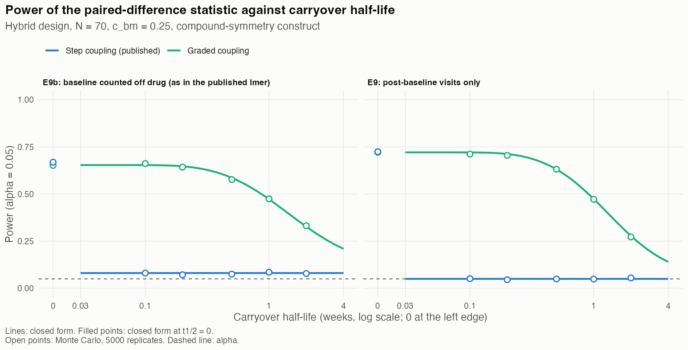
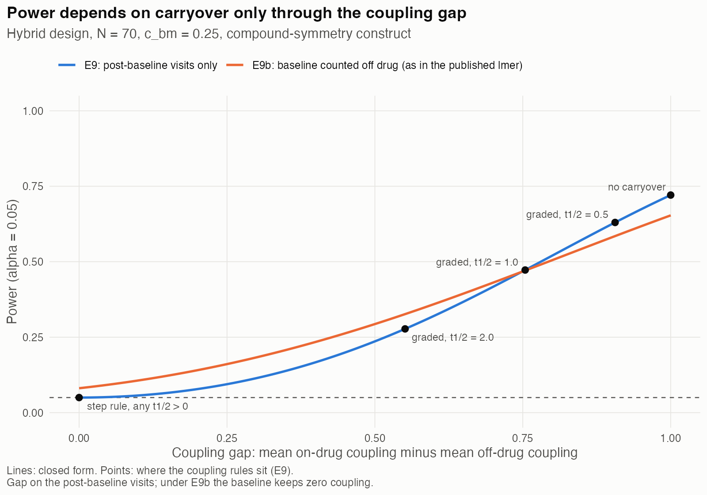
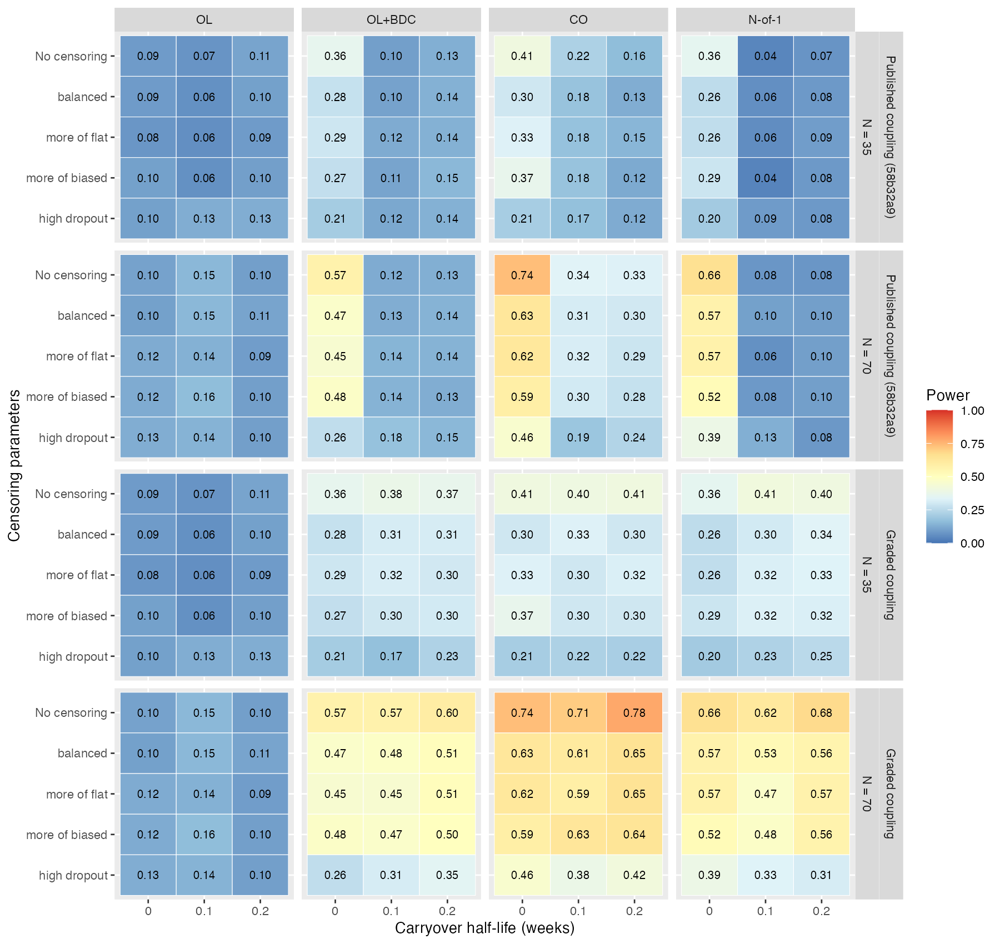
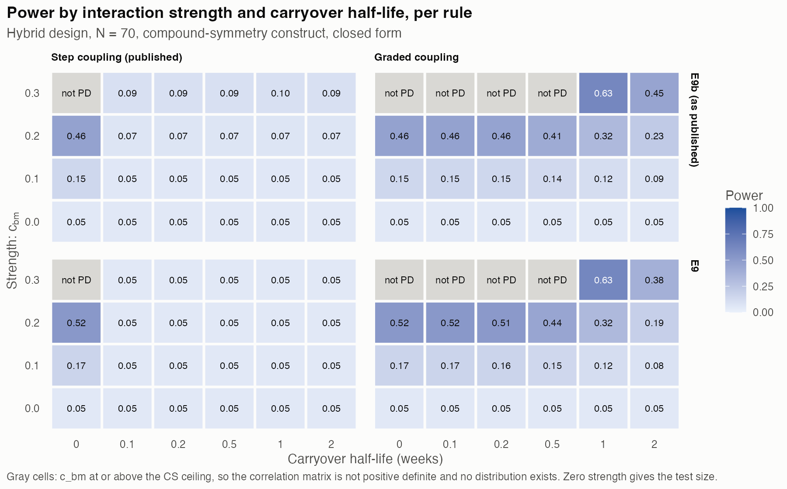
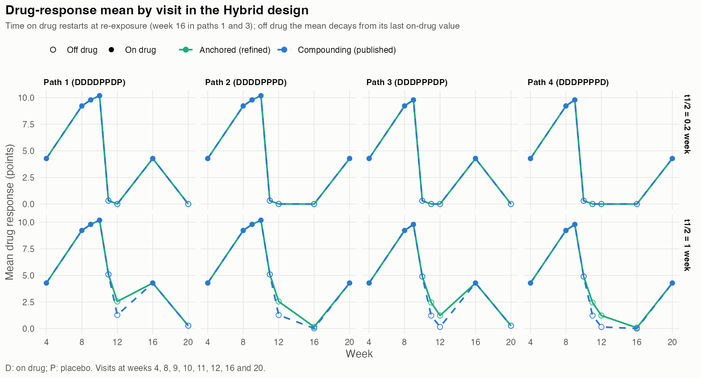

\nolinenumbers

```{r setup, include = FALSE}
knitr::opts_chunk$set(echo = FALSE, warning = FALSE, message = FALSE)
```

# Problem and approach {-}

Validating a predictive biomarker requires an interaction test, which needs about four times the sample of a main-effect test. Hendrickson et al. (2020) proposed a data-generating process (DGP) for simulating aggregated N-of-1 trials. In that original DGP the predictive biomarker is a correlation with the drug response that is present on drug and absent off drug. Paper 01 extends the original DGP for the Hybrid design with carryover. It judges each extension by five criteria: existence, identifiability under carryover, fidelity to the pharmacology, analyzability and calibration status. This summary reproduces every table and figure of the paper in the paper's order.

# Methods

Table \@ref(tab:estimands) states which analysis targets which quantity. The paired-difference statistic E9 is the one with a closed form.

Table: (\#tab:estimands) The analyses used in this paper and the quantity each estimates.

| Analysis | Drug indicator | Estimates | Used in |
|----------------------------|------------------|--------------------------------------|--------------|
| Paired-difference statistic E9, E9b (closed form) | binary | on-minus-off contrast, $\beta_{bm:D}$ times the on/off correlation difference | Stages 1, 2, 4, 5; planning |
| The original analysis (mixed model) | binary | the same contrast | Stage 2 (original code) |
| Stress-test analyses | $D_{bc,it}$ at the true half-life | on-drug moderation $\beta_{bm:D}$ | Stage 6 |

Table \@ref(tab:ademp) lays out three simulation studies. They verify the closed forms, rerun the original code and stress-test fourteen analyses under a prognostic biomarker.

Table: (\#tab:ademp) Design of the three simulation studies in the
ADEMP structure. MCSE: Monte Carlo standard error of a rejection rate,
$\sqrt{p(1-p)/R}$ for $R$ replicates.

| | 1. Closed-form verification | 2. The original code | 3. Stress test under a prognostic biomarker |
|--------------|------------------------------|------------------------------|------------------------------|
| **Aim** | Check the closed-form moments and power of Appendix A, and the loss of power under the original rule | Show on the original code that the correlation rule alone determines the loss of power | Find which analyses keep their nominal size under features the extended DGP adds |
| **Data-generating mechanisms** | The correlation encoding with the original rule and with the decaying correlation; compound symmetry and the separable AR(1) form; carryover on the drug-response mean decaying from the last on-drug value; Hybrid, crossover and OL+BDC designs; $N = 70$; grids of $c_{bm}$ and $t_{1/2}$ | The original `generateData()` at commit 58b32a9, as published and with the decaying correlation only (Appendix B.1); $c_{bm} = 0.25$. (a) Hybrid, $N = 70$, no censoring, $t_{1/2} \in \{0, 0.1, 0.2, 1\}$; (b) four designs, $N \in \{35, 70\}$, $t_{1/2} \in \{0, 0.1, 0.2\}$, the original censoring patterns | The extended DGP (Table \@ref(tab:spec)) with fixed allocation; base cell separable AR(1), $\rho = 0.7$, $N = 70$, $t_{1/2} = 0.5$ week; 15 null cells (11 without and 4 with a prognostic pathway of strength 0.3) and 10 alternative cells at $c_{bm} = 0.30$ varying $N$, half-life, decay form, dropout and measurement error |
| **Estimand** | $\beta_{bm:D}$, and the mean of the paired-difference statistic | $\beta_{bm:D}$ | $\beta_{bm:D}$ |
| **Methods** | Paired-difference statistics E9 and E9b, closed form and simulated; the original mixed model fitted with `lmer` | The original analysis pipeline (`lmer`, model-based test) on both versions | Fourteen analyses fitted to the same simulated trials; two-sided tests at $\alpha = 0.05$ |
| **Performance measures** | Mean, SD and power of the statistic; agreement as (simulated $-$ closed form)/MCSE | Power; mean interaction estimate; number of repaired correlation matrices | Null rejection rate; power; $\kappa$, the ratio of mean model SE to empirical SD; failed fits |
| **Replicates** | 5,000 per cell (MCSE of power at most 0.007); 500 to 1,000 for `lmer` | (a) 500 per cell (MCSE at most 0.022); (b) 250 per cell (at most 0.032) | 1,000 per null cell (MCSE 0.0069 at a rate of 0.05), 500 per alternative cell (at most 0.022) |

# Results

## Stage 1. Validity of the joint distribution

Table \@ref(tab:nonpd) counts correlation matrices that are not positive definite. The original code repaired 20 matrices (25%) on its own grid without a warning. The extended DGP stops instead, and it finds 75% of the grid infeasible at $c_{bm} = 0.6$.

```{r nonpd}
tab <- data.frame(
  grid = c('Figure 4 grid of the original study, $c_{bm} \\in \\{0, 0.3, 0.6\\}$ (81)',
           'Extended grid, $c_{bm} = 0.25$ (40)', 'Extended grid, $c_{bm} = 0.3$ (40)',
           'Extended grid, $c_{bm} = 0.6$ (40)'),
  orig = c('20 (25\\%)', '0 (0\\%)', '12 (30\\%)', '12 (30\\%)'),
  ref8 = c('21 (26\\%)', '0 (0\\%)', '0 (0\\%)', '30 (75\\%)'),
  ref7 = c('21 (26\\%)', '0 (0\\%)', '0 (0\\%)', '30 (75\\%)'))
knitr::kable(tab, booktabs = TRUE, escape = FALSE,
  col.names = c('Grid (number of matrices)',
                'Original DGP (constant correlation, compound symmetry, $\\rho_{cs} = 0.8$)',
                'Extended DGP (decaying correlation, separable AR(1)), $\\rho = 0.8$',
                'Extended DGP, $\\rho = 0.7$'),
  caption = 'Correlation matrices that are not positive definite. Figure 4 grid: open label, open label plus blinded discontinuation, crossover and Hybrid designs; $t_{1/2} \\in \\{0, 0.1, 0.2\\}$ week. Extended grid: the last three designs; $t_{1/2} \\in \\{0, 0.1, 0.2, 0.5, 1\\}$ week. The original-DGP counts reproduce those of the original code exactly. The extended-DGP counts are the same at $\\rho = 0.7$ (the recommended value) and $\\rho = 0.8$ because both feasibility bounds lie between 0.3 and 0.6.') |>
  kableExtra::column_spec(1, width = '4.6cm') |>
  kableExtra::column_spec(2:4, width = '2.9cm')
```

## Stage 2. The biomarker-response correlation under carryover

Table \@ref(tab:closedform) gives closed-form power by half-life. Under the original rule E9 power is 0.050 at every positive half-life. Under the decaying rule it is 0.721 at 0.1 week and falls to 0.278 at 2 weeks.

```{r closedform}
tab <- data.frame(
  Rule = c('Constant (original)', '', 'Decaying', ''),
  Statistic = rep(c('E9', 'E9b'), 2),
  h0 = c(0.721, 0.654, 0.721, 0.654),
  h01 = c(0.050, 0.081, 0.721, 0.653),
  h02 = c(0.050, 0.081, 0.712, 0.647),
  h05 = c(0.050, 0.081, 0.631, 0.586),
  h1 = c(0.050, 0.081, 0.473, 0.472),
  h2 = c(0.050, 0.081, 0.278, 0.327))
knitr::kable(tab, booktabs = TRUE, digits = 3,
  col.names = c('Correlation rule', 'Statistic', '0', '0.1', '0.2', '0.5', '1', '2'),
  caption = 'Closed-form power by carryover half-life (weeks). Hybrid design, $N = 70$, $c_{bm} = 0.25$, compound symmetry. Constant: the original rule (constant correlation after first exposure). Decaying: the extended rule (correlation decaying at the carryover half-life). E9: paired-difference statistic on post-baseline visits; E9b: the same with baseline counted as an off-drug visit, as in the original analysis. Against Monte Carlo estimates (5,000 replicates per cell), 10 of 278 cell-variants differ by more than 2 Monte Carlo SE.')
```

Figure \@ref(fig:powerfig) shows the same result as lines, with Monte Carlo points on them. The original rule drops to a flat floor and the decaying rule declines smoothly.

```{r powerfig, fig.cap = 'Closed-form power (lines) against carryover half-life, with Monte Carlo estimates (points; 5,000 replicates per cell), under the original rule (constant correlation after first exposure) and the extended rule (correlation decaying at the carryover half-life). Hybrid design, $N = 70$, $c_{bm} = 0.25$, compound symmetry; left panel E9b, right panel E9.', out.width = '85%', fig.align = 'center'}

```

Figure \@ref(fig:gapfig) plots power against the on/off correlation difference. Power depends on the correlation rule only through this difference.

```{r gapfig, fig.cap = 'Closed-form power against the on/off correlation difference, with the positions of the two correlation rules. Hybrid design, $N = 70$, $c_{bm} = 0.25$, E9.', out.width = '75%', fig.align = 'center'}

```

Table \@ref(tab:patch) repeats the comparison in the original code, with only the correlation lines replaced. At 0.1 week power is 0.126 with the original rule and 0.638 with the decaying rule, against 0.668 without carryover.

```{r patch}
tab <- data.frame(th = c('0', '0.1', '0.2', '1'),
  pm = c(-0.131, -0.028, -0.029, -0.033), gm = c(-0.131, -0.129, -0.131, -0.107),
  pp = c(0.668, 0.126, 0.092, 0.094), gp = c(0.668, 0.638, 0.656, 0.462))
knitr::kable(tab, booktabs = TRUE, digits = 3,
  col.names = c('$t_{1/2}$ (weeks)', 'Mean estimate, original', 'Mean estimate, decaying',
                'Power, original', 'Power, decaying'), escape = FALSE,
  caption = 'The original code at commit 58b32a9, as published (original) and with the decaying correlation (decaying): Hybrid design, $N = 70$, $c_{bm} = 0.25$, 500 replicates per cell, same seeds. Monte Carlo SE of power at most 0.022.')
```

Figure \@ref(fig:fig4bmc) repeats the comparison for all four designs, both sample sizes and five censoring patterns. The decaying correlation keeps power where the original rule loses it.

```{r fig4bmc, fig.cap = 'Power to detect the biomarker-by-treatment interaction, in the layout of Figure 4B of the original study, from the original code at commit 58b32a9 as published (upper two panel rows) and with the decaying correlation (lower two panel rows). Rows within panels: censoring patterns; columns: carryover half-life; panels: trial design (N-of-1 is the Hybrid design) and total sample size. $c_{bm} = 0.25$, 250 replicates per cell (Monte Carlo SE at most 0.032), the same seeds for both versions. No matrix was repaired in either version.', out.width = '100%', fig.align = 'center'}

```

```{r fig4bg9data}
g9f <- read.csv(file.path('..', '..', 'data', 'quick-sim',
                          'carryover-closed-form', 'g9-planning',
                          'fig4b-g9-cbm0.25.csv'))
g9f_pick <- function(d, N, th, cens = 'No censoring') {
  sprintf('%.2f', g9f$power[g9f$design == d & g9f$N == N &
                            g9f$t_half == th & g9f$censoring == cens])
}
```

Figure \@ref(fig:fig4bg9) repeats the grid under the extended DGP with the recommended analysis G9 (a random-intercept CAR(1) mixed model with an AIC-chosen analysis half-life and CR2 standard errors). At $N = 70$ without censoring, Hybrid power is `r g9f_pick('N-of-1', 70, 0)`, `r g9f_pick('N-of-1', 70, 0.1)` and `r g9f_pick('N-of-1', 70, 0.2)` at half-lives of 0, 0.1 and 0.2 week. The open-label design has no off-drug visit, so the interaction is not estimable under G9.

```{r fig4bg9, fig.cap = 'Power of the analysis G9 under the extended DGP (separable AR(1), $\\rho = 0.7$, $c_1 = 0.2$, decaying correlation), in the layout of Figure 4B of the original study. $c_{bm} = 0.25$, 250 replicates per cell (Monte Carlo SE at most 0.032). Censoring patterns use the corrected dropout rule, under which dropout rises with worsening; the original-code figure uses the published rule of commit 58b32a9, under which dropout rose with improvement. Gray cells (n/e): the open-label design, in which every visit is on drug and the interaction is not estimable under G9.', out.width = '100%', fig.align = 'center', fig.width = 9, fig.height = 5.2}
library(ggplot2)
fd <- g9f
fd$design <- factor(fd$design, levels = c('OL', 'OL+BDC', 'CO', 'N-of-1'))
fd$censoring <- factor(fd$censoring,
  levels = c('high dropout', 'more of biased', 'more of flat', 'balanced',
             'No censoring'))
fd$N <- factor(paste0('N = ', fd$N), levels = c('N = 35', 'N = 70'))
fd$label <- ifelse(is.na(fd$power), 'n/e', sprintf('%.2f', fd$power))
ggplot(fd, aes(factor(t_half), censoring, fill = power)) +
  geom_tile(color = 'white') +
  geom_text(aes(label = label), size = 2.8) +
  facet_grid(N ~ design) +
  scale_fill_distiller(palette = 'RdYlBu', limits = c(0, 1),
                       name = 'Power', na.value = 'grey85') +
  labs(x = 'Carryover half-life (weeks)', y = 'Censoring parameters') +
  theme_grey(base_size = 10)
```

Figure \@ref(fig:fig4b) extends the comparison over interaction strengths and longer half-lives. Gray cells mark effect sizes with no valid joint distribution.

```{r fig4b, fig.cap = 'Closed-form power of the paired-difference statistic by interaction strength ($c_{bm}$) and carryover half-life, in the layout of Figure 4B of the original study: the original rule (labeled Step in the figure) and the decaying correlation (labeled Graded). Upper row: E9b, which counts baseline as an off-drug visit as the original analysis does; lower row: E9. Gray cells: $c_{bm}$ at or above the compound-symmetry feasibility bound, where the correlation matrix is not positive definite. Hybrid design, $N = 70$, compound symmetry.', out.width = '100%', fig.align = 'center'}

```

## Stage 3. Carryover on the mean

Figure \@ref(fig:trajfig) shows the drug-response mean by visit for the four Hybrid paths under both carryover rules. The two rules differ only in the path means.

```{r trajfig, fig.cap = 'Drug-response mean by visit in the Hybrid design, by path, under the extended carryover rule (decay from the last on-drug mean, the extended DGP) and the original carryover rule (compounded decay), at carryover half-lives of 0.2 and 1 week. Filled points: on-drug visits; open points: off-drug visits. D: drug; P: placebo.', out.width = '100%', fig.align = 'center'}

```

## Stage 4. Serial correlation

Table \@ref(tab:rhostage) shows what the serial correlation does. Under compound symmetry, lowering $\rho_{cs}$ from 0.8 to 0.7 raises the feasibility bound from 0.256 to 0.346. It lowers power at $c_{bm} = 0.25$ from 0.721 to 0.628.

```{r rhostage}
tab <- data.frame(
  rho = c('0.5', '0.6', '0.7', '0.8'),
  cs_ceil = c(0.458, 0.410, 0.346, 0.256),
  cs_pow = c(0.492, 0.553, 0.628, 0.721),
  sep_ceil = c(0.448, 0.462, 0.474, 0.440),
  sep_pow = c(0.261, 0.270, 0.290, 0.335))
knitr::kable(tab, booktabs = TRUE, digits = 3,
  col.names = c('$\\rho_{cs}$ or $\\rho$', 'Ceiling', 'Power at $c_{bm} = 0.25$',
                'Ceiling', 'Power at $c_{bm} = 0.25$'), escape = FALSE,
  caption = 'Serial correlation: the feasibility bound on $c_{bm}$ (Ceiling; decaying correlation, no carryover, minimum over the Hybrid, crossover and OL+BDC designs) and closed-form E9 power (Hybrid, $N = 70$, no carryover) by $\\rho$, under compound symmetry and under the separable AR(1) form of Stage 5. Under compound symmetry the Hybrid and crossover designs tie for the minimum. Under the separable form the minimum is attained in the Hybrid design at $\\rho = 0.8$ and in the OL+BDC design at $\\rho \\le 0.7$, and the crossover design is never binding. At $t_{1/2} = 0.2$ week every power value is lower by 0.004 to 0.009.') |>
  kableExtra::add_header_above(c(' ' = 1, 'Compound symmetry' = 2, 'Separable AR(1)' = 2))
```

## Stage 5. Cross-component structure

Table \@ref(tab:ceilings) compares three correlation structures. At $\rho = 0.7$ the separable AR(1) structure allows a correlation of 0.474, against 0.346 under compound symmetry.

```{r ceilings}
tab <- data.frame(rho = c('0.8', '0.7'), cs = c(0.256, 0.346), f = c(0.291, 0.452),
                  c = c(0.440, 0.474))
knitr::kable(tab, booktabs = TRUE, digits = 3,
  col.names = c('$\\rho_{cs}$ or $\\rho$', 'Compound symmetry', 'AR(1), two-constant cross-component', 'Separable AR(1)'),
  escape = FALSE,
  caption = 'Largest feasible biomarker-response correlation $c_{bm}$ under the decaying correlation, without carryover, minimum over the Hybrid, crossover and OL+BDC designs. Under compound symmetry the Hybrid and crossover designs tie for the minimum. Under the two AR(1) forms the minimum is attained in the Hybrid design at $\\rho = 0.8$ and in the OL+BDC design at $\\rho = 0.7$ (separable form: Hybrid 0.480), and the crossover design is never binding.')
```

## Stage 6. Features the extended DGP adds

Table \@ref(tab:prognostic) gives null rejection rates under a prognostic biomarker. The original analysis rejected 0.159 under the placebo-response pathway. The expectancy-term model stayed between 0.040 and 0.047.

Table: (\#tab:prognostic) Null rejection rates under a prognostic biomarker, 1,000 replicates per cell (two-MCSE band 0.036 to 0.064 for a single cell), first run of study 3 (original carryover rule for the mean, fixed allocation). The rerun with carryover decaying from the last on-drug mean changed no analysis's verdict. Rates above 0.075 in bold.

| Analysis | Natural history, constant | Natural history, growing | Placebo response | Baseline severity |
|----------------------------------------|----------|----------|----------|----------|
| Original analysis (random intercept, model-based) | **0.107** | 0.053 | **0.159** | 0.075 |
| Random intercept + CAR(1), CR2 | **0.099** | 0.049 | **0.100** | 0.050 |
| The same, half-life chosen by AIC | **0.115** | 0.058 | **0.112** | 0.055 |
| Unstructured covariance, Kenward-Roger | **0.416** | **0.195** | **0.222** | 0.051 |
| The same, half-life chosen by AIC | **0.509** | **0.245** | **0.256** | 0.064 |
| Random intercept + CAR(1) with expectancy terms, CR2 | 0.047 | 0.046 | 0.040 | 0.040 |
| The same, with phase-specific residual variances, CR2 | 0.055 | 0.044 | 0.042 | 0.042 |
| The same, with phase-specific residual variances, model-based | 0.062 | 0.043 | 0.045 | 0.046 |
| Expectancy terms, half-life chosen by AIC, CR2 | 0.059 | 0.052 | 0.047 | 0.045 |
| Random intercept + CAR(1) with free baseline slope, CR2 | 0.049 | 0.063 | 0.049 | 0.050 |

Table \@ref(tab:jointceiling) gives the feasibility bounds when a prognostic correlation shares the biomarker row with $c_{bm}$. Each correlation lowers the room left for the other.

```{r jointceiling}
jc <- read.csv(file.path('..', '..', 'data', 'quick-sim',
                         'carryover-closed-form', 'rho-stage',
                         'prognostic-joint-ceilings.csv'))
hyb <- jc[jc$design == 'Hybrid' & jc$t1half %in% c(0.2, 0.5), ]
rows <- data.frame(
  coupling = c('$c_{PB}$ or $c_{TV}$', '', '', '', '$c_{BL}$', '', '', '',
               '$c_{bm}$', '', ''),
  given = c('alone', '$c_{bm} = 0.25$', '$c_{bm} = 0.30$', '$c_{bm} = 0.45$',
            'alone', '$c_{bm} = 0.25$', '$c_{bm} = 0.30$', '$c_{bm} = 0.45$',
            'alone', '$c_{PB} = 0.3$', '$c_{PB} = 0.6$'),
  key_c = c(rep('c_pb', 4), rep('c_bl', 4), rep('c_bm', 3)),
  key_g = c('alone', 'c_bm = 0.25', 'c_bm = 0.3', 'c_bm = 0.45',
            'alone', 'c_bm = 0.25', 'c_bm = 0.3', 'c_bm = 0.45',
            'alone', 'c_pb = 0.3', 'c_pb = 0.6'))
pick <- function(th) {
  sapply(seq_len(nrow(rows)), function(i) {
    v <- hyb$ceiling[hyb$t1half == th & hyb$coupling == rows$key_c[i] &
                     hyb$given == rows$key_g[i]]
    if (length(v) != 1 || is.na(v)) 'none' else sprintf('%.3f', v)
  })
}
tab <- data.frame(rows$coupling, rows$given, pick(0.2), pick(0.5))
knitr::kable(tab, booktabs = TRUE, escape = FALSE, linesep = '',
  col.names = c('Correlation', 'Given', '$t_{1/2} = 0.2$ week', '$t_{1/2} = 0.5$ week'),
  caption = 'Largest feasible prognostic correlation given the biomarker-response correlation, and the reverse, under the extended DGP (separable AR(1), $\\rho = 0.7$, $c_1 = 0.2$), Hybrid design, minimum over its four paths. Correlation: the quantity whose bound is given. $c_{PB}$, $c_{TV}$, $c_{BL}$: correlation of the biomarker with the placebo-response component, the natural-history component and baseline severity. None: no value is feasible.')
```

Table \@ref(tab:options) shows what each optional feature does to size and power. In the base cell power is 0.476 for the original analysis, 0.508 for the CAR(1) model and 0.410 for the expectancy-term model.

```{r options}
tab <- data.frame(
  cell = c('Base cell ($N = 70$, $t_{1/2} = 0.5$, exponential, no dropout)',
           'Measurement error (SD 3 and 6)',
           'Dropout 20 percent, completely at random',
           'Dropout 20 percent, dependent on last score',
           'Weibull decay, shape 0.5',
           'Weibull decay, shape 2', '$t_{1/2} = 0$', '$t_{1/2} = 1$ week',
           '$N = 35$', '$N = 150$'),
  n_R = c(0.076, 0.071, 0.079, 0.064, 0.073, 0.066, 0.072, 0.061, 0.081, 0.063),
  n_S = c(0.049, 0.051, 0.059, 0.056, 0.047, 0.037, 0.036, 0.043, 0.058, 0.047),
  n_F = c(0.062, 0.047, 0.051, 0.044, 0.046, 0.045, 0.049, 0.061, 0.053, 0.047),
  p_R = c(0.476, 0.424, 0.460, 0.426, 0.384, 0.538, 0.540, 0.388, 0.270, 0.770),
  p_S = c(0.508, 0.400, 0.466, 0.436, 0.384, 0.536, 0.538, 0.384, 0.238, 0.820),
  p_F = c(0.410, 0.310, 0.382, 0.366, 0.298, 0.476, 0.484, 0.310, 0.206, 0.726))
knitr::kable(tab, booktabs = TRUE, digits = 3, escape = FALSE,
  col.names = c('Cell', 'Original', 'CAR(1)', 'Expect.',
                'Original', 'CAR(1)', 'Expect.'),
  linesep = '',
  caption = 'The optional features of the extended DGP: null rejection rate ($c_{bm} = 0$; 1,000 replicates, MCSE 0.007) and power ($c_{bm} = 0.30$; 500 replicates, MCSE at most 0.022) for the original analysis (Original), the random-intercept CAR(1) model with CR2 and the expectancy-term model with CR2 (Expect.). Hybrid design, first run of study 3. Each row changes one feature of the base cell.') |>
  kableExtra::add_header_above(c(' ' = 1, 'Null rejection' = 3, 'Power' = 3)) |>
  kableExtra::kable_styling(font_size = 9) |>
  kableExtra::column_spec(1, width = '4.5cm')
```

## Stage 7. The extended DGP

Table \@ref(tab:spec) collects the choices. The Kind column marks each element as an extension, a choice, an option or a retained element.

Table: (\#tab:spec) The extended data-generating process. Defaults are those used in the stress test unless stated.

| Element | Specification | Default | Kind | Justified in |
|------------|------------------------------|------------|--------|---------|
| Components | $Y_{it} = \mathrm{BL}_i - (TV_{it} + PB_{it} + BR_{it})$, Gompertz means as in the original DGP | original parameters | retained | Methods |
| Validity | stop if the correlation matrix is not positive definite | always | extension | Stage 1 |
| Biomarker-response correlation | $c_{bm}$ on drug; $c_{bm}2^{-t_{sd}/t_{1/2}}$ off drug after exposure; 0 before exposure | $c_{bm}$ below the feasibility bound of every design in the study | extension | Stage 2 |
| Carryover on the mean | decay from the last on-drug value, $\mu_{BR,\text{last}}\,2^{-t_{sd}/t_{1/2}}$ | $t_{1/2} = 0.1$ to 0.2 week (pharmacological, assumed); 0.5 in the stress test | choice | Stage 3 |
| Re-exposure | as in the original DGP: time on drug restarts at zero | on, for titrated drugs | retained | Stage 3 |
| Within-component correlation | AR(1) in weeks, $\rho^{\lvert w_t-w_s\rvert}$, one $\rho$ for all three components | $\rho = 0.7$ (convention; report and vary) | choice | Stage 4 |
| Cross-component correlation | separable, $c_1\rho^{\lvert w_t-w_s\rvert}$ at every lag; the Kronecker form applies to the correlation, since the PB SD scales with the expectancy | $c_1 = 0.2$ (original value) | choice | Stage 5 |
| Path allocation | fixed numbers, as in the original DGP | original values | retained | Methods |
| Prognostic correlations | correlation of the biomarker with TV or PB, or with baseline severity; or a mean shift of TV growing along its curve | off; 0.3 in the stress test; correlations must lie inside the joint bound with $c_{bm}$ (Table \@ref(tab:jointceiling)) | option | Stage 6 |
| Measurement error | independent, SD by phase | off; 3 open label, 6 blinded in the stress test | option (driver only) | Stage 6 |
| Decay form | exponential or Weibull with the same half-life | exponential | option | Stage 6 |
| Dropout | monotone, completely at random or at random given the last score | off; 20% in the stress test | option | Stage 6 |

## Using the extended DGP to plan a trial

```{r planningg9data}
pg <- read.csv(file.path('..', '..', 'data', 'quick-sim',
                         'carryover-closed-form', 'g9-planning',
                         'planning-g9.csv'))
pg_design <- c(Hybrid = 'Hybrid', `OL+BDC` = 'OL+BDC', Crossover = 'CO')
pg_pow <- function(d, cbm, th, nlab = '70') {
  r <- pg[pg$design == pg_design[d] & pg$c_bm == cbm & pg$t_half == th &
          pg$N_label == nlab, ]
  paste0(sprintf('%.3f', r$power), if (r$capped) '$^\\dagger$' else '')
}
pg_n80 <- pg[pg$c_bm > 0 & pg$N_label == 'N80_E9' & !pg$capped, ]
pg_n80_range <- sprintf('%.3f to %.3f', min(pg_n80$power), max(pg_n80$power))
pg_size_range <- sprintf('%.3f to %.3f', min(pg$size, na.rm = TRUE),
                         max(pg$size, na.rm = TRUE))
```

Table \@ref(tab:planning) gives the total sample size for 80 percent power of the paired-difference statistic E9. At a half-life of 0.2 week the Hybrid design needs 278 participants at $c_{bm} = 0.25$ and 84 at 0.45. At 1 week it needs 480 and 146. The last column gives the simulated power of the recommended analysis G9 at $N = 70$ (1,000 replicates per cell, Monte Carlo SE at most 0.016). G9 rejected the null at `r pg_size_range` (2,000 replicates per cell). At the E9 sample size for 80 percent power, G9 power was `r pg_n80_range` in the `r nrow(pg_n80)` cells whose sample size was at most 400. The closed-form E9 rule is conservative for G9.

```{r planning}
tab <- data.frame(
  design = c('Hybrid', '', '', 'OL+BDC', '', '', 'Crossover', '', ''),
  cbm = rep(c(0.25, 0.35, 0.45), 3),
  slope = rep(c(2.0, 2.8, 3.6), 3),
  n0 = c(272, 138, 82, 394, 200, 120, 424, 216, 130),
  n02 = c(278, 140, 84, 404, 206, 124, 424, 216, 130),
  n1 = c(480, 244, 146, '> 800', 452, 272, 454, 230, 138),
  p70 = c(0.285, 0.503, 0.728, 0.210, 0.368, 0.558, 0.202, 0.353, 0.537))
tab$g70 <- mapply(function(d, cb) pg_pow(d, cb, 0.2, '70'),
                  rep(c('Hybrid', 'OL+BDC', 'Crossover'), each = 3), tab$cbm)
knitr::kable(tab, booktabs = TRUE, digits = 3, escape = FALSE, align = 'lrrrrrrr',
  linesep = '',
  col.names = c('Design', '$c_{bm}$', 'Slope (points per SD)', '$t_{1/2} = 0$', '0.2 week', '1 week', 'E9', 'G9'),
  caption = 'Planning under the extended DGP (separable AR(1), $\\rho = 0.7$, $c_1 = 0.2$, decaying correlation, carryover decaying from the last on-drug mean): total $N$ for 80 percent power of the paired-difference statistic E9 at $\\alpha = 0.05$, by design, interaction strength and carryover half-life, with the implied slope in symptom points per SD of biomarker ($\\sigma_{BR} = 8$) and the power at $N = 70$ and the 0.2-week half-life for E9 (closed form) and for the analysis G9 (simulated, 1,000 replicates per cell, Monte Carlo SE at most 0.016). Participants are allocated to paths in the original fixed proportions.') |>
  kableExtra::add_header_above(c(' ' = 3, 'N for 80 percent power' = 3, 'Power at $N = 70$, 0.2 week' = 2), escape = FALSE)
```

# Appendix A. Closed-form derivations {-}

## A.5 The separable structure {-}

The next table gives the contribution of each step between visits to the schedule term of the feasibility bound. The report carries it without a number.

| Step | Term |
|---|---|
| on to on | $(1 - \rho_t)/(1 + \rho_t)$ |
| on to off | $\rho_t^2/(1 - \rho_t^2)$ |
| off to on | $1/(1 - \rho_t^2)$ |
| off to off | 0 |

# Conclusions

The correlation encoding of the interaction is coherent. The original DGP holds the biomarker-response correlation constant after first exposure, so with any carryover the interaction is absent and power equals the test size. The extended DGP lets the correlation decay at the carryover half-life, and power returns to its no-carryover value at half-lives of 0.1 to 0.2 week. The original effect size of 0.6 relied on repaired matrices, and a separable AR(1) structure at serial correlation 0.7 raises the feasibility bound to 0.474. A prognostic biomarker with a pathway absent at baseline makes analyses that share the biomarker effect with baseline anticonservative. We propose the extended DGP, with a stop on infeasible matrices, as the reference for simulation studies of these designs.

