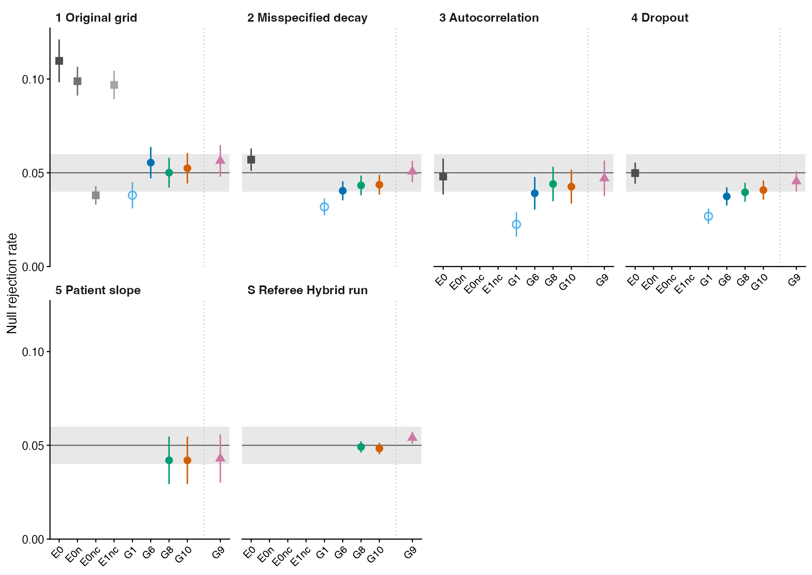
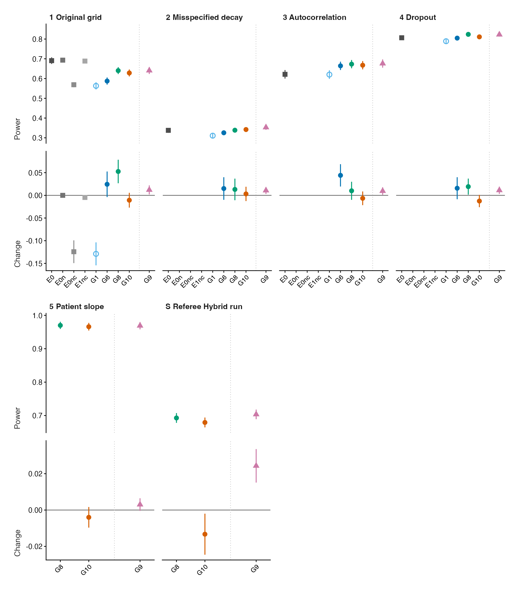
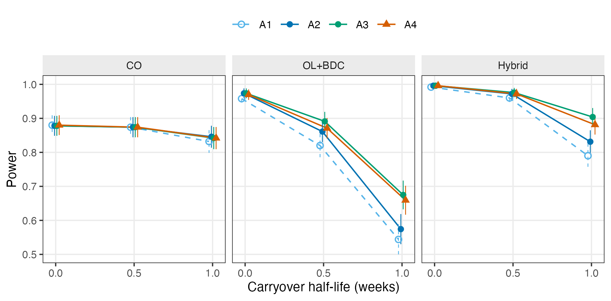
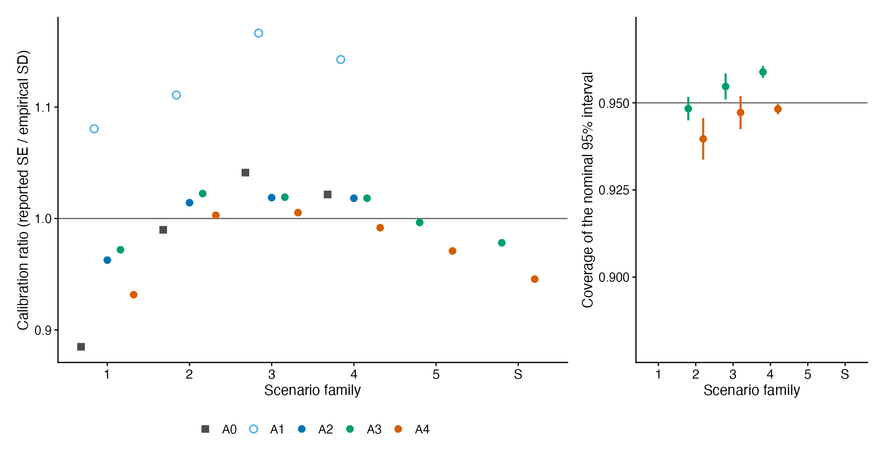
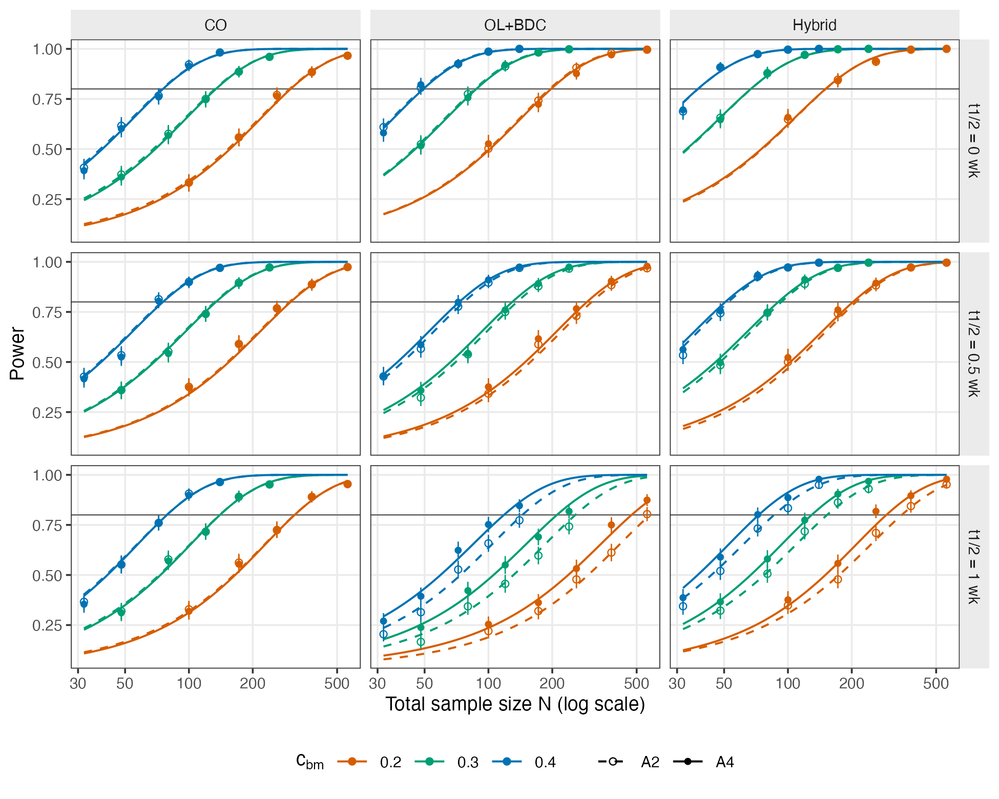

<!--
  Build pipeline for this manuscript (reconstructed 2026-10-26)
  ============================================================

  This Rmd runs no simulation code. It loads pre-computed summaries
  and figures produced by the scripts below, all run under the
  corrected simulation code (Corrections section). All paths are relative
  to the repository root.

  Factorial grid of rung 3 (simrun job 26, 2026-10-25, 540 cells x 500
  reps, of which this manuscript uses the 216-cell covariance-
  moderation slice):
    Rscript analysis/scripts/carryover-sensitivity/01-run-factorial.R
    Rscript analysis/scripts/carryover-sensitivity/02-summarise-grid.R
      -> analysis/data/02-grid-summary.rds
    Rscript analysis/scripts/carryover-sensitivity/03-render-figures-extra-slim.R
      -> analysis/figures/02xs-power-by-spec.pdf

  Rungs 1 to 4, corrected 30-cell grid (job 27), all specifications on the
  same trials (simrun job 27, 2026-10-25):
    Rscript analysis/scripts/carryover-sensitivity/27-run-tier1-g-vs-f-e0.R
      -> analysis/data/carryover-sensitivity/tier1-g-vs-f-e0/summary.rds
    Rscript analysis/scripts/carryover-sensitivity/12-hendrickson-heatmap.R
      -> analysis/figures/02xs-heatmap-hendrickson-{a,b}.pdf

  Scenario cells (simrun job 21, 2026-10-23):
    Rscript analysis/scripts/carryover-sensitivity/06-g-vs-f-comparison.R
      -> analysis/data/carryover-sensitivity/g-vs-f-comparison/summary.rds

  The prognostic material (jobs 28 and 30, scripts 28 to 31) moved to
  the companion paper on 2026-11-01 (revisions/split-plan-prognostic-
  2026-10-29.md); the last version of this Rmd that used it is at
  commit c866404be.

  G10 on the stored trials of families 1 to 5 (2026-10-31):
    Rscript analysis/scripts/carryover-sensitivity/41-run-g10-backfill.R
      -> analysis/data/carryover-sensitivity/g10-backfill/{all,summary,guard}.rds

  Size diagnostic at 3,000 replicates (Hybrid null; run before the
  cross-factor constant correction, Corrections section):
    analysis/scripts/carryover-sensitivity/diagnose-null-type1-cr2.R
      -> analysis/scripts/carryover-sensitivity/output/diag-null-type1-cr2.rds

  Exploratory sensitivity blocks that predate the corrections (S1 to
  S11 of earlier drafts) are no longer part of this manuscript; they
  remain in supplement.Rmd and in archive/.

  Analysis ladder tables and figures (reads stored data only):
    Rscript analysis/scripts/carryover-sensitivity/37-ladder-tables-figures.R --scope predictive
      -> analysis/data/carryover-sensitivity/ladder-predictive/*.csv
      -> analysis/figures/02-ladder-fig{1,2,3}-*-predictive.png
    Rscript analysis/scripts/carryover-sensitivity/40-stage-power-figure.R
      -> analysis/figures/02-power-by-half-life.{pdf,png}
  Isolation of the first rung (simrun job 42 on zeus; run before
  37-ladder-tables-figures.R, which reads its all.rds):
    38-run-e0-isolation.R, 39-check-e0-isolation.R
      -> analysis/data/carryover-sensitivity/e0-isolation/{all,summary}.rds

  Render through tools/render.sh, never rmarkdown::render() directly.
-->

```{r setup, include = FALSE}
knitr::opts_chunk$set(
  echo = FALSE,
  warning = FALSE,
  message = FALSE,
  fig.path = "../../figures/02-cache-",
  cache.path = "_cache/"
)
library(tibble)
library(dplyr)
library(tidyr)
library(knitr)
source(here::here(
  'analysis/report/02-carryover-sensitivity/shared-data.R'))
```

# Abstract {-}

**Background.** Aggregated N-of-1 trials pool repeated within-patient
on/off contrasts to validate predictive biomarkers. Drug carryover
attenuates the biomarker-by-treatment interaction. The analyst must
decide how to represent residual exposure, how to size the test, and
whether the half-life must be known.

**Methods.** In an exploratory simulation under the structure of a
companion paper's data-generating process, with a predictive-only
biomarker, we compared an analysis ladder in six scenario families.
Rung 0 is the starting analysis (A0);
rung 1 a binary drug indicator with `corCAR1` residual correlation
(A1); rung 2 adds CR2 cluster-robust inference (A2); rung 3 an
exposure-weighted predictor at the true half-life (A3, an oracle);
rung 4 chooses the half-life by AIC on the model without the
interaction (A4).

**Results.** Pooled over three designs in the base grid, A0 rejected
the null at `r f3(lv('E0', 'size'))` and A1 at
`r f3(lv('G1', 'size'))`. CR2 moved size to `r f3(lv('G6', 'size'))`.
In the Hybrid design A4 exceeded A2,
the CR2 binary indicator, by `r sprintf('%.1f', 100 * hy_d_mean)`
points on average over `r nrow(hy_cells)` alternative cells and by up
to `r sprintf('%.1f', 100 * hy_max)` at long half-lives. It was below
A2 in `r hy_below` cells, by at most
`r sprintf('%.1f', -100 * hy_min)` point. In the run with independent
seeds, the size of A4 minus that of the oracle was
`r sprintf('%+.4f', eqS$size_diff)` (90 percent interval
`r sprintf('%+.4f', eqS_lo)` to `r sprintf('%+.4f', eqS_hi)`),
equivalent within $\pm 0.01$. For 80 percent power at a 1-week
half-life, a Hybrid trial analyzed with A4 needs about
`r ceiling(ssN('simcore2026', 'Hybrid', 1, 0.4))` patients at
$c_{bm} = 0.4$ and `r ceiling(ssN('simcore2026', 'Hybrid', 1, 0.2))` at
0.2.

**Conclusions.** For a Hybrid trial with a biomarker known to be
predictive only, under this process at $N \le 70$, A4 is correctly
sized and needs no half-life. Its gain over the binary indicator is
modest except at long half-lives. Even the oracle recovers only part
of the power that carryover removes, so the rest has to be met by the
design. Whether a biomarker is also prognostic is rarely known before
a trial. In that case the analysis of the companion paper applies;
this paper's results bear on its choice of half-life and its CR2 test. The results
are conditional on the correlation encoding and one parameter set.

**Keywords:** N-of-1 trials; carryover; predictive biomarker;
cluster-robust inference; post-selection inference; simulation
study.

# Introduction

In a single N-of-1 trial, one patient is crossed repeatedly between
active treatment and a comparator. The within-patient contrast
between on-drug and off-drug periods estimates that patient's
individual treatment effect. An aggregated N-of-1 trial pools many
such series. Pooling allows population-level inference at sample
sizes smaller than a parallel-group trial would require
[@hendrickson2020]. The estimand here is the biomarker-treatment
interaction, that is, whether a baseline covariate $B_i$ modifies
the treatment effect. We evaluate analysis approaches for this
estimand in the Hybrid N-of-1 design defined in Section \@ref(sec-designs).

The main inferential complication in N-of-1 trials is carryover. A
drug's pharmacological effect does not stop at discontinuation. It
decays as a function of the drug's half-life. Observations taken
after discontinuation therefore still carry part of the treatment
effect. An exposure regressor that ignores this decay is a
mismeasured version of what the patient received. The consequences
are twofold. First, the interaction contrast is attenuated.
Occasions that still carry a large fraction of the drug effect are
coded the same as occasions that carry none. This biases the
biomarker-by-exposure coefficient toward zero, as any covariate
measured with error would. Second, those occasions vary in a way the
model does not represent. The unexplained variation inflates the
standard error of the same coefficient. Power falls for both
reasons.

This is a loss of power, not of validity. Under the null,
$c_{bm} = 0$, there is no biomarker-response association at any
level of residual exposure. A miscoded regressor then has no
interaction to distort, and test size does not depend on the
exposure coding. The conservatism reported in Section \@ref(sec-rung2) has a
separate origin in the working covariance and applies equally to
every specification. Carryover misspecification is therefore a
question of efficiency. Rung 3 of the study is therefore framed in terms of recovered power.

A companion study [@pmsimstats_dgp_architectures2026] builds on the
data-generating process of Hendrickson et al. [-@hendrickson2020].
In that process the interaction is encoded as a correlation between
the biomarker and the drug response. The correlation is present on
drug and decays off drug: $\text{Cor}(B_i, BR_{it}) = c_{bm} \cdot
\phi(t_{sd})$. We call this the correlation encoding of the
interaction. The companion study shows that carryover reduces power
under this encoding, and that the reduction depends on the design.
The loss under a given analysis is governed by the on/off correlation
difference, that is, the on-drug correlation minus the mean off-drug
correlation, which the analysis's exposure coding determines. At a
half-life of one week in this study's factorial grid, the binary
indicator loses a fifth to two thirds of its power under the Hybrid
and OL+BDC designs. It loses 7 to 16 percent under the crossover
design (Section \@ref(sec-rung3)). We restrict attention to the correlation
encoding. The carryover problem is largest there, and the starting DGP
uses it. Earlier work under this encoding fixed the decay shape at
exponential and evaluated only one analysis specification. Simulation studies of aggregated N-of-1 analyses
under carryover exist [@chen2014; @percha2019; @blackston2019;
@gartner2023]. One includes an exponentially decaying wash-in and
wash-out term [@gartner2023]. All target the treatment effect rather
than the biomarker-by-treatment interaction, which is the estimand
here. An interaction test needs about four times the sample of a
main-effect test of the same size [@brookes2004]. The correlation
encoding is a modeling assumption of this project, not a validated
description of any trial. Every recommendation below is conditional
on it.

This manuscript shows how a sequence of changes to the analysis model
improves both size and power. We call the sequence an analysis ladder.
Each rung changes one thing about the analysis. The rungs follow the
order in which the questions arise for an analyst. Section
\@ref(sec-ladder-def) defines the rungs and Table
\@ref(tab:tab-spec-summary) lists them.

Rung 0 is the starting analysis (A0), the analysis used with the
starting DGP [@hendrickson2020]. It fits a random intercept, uses a binary
on-drug indicator, and has no residual correlation structure. The
first question is whether its test is correctly sized. Rung 1 (A1)
keeps the binary indicator and uses an AR(1) residual correlation
through `corCAR1` with the working-covariance standard error. A0 and
A1 differ in three respects at once. Isolation analyses separate the three and
attribute the liberal size of A0 to its missing residual correlation
(Section \@ref(sec-rung1)).

The second question concerns the size of the test. The working
covariance of the mixed model is a random intercept with an AR(1)
residual correlation. It does not match the covariance that the
data-generating process induces, and the working-covariance test is
conservative. Rung 2 (A2) replaces the working-covariance standard error by a
CR2 bias-reduced cluster-robust standard error with Satterthwaite
degrees of freedom [-@bell2002bias]. The rung changes only the
standard error, the reference distribution and the $p$-value.

The third question is how residual exposure should enter the linear
predictor. The analyst may ignore the decay and code exposure as on or
off, as the starting analysis does (A1 and A2). Or the analyst may
represent it by committing to a decay form and half-life in a
continuous exposure-weighted predictor. The predictor changes the
regressor that carries the interaction. Rung 3 (A3) is the
exposure-weighted predictor at the true half-life with CR2 inference.
We compare the two positions against exponential and Weibull decay
forms in a full factorial.

The fourth question follows from the third position. Rung 3 uses the
true half-life, which no real analyst knows, so A3 is an oracle
benchmark rather than a candidate analysis. Rung 4 (A4) lets the data
choose the half-life by AIC over a candidate grid, from fits of the
model without the interaction, and then tests the interaction at the
chosen value. The selection step adds a post-selection inference risk
[@berk2013valid; @leeb2005; @kuchibhotla2022]. Leaving the tested
term out of the selection limits that risk. We measure what the
selection costs against the oracle in size, power and standard-error
calibration.

We then stress the ladder in scenario families that a real trial may
present. These are a misspecified half-life and decay shape, serial
correlation, patient dropout and a patient-specific slope variance.

The biomarker in this study is predictive only: it changes the drug
response and nothing else. A biomarker that is also prognostic raises
a different question, namely whether the interaction test confuses an
association with the natural history or the placebo response with
moderation of the drug effect. A prognostic shift that is constant
over visits is absorbed exactly by the biomarker main effect of every
analysis here. It cannot move the interaction estimate, so it needs no
simulation. Prognostic associations that vary over time, and the design-expectancy terms that
protect against them, are the subject of a companion paper
[@pmsimstats_prognostic2026].

Two defects in the simulation code were found during the study and
corrected. The first was a pre-exposure coding error in the
exposure-weighted predictor that affected the crossover design. The
second was a cross-factor correlation constant that departed from the
documented data-generating process. Every result in this manuscript
was produced under the corrected code. We
follow the ADEMP reporting framework of Morris, White, and Crowther
[-@morris2019simulation] throughout. We also follow later reporting
guidance on common random numbers and on comparative simulation
studies [@siepe2024; @pawel2024]. The study is exploratory. Its rungs
and scenarios were not fixed in advance, and the recommendation is the
end of a documented sequence of choices rather than a pre-specified
comparison. Section \@ref(sec-design) describes the simulation design
in ADEMP order. Section \@ref(sec-results) gives the results rung by
rung and then by scenario. Section \@ref(sec-discussion) states the
recommendation and its limits.

# Simulation design {#sec-design}

The study simulates complete aggregated N-of-1 trials and analyzes
each one under every specification. A single replicate proceeds as
follows. Patients are allocated across the randomization paths of
the chosen trial design (Section \@ref(sec-designs)). For each patient we draw a
pre-treatment biomarker together with three latent response
components. These are the drug-response component, the
natural-history component, and the placebo-response component. The
four quantities are drawn jointly across all eight measurement
occasions from a multivariate normal distribution. The means follow
modified Gompertz trajectories. The covariance matrix contains
within-component AR(1) autocorrelation, cross-component
correlations, and the biomarker-response correlation that encodes
the interaction and depends on treatment state (Section \@ref(sec-dgm)). The
observed symptom score at each occasion is the patient's baseline
severity minus the sum of the three components. A beneficial effect
therefore lowers the score. Carryover enters through a decay
function of time since discontinuation. The decay keeps part of the
drug-response component present at nominally off-drug occasions.
Every analysis specification in a given cell is then fitted to the
same simulated dataset. We record the interaction coefficient, its
standard error, and its $p$-value from each. This is repeated 500
times for every parameter combination in the grid of Section
\@ref(sec-grid), 1,000 to 5,000 times in the Hybrid run with
independent seeds, and 2,000 times in the supplementary size
diagnostic.

Fitting all specifications to a common dataset is deliberate. It
makes every contrast among them paired. Paired differences have
substantially less Monte Carlo variance than differences between
independent draws. Throughout, $N$ denotes the **total** number of
patients in a trial. Patients are allocated as evenly as possible
across the design's randomization paths, so a design with $P$ paths
assigns about $N/P$ patients to each. At $N = 70$ this is 35 per
path under the two-path designs and 17 or 18 per path under the
four-path Hybrid design.

## Aims {#sec-aims}

The first aim is to show how each change to the analysis model alters
size and power in the biomarker-treatment interaction test of a Hybrid
aggregated N-of-1 trial under the correlation encoding. The changes
form a ladder of five rungs (Table \@ref(tab:tab-spec-summary)). Rung 0
is the starting analysis. Rung 1 uses a binary drug indicator with a
residual AR(1) correlation. Rung 2 adds CR2 cluster-robust inference
to fix size. Rung 3 replaces the binary indicator by an
exposure-weighted predictor at the true half-life to recover part of
the power that carryover removes. Rung 4 chooses the half-life by AIC, on the
model without the interaction, to remove the need to know it. Each
rung is judged against its predecessor by a paired contrast on the
same simulated trials. A side analysis measures what it costs to
choose the half-life with the interaction in the model instead.

The second aim is to find where a rung does not help. The scenario
families of Table \@ref(tab:tab-families) stress the ladder with a
misspecified half-life and decay shape, serial correlation, dropout
and a patient-specific slope variance. The
third aim is to arrive at a recommended analysis for the Hybrid design
and to state its conditions and limits. A fourth aim is to document
the evidence for each rung so that a reader can check it.

```{r tab-families, echo = FALSE}
tab_fam <- tibble::tribble(
  ~Family, ~Scenarios, ~Replicates,
  '1', 'Base 30-cell grid: three designs, $N \\in \\{35, 70\\}$, $c_{bm} \\in \\{0, 0.30, 0.45\\}$, $t_{1/2} \\in \\{0, 0.5, 1\\}$ weeks', '500',
  '2', 'Misspecified half-life ($0.2$, $2$ or $4$ weeks) and decay shape (Weibull $k \\in \\{0.5, 2\\}$), analyzed as exponential', '500',
  '3', 'Serial correlation $\\rho \\in \\{0.5, 0.9\\}$', '500',
  '4', 'Patient-level dropout, completely at random or by baseline severity', '500',
  '5', 'Patient slope variance (SD 0.3 per week), Hybrid, $N = 70$', '1,000',
  'S', 'Hybrid run with independent seeds: A3 and A4, $N \\in \\{35, 70\\}$', '1,000 to 5,000'
)
knitr::kable(tab_fam, booktabs = TRUE, escape = FALSE, linesep = '',
  caption = 'The six scenario families of the ladder comparisons.
    Every biomarker is predictive only. Within a cell every analysis
    is fitted to the same simulated trials; A4 was fitted to the
    stored trials of families 1 to 5 afterward. Family S has
    independent seeds for every cell. Section \\ref{sec-grid}
    describes the cells.') |>
  kableExtra::column_spec(2, width = '9.5cm') |>
  kableExtra::kable_styling(font_size = 9)
```

## Trial designs {#sec-designs}

The three designs differ in how on-drug and off-drug occasions are
arranged. They therefore differ in how much post-discontinuation
information each generates. All three schedule eight measurement
occasions per patient. Each randomization path is a fixed
on-drug/off-drug schedule. Each design also carries an expectancy
weight, defined as the participant's probability of being on drug
by design. The weight is one during open-label periods and one half
during blinded periods, and it scales the placebo-response
component.

**Crossover (CO).** A traditional two-period within-patient
crossover, blinded throughout. Occasions are spaced 2.5 weeks apart
from 2.5 to 20 weeks. One path is active for the first four
occasions and then on comparator. The other path reverses that
order, so it never discontinues and contributes no
post-discontinuation observations.

**Open-label followed by blinded discontinuation (OL+BDC).**
Open-label titration at 4, 8, 12, and 16 weeks, then weekly
follow-up to week 20 with a blinded late switch to placebo. The two
paths discontinue after week 17 or 18, so only two or three
occasions follow.

**Hybrid.** The reference design of this program, taken from the
starting DGP. It consists of open-label titration at weeks 4 and
8, blinded discontinuation weekly from week 9 to 12, and a brief
two-occasion crossover at weeks 16 and 20. The four paths vary
discontinuation timing and crossover-arm order. It has the most
on/off transitions of the three designs. It is the only one that
allows more than one discontinuation per patient. The recommendation
of this manuscript is made for this design. CO and OL+BDC are
carried through the factorial grid and the corrected grid to show where the recommendation does
and does not transfer.

One consequence bears directly on the results. The first
post-discontinuation occasion falls one week after switching under
OL+BDC and Hybrid, but 2.5 weeks after switching under CO. At the
half-lives examined here, roughly half the drug effect persists into
the first off-drug occasion under the two non-crossover designs. Less
than a fifth persists under CO. The designs therefore differ
substantially in how much carryover they can accumulate.

## Data-generating mechanism {#sec-dgm}

Under the correlation encoding, the biomarker and the drug-response
component are drawn jointly from a multivariate normal distribution.
Their correlation depends on treatment state: $\text{Cor}(B_i,
BR_{it}) = c_{bm} \cdot \phi(t_{sd})$, where $\phi$ is the decay
form and $t_{sd}$ is the time since drug discontinuation. The
data-generating process has the structure of the recommended DGP of
the companion study. Its parameter values are not those of the
companion study (Table \@ref(tab:tab-params)). The response SDs and
the biomarker and baseline scales are the simulation core's own set,
chosen for this program, not Hendrickson's values. The placebo-response
SD in particular is 2 here against 10 in the starting DGP, which makes
the placebo pathway much weaker. The structure differs from the
starting DGP in four respects. The biomarker-response correlation is zero before
first exposure and decays after discontinuation at the carryover
half-life. The within-component correlation is a separable AR(1)
structure at $\rho = 0.7$. That is, every component has the same
first-order autoregressive correlation, and a single cross-component
constant $c_1 = 0.2$ is scaled by $\rho^{|w_t - w_s|}$ at every lag.
Carryover on the drug-response mean decays from the
last on-drug mean. A covariance matrix that is not positive definite
stops the simulation rather than being repaired (Section \@ref(sec-corrections)).

```{r tab-params, echo = FALSE}
## simcore2026 set of simulation-core.R (the driver default under which
## every tracked run of this paper was produced) against the starting
## values of commit 58b32a9 used by the companion paper; both checked by
## 42-check-param-sets.R (referee report 2026-11-08, M2).
pt <- tibble::tribble(
  ~Parameter, ~`This paper`, ~`Companion paper`,
  'Natural history (TV): Gompertz max, rate, displacement',
    '10.99, 0.42, 5', '6.51, 0.35, 5',
  'Placebo response (PB): Gompertz max, rate, displacement',
    '6.51, 0.35, 5', '6.51, 0.35, 5',
  'Drug response (BR): Gompertz max, rate, displacement',
    '10.99, 0.42, 5', '10.99, 0.42, 5',
  'SD of TV, PB, BR', '6, 2, 8', '10, 10, 8',
  'Biomarker: mean, SD', '0, 1', '124.3, 15.4',
  'Baseline severity: mean, SD', '70, 10', '83.1, 18.5',
  'Within-component serial correlation $\\rho$', '0.7', '0.7',
  'Cross-component constant $c_1$', '0.2', '0.2',
  'Biomarker-response correlation $c_{bm}$', '0 to 0.45 by scenario',
    'by scenario')
knitr::kable(pt, booktabs = TRUE, escape = FALSE, linesep = '',
  caption = 'Parameter values of the data-generating process. This
    paper uses the simulation core\'s own set (`simcore2026` in
    `simulation-core.R`). The companion paper\'s recommended DGP uses
    the response and baseline values of the published code with the
    same correlation structure, which is described in the text. The biomarker enters the analysis centered and scaled, so its
    location and scale do not affect the interaction test.') |>
  kableExtra::kable_styling(font_size = 8) |>
  kableExtra::column_spec(1, width = '7cm')
```

The decay function $\phi : \mathbb{R}_+ \to [0, 1]$ maps $t_{sd}$ to
a residual-effect multiplier. Two forms are used. Each is matched to
a common half-life $t_{1/2}$. Exponential decay,

$$
\phi_{\text{exp}}(t_{sd}) =
  \exp\left(-\lambda t_{sd}\right), \qquad
  \lambda = \frac{\ln 2}{t_{1/2}},
$$

is classical first-order elimination and the default pharmacokinetic
assumption. Weibull decay,

$$
\phi_{\text{weib}}(t_{sd}) =
  \exp\left(-\left(\lambda_w t_{sd}\right)^{k}\right), \qquad
  \lambda_w = \frac{(\ln 2)^{1/k}}{t_{1/2}},
$$

has a shape parameter $k$. The elimination tail is heavier than
exponential when $k < 1$ and lighter when $k > 1$. The form reduces
to exponential at $k = 1$. The factorial grid uses $k \in \{0.7,
1.5\}$ alongside exponential. The decay-shape
misspecification cells (family 2) use $k \in \{0.5, 2\}$. All forms pass through
the same half-life-defining point, $\phi = 0.5$ at $t_{sd} =
t_{1/2}$. They are therefore comparable at a fixed nominal half-life
even though their shapes differ on either side of it. The decay form
the analysis assumes differs by scenario. In the factorial grid the
exposure-weighted predictor is built with the data-generating form,
shape and half-life. This is the driver's default when no analysis
form is given. The Weibull cells of the factorial grid therefore test the
representation under a correctly specified decay, not its robustness
to the shape. Every other analysis assumes exponential
decay. The Weibull cells of family 2 are the shape-misspecification
check.

## Estimand and analysis specifications {#sec-spec}

The target of inference is the on-drug biomarker-response
correlation $c_{bm}$, a dimensionless quantity. Every analysis tests
it through the coefficient of $\text{bm} \times X$. Its target on the
calibrated scale is $\theta = -c_{bm}\sigma_{BR}$, with
$\sigma_{BR} = 8$ in this parameter set (Table \@ref(tab:tab-params)):
the expected difference in on-drug response per SD of the biomarker.
Bias, empirical SE and coverage are reported on this scale. Type I
error is the rejection rate at $c_{bm} = 0$ and power the rejection
rate at $c_{bm} > 0$. What the coefficient estimates depends on $X$.
Under A3, $X$ is exposure-weighted at the true half-life and the
coefficient targets $\theta$. Under A1 and A2, $X$ is the binary
indicator, which codes residual exposure off drug as none, so under
carryover the coefficient differs from $\theta$. Under A4 the
half-life is selected, and the coefficient targets $\theta$ only when
the selected value is the true one. The base analysis model is
`nlme::lme(Sx ~ bm * X + t, random = ~1 | ptID, correlation = corCAR1(form = ~ t | ptID))`.
The analyses differ in how $X$ is constructed and how the standard
error is obtained. This manuscript labels them A0 to A4 by rung (Table
\@ref(tab:tab-spec-summary)). The table also gives the code each
analysis carries in the companion papers and earlier drafts, where A4
is G10, and the `E`-prefixed code under which it is stored in the
code and data files described in the Reproducibility section.

```{r tab-spec-summary, echo = FALSE}
tex_fix <- function(x) {
  x <- gsub('\\', '\\textbackslash{}', x, fixed = TRUE)
  x <- gsub('{', '\\{', x, fixed = TRUE)
  x <- gsub('}', '\\}', x, fixed = TRUE)
  x <- gsub('~', '$\\sim$', x, fixed = TRUE)
  x <- gsub('%', '\\%', x, fixed = TRUE)
  x
}
## The five rungs, from the ladder CSV (37-ladder-tables-figures.R).
## Formula text that names another analysis by its G code is mapped to
## the A code.
g_to_a_txt <- function(x) {
  for (g in c('G10', 'G8', 'G6', 'G1')) x <- gsub(g, to_a(g), x, fixed = TRUE)
  gsub('\\bE0\\b', 'A0', x, perl = TRUE)
}
stored_code <- c(E0 = 'E0', G1 = 'E1', G6 = 'E1cr2', G8 = 'E2cr2',
                 G10 = 'E7null\\_cr2')
tab_spec <- lad_C |>
  filter(analysis %in% names(stored_code)) |>
  mutate(ord = match(analysis, names(stored_code))) |>
  arrange(ord) |>
  transmute(Analysis = to_a(analysis), Rung = rung,
            Companion = analysis, Stored = stored_code[analysis],
            Formula = tex_fix(g_to_a_txt(formula)),
            Inference = tex_fix(inference),
            Assumptions = tex_fix(assumes))
stopifnot(nrow(tab_spec) == 5, identical(tab_spec$Analysis, a_order))
knitr::kable(tab_spec, booktabs = TRUE, escape = FALSE, linesep = '',
  col.names = c('Analysis', 'Rung', 'Code in companion papers',
                'Stored code', 'Formula', 'Inference', 'Assumptions'),
  caption = 'The five analyses of the ladder. Each rung changes one
    thing from the one before, except the step from A0 to A1. A3 uses
    the true half-life and is an oracle benchmark, not a candidate
    analysis. The companion papers and earlier drafts use the codes in
    the third column; the data files use the stored codes. Sx is the
    symptom score, bm the biomarker, Db the binary on-drug indicator,
    Dbc the exposure-weighted predictor and De the design expectancy.
    Every analysis has a patient random intercept.') |>
  kableExtra::column_spec(1, width = '1.1cm') |>
  kableExtra::column_spec(2, width = '0.8cm') |>
  kableExtra::column_spec(3, width = '1.5cm') |>
  kableExtra::column_spec(4, width = '1.5cm') |>
  kableExtra::column_spec(5, width = '4.0cm') |>
  kableExtra::column_spec(6, width = '2.8cm') |>
  kableExtra::column_spec(7, width = '3.4cm') |>
  kableExtra::kable_styling(font_size = 8, latex_options = 'scale_down')

```
### The analysis ladder {#sec-ladder-def}

The ladder orders the analyses by what each one changes. Table
\@ref(tab:tab-spec-summary) gives the formula, the inference and the
assumptions of each. Rung 0 is the starting analysis (A0). Rung 1 is
the binary-indicator analysis with `corCAR1` residual correlation and
the working-covariance standard error (A1). Rung 2 is A1 with CR2
cluster-robust inference (A2). Rung 3 replaces the binary indicator by the
exposure-weighted predictor at the true half-life, with CR2 (A3). Rung
4 chooses the half-life by AIC on the model without the interaction,
with CR2 (A4). Each rung changes one thing from its predecessor, with
one exception. The step from A0 to A1 changes three things at once,
and the isolation analyses E0n, E0nc and E1nc separate them (Section
\@ref(sec-rung1)). A3 uses the true half-life. No analyst has it, so
A3 is an oracle benchmark, not a candidate analysis: it shows what the
selection step of rung 4 costs.

### Rung 0: the starting analysis (A0) {#sec-e0}

**A0** is the starting analysis, the analysis published with the
starting DGP [@hendrickson2020]. We read it from the published
repository (commit
`58b32a9`, `R/lme_analysis.R`) rather than from this project's
vendored copy, which had acquired a residual correlation structure
at some later point. It fits `lme4::lmer` with a random intercept
and no residual correlation structure. It uses the binary on-drug
indicator and takes Satterthwaite $p$-values from `lmerTest`. As
published it also adds the expectancy main effect $D_e$ whenever
expectancy varies within the design, and it drops patients who are
never on drug. Under the crossover design expectancy is constant, so
$D_e$ drops out. A0 therefore differs from A1 in three respects at once: no
`corCAR1`, the $D_e$ term, and the software and degrees-of-freedom
method. A separate simulation changes them one at a time (E0n, E0nc
and E1nc; Section \@ref(sec-rung1)).

### Rung 1: binary indicator with residual correlation (A1) {#sec-g1}

Here $X = D_{it}$, the binary on-drug indicator (one on drug, zero
off). Carryover is not represented. An off-drug occasion that still
carries most of the drug effect is coded the same as one that
carries none. This is the default an analyst obtains without
considering carryover. We treat it as the benchmark against which
the other specifications must justify their additional structure.
It uses no half-life, so it does not depend on the analyst's
pharmacokinetic assumptions.

### Rung 2: CR2 cluster-robust inference (A2 to A4) {#sec-cr2-method}

The standard error of $\beta_{bm:X}$ read from the fitted `lme`
object is valid only if the assumed residual covariance is correct.
The working covariance combines a patient random intercept with a
`corCAR1` AR(1) residual correlation. The companion calibration
study [@pmsimstats_calibration2026] shows that this does not match
the covariance the data-generating process induces. We quantify the
consequence with the calibration ratio

$$
\kappa = \frac{\overline{\widehat{SE}}}{SD\big(\hat\beta_{bm:X}\big)},
$$

the mean model-reported standard error across replicates divided by
the empirical standard deviation of the replicate point estimates.
$\kappa = 1$ is correctly calibrated and $\kappa > 1$ is a
conservative test. The mean of the standard errors is below their
root mean square. $\kappa$ as defined is therefore biased downward
when the standard errors vary across replicates. We keep the mean
because every stored driver output uses it. With the root mean square
instead, the family-level $\kappa$ of the CR2 analyses rises by
`r sprintf('%.2f to %.2f', min(krms_d), max(krms_d))`, slightly more
for A4, whose standard errors vary more with the selected
half-life. A2, A3 and A4 are close enough that their
order can change, and the alternative $\kappa$ of A4 reaches
`r sprintf('%.2f', min(krms_g10_alt_rms))` to
`r sprintf('%.2f', max(krms_g10_alt_rms))` by family. The empirical SD in the denominator is also
sensitive to a heavy-tailed estimate distribution. Section \@ref(sec-dropout) meets
that case under heavy missingness and reports a robust ratio beside
it. Coverage of the nominal 95% interval is the complementary
measure. It is reported where the stored per-replicate output allows
it. The remedy for the mismatch is a cluster-robust sandwich
variance. It derives the variance of $\hat\beta_{bm:X}$ from
observed between-patient variation rather than from the assumed
covariance. With only $N = 35$ or $70$ clusters the naive
Liang-Zeger form is itself biased downward. We therefore use the CR2
bias-reduced estimator of Bell and McCaffrey [-@bell2002bias] with
Satterthwaite degrees of freedom, as implemented in `clubSandwich`
[@pustejovsky2018]. It replaces only the standard error, the
reference distribution and the $p$-value. Point estimates are
unchanged. The Kenward-Roger correction [@kenward1997] is the
standard small-sample correction within the working covariance. It corrects the
degrees of freedom and the variance under the working covariance, so
it does not address a misspecified one. It is not evaluated here. A2
is A1 with CR2 inference. A3 and A4 also use CR2, so A2 and A3 are the
like-for-like comparators for the power of A4. A1 is conservative.
Part of any power difference against it is the increase in power from
correcting a conservative test.

### Rung 3: exposure-weighted predictor (A3) {#sec-g3}


Here $X = D_{bc,it}$, a continuous exposure-decayed predictor. It
is built from the analyst's assumed decay form and analysis
half-life $t^{a}_{1/2}$. At on-drug timepoints $D_{bc,it} = 1$. Off
drug after first exposure it decays as $D_{bc,it} =
(1/2)^{t_{sd,it}/t^{a}_{1/2}}$. It loses half its value every
$t^{a}_{1/2}$ weeks after discontinuation. Before any exposure
$D_{bc,it} = 0$. This pre-exposure rule was absent in earlier drafts
(Section \@ref(sec-corrections)). The half-life assumption enters only through the
predictor values passed to `lme`. Exposure-weighted is therefore a
different model for each assumed half-life. As $t^{a}_{1/2}
\rightarrow 0$, $D_{bc,it} \rightarrow D_{it}$, so Unadjusted is the
boundary member of the Exposure-weighted family at zero assumed
half-life. At rung 3 the assumed half-life is set equal to the data-generating one. This is the true half-life, which no real
analyst knows. Rung 4 removes that assumption. Under the correlation
encoding, the regression of the response on the biomarker at an
occasion is linear in $c_{bm}\,\phi(t_{sd})$. $D_{bc,it}$ at the true
$\phi$ is therefore the correctly specified regressor. The
factorial grid compares a correct model with two incorrect ones. The question it
answers is how much the incorrect ones lose.


### Rung 4: AIC-selected half-life (A4) {#sec-g4}

This specification uses the Exposure-weighted formula but chooses
the analysis half-life $\hat{t}^{a}_{1/2}$ from the data. Write
$M_0(t^{a}_{1/2})$ for the `lme` fit of the model without the
interaction, $\text{Sx} \sim bm + t + D_{bc}$, with $D_{bc,it}$
constructed at a candidate half-life. The selected half-life is

$$
\hat{t}^{a}_{1/2} = \operatorname*{arg\,min}_{h \,\in\, \mathcal{T}}
  \text{AIC}\big(M_0(h)\big), \qquad
  \mathcal{T} = \{0.25,\ 0.5,\ 1.0,\ 2.0\}\ \text{weeks},
$$

with $\text{AIC}(M) = -2\log L(M) + 2p$ [-@akaike1974new]. The
candidate fits are compared by maximum likelihood. The candidates
differ in a fixed-effects column, and REML likelihoods are not
comparable across fixed-effects designs. The model with the
interaction is then fitted by REML at $\hat{t}^{a}_{1/2}$, and the
interaction coefficient, its CR2 standard error and its $p$-value are
read from that single fit, not pooled across $\mathcal{T}$. Because
the selection model leaves out the interaction, the selected
half-life does not depend on the coefficient under test. The test
still treats $\hat t^{a}_{1/2}$ as fixed in advance when the same data
chose it, so a post-selection risk remains in principle
[@berk2013valid; @leeb2005; @kuchibhotla2022]. It is smaller than when
the selection uses the tested coefficient, and Section
\@ref(sec-rung4) measures it against the same predictor at the true
half-life (A3). That section also reports the distribution of the
selected half-life.

### Side analysis: selecting on the interaction model {#sec-comparators}

The obvious alternative makes the same choice with the interaction
term in the selection model, $\text{Sx} \sim bm + t + D_{bc} +
bm{:}D_{bc}$. It mirrors `characterize_carryover()`
(`R/carryover_analysis.R`), the package's own real-data
half-life-selection routine, and earlier drafts used it as the
recommended analysis. The selected half-life then depends on the
coefficient under test. Fitted with CR2 to the same simulated trials
as A4, it rejected the null more often than A4 in every scenario
family, by `r inc_rng('G10>G9', 'size_diff')`, and its standard error
was a few percent too small under the alternative. A4 leaves the
interaction out of the selection model for this reason. The variant is
not reported further.

## Choice of analysis specifications {#sec-choice}

The specifications were chosen to represent distinct, established
positions an analyst can take toward an unmeasured decay, and then
to answer the specific questions each rung raised. They were not
chosen to survey the wider space of N-of-1 analysis models. Bayesian
hierarchical models, GEE as a primary model, randomization tests,
flexible spline decay curves, state-space treatments of drug
concentration and two-stage meta-analytic combination are all
established in the N-of-1 or crossover literature. None is evaluated
here. Section \@ref(sec-related) returns to three of them. An earlier draft also
tested carryover terms interacted with the biomarker (`bm:L` and
`bm:t_{sd}`). Both had lower power than A1 at every cell. We
attribute this to the data-generating process having a single true
decay parameter, so that a second interacted coefficient adds
estimation noise with no signal to recover. They were dropped in
favor of choosing the decay half-life from the data (rung 4), which
addresses the same unknown.

## Factorial grid and parameter settings {#sec-grid}

The factorial grid of job 26 crosses biomarker moderation, carryover half-life, trial
design, sample size and decay form. It fits the binary indicator and
the exposure-weighted predictor at the true half-life, both with the
working-covariance standard error:

| Parameter | Values |
|---|---|
| Biomarker moderation ($c_{bm}$) | 0.0, 0.30, 0.45 |
| Carryover half-life ($t_{1/2}$) | 0.0, 0.5, 1.0 weeks |
| Sample size ($N$) | 35, 70 |
| Trial design | CO, Hybrid, OL+BDC |
| Decay form | exponential; Weibull $k \in \{0.7, 1.5\}$ |
| Replicates per cell | 500 |

Three half-lives, three designs, two sample sizes, three biomarker
levels and three decay forms give 162 distinct configurations in the
correlation-encoding slice reported here. The production grid holds
540 cells, 270 per encoding. Each encoding has the 162
configurations, a Weibull $k = 1$ condition (54 cells) and a linear
decay form (54 cells). The grid also stores a fourth specification
(`E4`) from an earlier draft. The
Weibull $k = 1$ condition is the exponential form drawn with its own
random numbers, so it is a replicate-level duplicate rather than a
numerical one. The linear decay form is not pharmacokinetically
motivated and is not reported. The `E4` specification is not part of
this study. Counts in the text refer to the 162 distinct
configurations unless the 216 exponential-plus-Weibull cells are
named. The $c_{bm} = 0$ row is the Type I error check against
nominal 5%. The $t_{1/2} = 0$ row gives a best-case power reference
at each combination of $N$, design and $c_{bm}$.

The corrected 30-cell grid (job 27, family 1) fits every specification
to the same trial each replicate. The grid uses exponential decay,
design $\times$ $\{$CO, Hybrid, OL+BDC$\}$, and $N \in \{35, 70\}$.
Panel A varies $c_{bm} \in \{0, 0.30, 0.45\}$ at $t_{1/2} = 1$ week.
Panel B varies $t_{1/2} \in \{0, 0.5\}$ at $c_{bm} = 0.45$. The
scenario job (family 2) places nine cells on Hybrid at $N = 70$ and
$t_{1/2} = 0.5$ week that this paper reports. These are the null and
two alternatives ($c_{bm} = 0.45$, $0.25$); the OL+BDC null and
alternative; a four-fold half-life misspecification (true
$t_{1/2} = 2$ weeks, null and $c_{bm} = 0.25$); and a decay-shape
misspecification (Weibull $k = 2$ data, exponential analysis, null
and $c_{bm} = 0.25$). Its other cells, with a prognostic biomarker or
mean moderation, are not reported here.

A supplementary study, specified in a working protocol after those jobs
(`32-gap-fill-protocol.md`), then closed the items they left
open. All of its cells are on Hybrid with every specification fit to
the same trial, at 500 replicates unless stated. It replaces the
size diagnostic with four corrected-code null cells at 2,000
replicates ($t_{1/2} \in \{0.5, 1\}$ weeks, $N \in \{35, 70\}$). It
extends two scenario cells from one cell to a grid crossing $N
\in \{35, 70\}$ with the null and an alternative. The first is
Weibull $k \in \{0.5, 2\}$ data analyzed as exponential ($c_{bm} \in
\{0, 0.25, 0.45\}$). The second is a true half-life of 0.2, 2 or 4
weeks ($c_{bm} \in \{0, 0.25\}$). The value 0.2 is below the
candidate grid of rung 4, 4 is above it, and 2 is at its boundary. The study
adds a third scenario, the within-component autocorrelation $\rho
\in \{0.5, 0.9\}$, at $c_{bm} \in \{0, 0.30\}$. The largest feasible
$c_{bm}$ falls with $\rho$, and 0.45 is infeasible at $\rho = 0.9$
(the largest value for which the correlation matrix is positive
definite is 0.391). Finally, the study imposes monotone dropout at
rates of 0.1, 0.2 and 0.3, with $c_{bm} \in \{0, 0.45\}$ and $N \in
\{35, 70\}$. Dropout is either completely at random (MCAR) or has a
hazard that rises with the baseline severity rank (MAR). The MAR
hazard is scaled by twice the rank so that the average hazard is
unchanged. The rate is
the fraction of patients whose series is incomplete. The first
occasion is always observed. The per-occasion hazard over the
remaining seven is $1 - (1 - \text{rate})^{1/7}$ (0.015, 0.031 and
0.050), which keeps about 95, 90 and 84 percent of the observations.
A first run used the earlier convention of the driver, in which the
rate is the hazard at each of the eight occasions including the
first. That convention keeps 64, 42 and 27 percent of the
observations and leaves 10, 20 and 30 percent of patients with none.
It is therefore not a 10 to 30 percent dropout scenario. It is
reported separately as a heavy-missingness stress case. The study
also ran prognostic cells, which belong to the companion paper
[@pmsimstats_prognostic2026]. Every cell
passed a pre-flight check that the smallest eigenvalue of its
covariance matrix is positive before any simulation ran.

The Hybrid run with independent seeds (family S) fits A3 and A4
at $t_{1/2} \in \{0.5, 1\}$ week for the null and $\{0.5, 2\}$ weeks for
the alternatives, $N \in \{35, 70\}$, with 5,000 replicates per null
cell and 1,000 per alternative. It adds the patient-slope cell of
family 5. A4 was later fitted to the stored trials of families 1 to 5
by regenerating each trial from its stored seed; a trial was used
only if a refit of a stored analysis reproduced its stored estimate
(Reproducibility section).

**Sample-size study.** A separate run gives the total $N$ that A4
needs for 80 percent power. It fits A4 and A2 to the same simulated
trials over a grid of $N$, for the three designs, $t_{1/2} \in \{0,
0.5, 1\}$ week and $c_{bm} \in \{0.2, 0.3, 0.4\}$, with five values of
$N$ per $c_{bm}$ chosen to bracket 80 percent power and 500 replicates
per cell. Every cell has its own seed. The run was made under both
parameter sets: the set used everywhere else in this paper, and the
starting values of commit 58b32a9 that the companion paper uses (Table
\@ref(tab:tab-params)), because the required $N$ depends strongly on
the variances. Within a design, half-life and analysis, power is
modeled as a probit curve in $c_{bm}\sqrt{N}$, fitted by binomial
maximum likelihood over the 15 cells, and inverted at 0.8. The
noncentrality of the interaction test is close to proportional to
$c_{bm}\sqrt{N}$, so one curve serves all three values of $c_{bm}$.
The interval for $N$ reflects Monte Carlo error under that model only.

## Performance measures and computing environment {#sec-perf}

For each cell we report Power, Type I error, Bias, Empirical SE
(calibrated scale), Coverage of the nominal 95% Wald CI, MSE,
non-convergence rate, and the MCSE of each, following Morris et al.
[-@morris2019simulation, Tables 5-6]. For the analyses that select
the half-life (A4), a fit can fail in the ML selection or
in the REML refit at the selected value. The stored output records
only whether the final fit succeeded, so the non-convergence rate
bounds the refit failure rate from above. Over the
`r format(sum(bf_all$method == 'E7null_cr2'), big.mark = ',')` A4
fits of the backfill, `r sum(!bf_all$converged[bf_all$method == 'E7null_cr2'])`
failed
(`r sprintf('%.2f', 100 * mean(!bf_all$converged[bf_all$method == 'E7null_cr2']))`
percent). We chose $n_{sim} = 500$ so
that the MCSE on power at $p = 0.5$ would not exceed 0.022. At
$n_{sim} = 500$ the two-MCSE band around a nominal 0.05 rejection
rate is approximately $[0.031, 0.069]$. That band is a check on
gross inflation, not a demonstration of nominal size. A single
500-replicate cell whose true size is 0.065 falls inside the band
with probability about 0.64. One whose true size is 0.075 falls
inside it with probability about 0.31 (normal approximation). Claims
about size therefore rest on the pooled 2,000-replicate cells of
Section \@ref(sec-rung4) and on paired contrasts between specifications. Single-cell
band membership is reported as such. No simulation runs while this
manuscript renders. All specifications are fit to the same simulated
dataset within each cell (common random numbers). Every pairwise
contrast between specifications therefore has reduced Monte Carlo
variance relative to independent draws. Where a paired standard
error is quoted, it is computed from the per-replicate rejection
indicators. The drivers also seed replicate $r$ of every cell from a
job-level base plus $r$. Cells at the same design and $N$ within a
job therefore share a random-number stream. Contrasts between such
cells are paired too. Counts of cells inside a band are not
independent confirmations and are not presented as such.
Comparisons across jobs, and across the two simulation hosts, are
unpaired and carry the full Monte Carlo error of both cells. The two
hosts do not produce identical draws. Exact file paths and versions
are given in the Reproducibility section.

## Corrections to the simulation code during the study {#sec-corrections}

Two defects in the simulation driver were found and corrected while
this study was in progress, and one policy was changed. Each is
stated here so that the reader can tell which results it affects.

1. **Pre-exposure coding of the exposure-weighted predictor
   (corrected 2026-10-06).** Before any exposure, $D_{bc,it}$ was
   coded as $\phi(0) = 1$ rather than 0. A patient on the
   placebo-first path of the crossover design was therefore treated
   as fully exposed at every visit. The same correction replaced the
   REML AIC comparison of the half-life selection with the ML comparison and REML refit of
   Section \@ref(sec-g4). A paired check fitted each simulated trial under the
   old and new coding (`26-co-dbc-fix-paired.R`). It showed that the
   entire collapse of the exposure-weighted family under the
   crossover design reported in earlier drafts was this defect. With
   the correction, the exposure-weighted analyses match A1 under CO. Hybrid cells were
   unaffected, because no patient starts on placebo there.
2. **Cross-factor correlation constant (corrected 2026-10-21).** The
   documented data-generating process uses a single cross-component
   correlation $c_1 = 0.2$ scaled by $\rho^{|w_t - w_s|}$ at every
   lag. The driver had used 0.1 at lags greater than zero. The factorial
   grid was rerun in full under the corrected constant. Every
   other comparison was run after it. No result from before
   this correction is reported. The 3,000-replicate size diagnostic
   of earlier drafts was replaced by the 2,000-replicate
   corrected-code diagnostic of Section \@ref(sec-rung2), which reproduces its
   conclusion.
3. **Non-positive-definite covariance matrices are refused
   (2026-10-26).** As in the recommended DGP, the driver stops on such
   a cell rather than changing it
   [@pmsimstats_dgp_architectures2026]. No cell reported here was
   affected.

The exploratory sensitivity blocks of earlier drafts predate both
corrections and are no longer part of this manuscript. Those blocks
covered within-component autocorrelation, analyst-truth half-life
mismatch, dropout, the effect-size curve, and single-cell
comparisons of further specifications and of the CR2 variants. Their
material remains in the archived drafts. The autocorrelation,
half-life and dropout scenarios were rerun under the corrected code
in the supplementary grids of Section \@ref(sec-scen-grids). The dropout block of those
drafts used the per-occasion convention described in Section \@ref(sec-grid).
Under that convention a stated rate of 0.1 to 0.3 removed 36 to 73
percent of the observations. Its rates are therefore not comparable
with the patient-level rates reported here.

# Results {#sec-results}

Results follow the ladder. Section \@ref(sec-glance) shows the whole
ladder at a glance. Section \@ref(sec-rungs) gives the evidence for
each rung. Section \@ref(sec-stress) stresses the ladder in scenario
families. Section \@ref(sec-calibration) reports calibration and
coverage. Section \@ref(sec-which) states which analysis to use. The
Monte Carlo standard error on power does not exceed 0.022 at $p = 0.5$
in a 500-replicate cell. Differences smaller than this should not be
over-interpreted. Pooled estimates and paired differences have smaller
standard errors and are quoted with them.

## The ladder at a glance {#sec-glance}

Table \@ref(tab:tab-spec-summary) defines the analyses. Rungs 0 to 4
form the ladder. Each rung changes one thing from the one before,
except the step from A0 to A1, which changes three things at once
(Section \@ref(sec-rung1)). A3 uses the true half-life: it is an
oracle benchmark, not a candidate analysis, and it shows what the
selection step of rung 4 costs.

```{r ladder-captions, echo = FALSE}
cap_fig1 <- paste0(
  'The size ladder. Each panel is one scenario family (Table ',
  '\\ref{tab:tab-families}). The vertical axis is the null rejection ',
  'rate pooled over the null cells of the family, weighted by ',
  'replicates. The horizontal axis lists the analyses in rung order, ',
  'A0 to A4. Bars are 2 $\\times$ the Monte Carlo standard error. ',
  'The shaded band is 0.04 to 0.06, the two-standard-error band for ',
  'roughly 2,000 replicates. It is a fixed tolerance around 0.05 and ',
  'not a test. An analysis that was not fitted in a family has no ',
  'point.')
cap_fig2 <- paste0(
  'The power ladder. Each panel is one scenario family. A0 is ',
  'omitted because its test is liberal; its size is in Figure ',
  '\\ref{fig:fig-ladder-size}. The upper ',
  'part of a panel is the power at the reference alternative, pooled ',
  'within the family and weighted by replicates. The lower part is ',
  'the paired change in power from the preceding rung on the same ',
  'trials. The horizontal axis is in rung order as in Figure ',
  '\\ref{fig:fig-ladder-size}. Each row shares one vertical scale ',
  'across all families, so heights can be compared between panels. ',
  'The open circle marks A1, which uses the working-covariance ',
  'standard error; filled circles use CR2. Families 5 and S fitted ',
  'A3 and A4 only. Bars are 2 $\\times$ the Monte Carlo ',
  'standard error, and the paired standard error for the changes. ',
  'Paired standard errors are conservative because cells within a ',
  'job share random-number streams.')
cap_fig3 <- paste0(
  'Calibration and coverage. Left: the calibration ratio, the mean ',
  'reported standard error divided by the empirical standard ',
  'deviation of the estimates, averaged without weights over the ',
  'cells of each scenario family, by analysis. A value of one is ',
  'calibrated and a value above one is conservative. Right: the ',
  'coverage of the nominal 95 percent interval of A3 and A4 in ',
  'families 2 to 4, as the mean of the cell lower bounds and upper ',
  'bounds. The bars span the two bounds. The coverage bounds are ',
  'not Monte Carlo intervals. Families 1, 5 and S have no coverage ',
  'output.')
```

Figure \@ref(fig:fig-ladder-size) shows the null rejection rate of
each analysis in each scenario family.

```{r fig-ladder-size, echo = FALSE, fig.cap = cap_fig1, out.width = '100%'}

```

```{r glance-size-numbers, echo = FALSE}
e0_sz <- fam_size('E0')
g10_sz <- fam_size('G10')
g8_sz <- fam_size('G8')
e0_out <- sum(e0_sz > 0.06 | e0_sz < 0.04)
g10_in <- sum(g10_sz >= 0.04 & g10_sz <= 0.06)
g8_in <- sum(g8_sz >= 0.04 & g8_sz <= 0.06)
```

In the base grid A0 rejects the null at
`r f3(lv('E0', 'size'))` (MCSE `r f3(lv('E0', 'size', w = 'mcse'))`),
and A1 at `r f3(lv('G1', 'size'))`
(`r f3(lv('G1', 'size', w = 'mcse'))`). A0 is liberal and A1 is
conservative. CR2 (A2) gives `r f3(lv('G6', 'size'))` and exposure
weighting at the true half-life (A3) gives `r f3(lv('G8', 'size'))`.
A4 gives `r f3(lv('G10', 'size'))` (`r f3(lv('G10', 'size', w = 'mcse'))`).
A4 lies inside the
0.04 to 0.06 band in `r g10_in` of `r length(g10_sz)` families, from
`r f3(min(g10_sz))` to `r f3(max(g10_sz))`; the oracle A3 does so in
`r g8_in` of `r length(g8_sz)`. A0 lies outside the band in
`r e0_out` of the `r length(e0_sz)` families in which it was fitted.

Figure \@ref(fig:fig-ladder-power) shows power at the reference
alternative and the paired change at each step.

```{r fig-ladder-power, echo = FALSE, fig.cap = cap_fig2, out.width = '100%'}

```

A0 is left out of the power comparisons: its test is liberal, so its
rejection rate under the alternative is not comparable with that of
a correctly sized test. In the base grid power is
`r f3(lv('G1', 'power'))` for A1. It rises to `r f3(lv('G6', 'power'))`
with CR2 and to `r f3(lv('G8', 'power'))` with exposure weighting at the
true half-life. A4 reaches `r f3(lv('G10', 'power'))`. Section \@ref(sec-rung3) gives the design
dependence of the gain from exposure weighting.

Table \@ref(tab:tab-ladder-inc) gives the paired increments behind the
figures.

```{r tab-ladder-inc, echo = FALSE}
## The four core steps of the ladder only.
A_ord <- lad_A |>
  filter(kind == 'core') |>
  mutate(ord = match(to, c('G1', 'G6', 'G8', 'G10'))) |>
  arrange(ord)
stopifnot(nrow(A_ord) == 4, !anyNA(A_ord$ord))
A_rows <- do.call(rbind, lapply(seq_len(nrow(A_ord)), function(i) {
  r <- A_ord[i, ]
  data.frame(
    Step = c(sprintf('%s to %s', to_a(r$from), to_a(r$to)), ''),
    Measure = c('Size', 'Power'),
    rbind(unlist(r[paste0('family', fam_ids, '_size')]),
          if (r$from == 'E0') rep('--', length(fam_ids)) else
            unlist(r[paste0('family', fam_ids, '_power')])),
    stringsAsFactors = FALSE, check.names = FALSE)
}))
names(A_rows)[2 + seq_along(fam_ids)] <- fam_ids
knitr::kable(A_rows, booktabs = TRUE, escape = FALSE, linesep = '',
  row.names = FALSE,
  caption = 'Paired increments along the ladder. Each cell is the
    later analysis minus the earlier one, with its paired standard
    error in parentheses, for size (pooled null rejection rate) and
    power (pooled reference alternative), by scenario family. A dash
    means the step has no data in that family. The standard errors
    are conservative because cells within a job share random-number
    streams. The step from A0 to A1 changes three things at once; its
    power change is not shown because A0 is liberal.') |>
  kableExtra::add_header_above(c(' ' = 2,
                                 'Scenario family' = length(fam_ids))) |>
  kableExtra::kable_styling(font_size = 7,
                            latex_options = 'scale_down')

```

In the base grid CR2 changes size by
`r fs3(inc('G1>G6', w = 'size_diff'))` (paired SE
`r f3(inc('G1>G6', w = 'size_se'))`) and power by
`r fs3(inc('G1>G6'))` (`r f3(inc('G1>G6', w = 'power_se'))`).
Exposure weighting changes size by
`r fs3(inc('G6>G8', w = 'size_diff'))`
(`r f3(inc('G6>G8', w = 'size_se'))`) and power by
`r fs3(inc('G6>G8'))` (`r f3(inc('G6>G8', w = 'power_se'))`). Choosing
the half-life by AIC on the model without the interaction changes size
by `r fs3(inc('G8>G10', w = 'size_diff'))`
(`r f3(inc('G8>G10', w = 'size_se'))`) and power by
`r fs3(inc('G8>G10'))` (`r f3(inc('G8>G10', w = 'power_se'))`). The
rungs therefore fix size at rung 2, recover power at rung 3 and remove
the need for the true half-life at rung 4. The patient slope variance is shown in Section
\@ref(sec-trend).

## Evidence rung by rung {#sec-rungs}

Each subsection opens with what the rung changes and ends with what the
rung changed in size and in power. Paired contrasts use the same
simulated trials. The numbers in the closing sentences come from Table
\@ref(tab:tab-ladder-inc) and the figures of Section \@ref(sec-glance).

### Rung 0 to 1: residual correlation {#sec-rung1}

Rung 1 replaces the starting analysis (A0) by A1. A0 fits `lme4::lmer`
with a random intercept and takes Satterthwaite $p$-values from
`lmerTest`. It has no residual correlation structure. As published it
adds the expectancy main effect $D_e$ whenever expectancy varies within
the design, and it drops patients who are never on drug. A1 fits
`nlme::lme` with a random intercept and a `corCAR1` residual
correlation. It has no expectancy term, keeps every patient, and uses
the working-covariance standard error. A0 and A1 therefore differ in three
respects at once. These are the software and degrees-of-freedom method,
the residual correlation, and the expectancy term with the exclusion of
patients. Table S1 reports Type I error at the six
null cells of the corrected grid. The grid has three designs and two
sample sizes, all at $t_{1/2} = 1$ week. It has no null cell at other
half-lives outside Hybrid.

A0 rejects at `r fmt3(min(e0_6))` to `r fmt3(max(e0_6))` in these six
cells. It is far outside the two-MCSE band under CO and OL+BDC and at
its edge under Hybrid. A1 rejects at `r fmt3(min(g1_6))` to
`r fmt3(max(g1_6))`, below nominal at every cell. The step from A0 to
A1 therefore moves the test from liberal to conservative.

**A0 is liberal under CO and OL+BDC, and at the edge of the band under
Hybrid.** Across the `r c('two', 'three', 'four', 'five', 'six')[length(e0_null) - 1]` Hybrid and OL+BDC null scenarios of
Table S7, A0 rejects at
`r sprintf('%.3f', min(e0_null))` to `r sprintf('%.3f', max(e0_null))`.
It reaches `r sprintf('%.3f', g21('olbdc_null', 'E0'))` under OL+BDC. In
the 2,000-replicate Hybrid cells of Table S3 it
is `r rngf(a2v('E0', 'reject'))`. Taken together, its inflation is clear under CO and
OL+BDC and marginal under Hybrid, where several single cells lie inside
the 500-replicate band. The power of A0 at the alternatives is not
comparable with that of the other analyses because the test is
liberal.

A separate run attributes the change from A0 to A1 (simrun job 42).
It fits five analyses to the same simulated trials and changes one
element at a time. E0n refits the formula and the sample of A0 with
`nlme` and no residual correlation. It changes only the software and
the degrees-of-freedom method. E0nc adds `corCAR1` to E0n. E1nc drops
the expectancy term and the exclusion rule of A0 and keeps `nlme`
without residual correlation. A1 adds `corCAR1` to E1nc. The run
covers the 30 cells of the grid at `r format(iso_rep, big.mark = ',')`
replicates per cell. E0nc failed to converge in at most
`r iso_nc_max` replicates of a cell. The other four analyses
converged in every replicate. Table S2 gives the
results at $t_{1/2} = 1$ week.

**The residual correlation carries the whole size correction.**
Adding `corCAR1` to E0n lowers Type I error from
`r f3(inull('CO', 'E0n'))` (MCSE `r f3(inull('CO', 'E0n', 'mcse'))`)
to `r f3(inull('CO', 'E0nc'))`
(`r f3(inull('CO', 'E0nc', 'mcse'))`) under CO, from
`r f3(inull('OLBDC', 'E0n'))` (`r f3(inull('OLBDC', 'E0n', 'mcse'))`)
to `r f3(inull('OLBDC', 'E0nc'))`
(`r f3(inull('OLBDC', 'E0nc', 'mcse'))`) under OL+BDC, and from
`r f3(inull('Hybrid', 'E0n'))`
(`r f3(inull('Hybrid', 'E0n', 'mcse'))`) to
`r f3(inull('Hybrid', 'E0nc'))`
(`r f3(inull('Hybrid', 'E0nc', 'mcse'))`) under Hybrid. Pooled over
the six null cells the paired change is
`r fs3(inc('E0n>E0nc', w = 'size_diff'))` (paired SE
`r f3(inc('E0n>E0nc', w = 'size_se'))`). Adding `corCAR1` to the A1
formula (E1nc to A1) has the same effect,
`r fs3(inc('E1nc>G1', w = 'size_diff'))`
(`r f3(inc('E1nc>G1', w = 'size_se'))`). Without the residual
correlation the standard error is too small. The calibration ratio
$\kappa$ of E0n is `r sprintf('%.2f', min(iso_k('E0n')))` to
`r sprintf('%.2f', max(iso_k('E0n')))` at the null cells. With
`corCAR1` it is `r sprintf('%.2f', min(iso_k('E0nc')))` to
`r sprintf('%.2f', max(iso_k('E0nc')))`. The overcorrection below
nominal under Hybrid and OL+BDC is the conservatism that rung 2
removes.

**The software and the degrees-of-freedom method have no effect.** A0 and
E0n give $p$-values that differ by less than
`r sprintf('%.4f', ceiling(iso_dp_sw * 1e4) / 1e4)` in every
replicate. Their rejection
rates agree in all 30 cells.

**The expectancy term and the exclusion rule have almost no effect.** The
exclusion rule of A0 drops no patient in any replicate of this grid,
because the drug indicator varies within patients in every design.
Under CO the expectancy term is absent from A0, so E0n and E1nc are
the same model. Under Hybrid and OL+BDC, removing the expectancy term
changes Type I error by `r fs3(min(iso_de_null$de_d))` to
`r fs3(max(iso_de_null$de_d))` at the null cells (paired SE at most
`r f3(max(iso_de_null$de_se))`). It changes power by
`r fs3(min(iso_de_alt$de_d))` to `r fs3(max(iso_de_alt$de_d))` at the
alternative cells (paired SE at most `r f3(max(iso_de_alt$de_se))`).
A0 is therefore liberal because it has no residual correlation
structure.

**The residual correlation also carries the change in power.** Pooled
over the six reference alternatives, adding `corCAR1` to E0n changes
power by `r fs3(inc('E0n>E0nc'))` (paired SE
`r f3(inc('E0n>E0nc', w = 'power_se'))`), and adding it to E1nc by
`r fs3(inc('E1nc>G1'))` (`r f3(inc('E1nc>G1', w = 'power_se'))`). At
$t_{1/2} = 1$ week it lowers power in all `r nrow(iso_t1)` alternative
cells, by `r f3(-max(iso_t1$car_d))` to `r f3(-min(iso_t1$car_d))`.
Part of this loss is the removal of the excess rejections of a liberal
test. There are `r nrow(iso_gain)` exceptions, all at
$t_{1/2} = 0$ under Hybrid and OL+BDC. There `corCAR1` raises power by
`r f3(min(iso_gain$car_d))` to `r f3(max(iso_gain$car_d))` (paired SE
`r f3(min(iso_gain$car_se))` to `r f3(max(iso_gain$car_se))`). The
gain exceeds two paired SE in
`r sum(iso_gain$car_d > 2 * iso_gain$car_se)` of these cells. The residual correlation makes the estimate more precise
in these designs. Under Hybrid at $N = 35$ and $t_{1/2} = 0$ the
empirical standard deviation of the estimate falls from
`r f3(iso_cell('E0n', 'Hybrid', 35, 0.45, 0, 'emp_sd'))` to
`r f3(iso_cell('E0nc', 'Hybrid', 35, 0.45, 0, 'emp_sd'))`. Under CO
the empirical standard deviation changes by at most
`r pct(100 * max(abs(iso_ratio$sd_ratio[iso_ratio$design == 'CO'] - 1)))`
percent, and the reported standard error rises by
`r pct(100 * (min(iso_ratio$se_ratio[iso_ratio$design == 'CO']) - 1))`
to
`r pct(100 * (max(iso_ratio$se_ratio[iso_ratio$design == 'CO']) - 1))`
percent. Under CO the residual correlation therefore corrects only
the standard error.

**The residual correlation changes the estimate under carryover.** At
$t_{1/2} = 1$ week and $c_{bm} > 0$, adding `corCAR1` moves the mean
estimate toward zero by `r pct(iso_shr(c('Hybrid', 'OLBDC'), 1)[1])`
to `r pct(iso_shr(c('Hybrid', 'OLBDC'), 1)[2])` percent under Hybrid
and OL+BDC and by `r pct(iso_shr('CO', 1)[1])` to
`r pct(iso_shr('CO', 1)[2])` percent under CO. At $t_{1/2} = 0$ the
change is at most
`r pct(100 * max(abs(iso_ratio$shrink[iso_ratio$t1half == 0])))`
percent. The binary indicator does not represent carryover, so its
coefficient depends on how the fit weights the off-drug occasions. A
plausible mechanism is that generalized least squares under a serial
correlation gives less weight to an occasion that is strongly
correlated with its neighbors. The first off-drug occasions sit next to
on-drug ones, and they carry most of the residual effect. We did not
verify this mechanism.

Rung 1 therefore turns a liberal test into a conservative one. In the
base grid A1 rejects the null at `r f3(lv('G1', 'size'))` against
`r f3(lv('E0', 'size'))` for A0. It also costs power. A1 has
`r f3(lv('G1', 'power'))` against `r f3(lv('E0', 'power'))` for A0
(Figure \@ref(fig:fig-ladder-power)). The comparison of power
is not like for like, because A0 rejects too often under the null.
Rungs 2 to 4 recover power with a correctly sized test.

### Rung 2: CR2 cluster-robust inference {#sec-rung2}

Rung 2 replaces the working-covariance standard error of A1 by a CR2
cluster-robust standard error with Satterthwaite degrees of freedom
(A1 to A2). The point estimates do not change. Across the null cells
of the factorial grid the working-covariance test rejects at about 0.037 on
average (Section \@ref(sec-rung3) gives the range). We asked whether CR2 corrects it without disturbing
the ranking of the analyses. Table S3 diagnoses
the conservatism at four Hybrid null cells with 2,000 replicates each.
That count is enough to resolve the calibration ratio $\kappa$ of
Section \@ref(sec-cr2-method) (two-MCSE band around 0.05:
$[0.040, 0.060]$).

The working-covariance test is conservative for both regressors at
every cell. It is most conservative with the exposure-weighted
predictor ($\kappa$ `r rngf(a2v('E2', 'kappa'), 2)`, Type I error
`r rngf(a2v('E2', 'reject'))`). The CR2 standard error brings
$\kappa$ to within 0.10 of one and Type I error inside the band for
A2, A3 and A4 at all four cells. A4 rejects at
`r rngf(a2v('E7null_cr2', 'reject'))` with $\kappa$
`r rngf(a2v('E7null_cr2', 'kappa'), 2)`, against
`r rngf(a2v('E2cr2', 'kappa'), 2)` for A3. A0 rejects at
`r rngf(a2v('E0', 'reject'))` at all four cells.

Table S1 also reports Type I error at the six null cells of the base
grid. A1 is at `r rngf(st3n('E1'), 2)` throughout. A2, A3 and A4 are
at `r rngf(st3n(c('E1cr2', 'E2cr2', 'E7null_cr2')), 2)`, inside the
two-MCSE band at every cell except A2 at
`r design_lab[st3_g6max$design]`, $N = `r st3_g6max$N`$
(`r f3(st3_g6max$reject)`, at its edge). A separate check
with 5,000 independent null datasets per cell, under this paper's
parameter set, gave A2
`r f3(olb$rej_cr2[olb$N == 35])` (MCSE
`r f3(olb$mcse_cr2[olb$N == 35])`) at $N = 35$ and
`r f3(olb$rej_cr2[olb$N == 70])` (MCSE
`r f3(olb$mcse_cr2[olb$N == 70])`) at $N = 70$ in OL+BDC
(`analysis/scripts/cr2-olbdc-check/`, output in
`analysis/data/cr2-olbdc-check/`). The `r f3(st3_g6max$reject)` is therefore a Monte
Carlo excursion of a 500-replicate cell, not a small-sample failure of
CR2. The rate at $N = 70$ is about two MCSE above 0.05, a small excess.
The median Satterthwaite degrees of freedom of the CR2 test were
`r sprintf('%.0f', olb$df_q50[olb$N == 35])` at $N = 35$ and
`r sprintf('%.0f', olb$df_q50[olb$N == 70])` at $N = 70$. So few
degrees of freedom widen the reference distribution. That is part of
the power cost of CR2 at small $N$. A0, the starting analysis, rejects at `r rngf(st3n('E0'), 2)`. It is far outside the band under CO and OL+BDC and at its edge
under Hybrid.

Figures \@ref(fig:fig-hendrickson-a) and \@ref(fig:fig-hendrickson-b)
show power for the five analyses on the corrected grid (job 27). The
layout follows Figure 4 of Hendrickson et al. Panel A varies the
biomarker effect and Panel B varies the carryover half-life.

```{r fig-hendrickson-a, echo = FALSE, fig.cap = "Power by trial design (columns), $N$ (row blocks) and analysis (rows within block) across $c_{bm} \\in \\{0, 0.30, 0.45\\}$ at $t_{1/2} = 1.0$ weeks, exponential DGP, corrected simulation code ($n_{sim} = 500$). The $c_{bm} = 0$ column is Type I error. A4 was fitted afterward to the same simulated trials. A0 is omitted because its test is liberal; its size is in Figure \\ref{fig:fig-ladder-size} and Table S1.", out.width = "95%"}
knitr::include_graphics("../../figures/02-heatmap-ladder-a.pdf")
```

```{r fig-hendrickson-b, echo = FALSE, fig.cap = "Power across $t_{1/2} \\in \\{0, 0.5, 1.0\\}$ weeks at $c_{bm} = 0.45$, exponential DGP, corrected simulation code ($n_{sim} = 500$).", out.width = "95%"}
knitr::include_graphics("../../figures/02-heatmap-ladder-b.pdf")
```

```{r stage3-numbers, echo = FALSE}
hy <- s27 |> filter(design == 'Hybrid', c_bm == 0.45)
p_hy <- function(m, n, h) hy$reject[hy$method == m & hy$N == n & hy$t1half == h]
## Change in power from adding CR2, by design, over the alternative
## cells of the 30-cell grid.
cr2_pair <- c(E1 = 'E1cr2', E2 = 'E2cr2')
cr2_gain <- s27 |> filter(c_bm > 0, method %in% c(names(cr2_pair), cr2_pair)) |>
  mutate(base = ifelse(method %in% cr2_pair,
                       names(cr2_pair)[match(method, cr2_pair)], method),
         cr2 = method %in% cr2_pair) |>
  select(design, N, c_bm, t1half, base, cr2, reject) |>
  pivot_wider(names_from = cr2, values_from = reject, names_prefix = 'cr2_') |>
  mutate(gain = cr2_TRUE - cr2_FALSE) |>
  group_by(design) |>
  summarise(mean_gain = mean(gain), min_gain = min(gain), .groups = 'drop')
cg <- function(d, w) cr2_gain[[w]][cr2_gain$design == d]
```

CR2 changes power as
well as size, and not in the same direction everywhere. At the
Hybrid reference cell A3 reaches
`r sprintf('%.3f', p_hy('E2cr2', 70, 1))` against
`r sprintf('%.3f', p_hy('E2', 70, 1))` for the same predictor with the
working-covariance standard error. Over the alternative cells of the
grid, adding CR2 to the binary indicator or to the exposure-weighted
predictor raises power by a mean of
`r sprintf('%.1f', 100 * cg('Hybrid', 'mean_gain'))` points under
Hybrid and `r sprintf('%.1f', 100 * cg('OLBDC', 'mean_gain'))` under
OL+BDC. Under CO it changes power by a mean of
`r sprintf('%.1f', 100 * cg('CO', 'mean_gain'))` points (minimum
`r sprintf('%.1f', 100 * cg('CO', 'min_gain'))`). The gain under the
two designs with a discontinuation phase is the increase in power
from correcting a conservative test. A3 and A4 lead, within a few
points of each other, at the Hybrid and OL+BDC alternative cells with
carryover. A2 tracks A1 below them. Under CO, A1 to A4 are within a
few points of one another. CR2 therefore fixes size without disturbing
the ranking. In what follows A2 and A3 are the like-for-like power
comparators for A4. A1 is retained because it is what an analyst who
does not use CR2 would run.

Rung 2 therefore fixes size. In the base grid CR2 moves the null
rejection rate from `r f3(lv('G1', 'size'))` to
`r f3(lv('G6', 'size'))`, a paired change of
`r fs3(inc('G1>G6', w = 'size_diff'))` (SE
`r f3(inc('G1>G6', w = 'size_se'))`). Power changes by
`r fs3(inc('G1>G6'))` (SE `r f3(inc('G1>G6', w = 'power_se'))`). The
regressor is unchanged, so the gain comes only from correcting a
conservative test. Figure \@ref(fig:fig-ladder-size) and
Table \@ref(tab:tab-ladder-inc) show the same step in the other
scenario families. The rung does not help under the crossover design,
where CR2 changes power by a mean of
`r sprintf('%.1f', 100 * cg('CO', 'mean_gain'))` points.

### Rung 3: exposure weighting {#sec-rung3}

Rung 3 replaces the binary on-drug indicator by the exposure-weighted
predictor at the true half-life. With CR2 inference the step is A2 to
A3. We
asked how much of the power that carryover removes the predictor
recovers. Table
\@ref(tab:tab-ref-cell) and Figure \@ref(fig:fig-power-by-half-life)
come from the corrected 30-cell grid (job 27, 500 replicates, every
analysis fitted to the same trials). The decay-form comparison and the
relative losses over the full factorial come from job 26 (216 cells,
500 replicates, including Weibull decay shapes 0.7 and 1.5 and
$N = 35$). Each statement below names its job.

```{r ref-cell-compute, echo = FALSE}
a27 <- readRDS(here::here(
  'analysis/data/carryover-sensitivity/tier1-g-vs-f-e0/all.rds')) |>
  bind_rows(a27_g10)
ref_lab <- c(E1 = 'G1', E1cr2 = 'G6', E2 = 'G3', E2cr2 = 'G8',
             E7 = 'G4', E7cr2 = 'G9', E0 = 'E0', E7null_cr2 = 'G10')
theta_true <- -0.45 * 8
cell27 <- a27 |>
  filter(method %in% names(ref_lab), design %in% c('CO', 'OLBDC', 'Hybrid'),
         converged, !is.na(p_value)) |>
  group_by(design, N, c_bm, t1half, method) |>
  summarise(n = n(), reject = mean(p_value < 0.05),
            mean_est = mean(estimate), emp_sd = sd(estimate),
            mean_se = mean(std_error), .groups = 'drop') |>
  mutate(mcse = sqrt(reject * (1 - reject) / n),
         kappa = mean_se / emp_sd)
nonconv27 <- a27 |>
  filter(method %in% names(ref_lab)) |>
  group_by(design, N, c_bm, t1half, method) |>
  summarise(nonconv = mean(!converged | is.na(p_value)), .groups = 'drop')
cell27 <- left_join(cell27, nonconv27,
                    by = c('design', 'N', 'c_bm', 't1half', 'method'))
## The per-replicate rejection rates must reproduce the stored summary.
chk27 <- inner_join(cell27, s27 |> select(design, N, c_bm, t1half, method,
                                          reject_s = reject),
                    by = c('design', 'N', 'c_bm', 't1half', 'method'))
stopifnot(nrow(chk27) == nrow(cell27),
          max(abs(chk27$reject - chk27$reject_s)) < 1e-9)
c27 <- function(d, m, h, cb = 0.45, nn = 70) {
  x <- cell27 |> filter(design == d, method == m, t1half == h,
                        c_bm == cb, N == nn)
  stopifnot(nrow(x) == 1)
  x
}
## Paired contrast of two analyses on the same replicates.
pair27 <- function(d, mA, mB, hh, cb = 0.45, nn = 70) {
  x <- a27 |>
    filter(design == d, N == nn, c_bm == cb, t1half == hh,
           method %in% c(mA, mB), converged, !is.na(p_value)) |>
    mutate(rej = p_value < 0.05) |>
    select(rep, method, rej) |>
    pivot_wider(names_from = method, values_from = rej) |>
    na.omit()
  dd <- as.numeric(x[[mA]]) - as.numeric(x[[mB]])
  list(diff = mean(dd), se = sd(dd) / sqrt(length(dd)),
       only_a = sum(x[[mA]] & !x[[mB]]), only_b = sum(!x[[mA]] & x[[mB]]))
}
```

```{r tab-ref-cell, echo = FALSE}
ref_tab <- lapply(c(0, 0.5, 1), function(h) {
  lapply(c('E0', 'E1', 'E1cr2', 'E2cr2', 'E7null_cr2'), function(m) {
    x <- c27('Hybrid', m, h)
    nul <- cell27 |> filter(design == 'Hybrid', method == m, c_bm == 0,
                            t1half == h, N == 70)
    est <- m %in% c('E2cr2', 'E7null_cr2')
    data.frame(
      `$t_{1/2}$` = sprintf('%.1f', h), Analysis = to_a(m),
      Power = if (m == 'E0') '--' else sprintf('%.3f (%.3f)', x$reject, x$mcse),
      `Type I` = if (nrow(nul) == 1) sprintf('%.3f (%.3f)', nul$reject, nul$mcse) else '--',
      `Empirical SD` = if (m == 'E0') '--' else sprintf('%.2f', x$emp_sd),
      `Mean SE` = if (m == 'E0') '--' else sprintf('%.2f', x$mean_se),
      `$\\kappa$` = if (m == 'E0') '--' else sprintf('%.2f', x$kappa),
      Bias = if (est) sprintf('%+.2f', x$mean_est - theta_true) else '--',
      `Non-conv` = sprintf('%.3f', x$nonconv),
      check.names = FALSE, stringsAsFactors = FALSE)
  })
}) |> unlist(recursive = FALSE) |> bind_rows()
ref_tab <- ref_tab |>
  mutate(order_a = match(Analysis, a_order),
         order_h = as.numeric(`$t_{1/2}$`)) |>
  arrange(order_h, order_a) |>
  select(-order_a, -order_h)
ref_tab$`$t_{1/2}$`[duplicated(ref_tab$`$t_{1/2}$`)] <- ''
knitr::kable(ref_tab, booktabs = TRUE, escape = FALSE, linesep = '',
  caption = 'Reference cell on the corrected 30-cell grid (job 27:
    Hybrid, $N = 70$, $c_{bm} = 0.45$, exponential decay, 500
    replicates, every analysis fitted to the same trials; A4 fitted
    afterward to the same trials). Power is
    the rejection rate of $H_0: \\beta_{bm:X} = 0$ at $\\alpha =
    0.05$ with its Monte Carlo standard error. Type I is the
    rejection rate in the null cell of the same design and $N$. That
    cell exists only at $t_{1/2} = 1$ week. Empirical SD is the
    standard deviation of the point estimates and Mean SE the mean
    reported standard error. $\\kappa$ is their ratio. Bias is the mean
    estimate minus $\\theta = -c_{bm} \\cdot 8 = -3.6$ and is shown
    only for the exposure-weighted analyses A3 and A4. A1 and A2
    estimate the coefficient of the binary indicator, which is a
    different quantity. A0 is shown for size only, because its test is
    liberal and its power is not comparable. A1
    uses the working-covariance standard error; A2, A3 and A4 use CR2.
    Non-conv is the fraction of fits that did not converge or gave
    no $p$-value.') |>
  kableExtra::kable_styling(font_size = 8, latex_options = 'scale_down')
```

```{r fig-power-by-half-life, echo = FALSE, fig.cap = 'Power against carryover half-life by analysis and design (job 27: $N = 70$, $c_{bm} = 0.45$, exponential decay, 500 replicates). A0 is omitted because its test is liberal. The analyses are A1 (binary indicator, working-covariance standard error); A2 (binary indicator, CR2); A3 (exposure-weighted at the true half-life, CR2); and A4 (exposure-weighted at the half-life chosen by AIC without the interaction, CR2), fitted afterward to the same trials. Points at each half-life are offset horizontally for legibility. Bars are 2 $\\times$ the Monte Carlo standard error.', out.width = '100%'}

```

```{r rung3-numbers, echo = FALSE}
## Job 26 (full factorial): decay-form comparison of G3 against G1.
sl <- grid |> filter(dgp_arch == 'mvn',
                     carryover_form %in% c('exponential', 'weibull'),
                     !(carryover_form == 'weibull' & weibull_shape == 1),
                     spec %in% c('E1', 'E2'))
w_cmp <- sl |>
  select(design, N, c_bm, t1half, carryover_form, weibull_shape, spec,
         power) |>
  pivot_wider(names_from = spec, values_from = power)
g3_below <- w_cmp |> filter(c_bm > 0, E2 < E1)
g3_min_diff <- min(w_cmp$E2[w_cmp$c_bm > 0] - w_cmp$E1[w_cmp$c_bm > 0])
w1 <- grid |> filter(dgp_arch == 'mvn', spec %in% c('E1', 'E2'),
                     (carryover_form == 'exponential') |
                       (carryover_form == 'weibull' & weibull_shape == 1)) |>
  select(design, N, c_bm, t1half, carryover_form, spec, power) |>
  pivot_wider(names_from = carryover_form, values_from = power)
twin_max <- max(abs(w1$weibull - w1$exponential))
null_mean <- grid |>
  filter(dgp_arch == 'mvn', carryover_form == 'exponential', c_bm == 0,
         spec %in% c('E1', 'E2')) |>
  summarise(m = mean(power), lo = min(power), hi = max(power))
## Job 26: relative loss of G1 from t1/2 = 0, by design, across N and c_bm.
rl <- grid |> filter(dgp_arch == 'mvn', carryover_form == 'exponential',
                     spec == 'E1', c_bm > 0) |>
  select(design, N, c_bm, t1half, power) |>
  pivot_wider(names_from = t1half, values_from = power, names_prefix = 'h') |>
  mutate(loss1 = 1 - h1 / h0, loss05 = 1 - h0.5 / h0) |>
  group_by(design) |>
  summarise(lo1 = min(loss1), hi1 = max(loss1),
            lo05 = min(loss05), hi05 = max(loss05), .groups = 'drop')
rl_txt <- function(d, h) {
  r <- rl[rl$design == d, ]
  ## Round first so that a small gain prints as 0, not -0.
  p <- function(x) sprintf('%.0f%%', round(100 * x) + 0)
  if (h == 1) paste(p(r$lo1), 'to', p(r$hi1))
  else paste(p(r$lo05), 'to', p(r$hi05))
}
pr_hy_g8_g6 <- pair27('Hybrid', 'E2cr2', 'E1cr2', 1)
pr_hy_g3_g1 <- pair27('Hybrid', 'E2', 'E1', 1)
## Share of G6's loss from t1/2 = 0 to 1 week that G8 recovers, job 27,
## c_bm = 0.45 (referee report 2026-11-08, M1).
rec27 <- expand.grid(design = c('Hybrid', 'OLBDC'), nn = c(35, 70),
                     stringsAsFactors = FALSE)
rec27$loss <- mapply(function(d, n) c27(d, 'E1cr2', 0, nn = n)$reject -
                       c27(d, 'E1cr2', 1, nn = n)$reject,
                     rec27$design, rec27$nn)
rec27$gain <- mapply(function(d, n) c27(d, 'E2cr2', 1, nn = n)$reject -
                       c27(d, 'E1cr2', 1, nn = n)$reject,
                     rec27$design, rec27$nn)
rec27$share <- rec27$gain / rec27$loss
stopifnot(all(rec27$share < 0.5))
rec_txt <- function(d) {
  r <- rec27[rec27$design == d, ]
  sprintf('%.0f%% to %.0f%%', 100 * min(r$share), 100 * max(r$share))
}
```

**Exposure weighting recovers part of the loss.** In the Hybrid
reference cell, power under A3 falls from
`r sprintf('%.3f', c27('Hybrid', 'E2cr2', 0)$reject)` with no carryover
to `r sprintf('%.3f', c27('Hybrid', 'E2cr2', 0.5)$reject)` at
$t_{1/2} = 0.5$ and
`r sprintf('%.3f', c27('Hybrid', 'E2cr2', 1)$reject)` at $t_{1/2} = 1$
week. A2 gives `r sprintf('%.3f', c27('Hybrid', 'E1cr2', 1)$reject)`
at $t_{1/2} = 1$. The advantage of A3 is
`r sprintf('%.1f', 100 * pr_hy_g8_g6$diff)` points. Its paired
standard error is `r sprintf('%.3f', pr_hy_g8_g6$se)`
(`r pr_hy_g8_g6$only_a` replicates rejected by A3 only against
`r pr_hy_g8_g6$only_b` by A2 only). With the working-covariance
standard error the exposure-weighted predictor leads A1 by `r sprintf('%.1f', 100 * pr_hy_g3_g1$diff)` points
(paired SE `r sprintf('%.3f', pr_hy_g3_g1$se)`). The advantage is zero
at $t_{1/2} = 0$, where there is no carryover to model, and grows with
the half-life (Figure \@ref(fig:fig-power-by-half-life)). Job 26
gives the relative loss of A1 from $t_{1/2} = 0$ to 1 week across $N$
and $c_{bm}$. It is `r rl_txt('OLBDC', 1)` under OL+BDC,
`r rl_txt('Hybrid', 1)` under Hybrid and `r rl_txt('CO', 1)` under CO.
At 0.5 week the losses are `r rl_txt('OLBDC', 0.5)`,
`r rl_txt('Hybrid', 0.5)` and `r rl_txt('CO', 0.5)`. Carryover
therefore removes up to half or more of the power under the two designs
with a blinded-discontinuation phase. Exposure weighting buys back
only part of it. In job 27 at $c_{bm} = 0.45$, A3 recovers
`r rec_txt('Hybrid')` of A2's loss from $t_{1/2} = 0$ to 1 week under
Hybrid and `r rec_txt('OLBDC')` under OL+BDC, at $N = 35$ and 70. A3
is the oracle: it uses the true half-life and the true decay form.
Most of the loss is therefore information the off-drug visits no
longer carry, not something a better analysis can recover. A planner
who expects a long half-life has to answer it with the design, for
example with more participants. We did not simulate design changes
such as more off-drug visits.

**The advantage depends on the design.** At $N = 70$,
$c_{bm} = 0.45$ and $t_{1/2} = 1$ in job 27, A3 leads A2 by
`r sprintf('%.0f', 100 * (c27('OLBDC', 'E2cr2', 1)$reject - c27('OLBDC', 'E1cr2', 1)$reject))`
points under OL+BDC (`r sprintf('%.3f', c27('OLBDC', 'E2cr2', 1)$reject)`
against `r sprintf('%.3f', c27('OLBDC', 'E1cr2', 1)$reject)`). OL+BDC
has the fewest post-discontinuation occasions, so it has the most to
gain from weighting them. A3 leads A2 by
`r sprintf('%.0f', 100 * (c27('Hybrid', 'E2cr2', 1)$reject - c27('Hybrid', 'E1cr2', 1)$reject))`
points under Hybrid. Under the crossover design the two are within
`r sprintf('%.3f', abs(c27('CO', 'E2cr2', 1)$reject - c27('CO', 'E1cr2', 1)$reject))`
of each other
(`r sprintf('%.3f', c27('CO', 'E2cr2', 1)$reject)` against
`r sprintf('%.3f', c27('CO', 'E1cr2', 1)$reject)`). The first
off-drug occasion under CO falls 2.5 weeks after discontinuation,
where less than a fifth of the effect persists, so there is little
residual exposure to represent. In the decay-form factorial of job 26,
over the `r sum(w_cmp$c_bm > 0)` alternative configurations, the
exposure-weighted predictor (working-covariance standard error) is
below A1 in `r nrow(g3_below)`, by at most
`r sprintf('%.3f', -g3_min_diff)`. That difference is within the noise
of a 500-replicate cell. The Weibull $k = 1$ cells of job 26 repeat the
exponential configurations with fresh draws. They differ from their
exponential counterparts by up to `r sprintf('%.3f', twin_max)` in
power, which gives the scale of that noise. Earlier drafts of this
manuscript reported the exposure-weighted predictor as markedly
inferior to the binary indicator under CO. That
result was the pre-exposure coding defect of Section
\@ref(sec-corrections) and does not survive its correction.

**The working-covariance tests are conservative on average at every
rung.** Under the null of job 26 the working-covariance test rejects at a mean of
`r sprintf('%.3f', null_mean$m)` across the exponential null cells
(range `r sprintf('%.3f', null_mean$lo)` to
`r sprintf('%.3f', null_mean$hi)`) against nominal 0.05. The
conservatism is the same for both regressors, so it does not disturb
the comparison between them. Rung 2 addresses it. In the reference
cell the calibration ratio of the exposure-weighted predictor is
`r sprintf('%.2f', c27('Hybrid', 'E2', 1)$kappa)` with the
working-covariance standard error against
`r sprintf('%.2f', c27('Hybrid', 'E2cr2', 1)$kappa)` with CR2 (A3) at
$t_{1/2} = 1$ (Table \@ref(tab:tab-ref-cell)).

Rung 3 therefore recovers power and leaves size unchanged. In the
base grid A3 gains
`r fs3(inc('G6>G8'))` (paired SE `r f3(inc('G6>G8', w = 'power_se'))`)
over A2 and changes size by `r fs3(inc('G6>G8', w = 'size_diff'))`
(`r f3(inc('G6>G8', w = 'size_se'))`; Figure
\@ref(fig:fig-ladder-power), Table \@ref(tab:tab-ladder-inc)). The
rung does not help under the crossover design. It assumes the true
half-life, which no real analyst knows. Rung 4 removes that
assumption.

### Rung 4: choosing the half-life {#sec-rung4}

Rung 4 replaces the true half-life by the half-life that AIC selects
from the data, on the model without the interaction (Section
\@ref(sec-g4)). We asked two questions. The first is whether the
selection recovers the power that the predictor obtains at the true
half-life. The second is what the selection step costs in size and in
standard-error calibration. A4 was fitted afterward to the stored
trials of families 1 to 5, so every comparison with A3 below is paired
on the same trials.

```{r stage3-variants-numbers, echo = FALSE}
if (has_rv) {
  dN <- function(m) rvNp |> filter(method == m, is.na(h_fixed)) |>
    pull(diff_vs_g8)
  sN <- function(m) rvNp |> filter(method == m, is.na(h_fixed)) |>
    pull(paired_se)
  pA <- function(m) rvA |> filter(method == m) |>
    arrange(t1half, c_bm, N) |> pull(reject)
  g8A <- rvA |> filter(method == 'E2cr2') |> arrange(t1half, c_bm, N)
  dA <- function(m) pA(m) - g8A$reject
  kA <- function(m) range(rvA$kappa[rvA$method == m])
  ## The text says A4 is within one paired SE of A3 at every null cell
  ## and below A3 at every alternative cell of family S.
  stopifnot(all(abs(dN('E7null_cr2')) <= sN('E7null_cr2')),
            all(dA('E7null_cr2') < 0))
}
```

**Power.** In the base grid A4 changes power against A3 by
`r fs3(inc('G8>G10'))` (paired SE
`r f3(inc('G8>G10', w = 'power_se'))`). Over the families of Table
\@ref(tab:tab-families) the change is
`r inc_rng('G8>G10', 'power_diff')`. Table S4 shows that the selection
does not recover the half-life. At a true value of 0.5 week the
smallest candidate is chosen in about
`r sprintf('%.0f to %.0f', 100 * min(m9_05$p_0.25), 100 * max(m9_05$p_0.25))`
percent of replicates and the true value in about
`r sprintf('%.0f to %.0f', 100 * min(m9_05$p_0.5), 100 * max(m9_05$p_0.5))`
percent. At 1 week the choice is spread over all four candidates. The
small power cost therefore reflects the insensitivity of the exposure
weight to the half-life over this range, not recovery of it.

**Size.** At the four 2,000-replicate Hybrid null cells of Table S3,
A4 rejects at `r rngf(a2v('E7null_cr2', 'reject'))` against
`r rngf(a2v('E2cr2', 'reject'))` for A3. Pooled by family, the change
in size from A3 to A4 is `r inc_rng('G8>G10', 'size_diff')`. The
Hybrid run with independent seeds (family S) gives the sharpest
check. It fitted A3 and A4 to the same simulated trials in four Hybrid
null cells at 5,000 replicates each, with an independent random-number
stream for every cell (Table S5), and in eight alternative cells at
1,000 replicates each (Table S6). Under the null A4 differs from A3 by
`r if (has_rv) sprintf('%+.4f', min(dN('E7null_cr2')))` to
`r if (has_rv) sprintf('%+.4f', max(dN('E7null_cr2')))`, within one
paired standard error in every cell. Its calibration ratio there is
`r if (has_rv) sprintf('%.2f', min(rvN$kappa[rvN$method == 'E7null_cr2']))`
to `r if (has_rv) sprintf('%.2f', max(rvN$kappa[rvN$method == 'E7null_cr2']))`.
At the alternatives A4 is below A3 by
`r if (has_rv) sprintf('%.3f', -max(dA('E7null_cr2')))` to
`r if (has_rv) sprintf('%.3f', -min(dA('E7null_cr2')))` in power. Its
calibration ratio there is
`r if (has_rv) sprintf('%.2f', kA('E7null_cr2')[1])` to
`r if (has_rv) sprintf('%.2f', kA('E7null_cr2')[2])`, against
`r if (has_rv) sprintf('%.2f', kA('E2cr2')[1])` to
`r if (has_rv) sprintf('%.2f', kA('E2cr2')[2])` for A3. The selection
step therefore costs no size but leaves the standard error of A4 a few
percent too small under the alternative (Section
\@ref(sec-calibration)).

Rung 4 therefore removes the need to know the half-life. A4 is the
leading analysis of the ladder among those that do not need the true
half-life: its size is that of the oracle within Monte Carlo error,
and its power is within about one point of the oracle's pooled by
family.

## Stress scenarios {#sec-stress}

The ladder was built on the base grid. A real trial departs from
that grid in several ways. Families 2 to 5 and S of Table
\@ref(tab:tab-families) stress the ladder with a misspecified
half-life and decay shape, serial correlation, dropout and a
patient-specific slope variance. Each subsection states what was
simulated and what each rung did. A rung that does not help is named as
such.

### Misspecified half-life, decay shape and serial correlation {#sec-scen-grids}

The scenario job placed one cell each at a four-fold half-life
misspecification and a Weibull decay analyzed as exponential, beside
Hybrid and OL+BDC reference cells. Table S7 gives
Type I error at its null scenarios and Table S8
power at its alternatives. A4 was fitted afterward to the four
misspecification cells only.

The largest differences are at the half-life misspecification cell,
where the true $t_{1/2} = 2$ weeks. A4 gives
`r f3(g21b('t1hifhi_alt', 'E7null_cr2'))`, against
`r f3(g21('t1hifhi_alt', 'E1'))` for the binary indicator A1. Under a
Weibull $k = 2$ data-generating decay analyzed as exponential, A4
gives `r f3(g21b('shapemis_alt', 'E7null_cr2'))`, so the advantage of exposure
weighting at rung 3 is not specific to the exponential case at this
effect size.

The supplementary study extended these two scenarios from one cell to
a grid crossing $N \in \{35, 70\}$ with the null and an alternative. It
added the within-component autocorrelation $\rho$ as a third scenario
(Section \@ref(sec-grid)). Table S9 gives Type
I error and Table S10 gives power.

The A4 Type I error lies inside the band at all fourteen null cells,
from `r fmt3(min(sB$reject[sB$c_bm == 0 & sB$method == 'E7null_cr2']))` to
`r fmt3(max(sB$reject[sB$c_bm == 0 & sB$method == 'E7null_cr2']))`.
These cells share random-number streams within a job and are
500-replicate cells. The result is therefore consistent with the
2,000-replicate cells of Table S3 but is not fourteen independent
confirmations. The working-covariance tests, A1 and the
exposure-weighted predictor with the same standard error, are
conservative throughout. They are most conservative at $\rho = 0.9$,
where the working covariance is furthest from the data. There the
Type I error is `r rngf(rho9('reject', 0))`, and $\kappa$ is
`r rngf(rho9('kappa', 0), 2)` at the null and up to
`r sprintf('%.2f', max(rho9('kappa', 0.3)))` at the alternative. CR2 corrects that fully, and
A0 is not liberal there. At the
`r nrow(alt_gfB)` alternative cells of the three grids, A4 is at or
above its equal-size comparator A2 at all but
`r sum(alt_gfB$d_g6 < 0)` (smallest margin
`r sprintf('%+.3f', min(alt_gfB$d_g6))`). It is within
`r sprintf('%.3f', max(abs(alt_gfB$d_g8)))` of A3 at the true
half-life. It is at or above the working-covariance A1 at all but
`r sum(alt_gfB$d_g1 < 0)` (smallest margin
`r sprintf('%+.3f', min(alt_gfB$d_g1))`). The largest margins over A1
occur where the true half-life is long
(`r fmt3(gf('B2-halflife', 'E7null_cr2', t1half == 2, c_bm == 0.25, N == 70))`
against `r fmt3(gf('B2-halflife', 'E1', t1half == 2, c_bm == 0.25, N == 70))`
for A1 at 2 weeks, $N = 70$) and where the autocorrelation is strong
(`r fmt3(gf('B4-rho', 'E7null_cr2', rho == 0.9, c_bm == 0.3, N == 35))`
against `r fmt3(gf('B4-rho', 'E1', rho == 0.9, c_bm == 0.3, N == 35))`
for A1 at $\rho = 0.9$, $N = 35$). The Weibull $k = 2$ alternatives
at $c_{bm} = 0.25$ are in the summary file but not in the printed
table, which shows one alternative per scenario.

### Dropout {#sec-dropout}

The scenarios so far use complete data. The last block of the
supplementary study imposes monotone dropout (Section \@ref(sec-grid)) on 10, 20
and 30 percent of patients. Dropout is either completely at random
or a function of the baseline severity rank. The block runs at $N
\in \{35, 70\}$ and 500 replicates (Table
\@ref(tab:stage4-dropout)).

```{r stage4-dropout, echo = FALSE}
sD <- sgf |>
  filter(sub == 'A1-dropout', dropout_per == 'patient') |>
  mutate(Method = to_a(method))
dtab <- sD |>
  filter(method %in% focus) |>
  mutate(part = ifelse(c_bm == 0, 'null', 'alt')) |>
  arrange(N, dropout_mech, dropout_rate) |>
  mutate(Cell = sprintf('%s %.1f, $N = %d$', dropout_mech,
                        dropout_rate, N)) |>
  select(Cell, part, Method, reject) |>
  pivot_wider(names_from = c(part, Method), values_from = reject) |>
  select(Cell, all_of(paste0('null_', a_order)),
         all_of(paste0('alt_', setdiff(a_order, 'A0')))) |>
  mutate(across(-Cell, fmt3))
stopifnot(nrow(dtab) == 12)
knitr::kable(dtab, booktabs = TRUE, escape = FALSE,
  col.names = c('Dropout (rate, $N$)', a_order, setdiff(a_order, 'A0')),
  caption = 'Type I error and power under monotone dropout
    (Hybrid, $t_{1/2} = 0.5$ week; the rate is the fraction of
    patients with an incomplete series; $n_{sim} = 500$; band $[0.031,
    0.069]$). A4 was fitted afterward to the same trials. A0 has no
    power column because its test is liberal.') |>
  kableExtra::add_header_above(
    c(' ' = 1, 'Type I error' = 5, 'Power, $c_{bm} = 0.45$' = 4),
    escape = FALSE) |>
  kableExtra::kable_styling(font_size = 8, latex_options = 'scale_down')

```

```{r stage4-dropout-numbers, echo = FALSE}
dn <- function(d, m, alt) d |>
  filter(method == m, if (alt) c_bm > 0 else c_bm == 0)
g10n <- dn(sD, 'E7null_cr2', FALSE); g10a <- dn(sD, 'E7null_cr2', TRUE)
g1n <- dn(sD, 'E1', FALSE); g1a <- dn(sD, 'E1', TRUE)
e0n <- dn(sD, 'E0', FALSE)
vs <- function(x, y) x$reject - y$reject[match(x$cell_id, y$cell_id)]
gap_g1 <- vs(g10a, g1a)
## No-dropout reference: the same Hybrid cell (c_bm 0.45, t1/2 0.5 week)
## in the independent-seed run of block A, which has no prognostic
## pathway. The comparison is unpaired.
ref_g10 <- rvA |> filter(method == 'E7null_cr2', c_bm == 0.45, t1half == 0.5)
r35 <- ref_g10$reject[ref_g10$N == 35]; r70 <- ref_g10$reject[ref_g10$N == 70]
stopifnot(length(r35) == 1, length(r70) == 1)
in_band <- function(x) sum(x >= 0.031 & x <= 0.069)
sO <- sgf |> filter(sub == 'A1-dropout', dropout_per == 'occasion')
## A4 was not fitted to the per-occasion cells; A3 is reported.
o3n <- dn(sO, 'E2cr2', FALSE); o3a <- dn(sO, 'E2cr2', TRUE)
o1a <- dn(sO, 'E1', TRUE)
## Mean kappa at alternative cells by method and N, across the
## patient-level dropout block and the scenario grids.
kap <- sgf |>
  filter(c_bm > 0, sub %in% c('A1-dropout', 'B1-shape', 'B2-halflife', 'B4-rho'),
         !(sub == 'A1-dropout' & dropout_per == 'occasion'),
         method %in% c('E1cr2', 'E2cr2', 'E7null_cr2')) |>
  group_by(method, N) |>
  summarise(k = mean(kappa), kmin = min(kappa), .groups = 'drop')
kp <- function(m, n, w = 'k') kap[[w]][kap$method == m & kap$N == n]
```

The A4 Type I error is `r fmt3(min(g10n$reject))` to
`r fmt3(max(g10n$reject))`. It is inside the band at
`r in_band(g10n$reject)` of the 12 null cells. No cell is above the
band for A4 or for the starting analysis A0 (`r fmt3(min(e0n$reject))` to
`r fmt3(max(e0n$reject))`). The working-covariance A1 is below the band at
`r sum(g1n$reject < 0.031)` of the 12 cells (`r fmt3(min(g1n$reject))`
to `r fmt3(max(g1n$reject))`), as it was without dropout. At the
alternative A4 is more powerful than A1 at
`r sum(gap_g1 > 0)` of 12 cells, by `r fmt3(min(gap_g1))` to
`r fmt3(max(gap_g1))`. Dropout costs power mainly at $N = 35$. Within the dropout block, A4
falls from
`r fmt3(min(g10a$reject[g10a$N == 35 & g10a$dropout_rate == 0.1]))` to
`r fmt3(max(g10a$reject[g10a$N == 35 & g10a$dropout_rate == 0.1]))` at
rate 0.1 to
`r fmt3(min(g10a$reject[g10a$N == 35 & g10a$dropout_rate == 0.3]))` to
`r fmt3(max(g10a$reject[g10a$N == 35 & g10a$dropout_rate == 0.3]))` at
rate 0.3. At $N = 70$ it falls from
`r fmt3(min(g10a$reject[g10a$N == 70 & g10a$dropout_rate == 0.1]))` to
`r fmt3(max(g10a$reject[g10a$N == 70 & g10a$dropout_rate == 0.1]))` to
`r fmt3(min(g10a$reject[g10a$N == 70 & g10a$dropout_rate == 0.3]))` to
`r fmt3(max(g10a$reject[g10a$N == 70 & g10a$dropout_rate == 0.3]))`.
The block has no cell without dropout, so the loss from no dropout to
rate 0.1 is not measured on the same trials.
The earlier convention of the driver, in which the rate is the
per-occasion hazard, removes far more data (Section \@ref(sec-grid)). It gives
the heavy-missingness stress case. Its cells are not tabulated here.
They are in `g9-gap-fill/job-31/summary.rds`. A4 was not fitted to
them, so A3 is reported. The A3 Type I error is
`r fmt3(min(o3n$reject))` to `r fmt3(max(o3n$reject))`. It is above
the band at `r sum(o3n$reject > 0.069)` of 12 cells. Its $\kappa$
falls to `r sprintf('%.2f', min(o3n$kappa))`. Power falls steeply for
every analysis. A3 falls to
`r fmt3(o3a$reject[o3a$dropout_mech == 'MCAR' & o3a$dropout_rate == 0.3 & o3a$N == 35])`
at MCAR rate 0.3 and $N = 35$ and to
`r fmt3(o3a$reject[o3a$dropout_mech == 'MCAR' & o3a$dropout_rate == 0.3 & o3a$N == 70])`
at $N = 70$. A3 exceeds A1 at `r sum(vs(o3a, o1a) > 0)` of 12 cells.
At that level of missingness the retention of patients matters more
than the choice of specification. The low $\kappa$ at $N = 35$ is
not a calibration failure of the kind seen under the alternative
above. The estimate distribution in that cell is heavy-tailed, so
the empirical SD in the denominator is dominated by a few extreme
fits. The Type I error in the same cell is below nominal. A robust
ratio (median standard error to a MAD-based scale) is much closer to
one. Table S11 gives the figures.

### Patient slope variance {#sec-trend}

The referee-variant runs added a patient-specific linear slope to the
natural-history component, with standard deviation 0.3 outcome units
per week and unrelated to the biomarker. It is a heterogeneity stress,
not a prognostic one. A3 was fitted in the run, and A4 was
fitted to the same trials afterward, at $N = 70$ and 1,000 replicates
(Table S12).

```{r stage5-slope-rs, include = FALSE}
## G10 and G9 with and without a random slope on time, refitted to the
## block-S trials in container runs (44-g10-random-slope.R, with --g9
## for G9; referee report 2026-11-08, m17).
rs_load <- function(spec, ref) {
  d <- here::here('analysis/data/carryover-sensitivity',
                  sprintf('%s-random-slope', tolower(spec)))
  if (!file.exists(file.path(d, 'all.rds'))) return(NULL)
  all <- readRDS(file.path(d, 'all.rds'))
  guard <- readRDS(file.path(d, 'guard.rds'))
  rs <- paste0(spec, 'rs')
  w <- all |>
    filter(converged) |>
    select(cell_id, rep, c_bm, method, p_value) |>
    tidyr::pivot_wider(names_from = method, values_from = p_value) |>
    filter(!is.na(.data[[spec]]), !is.na(.data[[rs]]))
  rej <- function(m, cb) {
    x <- all |> filter(method == m, c_bm == cb, converged)
    mean(x$p_value < 0.05)
  }
  ## Each pairing miss is a different half-life choice (Reproducibility).
  miss_h <- guard |>
    filter(!(gap < 1e-6)) |>
    left_join(all |> filter(method == spec) |> select(cell_id, rep, h),
              by = c('cell_id', 'rep')) |>
    left_join(bf_all |> filter(source == 'rvS', method == ref) |>
                select(cell_id, rep, h_ref = h), by = c('cell_id', 'rep'))
  ## The random-intercept refit reproduces the stored block-S rates.
  stopifnot(all(miss_h$h != miss_h$h_ref),
            abs(rej(spec, 0) - bf_rej('rvS', ref, c_bm == 0)) < 0.002,
            abs(rej(spec, 0.45) - bf_rej('rvS', ref, c_bm == 0.45)) < 0.002,
            nrow(miss_h) <= 0.01 * nrow(guard),
            all(all$stage[!all$converged] == 'refit'))
  list(all = all, guard = guard, n_pair = nrow(w),
       disagree = sum((w[[spec]] < 0.05) != (w[[rs]] < 0.05)),
       rej = rej, n_fit = sum(all$method == rs),
       fail = function(m) sum(all$method == m & !all$converged))
}
rs10 <- rs_load('G10', 'E7null_cr2')
has_rs <- !is.null(rs10)
decisions <- function(x) {
  if (x$disagree == 0) {
    sprintf('the same decision in all %s',
            format(x$n_pair, big.mark = ','))
  } else {
    sprintf('different decisions in %d of %s', x$disagree,
            format(x$n_pair, big.mark = ','))
  }
}
```

The slope variance changes neither size nor power. A4 rejects at
`r if (has_rv) fmt3(bf_rej('rvS', 'E7null_cr2', c_bm == 0))` under the
null and `r if (has_rv) fmt3(bf_rej('rvS', 'E7null_cr2', c_bm == 0.45))`
at $c_{bm} = 0.45$. Without the slope variance, the same cell of the
independent Hybrid run gives
`r if (has_rv) fmt3(rv_cell(rvN, 'E7null_cr2', t1half == 0.5, N == 70)$reject)`
and
`r if (has_rv) fmt3(rv_cell(rvA, 'E7null_cr2', t1half == 0.5, N == 70, c_bm == 0.45)$reject)`.
We also refitted A4 to the same trials with
a random slope on time, in both the half-life selection and the final
fit. Size was `r if (has_rs) fmt3(rs10$rej('G10rs', 0))` and power
`r if (has_rs) fmt3(rs10$rej('G10rs', 0.45))`. The two fits reached
`r if (has_rs) decisions(rs10)` replicates in which both converged.
The random slope added failures of the final fit
(`r if (has_rs) rs10$fail('G10rs')` of
`r if (has_rs) format(rs10$n_fit, big.mark = ',')` against
`r if (has_rs) rs10$fail('G10')`); no half-life selection failed. At
this slope variance a random slope on time neither gains power nor
changes size.

## Calibration and coverage {#sec-calibration}

The calibration ratio $\kappa$ (Section \@ref(sec-cr2-method)) and the
coverage of the nominal 95 percent interval measure whether the
reported standard error describes the spread of the estimates. Figure
\@ref(fig:fig-ladder-calibration) gives $\kappa$ by scenario family and
analysis, and the coverage of A3 and A4 where the per-replicate output
allows it.

```{r fig-ladder-calibration, echo = FALSE, fig.cap = cap_fig3, out.width = '100%'}

```

```{r calib-numbers, echo = FALSE}
kr <- function(a) lad_fam |> filter(analysis == a, quantity == 'kappa') |>
  pull(value)
cvr <- function(a) lad_fam |> filter(analysis == a, quantity == 'coverage',
                                     family %in% c('2', '3', '4')) |>
  pull(value)
```

A1, and the exposure-weighted predictor with the same
working-covariance standard error, have $\kappa$ above one in every
family. The range is `r sprintf('%.2f', min(kr('G1')))` to
`r sprintf('%.2f', max(kr('G1')))` for A1 and
`r sprintf('%.2f', min(kr('G3')))` to
`r sprintf('%.2f', max(kr('G3')))` for the exposure-weighted
predictor. CR2 brings A2 and A3 to
`r sprintf('%.2f', min(kr('G6')))` to `r sprintf('%.2f', max(kr('G6')))`
and `r sprintf('%.2f', min(kr('G8')))` to
`r sprintf('%.2f', max(kr('G8')))`. A4 is from
`r sprintf('%.2f', min(kr('G10')))` to
`r sprintf('%.2f', max(kr('G10')))`. The shortfall belongs to the
selection step and not to CR2: the standard error of A4 is too small.
Pooled by family the shortfall is a few percent. In single cells it is
larger. In the independent Hybrid run the calibration ratio of A4 at
the alternative falls to
`r if (has_rv) sprintf('%.2f', kA('E7null_cr2')[1])`, and at the
reference cell of Table \@ref(tab:tab-ref-cell) it is
`r sprintf('%.2f', c27('Hybrid', 'E7null_cr2', 1)$kappa)`. The coverage
of the A3 interval over families 2 to 4 is
`r sprintf('%.3f', min(cvr('G8')))` to
`r sprintf('%.3f', max(cvr('G8')))`, and that of the A4 interval
`r sprintf('%.3f', min(cvr('G10')))` to
`r sprintf('%.3f', max(cvr('G10')))`.

The standard error of A4 is close to calibrated at the null ($\kappa$
`r sprintf('%.2f', min(g10n$kappa))` to
`r sprintf('%.2f', max(g10n$kappa))` in the dropout block). It is
somewhat too small at the alternative ($\kappa$
`r sprintf('%.2f', min(g10a$kappa))` to
`r sprintf('%.2f', max(g10a$kappa))`). That shortfall is not a dropout
effect. Across every alternative cell of the supplementary study
without heavy missingness, the mean $\kappa$ of A4 is
`r sprintf('%.2f', kp('E7null_cr2', 35))` at $N = 35$ and
`r sprintf('%.2f', kp('E7null_cr2', 70))` at $N = 70$ (minimum
`r sprintf('%.2f', min(kap$kmin[kap$method == 'E7null_cr2']))`). A3,
the same predictor and inference at the true half-life, has
`r sprintf('%.2f', kp('E2cr2', 35))` and
`r sprintf('%.2f', kp('E2cr2', 70))`. A2 has
`r sprintf('%.2f', kp('E1cr2', 35))` and
`r sprintf('%.2f', kp('E1cr2', 70))`. The CR2 standard error without
selection is calibrated under the alternative. The shortfall is
specific to the data-chosen half-life and is present with complete
data (Section \@ref(sec-rung4)). A nominal 95% interval for A4 will
therefore cover below its nominal rate under the alternative at these
sample sizes. Table \@ref(tab:stage3-coverage) quantifies the amount
where the per-replicate output allows it.

```{r stage3-coverage, echo = FALSE}
if (file.exists(file.path(rr_dir, 'm3-coverage.csv'))) {
  ## The stored summary rows also pool the prognostic C1 cells, which
  ## belong to the companion paper, and the per-occasion dropout cells
  ## of job 31 (A1-dropout without the -pt suffix), the heavy-missingness
  ## case, so the summary is recomputed here.
  m3c <- read.csv(file.path(rr_dir, 'm3-coverage.csv')) |>
    filter(level == 'cell', dgp_arch == 'mvn', sub != 'C1-ladder',
           !(sub == 'A1-dropout' & !grepl('-pt$', cell_id))) |>
    group_by(method, N) |>
    summarise(cells = n(), lo = mean(coverage_lower),
              hi = mean(coverage_upper), mn = min(coverage_lower),
              .groups = 'drop')
  ## G10 from the per-replicate refits of 41-run-g10-backfill.R, same
  ## method, same cells (43-g10-coverage.R; referee report 2026-11-08,
  ## M5).
  m5c <- read.csv(file.path(rr_dir, 'm5-coverage-g10.csv')) |>
    filter(level == 'cell', method == 'G10') |>
    group_by(method, N) |>
    summarise(cells = n(), lo = mean(coverage_lower),
              hi = mean(coverage_upper), mn = min(coverage_lower),
              .groups = 'drop')
  stopifnot(identical(sort(unique(m5c$cells)), sort(unique(m3c$cells))))
  m3c <- bind_rows(m3c, m5c) |>
    arrange(match(method, c('G8', 'G10', 'G9')), N)
  m3c_g10 <- m3c |> filter(method == 'G10')
  m3c <- m3c |>
    filter(method %in% c('G8', 'G10')) |>
    transmute(Method = to_a(method), `$N$` = N, Cells = cells,
              `Mean coverage (lower, upper)` = sprintf('%.3f, %.3f', lo, hi),
              `Minimum (lower)` = sprintf('%.3f', mn))
  knitr::kable(m3c, booktabs = TRUE, escape = FALSE, linesep = '',
    caption = 'Coverage of the nominal 95 percent CR2 interval for A3
      and A4 over the predictive-only alternative cells of the
      supplementary study without heavy missingness, on the
      calibrated scale ($\\theta = -c_{bm}\\sigma_{BR}$). The
      Satterthwaite degrees of freedom are not stored per replicate
      and were recovered from the stored $t$ and $p$ where $|t| \\ge
      0.5$; the remaining replicates are classified as covering, not
      covering, or ambiguous, which gives the lower and upper bounds.
      A3 from `34-referee-reanalysis.R`, A4 from
      `43-g10-coverage.R`.') |>
    kableExtra::kable_styling(font_size = 9)
}
```

The A3 interval covers at its nominal rate. The A4 interval covers at
`r f3(m3c_g10$lo[m3c_g10$N == 35])` to `r f3(m3c_g10$hi[m3c_g10$N == 35])`
at $N = 35$ and `r f3(m3c_g10$lo[m3c_g10$N == 70])` to
`r f3(m3c_g10$hi[m3c_g10$N == 70])` at $N = 70$, with a minimum lower
bound of `r f3(min(m3c_g10$mn))`. It is close to nominal at $N = 35$
and about one point short at $N = 70$. Selecting the half-life without
the term under test therefore protects the test better than the
interval. A selection-aware interval, for example a parametric
bootstrap that repeats the selection, has not been evaluated.

## Which analysis to use {#sec-which}

Table \@ref(tab:tab-ladder-score) is a scoreboard over all scenario
families. For each analysis it gives the number of families whose
pooled null rejection rate lies in the 0.04 to 0.06 band, the smallest
and largest cell-level size, the power relative to A4, the worst power
loss against A4 by family and by cell, and the mean coverage.

```{r tab-ladder-score, echo = FALSE}
tex_cell <- function(x) {
  x <- gsub('%', ' percent', x, fixed = TRUE)
  x <- gsub(' | ', ', ', x, fixed = TRUE)
  x <- gsub('t1/2=', '$t_{1/2}$ = ', x, fixed = TRUE)
  x <- gsub('cbm=', '$c_{bm}$ = ', x, fixed = TRUE)
  x <- gsub('rho=', '$\\rho$ = ', x, fixed = TRUE)
  x <- gsub('N=', '$N$ = ', x, fixed = TRUE)
  x <- gsub('k=', '$k$ = ', x, fixed = TRUE)
  x <- gsub('(^|, )t=', '\\1$t_{1/2}$ = ', x)
  x
}
lad_B2 <- lad_B |>
  filter(analysis %in% c('E0', 'G1', 'G6', 'G8', 'G10')) |>
  arrange(match(analysis, c('E0', 'G1', 'G6', 'G8', 'G10'))) |>
  transmute(
    Analysis = to_a(analysis),
    `Families in band` = size_in_band,
    `Smallest size` = sprintf('%.3f', min_size),
    `Largest size (cell)` = sprintf('%.3f (%s)', max_size,
                                    tex_cell(max_size_cell)),
    `Power, percent of A4` = ifelse(is.na(mean_power_pct_of_g10) |
                                      analysis == 'E0', '--',
      sprintf('%.1f', mean_power_pct_of_g10)),
    `Worst family loss, points (family)` = ifelse(
      analysis == 'E0', '--', ifelse(is.na(worst_family), '0',
      sprintf('%.1f (%s)', worst_family_power_loss_pp, worst_family))),
    `Worst cell loss, points (cell)` = ifelse(
      analysis == 'E0', '--', ifelse(is.na(worst_cell), '0',
      sprintf('%.1f (%s)', worst_cell_power_loss_pp, tex_cell(worst_cell)))),
    Coverage = ifelse(is.na(coverage_mean), '--',
                      sprintf('%.3f', coverage_mean)))
knitr::kable(lad_B2, booktabs = TRUE, escape = FALSE, linesep = '',
  caption = 'Scoreboard of the analyses over the scenario families.
    Families in band counts the families whose pooled null rejection
    rate lies in 0.04 to 0.06, out of the families in which the
    analysis was fitted; it is descriptive and does not separate the
    analyses (Table \\ref{tab:tab-size-equiv} compares size with the
    oracle directly). Smallest and largest size are cell-level
    null rejection rates. Power is the mean over families of the
    pooled power as a percent of A4 in the same family. The worst
    power loss is against A4 in points of power, by family and by
    cell; a negative value is a gain. Coverage is the mean of the
    nominal 95 percent interval over families with coverage output
    (A3 and A4 only). A dash means not available; the power columns of
    A0 are dashed because its test is liberal. A4 is the reference, so
    its losses are zero.') |>
  kableExtra::column_spec(1, width = '1.2cm') |>
  kableExtra::column_spec(2, width = '1.1cm') |>
  kableExtra::column_spec(3, width = '1.0cm') |>
  kableExtra::column_spec(4, width = '3.1cm') |>
  kableExtra::column_spec(5, width = '1.2cm') |>
  kableExtra::column_spec(6, width = '1.5cm') |>
  kableExtra::column_spec(7, width = '3.1cm') |>
  kableExtra::column_spec(8, width = '1.2cm') |>
  kableExtra::kable_styling(font_size = 7)
```

```{r which-numbers, echo = FALSE}
bv <- function(a, col) lad_B[[col]][lad_B$analysis == a]
## Equivalence of G10's size to the oracle G8 (referee report
## 2026-11-08, M6): paired difference per family with a 90 percent
## interval, which is the two one-sided tests at the 5 percent level.
## The paired SE is the replicate-weighted mean of cell SEs, an upper
## bound, so the interval is conservative. The margin of 0.01 was
## chosen after the results were seen.
eq_margin <- 0.01
eq <- lad_An |>
  filter(step_id == 'G8>G10') |>
  select(step_id, family, size_diff, size_se) |>
  mutate(lo = size_diff - qnorm(0.95) * size_se,
         hi = size_diff + qnorm(0.95) * size_se,
         equiv = lo > -eq_margin & hi < eq_margin)
eq10 <- eq |> filter(step_id == 'G8>G10')
stopifnot(nrow(eq10) == 6, eq10$equiv[eq10$family == 'S'])
fam_ord <- c('S', '1', '2', '3', '4', '5')
g8_low <- lad_fam |> filter(analysis == 'G8', quantity == 'size') |>
  slice_min(value, n = 1)
## The text says G10 is in band everywhere and G8 misses once.
stopifnot(bv('G10', 'families_size_in_band') == 6,
          bv('G8', 'families_size_in_band') == 5)
```

```{r tab-size-equiv, echo = FALSE}
te <- eq10 |>
  arrange(match(family, fam_ord)) |>
  mutate(size_diff = ifelse(abs(size_diff) < 1e-9, 0, size_diff)) |>
  transmute(
    Family = ifelse(family == '5', '5 (one cell)',
                    ifelse(family == 'S', 'S (independent seeds)', family)),
    `A4 $-$ A3` = sprintf('%+.4f', size_diff),
    `Paired SE` = sprintf('%.4f', size_se),
    `90\\% interval` = sprintf('%+.4f to %+.4f', lo, hi),
    `Within $\\pm 0.01$` = ifelse(equiv, 'yes', 'no'))
knitr::kable(te, booktabs = TRUE, escape = FALSE, linesep = '',
  caption = 'Size of A4 against the oracle A3, by family: the paired
    difference in null rejection rate on the same trials, its paired
    standard error, and the 90 percent interval. An interval inside
    $\\pm 0.01$ is equivalence by two one-sided tests at the 5 percent
    level. The paired SE is the replicate-weighted mean of the cell
    SEs, an upper bound, so the interval is conservative. The margin
    was chosen after the results were seen. Family S has
    independent seeds per cell; the cells of families 2 to 4 share
    random-number streams.') |>
  kableExtra::kable_styling(font_size = 8)
```

The band counts of Table \@ref(tab:tab-ladder-score) do not separate
the analyses. A4 lies in the 0.04 to 0.06 band in every family. A3, the oracle, misses it in one family, with a pooled rate
of `r sprintf('%.4f', g8_low$value)` in family `r g8_low$family`, where
A4 has `r sprintf('%.4f', lv('G10', 'size', g8_low$family))`.
A count that ranks the oracle below A4 on so small a difference
measures noise. A paired
comparison with the oracle is sharper (Table
\@ref(tab:tab-size-equiv)). The difference of A4 from A3 is
`r sprintf('%+.4f', eq10$size_diff[eq10$family == 'S'])` in family S,
the run with independent seeds, with a 90 percent interval of
`r sprintf('%+.4f to %+.4f', eq10$lo[eq10$family == 'S'], eq10$hi[eq10$family == 'S'])`.
That is equivalence within $\pm 0.01$. The interval lies inside the
margin in `r sum(eq10$equiv)` of the `r nrow(eq10)` families.
`r if (any(!eq10$equiv)) paste0('In family ', paste(eq10$family[!eq10$equiv], collapse = ' and '), ' it reaches ', sprintf('%+.4f', max(eq10$hi[!eq10$equiv])), ', just outside, with a conservative SE.') else ''`

The largest cell size of A4 is
`r sprintf('%.3f', bv('G10', 'max_size'))`. A0 lies in the band in `r bv('E0', 'size_in_band')`, with a largest
cell size of `r sprintf('%.3f', bv('E0', 'max_size'))`. A1 lies in the
band in `r bv('G1', 'size_in_band')` and loses up to
`r sprintf('%.1f', bv('G1', 'worst_cell_power_loss_pp'))` points of
power against A4 in a single cell.

For a Hybrid trial with a predictive-only biomarker, A4 is the
analysis to use. It needs no half-life, and its size is equivalent to
the oracle's within $\pm 0.01$ in the run with independent seeds and in
`r sum(eq10$equiv) - 1` of the other five families. The other analyses reach
`r sprintf('%.1f', min(lad_B$mean_power_pct_of_g10[lad_B$analysis %in% c('E0', 'G1', 'G6', 'G8')], na.rm = TRUE))`
to `r sprintf('%.1f', max(lad_B$mean_power_pct_of_g10[lad_B$analysis %in% c('E0', 'G1', 'G6', 'G8')], na.rm = TRUE))`
percent of its power on average; the analyses above 100 percent, A0
and A3, are respectively liberal and unavailable to an analyst. The
conditions and limits are in Section \@ref(sec-discussion).

## Sample size for A4 {#sec-samplesize}

Table \@ref(tab:tab-sample-size) gives the total $N$ at which A4 has 80
percent power, and Figure \@ref(fig:fig-sample-size) shows the power
curves behind it for the parameter set of this paper. Halving the
effect roughly quadruples $N$. Under this paper's parameter set a
Hybrid trial with a 1-week half-life needs about
`r ceiling(ssN('simcore2026', 'Hybrid', 1, 0.4))` patients at
$c_{bm} = 0.4$, `r ceiling(ssN('simcore2026', 'Hybrid', 1, 0.3))` at
0.3 and `r ceiling(ssN('simcore2026', 'Hybrid', 1, 0.2))` at 0.2.
Carryover raises the requirement in the two designs with a
discontinuation phase: at $c_{bm} = 0.3$ the Hybrid design needs
`r ceiling(ssN('simcore2026', 'Hybrid', 0, 0.3))` patients without
carryover and `r ceiling(ssN('simcore2026', 'Hybrid', 1, 0.3))` at a
1-week half-life, and OL+BDC
`r ceiling(ssN('simcore2026', 'OLBDC', 0, 0.3))` and
`r ceiling(ssN('simcore2026', 'OLBDC', 1, 0.3))`. The crossover design
is almost insensitive to the half-life but needs about twice the
Hybrid sample without carryover. Under the starting values the
required $N$ is
`r sprintf('%.1f to %.1f', min(ss_p_ratio$r), max(ss_p_ratio$r))`
times larger, because the response components vary more; the ordering
of designs and half-lives is the same.

The binary indicator with CR2 (A2) needs the same $N$ as A4 within a
few percent, except at a 1-week half-life in the two designs with a
discontinuation phase. There it needs `r ssr('Hybrid', 1)` percent more patients
than A4 in the Hybrid design and `r ssr('OLBDC', 1)` percent more in
OL+BDC, over both parameter sets. That is the gain from modeling
carryover expressed in patients. Table S14 gives the $N$ for A2 in
every cell.

A4 was also simulated in the Hybrid design under the starting values
with the simulation code of the companion paper
[@pmsimstats_dgp_architectures2026], with its own seeds and grid;
the companion paper does not report these runs. A likelihood-ratio
test of a
difference between the two studies' power curves gives
$p = `r sprintf('%.2f', ss_rec$lr_p[ss_rec$t_half == 0][1])`$ without
carryover and
$p = `r sprintf('%.2f', ss_rec$lr_p[ss_rec$t_half == 1][1])`$ at a
1-week half-life, and the two studies' $N$ for 80 percent power differ
by at most
`r max(abs(round(ss_rec$N80_paper01) - round(ss_rec$N80_paper02)))`
patients over $c_{bm}$ from 0.25 to 0.40. In runs made with the
companion paper's simulation code under the starting values, A4 had
power
`r sprintf('%.3f to %.3f', e9_g10_p[1], e9_g10_p[2])` at the
sample size of that paper's closed-form paired-difference rule, in
every cell where that sample size was at most 400 (Table S15). The
rule is therefore conservative for A4 under the starting values.
Serial correlation matters as much as the half-life: in the same
code's runs the Hybrid $N$ at $c_{bm} = 0.25$ is
`r sprintf('%.2f to %.2f', min(rho_r$r09), max(rho_r$r09))` times its
$\rho = 0.7$ value at $\rho = 0.9$ and
`r sprintf('%.2f to %.2f', min(rho_r$r05), max(rho_r$r05))` times at
$\rho = 0.5$, over half-lives of 0, 0.2 and 1 week (Table S13).

The curve model is an approximation. Fitting a separate curve for each
$c_{bm}$ changes $N$ by a factor of
`r sprintf('%.2f to %.2f', min(ss_sep$ratio), max(ss_sep$ratio))`, and
`r sum(ss_fit$gof_p < 0.05)` of the `r nrow(ss_fit)` curves fail a
goodness-of-fit test at the 5 percent level. The intervals of Table
\@ref(tab:tab-sample-size) cover Monte Carlo error under the model
only, so the values are best read as accurate to about 6 percent.
They assume complete data, the exponential decay form, $\rho = 0.7$
and a predictive-only biomarker.

```{r tab-sample-size, echo = FALSE}
ss_tab <- ss_n80 |>
  filter(analysis == 'A4', c_bm %in% c(0.2, 0.3, 0.4)) |>
  mutate(cell = sprintf('%d (%d--%d)', as.integer(ceiling(N80)),
                        as.integer(ceiling(N80_lo)),
                        as.integer(ceiling(N80_hi))),
         col = sprintf('%s_%.1f', params, c_bm)) |>
  select(design, t1half, col, cell) |>
  pivot_wider(names_from = col, values_from = cell) |>
  arrange(match(design, c('CO', 'OLBDC', 'Hybrid')), t1half) |>
  mutate(design = design_lab[design], t1half = sprintf('%.1f', t1half)) |>
  select(design, t1half, simcore2026_0.2, simcore2026_0.3,
         simcore2026_0.4, published_0.2, published_0.3, published_0.4)
stopifnot(nrow(ss_tab) == 9, !anyNA(ss_tab))
ss_tab$design[duplicated(ss_tab$design)] <- ''
knitr::kable(ss_tab, booktabs = TRUE, escape = FALSE, linesep = '',
  col.names = c('Design', '$t_{1/2}$', '0.2', '0.3', '0.4', '0.2', '0.3',
                '0.4'),
  caption = paste0('Total $N$ for 80 percent power of A4 at $\\alpha =
    0.05$, with a 95 percent Monte Carlo interval, by design, carryover
    half-life (weeks) and $c_{bm}$, under the parameter set of this
    paper and under the starting values of the companion paper. From
    a probit curve in $c_{bm}\\sqrt{N}$ fitted to five values of $N$ per
    $c_{bm}$, ', ss_reps, ' replicates each; the interval does not
    include the approximation of the curve model (about 6 percent).
    $\\rho = 0.7$, exponential decay, complete data, predictive-only
    biomarker.')) |>
  kableExtra::add_header_above(c(' ' = 2, 'This paper, $c_{bm}$' = 3,
                                 'Starting values, $c_{bm}$' = 3),
                               escape = FALSE) |>
  kableExtra::kable_styling(font_size = 8, latex_options = 'scale_down')
```

```{r fig-sample-size, echo = FALSE, fig.cap = 'Power of A4 (filled points, solid lines) and A2 (open points, dashed lines) against total $N$ under the parameter set of this paper, by design (columns) and carryover half-life (rows), for $c_{bm} \\in \\{0.2, 0.3, 0.4\\}$. Points are simulated rejection rates (500 replicates) with 2 $\\times$ the Monte Carlo standard error; lines are the fitted probit curves in $c_{bm}\\sqrt{N}$. The horizontal line is 80 percent power. The same figure under the starting values is Figure S1.', out.width = '100%'}

```

# Discussion {#sec-discussion}

## What each rung bought {#sec-bought}

The ladder was not planned in advance. Each rung answered the question
the previous one raised. The recommendation rests on the chain of
rungs and on the stress scenarios rather than on any single
comparison. Everything below is conditional on the correlation encoding
of the companion study, on one parameter set chosen for the
simulation core (Table \@ref(tab:tab-params)), and on the Hybrid
design. The analysis model is
close to the conditional mean of that Gaussian DGP. Part of what the
rungs show is therefore that a correctly specified regressor
outperforms a misspecified one. The findings concern which choices cost
power or size under that DGP, not the DGP itself.

```{r meanmod-direction, echo = FALSE}
## Exposure weighting (G3) against the binary indicator (G1) at a
## one-week half-life in the factorial grid (job 26), under each
## encoding (referee report 2026-11-08, M8). In the mean-moderation
## slice the shift is applied at on-drug visits only, so no moderation
## persists after discontinuation.
mm_d <- grid |>
  filter(carryover_form == 'exponential', spec %in% c('E1', 'E2'),
         c_bm > 0, t1half == 1, design %in% c('Hybrid', 'OLBDC')) |>
  select(dgp_arch, design, N, c_bm, spec, power) |>
  pivot_wider(names_from = spec, values_from = power) |>
  group_by(dgp_arch, design) |>
  summarise(d = mean(E2 - E1), .groups = 'drop')
mmd <- function(a, d) 100 * mm_d$d[mm_d$dgp_arch == a & mm_d$design == d]
stopifnot(mmd('mean_moderation', 'Hybrid') < 0, mmd('mvn', 'Hybrid') > 0)
```

The direction of rung 3 depends on the encoding. The factorial grid
also ran the mean-moderation encoding, in which the biomarker shifts
the drug-response mean at on-drug visits only, so no moderation
persists after discontinuation. There the binary indicator is the
correctly specified regressor. At a one-week half-life exposure
weighting changed power by `r sprintf('%+.1f', mmd('mean_moderation', 'Hybrid'))`
points under Hybrid and `r sprintf('%+.1f', mmd('mean_moderation', 'OLBDC'))`
under OL+BDC, against `r sprintf('%+.1f', mmd('mvn', 'Hybrid'))` and
`r sprintf('%+.1f', mmd('mvn', 'OLBDC'))` under the correlation
encoding. Rung 3 therefore pays only when the moderation fades with
the drug effect. Which encoding holds for a given drug is an empirical
question that these trials have not yet answered.

Rung 1 showed that the starting analysis is liberal and that A1 is
conservative. A0 is liberal by a factor of two to three under the
crossover and OL+BDC designs and marginally liberal under Hybrid. It
differs from A1 in three respects at once. The isolation analyses of
Section \@ref(sec-rung1) separate them. The missing residual
correlation accounts for the whole inflation. The software, the
degrees-of-freedom method, the expectancy term and the exclusion of
patients change size by at most
`r f3(max(abs(iso_de_null$de_d)))`.
A1 costs power against A0 in the base grid, but the power of A0 is
the power of a test that rejects too often.

Rung 2 showed that the working-covariance test is conservative by about a
quarter of its nominal size. The conservatism comes from a working
covariance that does not match the data. A CR2 cluster-robust standard
error with Satterthwaite degrees of freedom brings every analysis to
within about half a point of nominal size. It changes power by a mean
of `r sprintf('%+.1f', 100 * cg('Hybrid', 'mean_gain'))` points under
Hybrid, `r sprintf('%+.1f', 100 * cg('OLBDC', 'mean_gain'))` under
OL+BDC and `r sprintf('%+.1f', 100 * cg('CO', 'mean_gain'))` under the
crossover design.

Rung 3 showed that the choice of exposure representation is a question
of power, not validity. Only the representation that changes the
regressor carrying the interaction recovers any power. Even at the
true half-life, exposure weighting recovered only
`r rec_txt('Hybrid')` of the loss at a one-week half-life under
Hybrid and `r rec_txt('OLBDC')` under OL+BDC. Most of the loss is
not recoverable by the analysis and has to be met by the design. The
exposure-weighted predictor was within Monte Carlo noise of the
binary indicator where it did not gain. The earlier finding that it
failed under a crossover design was a coding defect, and we withdraw
it. Under this DGP the exposure-weighted predictor at the true decay is
the correctly specified regressor. Rung 3 therefore measures the cost
of misspecifying the regressor, not a general superiority.

Rung 4 showed that the true half-life, which rung 3 gave the analyst, is
not needed. Choosing it by AIC on the model without the interaction
(A4) changes power against the oracle A3 by
`r inc_rng('G8>G10', 'power_diff')` and size by
`r inc_rng('G8>G10', 'size_diff')` across the six families. This
includes the crossover design, once the selection compares ML fits and
the predictor is coded correctly before first exposure. Rung 4 does not
show that the selection recovers the half-life. The selected value is
spread over the candidates (Table S4). The small power
cost means the exposure weight is insensitive to the half-life over
this range.

Selecting the half-life with the interaction in the selection model
instead raised size above the oracle's in every family (Section
\@ref(sec-comparators)). That is why A4 leaves the term under test
out of the selection. The scenario grids confirmed the ordering across
sample size and effect size. Dropout of 10 to 30 percent of patients,
completely at random or dependent on baseline severity, changed
neither the size of the CR2 analyses nor their ordering. Only the heavier per-occasion convention, which removes up to
73 percent of the observations, collapsed power. A patient-specific
linear trend of 0.3 outcome units per week, unrelated to the biomarker,
left size and power unchanged.

Size was evaluated at $N = 35$ and $N = 70$. The working-covariance tests were
conservative at both, which points to a working covariance that does
not fit rather than to a small-sample effect. The small-sample
refinements of CR2 would matter less in larger trials, but the need for
a robust standard error would not.

## The recommended analysis for a Hybrid trial {#sec-recommend}

For a Hybrid aggregated N-of-1 trial with a biomarker that is
predictive only, simulated under the correlation encoding at
$N \le 70$, we recommend A4:

$$
\text{Sx}_{it} \sim bm_i + t + D_{bc,it}(\hat t^{a}_{1/2}) +
  bm_i{:}D_{bc,it}(\hat t^{a}_{1/2}),
$$

with a patient random intercept and `corCAR1` residual correlation.
$D_{bc,it}$ equals one on drug, $2^{-t_{sd}/\hat t^{a}_{1/2}}$ off
drug after first exposure, and zero before first exposure.
$\hat t^{a}_{1/2}$ is chosen by AIC over $\{0.25, 0.5, 1, 2\}$ weeks
from ML fits of the model without the interaction,
$\text{Sx}_{it} \sim bm_i + t + D_{bc,it}$. The model with the
interaction is then fitted by REML at that half-life. The interaction
is tested with a CR2 cluster-robust standard error and Satterthwaite
degrees of freedom. Two properties recommend it. It requires no
pharmacokinetic input from the analyst. Its size is within one paired
standard error of the oracle at the true half-life in every family,
because the half-life is chosen without reference to the term under
test. Two qualifications apply. Its
standard error under the alternative is still too small, by a few
percent in pooled families and by up to about
`r if (has_rv) sprintf('%.0f', 100 * (1 - kA('E7null_cr2')[1]))`
percent in single cells, and its interval covers about one point below nominal at
$N = 70$ (Section \@ref(sec-calibration)). With a predictive-only biomarker A2 to A4 hold
nominal size without the design-expectancy terms in every family
examined; the terms matter when the biomarker may also be prognostic,
which the companion paper [@pmsimstats_prognostic2026] examines. A
trial whose biomarker may be prognostic should follow that paper,
which pairs the selection rule of A4 with the expectancy terms.

The recommendation transfers to OL+BDC on the evidence of rungs 3
and 4 and the scenario cells, where A4 and A3 lead in the same
near-tie. Under the crossover design the analyses are within a few
points of one another. A4 has the lowest power of A1 to A4 there,
`r f3(cell_pw('CO', 'G10'))` against `r f3(cell_pw('CO', 'G1'))` for
A1 on the base grid, and the binary indicator is as good a
choice. The recommendation is stated for the correlation encoding.

## Limitations

The numbers come from a single parameter set chosen for the
simulation core (Table \@ref(tab:tab-params)). It is not calibrated to
data, and it differs from the starting values that the companion paper
uses. Its placebo-response SD is a fifth of the starting value, so the
placebo pathway is weak. Reruns of the main cells under the starting
values exist but are not reported here. That set has one trajectory shape per
component, one response SD vector, $\rho = 0.7$ except in the $\rho$
grid, and $c_1 = 0.2$. The recommendation comes from one design.
Size was evaluated at $N = 35$ and $N = 70$; behavior at larger samples
was not examined for a predictive-only biomarker. Absolute power values are
therefore illustrative. The ranking, conditional on design, is the
more portable result. The correlation encoding is itself an
unvalidated modeling assumption of this project. The analysis model
is close to its conditional mean. The study therefore cannot show
how the ranking would change under a DGP with a different mean
structure. Every biomarker simulated here is predictive only; a
biomarker that is also prognostic is examined in the companion paper
[@pmsimstats_prognostic2026]. Selecting the half-life costs a few percent of
standard-error calibration under the alternative.
Coverage of the CR2 interval has been quantified only over the
cells of the supplementary study (Section \@ref(sec-calibration)). A
selection-aware interval has not been evaluated. Dropout was examined at 10 to 30
percent of patients, monotone, with the MAR mechanism tied to
baseline severity. Baseline severity is not among the analysis
variables, so the mechanism is MAR given the analyzed data only
insofar as early outcomes proxy for it. Informative dropout related
to the outcome or to treatment response was not simulated. The
dropout block has no alternative cell without dropout under the same
code. Under the heavier per-occasion convention power collapsed for
every specification. The recommendation is therefore for trials that
retain most of their observations. The scenario grids use one
alternative effect size per scenario. The patient-specific slope
variance was simulated at one value, in one Hybrid cell, and with A3
and A4 only; A4 was also fitted with a random slope on time. Cells within a job share random-number streams.
Counts of cells inside a band are therefore not independent, and the
cross-job comparisons are unpaired. The calibration ratio $\kappa$
uses the mean rather than the root mean square of the standard
errors, which lowers it by 0.01 to 0.03 (Section
\@ref(sec-cr2-method)). The
effect-size curve of
earlier drafts was not rerun under the corrected code. The
sensitivity checks vary one factor at a time, so they can miss
interactions between factors.

## Related approaches not evaluated {#sec-related}

Three N-of-1 analysis approaches sit outside the family examined.
Each would require substantial independent development to enter the
comparison. Tang and Landes [-@tang2020ttests] propose formula-based
$t$-tests that correct a single-subject paired-difference test for
an estimated serial correlation. They have no biomarker-moderation
term. Schmid and Yang [-@schmid2022bayesian] describe a Bayesian
hierarchical alternative with partial pooling of individual-level
treatment, trend and autocorrelation parameters, and discuss
extensions for carryover. Daza
[-@daza2018causal] frames N-of-1 inference as a counterfactual
time-varying-treatment problem. In that framing carryover is
confounding to be controlled rather than a predictor to be modeled.
Chen and Chen [-@chen2014] found that a paired $t$-test matched or
exceeded mixed models in simulated N-of-1 series with and without
carryover. Araujo, Julious and Senn [-@araujo2016] describe the
variance components that a set of N-of-1 trials identifies. These
two papers motivated a paired-difference specification in earlier
drafts. On the corrected grid it trails the mixed-model analyses under
every design and is not pursued. The closest prior work
on an exponentially decaying exposure term is the carryover-adjusted
parametric model of Gärtner et al. for aggregated N-of-1 trials,
with exponential wash-in and wash-out [@gartner2023]. Its estimand is
the treatment effect, not the biomarker interaction. The biomarker
interaction is where this study's contribution lies. Blackston et
al. [@blackston2019] show inflated Type I error for aggregated N-of-1
analyses of the treatment effect that ignore moderate or strong
carryover. The interaction behaves differently. A1 ignores carryover
and is conservative, and the inflation of A0 comes from its missing
residual correlation (Section \@ref(sec-e0)). For the interaction,
ignoring carryover costs power rather than validity. Percha et al.
[@percha2019] give design recommendations from simulated
single-series N-of-1 trials with carryover and wash-in. Zucker et
al. [@zucker2010] set out the methodology for combining N-of-1
trials into population estimates. The case against a single lagged
term as a carryover adjustment in crossover trials is classical
[@senn2002; @freeman1989; @jones2014crossover].

# Conclusions {#sec-conclusions}

1. **Rung 0 to 1: do not use the starting analysis as is.** It is liberal
   by two to three times nominal under the crossover and OL+BDC designs
   and marginally liberal under Hybrid. It differs from A1 in its
   residual correlation structure, an expectancy term and its software.
   A1 is conservative and costs power against A0 in the base grid.
2. **Rung 2: use a CR2 cluster-robust standard error.** The working-covariance
   test rejects at about 0.037 under the null. CR2 with Satterthwaite
   degrees of freedom brings every analysis to within about half a
   point of nominal size. It changes power by a mean of
   `r sprintf('%+.1f', 100 * cg('Hybrid', 'mean_gain'))` points under
   Hybrid and `r sprintf('%+.1f', 100 * cg('OLBDC', 'mean_gain'))` under
   OL+BDC, and by `r sprintf('%+.1f', 100 * cg('CO', 'mean_gain'))` under
   the crossover design.
3. **Rung 3: represent residual exposure in the regressor.** An
   exposure-weighted predictor at the true half-life recovers part of
   the power that carryover removes under the Hybrid and OL+BDC designs,
   `r rec_txt('Hybrid')` and `r rec_txt('OLBDC')` at a one-week
   half-life. The rest has to be met by the design, for example with
   more participants. It is within Monte Carlo noise of the binary
   indicator where it does not gain.
4. **Rung 4: let the data choose the half-life, on the model without
   the interaction.** AIC selection over four candidates, comparing ML
   fits of the model without the interaction and refitting the
   interaction model at the selected half-life by REML, removes the
   need for the analyst to supply a half-life. Paired against the
   oracle at the true half-life, it changes size by
   `r inc_rng('G8>G10', 'size_diff')` and power by
   `r inc_rng('G8>G10', 'power_diff')` across the six families. The
   selected value is spread over the candidates, so the small power
   cost reflects the insensitivity of the predictor to the half-life
   rather than recovery of it. Leaving the interaction out of the
   selection keeps the size of the oracle; selecting with it in the
   model raised size in every family.
5. **Recommendation.** For a Hybrid aggregated N-of-1 trial with a
   biomarker known to be predictive only, simulated under the
   correlation encoding at $N \le 70$, use A4: the exposure-weighted
   predictor at the half-life chosen by AIC on the model without the
   interaction, with CR2 inference. Its size is equivalent to the
   oracle's within $\pm 0.01$ in the run with independent seeds and in
   `r sum(eq10$equiv) - 1` of the other five families. Against A2, the binary indicator with
   CR2, A4 gains `r sprintf('%.1f', 100 * hy_d_mean)` points of power
   on average in the Hybrid cells, up to
   `r sprintf('%.1f', 100 * hy_max)` at long half-lives, and loses at
   most `r sprintf('%.1f', -100 * hy_min)` point in the
   `r hy_below` cells where it is behind. Among the analyses fitted in every family that do not
   need the true half-life, A4 is the most powerful one whose size is
   within Monte Carlo error of the oracle's. Under
   dropout of 10 to 30 percent of patients, completely at random or
   dependent on baseline severity, A4 keeps its size and, in all but
   one cell, its power advantage over the binary indicator. It should
   be accompanied by an
   effort to retain patients, because heavier missingness costs every
   analysis power.
6. **A biomarker of unknown role.** Whether a candidate biomarker is
   also prognostic is rarely known before a trial and is hard to test
   within it. A4 omits the design-expectancy terms, which protect the
   test when the biomarker is prognostic through a pathway that
   changes over time. The default for a biomarker of unknown role is
   therefore the analysis of the companion paper
   [@pmsimstats_prognostic2026]. This paper supports the parts of that
   analysis it shares with A4: the exposure-weighted predictor, the
   choice of half-life on the model without the interaction, and the
   CR2 test.
7. **Sample size.** Halving the effect roughly quadruples the
   required $N$. Under this paper's parameter set a Hybrid trial with
   a 1-week half-life analyzed with A4 needs about
   `r ceiling(ssN('simcore2026', 'Hybrid', 1, 0.4))`,
   `r ceiling(ssN('simcore2026', 'Hybrid', 1, 0.3))` and
   `r ceiling(ssN('simcore2026', 'Hybrid', 1, 0.2))` patients at
   $c_{bm}$ = 0.4, 0.3 and 0.2, and the binary indicator about
   `r ssr('Hybrid', 1)` percent more (Table \@ref(tab:tab-sample-size)).
   The requirement is roughly twice as large under the starting values
   and depends strongly on the serial correlation.
8. **Limits.** The recommendation is conditional on the correlation
   encoding, on one parameter set (Table \@ref(tab:tab-params)), on
   one design and on a biomarker that is predictive only. Size was
   evaluated at $N = 35$ and $N = 70$. The analysis model is close to
   the conditional mean of the DGP, so part of what the rungs show is
   that a correctly specified regressor outperforms a misspecified
   one.

# Glossary {-}

- **Analysis codes (A0 to A4).** The five analyses of Table
  \@ref(tab:tab-spec-summary), numbered by rung. The companion papers
  and earlier drafts call them E0, G1, G6, G8 and G10. Stored data
  files label them `E0`, `E1`, `E1cr2`, `E2cr2` and `E7null_cr2`.
- **A4.** The recommended analysis: the exposure-weighted predictor at
  the analysis half-life chosen by AIC on the model without the
  interaction, refitted by REML with the interaction and tested with
  CR2 (G10 in the companion papers).
- **Oracle benchmark (A3).** An analysis that uses the true
  data-generating half-life. It is not available to an analyst and is
  not a candidate analysis. It shows what the selection step costs.
- **Slope variance.** A data-generating option added for the
  referee-variant runs (`sd_slope`). It adds a patient-specific linear
  trend, unrelated to the biomarker, with the stated standard
  deviation per week.
- **Isolation analyses (E0n, E0nc, E1nc).** Three analyses that change
  one difference between A0 and A1 at a time. E0n refits the formula of
  A0 with `nlme` and no residual correlation. E0nc adds `corCAR1` to
  E0n. E1nc uses the formula of A1 with `nlme` and no residual
  correlation. A1 is E1nc with `corCAR1`.
- **Ladder.** The ordered set of analyses of Table
  \@ref(tab:tab-spec-summary), from the starting analysis (rung 0) to the
  analysis with an AIC-selected half-life and CR2 inference (rung 4).
- **Rung.** One analysis of the ladder. Each rung changes one thing
  from the rung before, except the step from rung 0 to rung 1.
- **Scenario family.** A set of simulation cells that share one
  departure from the base grid. The families are numbered 1 to 5,
  with family S for the Hybrid run with independent seeds (Table
  \@ref(tab:tab-families)).
- **Biomarker-response correlation ($c_{bm}$).** The on-drug
  correlation between the biomarker and the drug-response component.
  It is the interaction estimand of this study. Stored data and code
  refer to it as `c_bm` or `coupling`.
- **Carryover half-life ($t_{1/2}$).** The time after
  discontinuation at which the residual drug effect, and under the
  correlation encoding the biomarker-response correlation, has
  fallen to half its on-drug value. The analysis half-life
  $t^{a}_{1/2}$ is the value the analyst assumes or selects.
- **Common random numbers.** Fitting every specification to the same
  simulated dataset within a cell, so that differences between
  specifications are paired and have reduced Monte Carlo variance.
- **CO (crossover).** The two-period blinded crossover design of
  Section \@ref(sec-designs).
- **Cluster-robust standard error (CR2).** The bias-reduced
  cluster-robust sandwich standard error of Bell and McCaffrey, which
  estimates the variance of the interaction coefficient from
  between-patient variation. It remains valid when the working
  covariance is misspecified. It is paired with Satterthwaite degrees
  of freedom.
- **Working-covariance standard error.** The standard error that
  `nlme::lme` reports, computed under the working covariance: a
  patient random intercept with `corCAR1` residual correlation. It is
  correct only if that covariance is the true one. A test that uses
  it is called a working-covariance test. Each cluster-robust analysis
  fits the same model and changes only the standard error, the
  reference distribution and the $p$-value.
- **Correlation encoding of the interaction.** The data-generating
  convention in which the biomarker-treatment interaction is a
  correlation between the biomarker and the drug response that is
  present on drug and absent or decayed off drug. Code and data
    files label it `mvn` or covariance moderation.
- **$D_{bc}$.** The exposure-weighted predictor: one on drug,
  $2^{-t_{sd}/t^{a}_{1/2}}$ off drug after first exposure, zero
  before first exposure.
- **Expectancy ($D_e$, $\eta_t$).** The participant's probability of
  being on drug by design: one during open-label periods and one
  half during blinded periods. It scales the placebo-response
  component.
- **Hybrid design.** Open-label titration, blinded discontinuation,
  then a brief crossover (Section \@ref(sec-designs)).
- **$\kappa$ (calibration ratio).** The mean reported standard error
  (working-covariance or cluster-robust, whichever the analysis uses)
  divided by the empirical standard deviation of the estimates across
  replicates. A value of one is correctly calibrated.
- **MCSE.** Monte Carlo standard error, the standard error of a
  simulation estimate that arises from the finite number of
  replicates.
- **Natural-history component (TV).** The latent component of the
  outcome that follows the untreated time course.
- **OL+BDC.** Open-label titration followed by blinded discontinuation
  (Section \@ref(sec-designs)).
- **Placebo-response component (PB).** The latent component of the
  outcome that responds to expectancy rather than to the drug.
- **Predictive-only biomarker.** A biomarker that changes the drug
  response and nothing else: it is uncorrelated with baseline
  severity, the natural-history component and the placebo-response
  component. Every cell of this study has such a biomarker.
- **Recommended DGP** (`refined` in code and data labels). The
  data-generating process of the companion study, in which the
  biomarker-response correlation decays after discontinuation, the
  within-component correlation is separable AR(1), carryover decays
  from the last on-drug mean, and a non-positive-definite covariance
  matrix stops the simulation.
- **Satterthwaite degrees of freedom.** An approximate degrees of
  freedom for the $t$ reference distribution of a cluster-robust
  test, computed from the variance of the variance estimate.
- **Separable AR(1) structure.** The same first-order autoregressive
  correlation for every component across occasions, with a constant
  between-component correlation at every lag.
- **Starting analysis (A0).** The analysis published with the
  starting DGP: `lme4::lmer` with a random intercept, no residual
  correlation structure, a binary on-drug indicator, and Satterthwaite
  $p$-values. Paper 01 calls it the binary-indicator analysis.
- **Starting DGP.** The data-generating process of Hendrickson et al.
  (2020), the starting point of the companion study.
- **Supplementary study.** A later simulation study that added the
  shape, half-life, serial-correlation and dropout cells of families 2
  to 4. Code and data files label it `gap-fill`.
- **Two-MCSE band.** The interval of plus or minus two Monte Carlo
  standard errors around the nominal 0.05 rejection rate, which is
  $[0.031, 0.069]$ at 500 replicates, $[0.036, 0.064]$ at 1,000 and
  $[0.040, 0.060]$ at 2,000.

# Declarations

**Ethics approval and consent to participate.** Not applicable. This
is a simulation study with no human participants or patient data.

**Consent for publication.** Not applicable.

**Availability of data and materials.** The data and code supporting
the findings of this study are available in the pmsimstats-ng
project repository (`https://github.com/rgt47/pmsimstats-ng`). A
tagged release with a persistent identifier will be deposited at
submission. The commit reported here should be cited until then.
Per-replicate Monte Carlo outputs and ADEMP-compliant cell-level
summaries are versioned under `analysis/data/`. Simulation drivers
are at `analysis/scripts/carryover-sensitivity/`. Exact paths are
listed in the Reproducibility section below. The stored summaries
also contain cells from a mean-shift encoding of the interaction
(`meanmod` and `B3-meanmod` labels) and a linear decay form. Both
are outside the main scope of this manuscript; the mean-shift cells
of the factorial grid enter only the Discussion's paragraph on the
direction of rung 3. The data dictionary in the repository marks them
as such.

**Competing interests.** To be completed by the authors. Any author
of this paper who is also an author of the published framework
[@hendrickson2020] must be disclosed here.

**Funding.** This work received no specific funding.

**Authors' contributions.** To be completed by the authors.

**Acknowledgements.** To be completed by the authors.

**Reporting.** This is a simulation study and reports no trial. The
CENT 2015 extension of CONSORT [@vohra2015cent] governs the reporting
of any N-of-1 trial that applies the recommended analysis.

# Reproducibility {#sec-repro}

This manuscript was rendered inside the project's zzcollab Docker
container, with the image hash in `Dockerfile` and the package set in
`renv.lock`. The simulations ran under R 4.6.0 on the project's
simulation host. The study uses `nlme` for the continuous-time
linear-mixed analysis, `clubSandwich` for CR2 inference, `lme4` and
`lmerTest` for A0, and `parallel` for the parameter-grid sweep. No
simulation code runs during knitting. Knitting loads pre-computed
summaries only.

**Drivers and data, by table and figure.** All paths are under
`analysis/scripts/carryover-sensitivity/` (scripts) and
`analysis/data/` (summaries).

- Factorial grid of job 26 (decay-form comparison and relative losses
  of A1 in Section \@ref(sec-rung3)): `01-run-factorial.R` (540 cells,
  500 replicates, master seed 20260415; rerun 2026-10-25 under the
  corrected code) and `02-summarise-grid.R` producing
  `02-grid-summary.rds`.
- Corrected 30-cell grid of job 27: `27-run-tier1-g-vs-f-e0.R` (30
  cells, 500 replicates, 2026-10-25) producing
  `carryover-sensitivity/tier1-g-vs-f-e0/{summary,all}.rds`. Table
  \@ref(tab:tab-ref-cell) and Figure \@ref(fig:fig-power-by-half-life)
  are computed from the per-replicate `all.rds` by the chunk of
  Section \@ref(sec-rung3) and by `40-stage-power-figure.R`, which writes
  `analysis/figures/02-power-by-half-life.{pdf,png}`. Table S1 and
  Figures \@ref(fig:fig-hendrickson-a) and
  \@ref(fig:fig-hendrickson-b) (via `45-ladder-heatmaps.R`) are drawn
  from the summary. A4 in all of them comes from the backfill below. The size
  diagnostic of Table S3 is block A of the
  supplementary study below.
- Scenario cells: `06-g-vs-f-comparison.R` (9 of its 15 cells are
  reported; 500 replicates, 2026-10-23) producing
  `carryover-sensitivity/g-vs-f-comparison/summary.rds`.
- Supplementary study (labeled `gap-fill` in code and data):
  `32-run-g9-gap-fill.R` under the working protocol
  `32-gap-fill-protocol.md`, run as four simrun jobs (blocks A, B
  and C; jobs 31, 32 and 33 on the primary host and job 40 on a
  second, 2026-10-26 to 2026-10-27, at commit `ca2eef2` or a
  code-identical successor, except job 33, which reran the dropout
  cells at commit `fc7ee08` under the patient-level convention),
  assembled by `33-assemble-gap-fill.R`
  into `carryover-sensitivity/g9-gap-fill/summary.rds` with each
  job's own outputs under `g9-gap-fill/job-NN/`. Tables
  S3, S9,
  S10 and \@ref(tab:stage4-dropout) are drawn
  from it. The per-occasion dropout cells of job 31 and the
  prognostic cells of the companion paper [@pmsimstats_prognostic2026] are
  in the same file. The pre-flight eigenvalue of every cell is in
  `preflight.rds`.
- Corrections: the paired check of the pre-exposure coding defect is
  `26-co-dbc-fix-paired.R` (`carryover-sensitivity/26-co-dbc-fix-paired-reps500.rds`);
  the cross-factor constant correction and the stop-on-non-PD default
  are in `simulation-core.R` and `implementations/tidyverse/R/functions.R`.
- Reanalysis of the per-replicate output for the 2026-10-27 referee
  report (calibration and coverage at the alternatives, the
  heavy-missingness dispersion): `34-referee-reanalysis.R` producing
  the CSV files in `carryover-sensitivity/referee-reanalysis/`, from
  which Tables \@ref(tab:stage3-coverage) and S11 are drawn. Table S4
  is computed from the backfill below.
  The A4 rows of Table \@ref(tab:stage3-coverage) come from
  `43-g10-coverage.R`, which applies the same method to the A4 refits
  of `41-run-g10-backfill.R`, checks that its bounds for the selection
  variant of Section \@ref(sec-comparators) reproduce
  `m3-coverage.csv` exactly, and writes `m5-coverage-g10.csv`.
- Referee-variant runs: `36-run-referee-variants.R` (checked by
  `35-check-new-variants.R`) adds, with an independent seed per cell
  derived from the cell label, A4 (stored as `E7null_cr2`) beside A3
  and the selection variant of Section \@ref(sec-comparators) (stored
  as `E7cr2`) in the Hybrid null and alternative cells (blocks N and A)
  and a patient-specific slope variance (`sd_slope`, block S). Run as
  simrun jobs 34, 35 and 37 on the zeus host (8 cores) at commit
  `086f826` on 2026-10-27 (3.5 hours, 42 minutes and 8 minutes),
  producing `carryover-sensitivity/referee-variants/block-{N,A,S}/`
  with `summary.rds`, `selection.rds`, `paired.rds`, `preflight.rds`,
  `meta.rds` and the job's `provenance.yml`. Tables
  S5, S6 and
  S12 are drawn from them. Because these cells
  have their own seeds, comparisons between them and any other stored
  cell are unpaired. The runs also fitted the A3 formula at a fixed
  analysis half-life (`E3fix_cr2`), which is not reported. The null
  cells
  with a prognostic placebo pathway (block N) belong to the companion
  paper and are not reported here.
- A4 in the other families: `41-run-g10-backfill.R` regenerates each
  stored trial of jobs 27, 21, 32, 33 and 37 from its stored seed and
  refits the stored selection variant (`E7cr2`) and fits A4 to it
  (2026-10-31), writing `carryover-sensitivity/g10-backfill/`. The
  refit of `E7cr2` is the pairing check: a replicate is used only if
  it reproduces the stored fit, which held in
  `r format(sum(bf_guard$match, na.rm = TRUE), big.mark = ',')` of
  `r format(nrow(bf_guard), big.mark = ',')` replicates (`guard.rds`).
- A4 with a random slope on time: `44-g10-random-slope.R`
  regenerates the block-S trials from their seeds and fits A4 with a
  random intercept and with a random slope, recording whether a
  failure came at the half-life selection or the final fit. Run as
  simrun job 5 (commit `2c9dadd`, 37 minutes) on the julia host (6
  cores) on 2026-11-09, writing `carryover-sensitivity/g10-random-slope/`
  (`all.rds`, `summary.rds`, `guard.rds`). The random-intercept fit is
  the pairing check against the stored block-S fit: it reproduced the
  stored estimate within $10^{-6}$ in
  `r if (has_rs) format(sum(rs10$guard$gap < 1e-6), big.mark = ',')` of
  `r if (has_rs) format(nrow(rs10$guard), big.mark = ',')` replicates.
  Each exception chose a different half-life. The same script with
  `--g9` refits the selection variant (job 7, `g9-random-slope/`),
  which is not reported.
- Ladder tables and figures: `37-ladder-tables-figures.R --scope
  predictive` reads only stored data, in a few seconds, and writes the
  CSV files in `carryover-sensitivity/ladder-predictive/` and the three
  figures
  `analysis/figures/02-ladder-fig{1-size,2-power,3-calibration}-predictive`
  (Tables \@ref(tab:tab-spec-summary), \@ref(tab:tab-ladder-inc) and
  \@ref(tab:tab-ladder-score), Figures \@ref(fig:fig-ladder-size),
  \@ref(fig:fig-ladder-power) and \@ref(fig:fig-ladder-calibration)).
  `37-ladder-README.md` documents its definitions and known limits.
- Sample size for A4: `46-run-sample-size.R` fits A4 and A2 over the
  $N$ grid of Section \@ref(sec-grid), 500 replicates per cell, as six
  simrun jobs on 2026-11-11 (one per parameter set and design: athena
  21, joe 14, zeus 66 and 67, mercury 53 and 54; commits `5819e1d` and
  `431f126`, which differ only in paper 01 files), writing
  `carryover-sensitivity/sample-size-<set>-<design>/`.
  `47-sample-size-curves.R` fits the probit curves and writes
  `sample-size-n80.csv`, `sample-size-fit.csv`,
  `sample-size-sepcheck.csv` and the figures
  `02-sample-size-curves-<set>`.
  `48-reconcile-sample-size-paper01.R` compares the Hybrid run under
  the starting values with runs made with the companion paper's
  driver `19-g9-planning-and-fig4b.R` and writes
  `sample-size-reconcile.csv`. Table S13 reads that driver's
  `n80-g10.csv` in `published-planning/block-N/`,
  `published-planning/rho0.5/block-N/` and
  `published-planning/rho0.9/block-N/`; Table S15 reads its
  `published-planning/planning-g10.csv`. These runs are not reported
  in the companion paper.
- Isolation of the first rung: `38-run-e0-isolation.R` fits the chain
  A0, E0n, E0nc, E1nc and A1 to the same trials on the 30-cell grid at
  1,000 replicates (simrun job 42) and writes
  `analysis/data/carryover-sensitivity/e0-isolation/{all,summary}.rds`.
  `39-check-e0-isolation.R` checks the fitted models and reproduces
  A0 and A1 of job 27 on a subset. Section \@ref(sec-rung1) reads both
  files, and `37-ladder-tables-figures.R` reads `all.rds`, so the
  isolation run must precede the ladder script.

Table and figure sources by job. Job 27 supplies Table
\@ref(tab:tab-ref-cell), Figure \@ref(fig:fig-power-by-half-life),
Table S1 and the two heatmaps. Job 26 supplies the decay-form comparison,
the relative loss of A1 and the mean null rejection rate quoted in
Section \@ref(sec-rung3).

The fitting functions for every specification (`fit_spec_s7`,
`cr2_extract`, `select_half_life_aic`, `fit_spec_e0`,
`simulate_cell_combined`, `simulate_cell_g10`) are in
`simulation-core.R`. Specifications are stored under `E`-prefixed
codes (`E1`, `E2`, `E3`, `E7`, `E9` and their `cr2` variants, and
`E7null_cr2`) in every data file. This manuscript displays them as
A0 to A4 at render time through `to_a()` in `spec-labels.R`; the
companion papers display them as G codes. Output archived before
2026-07-31 stores the specifications as `A1`, `A2`, `A3`. Those legacy
stored codes are unrelated to the A0 to A4 labels of this manuscript.
The migration is documented in `analysis/report/NOTATION.md`. The
exploratory sensitivity blocks of earlier drafts and their figures are
documented in the `archive/` directory of this manuscript, including
the earlier supplement (`archive/supplement-2026-10-21.Rmd`). The scripts that
produced them are retained under the same directory as above.

# References

::: {#refs}
:::

<!--
  No in-document footer chunk. The page footer (source path, render
  time, git version) is injected at render time by tools/stamp.tex
  via the knit: hook above.
-->
