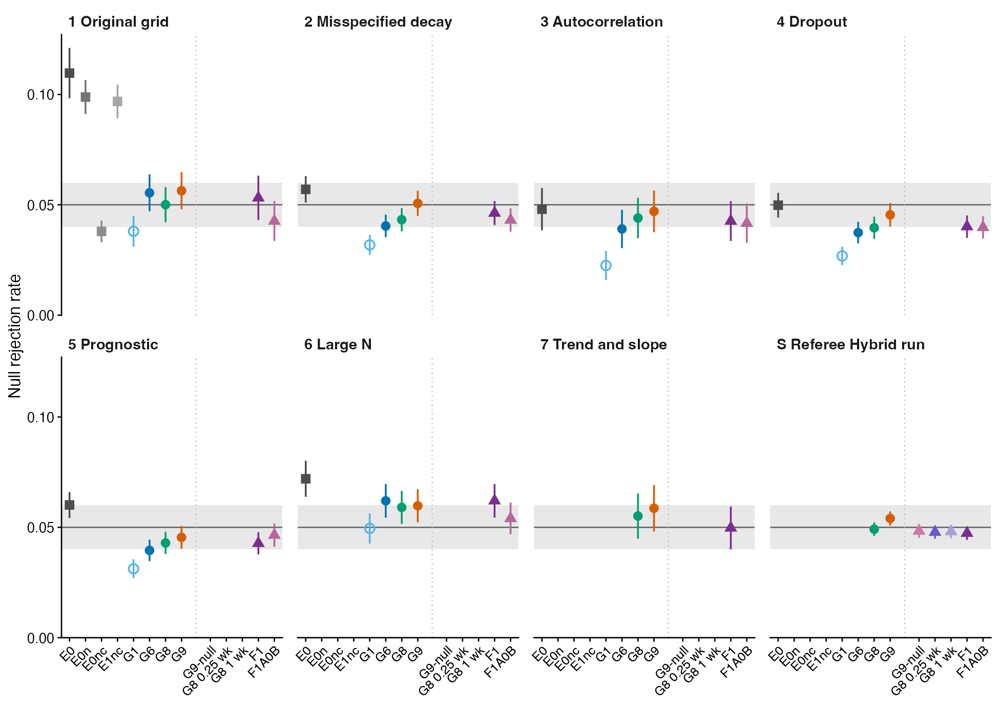
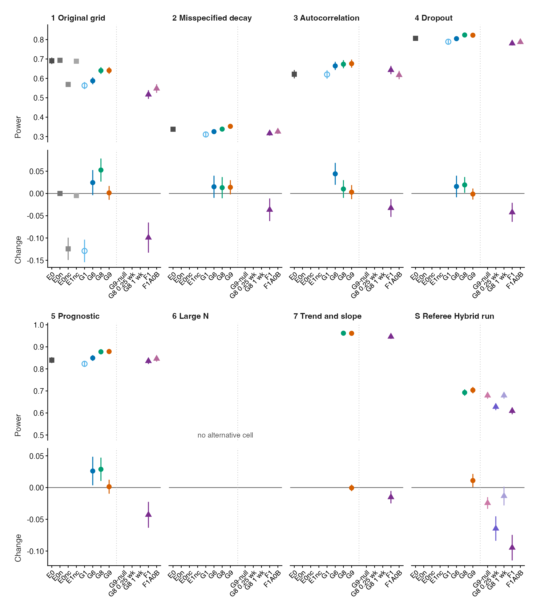
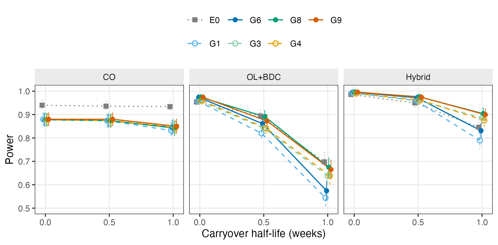
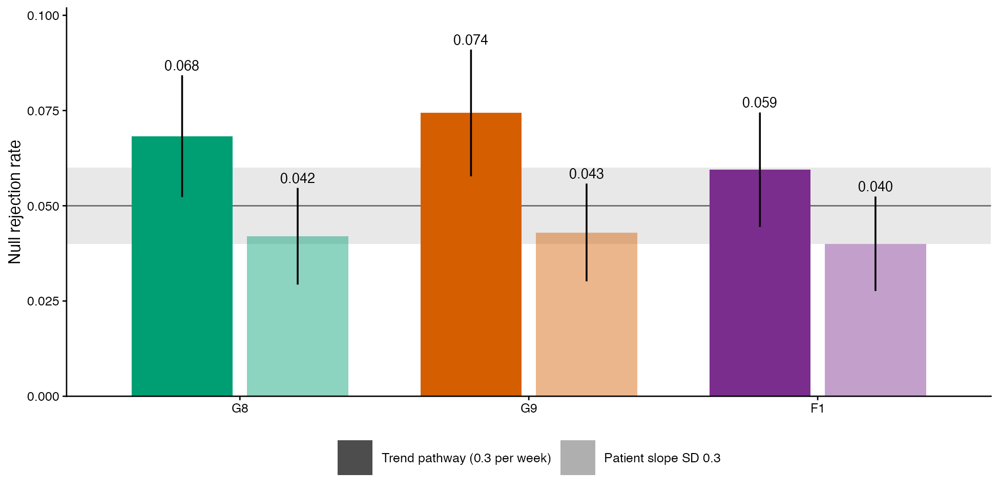
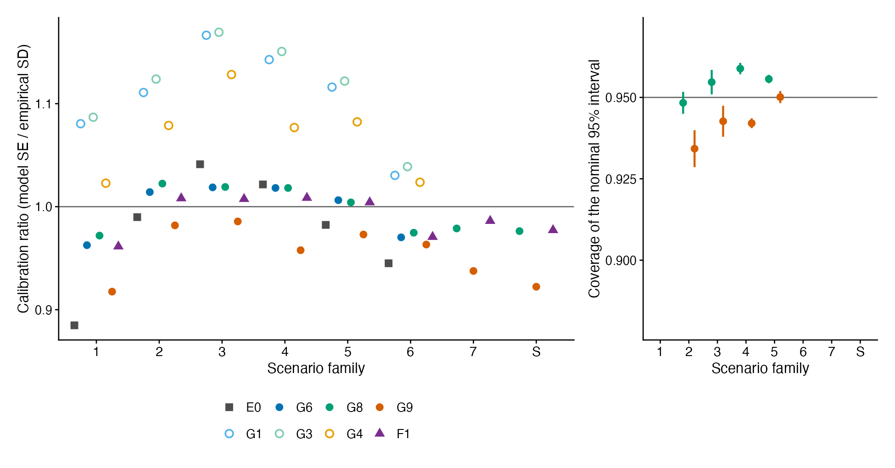

<!--
  Build pipeline for this manuscript (reconstructed 2026-10-26)
  ============================================================

  This Rmd runs no simulation code. It loads pre-computed summaries
  and figures produced by the scripts below, all run under the
  corrected simulation code (Corrections section). All paths are relative
  to the repository root.

  Factorial grid of rung 3 (simrun job 26, 2026-10-25, 540 cells x 500
  reps, of which this manuscript uses the 216-cell covariance-
  moderation slice):
    Rscript analysis/scripts/carryover-sensitivity/01-run-factorial.R
    Rscript analysis/scripts/carryover-sensitivity/02-summarise-grid.R
      -> analysis/data/02-grid-summary.rds
    Rscript analysis/scripts/carryover-sensitivity/03-render-figures-extra-slim.R
      -> analysis/figures/02xs-power-by-spec.pdf

  Rungs 1 to 4, corrected 30-cell grid (job 27), all specifications on the
  same trials (simrun job 27, 2026-10-25):
    Rscript analysis/scripts/carryover-sensitivity/27-run-tier1-g-vs-f-e0.R
      -> analysis/data/carryover-sensitivity/tier1-g-vs-f-e0/summary.rds
    Rscript analysis/scripts/carryover-sensitivity/12-hendrickson-heatmap.R
      -> analysis/figures/02xs-heatmap-hendrickson-{a,b}.pdf

  Scenario cells (simrun job 21, 2026-10-23):
    Rscript analysis/scripts/carryover-sensitivity/06-g-vs-f-comparison.R
      -> analysis/data/carryover-sensitivity/g-vs-f-comparison/summary.rds

  Prognostic stress (simrun jobs 28 and 30, 2026-10-25/26, and two analytic
  checks that run in seconds):
    Rscript analysis/scripts/carryover-sensitivity/28-run-g9-prognostic-stress.R
    Rscript analysis/scripts/carryover-sensitivity/29-run-g9-random-effects.R
    Rscript analysis/scripts/carryover-sensitivity/30-check-prognostic-confound-pd.R
    Rscript analysis/scripts/carryover-sensitivity/31-prognostic-coupling-ceiling.R
      -> analysis/data/carryover-sensitivity/g9-prognostic-stress/{summary,pd-check,coupling-ceilings}.rds
      -> analysis/data/carryover-sensitivity/g9-random-effects/summary.rds

  Size diagnostic at 3,000 replicates (Hybrid null; run before the
  cross-factor constant correction, Corrections section):
    analysis/scripts/carryover-sensitivity/diagnose-null-type1-cr2.R
      -> analysis/scripts/carryover-sensitivity/output/diag-null-type1-cr2.rds

  Exploratory sensitivity blocks that predate the corrections (S1 to
  S11 of earlier drafts) are no longer part of this manuscript; they
  remain in supplement.Rmd and in archive/.

  Analysis ladder tables and figures (reads stored data only):
    Rscript analysis/scripts/carryover-sensitivity/37-ladder-tables-figures.R
      -> analysis/data/carryover-sensitivity/ladder/*.csv
      -> analysis/figures/02-ladder-fig{1,2,3,4}-*.png
    Rscript analysis/scripts/carryover-sensitivity/40-stage-power-figure.R
      -> analysis/figures/02-power-by-half-life.{pdf,png}
  Isolation of the first rung (simrun job 42 on zeus; run before
  37-ladder-tables-figures.R, which reads its all.rds):
    38-run-e0-isolation.R, 39-check-e0-isolation.R
      -> analysis/data/carryover-sensitivity/e0-isolation/{all,summary}.rds

  Render through tools/render.sh, never rmarkdown::render() directly.
-->

```{r setup, include = FALSE}
knitr::opts_chunk$set(
  echo = FALSE,
  warning = FALSE,
  message = FALSE,
  fig.path = "../../figures/02-cache-",
  cache.path = "_cache/"
)
library(tibble)
library(dplyr)
library(tidyr)
library(knitr)

## Display names. Stored values stay E1/E2/E3/E7/E9 and their cr2
## variants everywhere; only the display layer maps them to G1-G9.
source(here::here(
  'analysis/scripts/carryover-sensitivity/spec-labels.R'))

## Data loaded once for the tables below.
grid <- readRDS(here::here('analysis/data/02-grid-summary.rds'))$summary
s27  <- readRDS(here::here(
  'analysis/data/carryover-sensitivity/tier1-g-vs-f-e0/summary.rds'))
s21  <- readRDS(here::here(
  'analysis/data/carryover-sensitivity/g-vs-f-comparison/summary.rds'))
s28  <- readRDS(here::here(
  'analysis/data/carryover-sensitivity/g9-prognostic-stress/summary.rds'))
s30  <- readRDS(here::here(
  'analysis/data/carryover-sensitivity/g9-random-effects/summary.rds'))
pdc  <- readRDS(here::here(
  'analysis/data/carryover-sensitivity/g9-prognostic-stress/pd-check.rds'))
ceil <- readRDS(here::here(
  'analysis/data/carryover-sensitivity/g9-prognostic-stress/coupling-ceilings.rds'))
sgf  <- readRDS(here::here(
  'analysis/data/carryover-sensitivity/g9-gap-fill/summary.rds'))
## One rejection rate from the gap-fill summary; the dots are filter
## conditions and must identify exactly one cell.
gf <- function(sub_, m, ...) {
  d <- sgf |> filter(sub == sub_, method == m, ...)
  stopifnot(nrow(d) == 1)
  d$reject
}

## Method display labels shared by the tables.
m_lab <- c(E0 = 'E0', E1 = 'G1', E3 = 'G2', E2 = 'G3', E7 = 'G4',
           E9 = 'G5', E1cr2 = 'G6', E3cr2 = 'G7', E2cr2 = 'G8',
           E7cr2 = 'G9', F1 = 'F1', F1A = 'F1A', F1A0 = 'F1A0',
           F1A0B = 'F1A0B')
focus <- c('E1', 'E2', 'E7', 'E1cr2', 'E2cr2', 'E7cr2', 'E0', 'F1', 'F1A0B')
focus_cols <- c('G1', 'G3', 'G4', 'G6', 'G8', 'G9', 'E0', 'F1', 'F1A0B')
design_lab <- c(CO = 'CO', Hybrid = 'Hybrid', OLBDC = 'OL+BDC')
fmt3 <- function(x) ifelse(is.na(x), '--', sprintf('%.3f', x))
## Reanalysis of the per-replicate output for the 2026-10-27 referee
## report (34-referee-reanalysis.R); the tables that use it are
## skipped if the files are absent.
rr_dir <- here::here('analysis/data/carryover-sensitivity/referee-reanalysis')
has_rr <- file.exists(file.path(rr_dir, 'm2-pooled-size.csv'))
g9_pooled <- if (has_rr) read.csv(file.path(rr_dir, 'm2-pooled-size.csv')) else NULL
## The four referee-variant runs (36-run-referee-variants.R, simrun
## jobs 34 to 37 on zeus, 2026-10-27), one directory per block.
rv_dir <- here::here('analysis/data/carryover-sensitivity/referee-variants')
rv_read <- function(block, what) {
  f <- file.path(rv_dir, paste0('block-', block), paste0(what, '.rds'))
  if (file.exists(f)) readRDS(f) else NULL
}
has_rv <- !is.null(rv_read('N', 'summary'))
rv_lab <- c(E2cr2 = 'G8', E7cr2 = 'G9', E7null_cr2 = 'G9-null',
            E3fix_cr2 = 'G8-fixed', F1 = 'F1')
rv_method <- function(d) ifelse(d$method == 'E3fix_cr2',
  sprintf('G8 at %.2f wk', d$h_fixed), rv_lab[d$method])
rvN <- rv_read('N', 'summary'); rvA <- rv_read('A', 'summary')
rvT <- rv_read('T', 'summary'); rvS <- rv_read('S', 'summary')
rvNp <- rv_read('N', 'paired'); rvAp <- rv_read('A', 'paired')
rv_cell <- function(d, m, ...) {
  x <- d |> filter(method == m, ...)
  stopifnot(nrow(x) == 1)
  x
}

## Isolation block (38-run-e0-isolation.R, checked by
## 39-check-e0-isolation.R; simrun job 42). Paired step differences
## are computed from the per-replicate file.
iso_dir <- here::here('analysis/data/carryover-sensitivity/e0-isolation')
iso <- readRDS(file.path(iso_dir, 'summary.rds'))
iso_all <- readRDS(file.path(iso_dir, 'all.rds'))
stopifnot(nrow(iso) == 150, nrow(iso_all) == 150000)

## Analysis-ladder tables and figures (37-ladder-tables-figures.R).
## The script reads stored data only. This document reads its CSV
## files and recomputes nothing.
lad_dir <- here::here('analysis/data/carryover-sensitivity/ladder')
lad_long <- read.csv(file.path(lad_dir, 'ladder-long.csv'),
                     stringsAsFactors = FALSE)
lad_A  <- read.csv(file.path(lad_dir, 'ladder-table-A.csv'),
                   stringsAsFactors = FALSE, check.names = FALSE)
lad_An <- read.csv(file.path(lad_dir, 'ladder-table-A-numeric.csv'),
                   stringsAsFactors = FALSE)
lad_B  <- read.csv(file.path(lad_dir, 'ladder-table-B.csv'),
                   stringsAsFactors = FALSE)
lad_C  <- read.csv(file.path(lad_dir, 'ladder-table-C.csv'),
                   stringsAsFactors = FALSE)
lad_fam <- lad_long |> filter(level == 'family')
## One family-level value (size, power, kappa, coverage) of an
## analysis. The filter must identify exactly one row.
lv <- function(a, q, f = '1', w = 'value') {
  x <- lad_fam |> filter(analysis == a, quantity == q, family == f)
  stopifnot(nrow(x) == 1)
  x[[w]]
}
## One paired increment between adjacent analyses, from the numeric
## copy of Table A. `w` is size_diff, size_se, power_diff or power_se.
inc <- function(step, f = '1', w = 'power_diff') {
  x <- lad_An |> filter(step_id == step, family == f)
  stopifnot(nrow(x) == 1)
  x[[w]]
}
fam_ids <- c('1', '2', '3', '4', '5', '6', '7', 'S')
fam_size <- function(a) {
  x <- lad_fam |> filter(analysis == a, quantity == 'size')
  setNames(x$value, x$family)
}
f3 <- function(x) sprintf('%.3f', x)
fs3 <- function(x) sprintf('%+.3f', x)
lag_mean_g2 <- grid |>
  filter(dgp_arch == 'mvn', carryover_form %in% c('exponential', 'weibull'),
         !(carryover_form == 'weibull' & weibull_shape == 1),
         spec %in% c('E1', 'E3')) |>
  select(design, N, c_bm, t1half, carryover_form, weibull_shape, spec,
         power) |>
  pivot_wider(names_from = spec, values_from = power) |>
  summarise(m = mean(E3 - E1)) |> pull(m)
```

# Abstract {-}

**Background.** Aggregated N-of-1 trials pool repeated within-patient
on/off contrasts to validate predictive biomarkers. Drug carryover
attenuates the biomarker-by-treatment interaction. The analyst must
decide how to represent residual exposure, how to obtain a correctly
sized test, and whether the half-life must be known.

**Methods.** We ran an exploratory simulation study under the
data-generating process of a companion paper, where the interaction is
a biomarker-drug-response correlation. We built an analysis ladder in
which each rung changes one thing. Rung 0 is the original analysis
(E0). Rung 1 uses a binary drug indicator with residual `corCAR1`
correlation (G1). Rung 2 adds CR2 cluster-robust inference (G6).
Rung 3 uses an exposure-weighted predictor at the true half-life
(G8). Rung 4 chooses the half-life by AIC (G9). Side analyses
select the half-life without the interaction, fix it, or add
expectancy terms (F1, F1A0B). We compared the rungs in eight scenario
families.

**Results.** In the original grid E0 rejected the null at
`r f3(lv('E0', 'size'))` and G1 at `r f3(lv('G1', 'size'))`. CR2 moved
size to `r f3(lv('G6', 'size'))`. Exposure weighting raised power by
`r f3(inc('G6>G8'))` (paired SE `r f3(inc('G6>G8', w = 'power_se'))`).
AIC selection matched the power of G8 and added about half a point of
size. Pooled over 7,987 null fits, G9 rejected at 0.055 against 0.049
for G8 (paired difference 0.006, SE 0.001). Its interval covered at
about 0.93 under the alternative. G9 stayed within 0.04 to 0.06 in
all eight families. F1 lost power where its fixed half-life was wrong.
A biomarker that predicts the natural-history trend biased every
analysis. A power loss at the strongest prognostic confound came from
an infeasible covariance matrix that the code had repaired. A
feasibility bound now excludes such scenarios.

**Conclusions.** For a Hybrid trial under this process we recommend
G9: the exposure-weighted predictor with an AIC-selected half-life
and CR2 inference. Its size is about 0.055 at
$N \le 70$. A fixed 1-week analysis half-life with CR2 holds nominal
size for at most two points of power. The recommendation is
conditional on the correlation encoding.

**Keywords:** N-of-1 trials; carryover; predictive biomarker;
cluster-robust inference; post-selection inference; simulation
study.

# Introduction

In a single N-of-1 trial, one patient is crossed repeatedly between
active treatment and a comparator. The within-patient contrast
between on-drug and off-drug periods estimates that patient's
individual treatment effect. An aggregated N-of-1 trial pools many
such series. Pooling allows population-level inference at sample
sizes smaller than a parallel-group trial would require
[@hendrickson2020]. The estimand here is the biomarker-treatment
interaction, that is, whether a baseline covariate $B_i$ modifies
the treatment effect. We evaluate analysis approaches for this
estimand in the Hybrid N-of-1 design defined in Section \@ref(sec-designs).

The main inferential complication in N-of-1 trials is carryover. A
drug's pharmacological effect does not stop at discontinuation. It
decays as a function of the drug's half-life. Observations taken
after discontinuation therefore still carry part of the treatment
effect. An exposure regressor that ignores this decay is a
mismeasured version of what the patient received. The consequences
are twofold. First, the interaction contrast is attenuated.
Occasions that still carry a large fraction of the drug effect are
coded the same as occasions that carry none. This biases the
biomarker-by-exposure coefficient toward zero, as any covariate
measured with error would. Second, those occasions vary in a way the
model does not represent. The unexplained variation inflates the
standard error of the same coefficient. Power falls for both
reasons.

This is a loss of power, not of validity. Under the null,
$c_{bm} = 0$, there is no biomarker-response association at any
level of residual exposure. A miscoded regressor then has no
interaction to distort, and test size does not depend on the
exposure coding. The conservatism reported in Section \@ref(sec-rung2) has a
separate origin in the working covariance and applies equally to
every specification. Carryover misspecification is therefore a
question of efficiency. Rung 3 of the study is therefore framed in terms of recovered power.

A companion study [@pmsimstats_dgp_architectures2026] builds on the
data-generating process of Hendrickson et al. [-@hendrickson2020].
In that process the interaction is encoded as a correlation between
the biomarker and the drug response. The correlation is present on
drug and decays off drug: $\text{Cor}(B_i, BR_{it}) = c_{bm} \cdot
\phi(t_{sd})$. We call this the correlation encoding of the
interaction. The companion study shows that carryover reduces power
under this encoding, and that the reduction depends on the design.
The loss under a given analysis is governed by the on/off correlation
difference, that is, the on-drug correlation minus the mean off-drug
correlation, which the analysis's exposure coding determines. At a
half-life of one week in this study's factorial grid, the binary
indicator loses a fifth to two thirds of its power under the Hybrid
and OL+BDC designs. It loses a tenth to a sixth under the crossover
design (Section \@ref(sec-rung3)). We restrict attention to the correlation
encoding. The carryover problem is largest there, and the original
results of Hendrickson et al. were obtained there. That earlier work
fixed the decay shape at exponential and evaluated only one analysis
specification. Simulation studies of aggregated N-of-1 analyses
under carryover exist [@chen2014; @percha2019; @blackston2019;
@gartner2023]. One includes an exponentially decaying wash-in and
wash-out term [@gartner2023]. All target the treatment effect rather
than the biomarker-by-treatment interaction, which is the estimand
here. An interaction test needs about four times the sample of a
main-effect test of the same size [@brookes2004]. The correlation
encoding is a modeling assumption of this project, not a validated
description of any trial. Every recommendation below is conditional
on it.

This manuscript shows how a sequence of changes to the analysis model
improves both size and power. We call the sequence an analysis ladder.
Each rung changes one thing about the analysis. The rungs follow the
order in which the questions arise for an analyst. Section
\@ref(sec-ladder-def) defines the rungs and Table
\@ref(tab:tab-ladder-def) lists them.

Rung 0 is the original analysis (E0) of Hendrickson et al.
[-@hendrickson2020]. It fits a random intercept, uses a binary
on-drug indicator, and has no residual correlation structure. The
first question is whether its test is correctly sized. Rung 1 (G1)
keeps the binary indicator and uses an AR(1) residual correlation
through `corCAR1` with model-based inference. E0 and G1 differ in
three respects at once. Isolation analyses separate the three and
attribute the liberal size of E0 to its missing residual correlation
(Section \@ref(sec-rung1)).

The second question concerns the size of the test. The working
covariance of the mixed model is a random intercept with an AR(1)
residual correlation. It does not match the covariance that the
data-generating process induces, and the model-based test is
conservative. Rung 2 (G6) replaces the model-based standard error by a
CR2 bias-reduced cluster-robust standard error with Satterthwaite
degrees of freedom [-@bell2002bias]. The rung changes only the
standard error, the reference distribution and the $p$-value.

The third question is how residual exposure should enter the linear
predictor. The analyst may ignore the decay and code exposure as on or
off, as the original analysis does (G1 and G6). Or the analyst may
represent it by committing to a decay form and half-life in a
continuous exposure-weighted predictor (G3). The predictor changes the
regressor that carries the interaction. Rung 3 (G8) is the
exposure-weighted predictor at the true half-life with CR2 inference.
We compare the two positions against exponential and Weibull decay
forms in a full factorial.

The fourth question follows from the third position. An assumed
half-life is the true half-life, which no real analyst knows. Rung 4
(G9) lets the data choose the half-life by AIC over a candidate grid.
The selection step adds a post-selection inference risk
[@berk2013valid; @leeb2005; @kuchibhotla2022]. We measure what it
costs in size and in interval coverage.

Four side analyses test alternatives to rungs 3 and 4. The first
selects the half-life on the model without the interaction (G9-null).
The second fixes the analysis half-life at 1 week or 0.25 week
whatever the truth (G8 at a fixed half-life). The third and fourth are
members of a richer family developed in parallel within this program
(F1, F1A0B). That family adds design-expectancy terms to protect
against a prognostic biomarker. It either fixes the half-life or
calibrates its selection by a parametric bootstrap.

We then stress the ladder in scenario families that a real trial may
present. These are a misspecified half-life and decay shape, serial
correlation, patient dropout, a biomarker that is prognostic as well
as predictive through three correlation pathways, large samples, a
biomarker that predicts the natural-history trend, and a
patient-specific slope variance. The prognostic scenarios also
produced a methodological finding about the simulation itself. A
non-positive-definite covariance matrix had been repaired without
warning. We report it because it changes how such stress tests must be
designed.

Two defects in the simulation code were found during the study and
corrected. The first was a pre-exposure coding error in the
exposure-weighted predictor that affected the crossover design. The
second was a cross-factor correlation constant that departed from the
documented data-generating process. Every result in this manuscript
was produced under the corrected code, with one labeled exception. We
follow the ADEMP reporting framework of Morris, White, and Crowther
[-@morris2019simulation] throughout. We also follow later reporting
guidance on common random numbers and on comparative simulation
studies [@siepe2024; @pawel2024]. The study is exploratory. Its rungs
and scenarios were not fixed in advance, and the recommendation is the
end of a documented sequence of choices rather than a pre-specified
comparison. Section \@ref(sec-design) describes the simulation design
in ADEMP order. Section \@ref(sec-results) gives the results rung by
rung and then by scenario. Section \@ref(sec-discussion) states the
recommendation and its limits.

# Simulation design {#sec-design}

The study simulates complete aggregated N-of-1 trials and analyzes
each one under every specification. A single replicate proceeds as
follows. Patients are allocated across the randomization paths of
the chosen trial design (Section \@ref(sec-designs)). For each patient we draw a
pre-treatment biomarker together with three latent response
components. These are the drug-response component, the
natural-history component, and the placebo-response component. The
four quantities are drawn jointly across all eight measurement
occasions from a multivariate normal distribution. The means follow
modified Gompertz trajectories. The covariance matrix contains
within-component AR(1) autocorrelation, cross-component
correlations, and the biomarker-response correlation that encodes
the interaction and depends on treatment state (Section \@ref(sec-dgm)). The
observed symptom score at each occasion is the patient's baseline
severity minus the sum of the three components. A beneficial effect
therefore lowers the score. Carryover enters through a decay
function of time since discontinuation. The decay keeps part of the
drug-response component present at nominally off-drug occasions.
Every analysis specification in a given cell is then fitted to the
same simulated dataset. We record the interaction coefficient, its
standard error, and its $p$-value from each. This is repeated 500
times for every parameter combination in the grid of Section \@ref(sec-grid). It is repeated 1,000 times in the random-effects comparison of the prognostic scenarios and in the large-sample cells of the supplementary study, and 2,000
times in the supplementary size diagnostic.

Fitting all specifications to a common dataset is deliberate. It
makes every contrast among them paired. Paired differences have
substantially less Monte Carlo variance than differences between
independent draws. Throughout, $N$ denotes the **total** number of
patients in a trial. Patients are allocated as evenly as possible
across the design's randomization paths, so a design with $P$ paths
assigns about $N/P$ patients to each. At $N = 70$ this is 35 per
path under the two-path designs and 17 or 18 per path under the
four-path Hybrid design.

## Aims {#sec-aims}

The first aim is to show how each change to the analysis model alters
size and power in the biomarker-treatment interaction test of a Hybrid
aggregated N-of-1 trial under the correlation encoding. The changes
form a ladder of five rungs (Table \@ref(tab:tab-ladder-def)). Rung 0
is the original analysis. Rung 1 uses a binary drug indicator with a
residual AR(1) correlation. Rung 2 adds CR2 cluster-robust inference
to fix size. Rung 3 replaces the binary indicator by an
exposure-weighted predictor at the true half-life to recover the power
that carryover removes. Rung 4 chooses the half-life by AIC to remove
the need to know it. Each rung is judged against its predecessor by a
paired contrast on the same simulated trials. Four side analyses test
alternatives to rungs 3 and 4.

The second aim is to find where a rung does not help. The scenario
families of Table \@ref(tab:tab-families) stress the ladder with a
misspecified half-life and decay shape, serial correlation, dropout,
prognostic pathways, large samples, a biomarker that predicts the
natural-history trend, and a patient-specific slope variance. The
third aim is to arrive at a recommended analysis for the Hybrid design
and to state its conditions and limits. A fourth aim is to document
the evidence for each rung so that a reader can check it.

```{r tab-families, echo = FALSE}
tab_fam <- tibble::tribble(
  ~Family, ~Scenarios, ~Replicates,
  '1', 'Original 30-cell grid: three designs, $N \\in \\{35, 70\\}$, $c_{bm} \\in \\{0, 0.30, 0.45\\}$, $t_{1/2} \\in \\{0, 0.5, 1\\}$ weeks', '500',
  '2', 'Misspecified half-life ($0.2$, $2$ or $4$ weeks) and decay shape (Weibull $k \\in \\{0.5, 2\\}$), analyzed as exponential', '500',
  '3', 'Serial correlation $\\rho \\in \\{0.5, 0.9\\}$', '500',
  '4', 'Patient-level dropout, completely at random or by baseline severity', '500',
  '5', 'Prognostic pathways at strength 0.3 and the feasible prognostic grid', '500',
  '6', 'Large samples, $N \\in \\{140, 280\\}$, null only', '1,000',
  '7', 'Trend pathway and patient slope variance, Hybrid, $N = 70$', '1,000',
  'S', 'Hybrid run with independent seeds: selection on the null model, fixed half-lives', '1,000 to 5,000'
)
knitr::kable(tab_fam, booktabs = TRUE, escape = FALSE, linesep = '',
  caption = 'The eight scenario families of the ladder comparisons.
    Within a cell every analysis is fitted to the same simulated
    trials. Family S has independent seeds for every cell. Section
    \\ref{sec-grid} describes the cells.') |>
  kableExtra::column_spec(2, width = '9.5cm') |>
  kableExtra::kable_styling(font_size = 9)
```

## Trial designs {#sec-designs}

The three designs differ in how on-drug and off-drug occasions are
arranged. They therefore differ in how much post-discontinuation
information each generates. All three schedule eight measurement
occasions per patient. Each randomization path is a fixed
on-drug/off-drug schedule. Each design also carries an expectancy
weight, defined as the participant's probability of being on drug
by design. The weight is one during open-label periods and one half
during blinded periods, and it scales the placebo-response
component.

**Crossover (CO).** A traditional two-period within-patient
crossover, blinded throughout. Occasions are spaced 2.5 weeks apart
from 2.5 to 20 weeks. One path is active for the first four
occasions and then on comparator. The other path reverses that
order, so it never discontinues and contributes no
post-discontinuation observations.

**Open-label followed by blinded discontinuation (OL+BDC).**
Open-label titration at 4, 8, 12, and 16 weeks, then weekly
follow-up to week 20 with a blinded late switch to placebo. The two
paths discontinue after week 17 or 18, so only two or three
occasions follow.

**Hybrid.** The design of Hendrickson et al. and this program's
reference design. It consists of open-label titration at weeks 4 and
8, blinded discontinuation weekly from week 9 to 12, and a brief
two-occasion crossover at weeks 16 and 20. The four paths vary
discontinuation timing and crossover-arm order. It has the most
on/off transitions of the three designs. It is the only one that
allows more than one discontinuation per patient. The recommendation
of this manuscript is made for this design. CO and OL+BDC are
carried through the factorial grid and the corrected grid to show where the recommendation does
and does not transfer.

One consequence bears directly on the results. The first
post-discontinuation occasion falls one week after switching under
OL+BDC and Hybrid, but 2.5 weeks after switching under CO. At the
half-lives examined here, roughly half the drug effect persists into
the first off-drug occasion under the two non-crossover designs. Less
than a fifth persists under CO. The designs therefore differ
substantially in how much carryover they can accumulate.

## Data-generating mechanism {#sec-dgm}

Under the correlation encoding, the biomarker and the drug-response
component are drawn jointly from a multivariate normal distribution.
Their correlation depends on treatment state: $\text{Cor}(B_i,
BR_{it}) = c_{bm} \cdot \phi(t_{sd})$, where $\phi$ is the decay
form and $t_{sd}$ is the time since drug discontinuation. The
data-generating process is the extended DGP of the companion study.
The extended DGP differs from the original DGP of Hendrickson et al.
in four respects. The biomarker-response correlation is zero before
first exposure and decays after discontinuation at the carryover
half-life. The within-component correlation is a separable AR(1)
structure at $\rho = 0.7$. That is, every component has the same
first-order autoregressive correlation, and a single cross-component
constant $c_1 = 0.2$ is scaled by $\rho^{|w_t - w_s|}$ at every lag.
Carryover on the drug-response mean decays from the
last on-drug mean. A covariance matrix that is not positive definite
stops the simulation rather than being repaired (Section \@ref(sec-corrections)).

The decay function $\phi : \mathbb{R}_+ \to [0, 1]$ maps $t_{sd}$ to
a residual-effect multiplier. Two forms are used. Each is matched to
a common half-life $t_{1/2}$. Exponential decay,

$$
\phi_{\text{exp}}(t_{sd}) =
  \exp\left(-\lambda t_{sd}\right), \qquad
  \lambda = \frac{\ln 2}{t_{1/2}},
$$

is classical first-order elimination and the default pharmacokinetic
assumption. Weibull decay,

$$
\phi_{\text{weib}}(t_{sd}) =
  \exp\left(-\left(\lambda_w t_{sd}\right)^{k}\right), \qquad
  \lambda_w = \frac{(\ln 2)^{1/k}}{t_{1/2}},
$$

has a shape parameter $k$. The elimination tail is heavier than
exponential when $k < 1$ and lighter when $k > 1$. The form reduces
to exponential at $k = 1$. The factorial grid uses $k \in \{0.7,
1.5\}$ alongside exponential. The decay-shape
misspecification cells (family 2) use $k \in \{0.5, 2\}$. All forms pass through
the same half-life-defining point, $\phi = 0.5$ at $t_{sd} =
t_{1/2}$. They are therefore comparable at a fixed nominal half-life
even though their shapes differ on either side of it. The decay form
the analysis assumes differs by scenario. In the factorial grid the
exposure-weighted predictor is built with the data-generating form,
shape and half-life. This is the driver's default when no analysis
form is given. The Weibull cells of the factorial grid therefore test the
representation under a correctly specified decay, not its robustness
to the shape. Every other analysis assumes exponential
decay. The Weibull cells of family 2 are the shape-misspecification
check.

## Estimand and analysis specifications {#sec-spec}

The interaction estimand is the on-drug biomarker-response
correlation $c_{bm}$, a dimensionless quantity. Bias and empirical
SE are reported on a calibrated effect-size scale. That scale is the
expected difference in on-drug response per SD of the biomarker at
$t_{1/2}=0$. Power and Type I error are on the native test-statistic
scale, with the null estimand $c_{bm} = 0$. The base analysis model
is
`nlme::lme(Sx ~ bm * X + t, random = ~1 | ptID, correlation = corCAR1(form = ~ t | ptID))`.
The specifications differ in how $X$ is constructed, whether a
nuisance term is added, and how the standard error is obtained. In
the code and data files described in the Reproducibility section,
each specification is stored under an `E`-prefixed code. This
manuscript refers to them by the `G1`-`G9` code of Table
\@ref(tab:tab-spec-summary), or by name. Six codes carry the
argument: G1, G3, G4, G6, G8 and G9. G5 appears in the nine-specification
heatmaps of Section \@ref(sec-rung2) for completeness and is otherwise not
discussed.

```{r tab-spec-summary, echo = FALSE}
tab_spec <- tibble::tribble(
  ~Code, ~Stored, ~Name, ~Formula, ~Target,
  'G1', 'E1', 'Unadjusted', 'Sx ~ bm + t + Db + bm:Db', 'bm:Db',
  'G2', 'E3', 'Lag-adjusted', 'Sx ~ bm + t + Db + bm:Db + L', 'bm:Db',
  'G3', 'E2', 'Exposure-weighted', 'Sx ~ bm + t + Dbc + bm:Dbc', 'bm:Dbc',
  'G4', 'E7', 'AIC-selected t1/2', 'G3 formula, t1/2 by AIC over \\{0.25,0.5,1.0,2.0\\}', 'bm:Dbc',
  'G5', 'E9', 'Paired-difference', 'diff ~ bm (patient-level OLS)', 'bm slope',
  'G6', 'E1cr2', 'Unadjusted + CR2', 'G1 formula, CR2 SE', 'bm:Db',
  'G7', 'E3cr2', 'Lag-adjusted + CR2', 'G2 formula, CR2 SE', 'bm:Db',
  'G8', 'E2cr2', 'Exposure-weighted + CR2', 'G3 formula, CR2 SE', 'bm:Dbc',
  'G9', 'E7cr2', 'AIC-selected t1/2 + CR2', 'G4 formula, CR2 SE', 'bm:Dbc'
)
knitr::kable(tab_spec, booktabs = TRUE, escape = FALSE,
  col.names = c('Code', 'Stored', 'Name', 'Formula', 'Target coefficient'),
  caption = 'The nine G-family analysis specifications. G1 to G3 are
    the model-based representations of residual exposure. G4 replaces
    the assumed half-life by a data-driven choice. G6 to G9
    are CR2 cluster-robust variants of G1, G2, G4 and G3. G2 and G7
    are the lag-adjusted pair, fitted and not discussed. G5 collapses to
    one row per patient before fitting and has no
    CR2 variant. The original analysis E0 is defined in Section
    \\ref{sec-e0} and the F-family in Section
    \\ref{sec-comparators}.') |>
  kableExtra::kable_styling(latex_options = "scale_down", font_size = 9)
```
### The analysis ladder {#sec-ladder-def}

The ladder orders the analyses by what each one changes. Table
\@ref(tab:tab-ladder-def) gives the formula, the inference and the
assumptions of each. Rung 0 is the original analysis (E0). Rung 1 is
the binary-indicator analysis with `corCAR1` residual correlation and
model-based inference (G1). Rung 2 is G1 with CR2 cluster-robust
inference (G6). Rung 3 replaces the binary indicator by the
exposure-weighted predictor at the true half-life, with CR2 (G8). Rung
4 chooses the half-life by AIC, with CR2 (G9). Each rung changes one
thing from its predecessor, with one exception. The step from E0 to G1
changes three things at once, and the isolation analyses E0n, E0nc and
E1nc separate them (Section \@ref(sec-rung1)). G3 and G4 are the
model-based counterparts of G8 and G9. They separate the change of
regressor from the change of inference.

Four side analyses test alternatives to rungs 3 and 4. G9-null selects
the half-life on the model without the interaction. G8 at a fixed
half-life uses an analysis half-life of 0.25 or 1 week whatever the
truth. F1 and F1A0B add the design-expectancy terms. Section
\@ref(sec-comparators) defines them. The lag-adjusted specifications G2
and G7 were fitted in the full grid, changed power by
`r sprintf('%.3f', lag_mean_g2)` on average, and are not reported or
discussed further. Their codes stay in Table \@ref(tab:tab-spec-summary)
so that the stored labels map to the displayed ones.

### Rung 0: the original analysis (E0) {#sec-e0}

**E0** is the original analysis published with the original DGP
[@hendrickson2020]. We read it from the original repository (commit
`58b32a9`, `R/lme_analysis.R`) rather than from this project's
vendored copy, which had acquired a residual correlation structure
at some later point. It fits `lme4::lmer` with a random intercept
and no residual correlation structure. It uses the binary on-drug
indicator and takes Satterthwaite $p$-values from `lmerTest`. As
published it also adds the expectancy main effect $D_e$ whenever
expectancy varies within the design, and it drops patients who are
never on drug. E0 therefore differs from G1 in three respects at once: no
`corCAR1`, the $D_e$ term, and the software and degrees-of-freedom
method. A separate simulation changes them one at a time (E0n, E0nc
and E1nc; Section \@ref(sec-rung1)).

### Rung 1: binary indicator with residual correlation (G1) {#sec-g1}

Here $X = D_{it}$, the binary on-drug indicator (one on drug, zero
off). Carryover is not represented. An off-drug occasion that still
carries most of the drug effect is coded the same as one that
carries none. This is the default an analyst obtains without
considering carryover. We treat it as the benchmark against which
the other specifications must justify their additional structure.
It uses no half-life, so it does not depend on the analyst's
pharmacokinetic assumptions.

### Rung 2: CR2 cluster-robust inference (G6, G8, G9) {#sec-cr2-method}

The standard error of $\beta_{bm:X}$ read from the fitted `lme`
object is valid only if the assumed residual covariance is correct.
The working covariance combines a patient random intercept with a
`corCAR1` AR(1) residual correlation. The companion calibration
study [@pmsimstats_calibration2026] shows that this does not match
the covariance the data-generating process induces. We quantify the
consequence with the calibration ratio

$$
\kappa = \frac{\overline{\widehat{SE}}}{SD\big(\hat\beta_{bm:X}\big)},
$$

the mean model-reported standard error across replicates divided by
the empirical standard deviation of the replicate point estimates.
$\kappa = 1$ is correctly calibrated and $\kappa > 1$ is a
conservative test. The mean of the standard errors is below their
root mean square. $\kappa$ as defined is therefore biased downward
by a few percent when the standard errors vary across replicates,
as they do at $N = 35$. The empirical SD in the denominator is also
sensitive to a heavy-tailed estimate distribution. Section \@ref(sec-dropout) meets
that case under heavy missingness and reports a robust ratio beside
it. Coverage of the nominal 95% interval is the complementary
measure. It is reported where the stored per-replicate output allows
it. The remedy for the mismatch is a cluster-robust sandwich
variance. It derives the variance of $\hat\beta_{bm:X}$ from
observed between-patient variation rather than from the assumed
covariance. With only $N = 35$ or $70$ clusters the naive
Liang-Zeger form is itself biased downward. We therefore use the CR2
bias-reduced estimator of Bell and McCaffrey [-@bell2002bias] with
Satterthwaite degrees of freedom, as implemented in `clubSandwich`
[@pustejovsky2018]. It replaces only the standard error, the
reference distribution and the $p$-value. Point estimates are
unchanged. The Kenward-Roger correction [@kenward1997] is the
standard model-based small-sample alternative. It corrects the
degrees of freedom and the variance under the working covariance, so
it does not address a misspecified one. It is not evaluated here. G6
is G1 with CR2 inference, G8 is G3 with CR2 inference and G9 is G4 with CR2 inference. G7
is the corresponding variant of G2. G6 and G8 share G9's
inference, so they are the like-for-like comparators for its power.
The model-based G1 and G3 are conservative. Part of any power
difference against them is the increase in power from correcting a
conservative test.

### Rung 3: exposure-weighted predictor (G3, G8) {#sec-g3}


Here $X = D_{bc,it}$, a continuous exposure-decayed predictor. It
is built from the analyst's assumed decay form and analysis
half-life $t^{a}_{1/2}$. At on-drug timepoints $D_{bc,it} = 1$. Off
drug after first exposure it decays as $D_{bc,it} =
(1/2)^{t_{sd,it}/t^{a}_{1/2}}$. It loses half its value every
$t^{a}_{1/2}$ weeks after discontinuation. Before any exposure
$D_{bc,it} = 0$. This pre-exposure rule was absent in earlier drafts
(Section \@ref(sec-corrections)). The half-life assumption enters only through the
predictor values passed to `lme`. Exposure-weighted is therefore a
different model for each assumed half-life. As $t^{a}_{1/2}
\rightarrow 0$, $D_{bc,it} \rightarrow D_{it}$, so Unadjusted is the
boundary member of the Exposure-weighted family at zero assumed
half-life. At rung 3 the assumed half-life is set equal to the data-generating one. This is the true half-life, which no real
analyst knows. Rung 4 removes that assumption. Under the correlation
encoding, the regression of the response on the biomarker at an
occasion is linear in $c_{bm}\,\phi(t_{sd})$. $D_{bc,it}$ at the true
$\phi$ is therefore the correctly specified regressor. The
factorial grid compares a correct model with two incorrect ones. The question it
answers is how much the incorrect ones lose.


### Rung 4: AIC-selected half-life (G4, G9) {#sec-g4}

This specification uses the Exposure-weighted formula but chooses
the analysis half-life $\hat{t}^{a}_{1/2}$ from the data. Write
$M(t^{a}_{1/2})$ for the `lme` fit of the full formula, interaction
included, with $D_{bc,it}$ constructed at a candidate half-life. The
selected half-life is

$$
\hat{t}^{a}_{1/2} = \operatorname*{arg\,min}_{h \,\in\, \mathcal{T}}
  \text{AIC}\big(M(h)\big), \qquad
  \mathcal{T} = \{0.25,\ 0.5,\ 1.0,\ 2.0\}\ \text{weeks},
$$

with $\text{AIC}(M) = -2\log L(M) + 2p$ [-@akaike1974new]. The
candidate fits are compared by maximum likelihood. The candidates
differ in a fixed-effects column, and REML likelihoods are not
comparable across fixed-effects designs. The selected model is then
refitted by REML. The interaction coefficient, its standard error
and its $p$-value are read from that single refit, not pooled across
$\mathcal{T}$. This mirrors `characterize_carryover()`
(`R/carryover_analysis.R`), the package's own real-data
half-life-selection routine. The selection model contains the
interaction term, so the selected half-life depends on the
coefficient under test. In the vocabulary of the F-family below this
is the F1A construction, not F1A0. The cost is a post-selection
inference risk [@berk2013valid; @leeb2005; @kuchibhotla2022]. The
reported standard error treats $\hat t^{a}_{1/2}$ as fixed in
advance when the same data chose it. A test that is correctly sized
under one configuration need not be correctly sized under all.
Section \@ref(sec-rung4) measures what the selection costs in size. The paired
reference is the same predictor at the true half-life (G8). It
also reports the distribution of the selected half-life.

### Side analyses: expectancy terms and variants of the selection {#sec-comparators}

Further analyses are fitted alongside the G-family to the same simulated trials.

**The F-family** adds the design-expectancy covariate $D_e$ and its
product with the biomarker to the G3 formula. $D_e$ is $\eta_t$, one
during open-label periods and one half during blinded periods. The
formula is $\text{Sx} \sim bm + t + D_{bc} + bm{:}D_{bc} + D_e +
bm{:}D_e$, with the same random intercept, `corCAR1` and CR2
inference as G8 and G9. The expectancy terms were introduced in the
companion study to protect the interaction test against a biomarker
that is prognostic rather than predictive. The members differ only in
how the analysis half-life is set. **F1** fixes it at the project's
policy value of 0.2 week. That value is below the data-generating
half-lives of the corrected grid at positive half-lives, the scenario cells and the prognostic cells (0.5, 1 and 2 weeks). The supplementary cell with a true half-life of 0.2 week is the exception. Every
G9-against-F1 contrast at those cells is therefore in part a
contrast between a selected and a misspecified half-life. **F1A**
selects the half-life by AIC with the interaction in the selection
model, as G4 does. **F1A0** selects it on the model without the
interaction and refits with it. **F1A0B** calibrates the F1A0 test
by a parametric bootstrap under the null that repeats the selection
on every resample. The F1A0B candidate grid is $\{0, 0.2, 0.5, 1,
2\}$ weeks, wider than that of G4. Its bootstrap is a
single-resample bootstrap: one null resample per Monte Carlo
replicate, with the critical value estimated from the pooled
resamples of the cell. Its calibration therefore carries the Monte
Carlo error of the cell. F1 and F1A0B are the two reported here.
$D_e$ is constant within every path of the crossover design. The
F-family is therefore not identifiable there and is reported for
Hybrid and OL+BDC only.

**G9-null and G8 at a fixed half-life** are the two variants of the
referee-variant runs. G9-null selects the analysis half-life by AIC on
the model without the interaction and then refits with it. Its
selection does not depend on the coefficient under test. G8 at a fixed
half-life uses an analysis half-life of 0.25 or 1 week whatever the
true value. It needs no selection step.

### Prognostic biomarker pathways {#sec-pathways}

A biomarker may be associated with the outcome through channels
other than the drug response. An interaction test that rejects
because of such an association is not usable in practice. Three
pathways are implemented as entries in the biomarker row of the
joint correlation matrix. Each sets one parameter with all others at
their defaults. The first is a correlation between the biomarker and
baseline severity (prog-BL, $c_{bl}$). The second is a correlation
with the natural-history component at every occasion (prog-TV-const,
$c_{tv}$). The third is a correlation with the placebo-response
component at every occasion (prog-PB, $c_{pb}$). We refer to these
as prognostic correlations and use the short labels in tables and
prose from here on. Their feasible
strengths are bounded, and Section \@ref(sec-feasibility) derives the bound. A fourth
setting is an additive shift of the natural-history mean
proportional to the standardized biomarker ($b_{tv}$, labeled
`prog-TV-grow` in the stored data). Despite its label, the shift is
constant over occasions. It is absorbed exactly by the biomarker
main effect of every analysis, so it cannot move the interaction. It
serves only as a check of that absorption. A biomarker that predicts
the rate of natural-history change produces a shift that grows with
time and is not bounded by the correlation matrix. That pathway is
the one most likely to bias an interaction estimator whose model has
no biomarker-by-time term. It is not among the three correlation pathways.
Section \@ref(sec-trend) simulates it as a mean shift.

## Choice of analysis specifications {#sec-choice}

The specifications were chosen to represent distinct, established
positions an analyst can take toward an unmeasured decay, and then
to answer the specific questions each rung raised. They were not
chosen to survey the wider space of N-of-1 analysis models. Bayesian
hierarchical models, GEE as a primary model, randomization tests,
flexible spline decay curves, state-space treatments of drug
concentration and two-stage meta-analytic combination are all
established in the N-of-1 or crossover literature. None is evaluated
here. Section \@ref(sec-related) returns to three of them. An earlier draft also
tested carryover terms interacted with the biomarker (`bm:L` and
`bm:t_{sd}`). Both had lower power than G1 at every cell. We
attribute this to the data-generating process having a single true
decay parameter, so that a second interacted coefficient adds
estimation noise with no signal to recover. They were dropped in
favor of G4, which addresses the same unknown, the decay half-life,
by estimating it.

## Factorial grid and parameter settings {#sec-grid}

The factorial grid of job 26 crosses biomarker moderation, carryover half-life, trial
design, sample size and decay form against the binary indicator, the lag-adjusted specification and the exposure-weighted predictor (G1, G2 and G3):

| Parameter | Values |
|---|---|
| Biomarker moderation ($c_{bm}$) | 0.0, 0.30, 0.45 |
| Carryover half-life ($t_{1/2}$) | 0.0, 0.5, 1.0 weeks |
| Sample size ($N$) | 35, 70 |
| Trial design | CO, Hybrid, OL+BDC |
| Decay form | exponential; Weibull $k \in \{0.7, 1.5\}$ |
| Replicates per cell | 500 |

Three half-lives, three designs, two sample sizes, three biomarker
levels and three decay forms give 162 distinct configurations in the
correlation-encoding slice reported here. The production grid holds
540 cells per encoding. These are the 162 configurations, a Weibull
$k = 1$ condition (54 cells), a linear decay form (216 cells), and a
fourth specification (stored as `E4`) from an earlier draft. The
Weibull $k = 1$ condition is the exponential form drawn with its own
random numbers, so it is a replicate-level duplicate rather than a
numerical one. The linear decay form is not pharmacokinetically
motivated and is not reported. The `E4` specification is not part of
this study. Counts in the text refer to the 162 distinct
configurations unless the 216 exponential-plus-Weibull cells are
named. The $c_{bm} = 0$ row is the Type I error check against
nominal 5%. The $t_{1/2} = 0$ row gives a best-case power reference
at each combination of $N$, design and $c_{bm}$.

The corrected 30-cell grid (job 27, family 1) fits every specification
to the same trial each replicate. The grid uses exponential decay,
design $\times$ $\{$CO, Hybrid, OL+BDC$\}$, and $N \in \{35, 70\}$.
Panel A varies $c_{bm} \in \{0, 0.30, 0.45\}$ at $t_{1/2} = 1$ week.
Panel B varies $t_{1/2} \in \{0, 0.5\}$ at $c_{bm} = 0.45$. The scenario job (families 2 and 5)
adds thirteen scenario cells on Hybrid at $N = 70$ and $t_{1/2} =
0.5$ week. These are the null and two alternatives ($c_{bm} = 0.45$,
$0.25$); the OL+BDC null and alternative; the three prognostic
correlation pathways and the constant-shift setting at strength 0.3
under the null; a four-fold half-life misspecification (true
$t_{1/2} = 2$ weeks, null and $c_{bm} = 0.25$); and a decay-shape
misspecification (Weibull $k = 2$ data, exponential analysis, null
and $c_{bm} = 0.25$). The prognostic stress job (family 5) crosses the same four prognostic
settings with strength $\{0.3, 0.6\}$, $c_{bm} \in \{0, 0.45\}$ and
$N \in \{35, 70\}$ on Hybrid at $t_{1/2} = 0.5$ week (32 cells, 500
replicates). It also refits G9 with three random-effects structures
on twelve of those cells at 1,000 replicates.

A supplementary study, specified in a working protocol after those jobs
(`32-gap-fill-protocol.md`), then closed the items they left
open. All of its cells are on Hybrid with every specification fit to
the same trial, at 500 replicates unless stated. It replaces the
size diagnostic with four corrected-code null cells at 2,000
replicates ($t_{1/2} \in \{0.5, 1\}$ weeks, $N \in \{35, 70\}$). It
extends two scenario cells from one cell to a grid crossing $N
\in \{35, 70\}$ with the null and an alternative. The first is
Weibull $k \in \{0.5, 2\}$ data analyzed as exponential ($c_{bm} \in
\{0, 0.25, 0.45\}$). The second is a true half-life of 0.2, 2 or 4
weeks ($c_{bm} \in \{0, 0.25\}$). The value 0.2 is below the G4
candidate grid, 4 is above it, and 2 is at its boundary. The study
adds a third scenario, the within-component autocorrelation $\rho
\in \{0.5, 0.9\}$, at $c_{bm} \in \{0, 0.30\}$. The largest feasible
$c_{bm}$ falls with $\rho$, and 0.45 is infeasible at $\rho = 0.9$
(feasibility bound 0.391). The study also runs a feasible prognostic grid at
$N = 70$ chosen inside the feasibility bounds of Section \@ref(sec-feasibility). The
grid sets $c_{pb}$ and $c_{tv}$ at 0.40 and 0.45 and $c_{bl}$ at
0.6 and 0.8, each at $c_{bm} \in \{0, 0.30\}$, plus $c_{bl} = 0.45$
at $c_{bm} \in \{0, 0.45\}$. No prog-PB or prog-TV-const cell is run
at $c_{bm} = 0.45$ above the strength of 0.3 used in the prognostic stress job, since the
feasibility bound there is 0.306. The grid also runs prog-PB at
$c_{pb} \in \{0.3, 0.45\}$ with $c_{bm} = 0$ at $N \in \{140, 280\}$
(1,000 replicates). Finally, the study imposes monotone dropout at
rates of 0.1, 0.2 and 0.3, with $c_{bm} \in \{0, 0.45\}$ and $N \in
\{35, 70\}$. Dropout is either completely at random (MCAR) or has a
hazard that rises with the baseline severity rank (MAR). The MAR
hazard is scaled by twice the rank so that the average hazard is
unchanged. The rate is
the fraction of patients whose series is incomplete. The first
occasion is always observed. The per-occasion hazard over the
remaining seven is $1 - (1 - \text{rate})^{1/7}$ (0.015, 0.031 and
0.050), which keeps about 95, 90 and 84 percent of the observations.
A first run used the earlier convention of the driver, in which the
rate is the hazard at each of the eight occasions including the
first. That convention keeps 64, 42 and 27 percent of the
observations and leaves 10, 20 and 30 percent of patients with none.
It is therefore not a 10 to 30 percent dropout scenario. It is
reported separately as a heavy-missingness stress case. Every cell
passed a pre-flight check that the smallest eigenvalue of its
covariance matrix is positive before any simulation ran.

## Performance measures and computing environment {#sec-perf}

For each cell we report Power, Type I error, Bias, Empirical SE
(calibrated scale), Coverage of the nominal 95% Wald CI, MSE,
non-convergence rate, and the MCSE of each, following Morris et al.
[-@morris2019simulation, Tables 5-6]. We chose $n_{sim} = 500$ so
that the MCSE on power at $p = 0.5$ would not exceed 0.022. At
$n_{sim} = 500$ the two-MCSE band around a nominal 0.05 rejection
rate is approximately $[0.031, 0.069]$. That band is a check on
gross inflation, not a demonstration of nominal size. A single
500-replicate cell whose true size is 0.065 falls inside the band
with probability about 0.64. One whose true size is 0.075 falls
inside it with probability about 0.31 (normal approximation). Claims
about size therefore rest on the pooled 2,000-replicate cells of
Section \@ref(sec-rung4) and on paired contrasts between specifications. Single-cell
band membership is reported as such. No simulation runs while this
manuscript renders. All specifications are fit to the same simulated
dataset within each cell (common random numbers). Every pairwise
contrast between specifications therefore has reduced Monte Carlo
variance relative to independent draws. Where a paired standard
error is quoted, it is computed from the per-replicate rejection
indicators. The drivers also seed replicate $r$ of every cell from a
job-level base plus $r$. Cells at the same design and $N$ within a
job therefore share a random-number stream. Contrasts between such
cells are paired too. Counts of cells inside a band are not
independent confirmations and are not presented as such.
Comparisons across jobs, and across the two simulation hosts, are
unpaired and carry the full Monte Carlo error of both cells. The two
hosts do not produce identical draws. Exact file paths and versions
are given in the Reproducibility section.

## Corrections to the simulation code during the study {#sec-corrections}

Two defects in the simulation driver were found and corrected while
this study was in progress. A third change in policy followed from
the prognostic scenarios. Each is stated here so that the reader can tell which
results it affects.

1. **Pre-exposure coding of the exposure-weighted predictor
   (corrected 2026-10-06).** Before any exposure, $D_{bc,it}$ was
   coded as $\phi(0) = 1$ rather than 0. A patient on the
   placebo-first path of the crossover design was therefore treated
   as fully exposed at every visit. The same correction replaced the
   REML AIC comparison of G4 with the ML comparison and REML refit of
   Section \@ref(sec-g4). A paired check fitted each simulated trial under the
   old and new coding (`26-co-dbc-fix-paired.R`). It showed that the
   entire collapse of the exposure-weighted family under the
   crossover design reported in earlier drafts was this defect. With
   the correction, G3 and G4 match G1 under CO. Hybrid cells were
   unaffected, because no patient starts on placebo there.
2. **Cross-factor correlation constant (corrected 2026-10-21).** The
   documented data-generating process uses a single cross-component
   correlation $c_1 = 0.2$ scaled by $\rho^{|w_t - w_s|}$ at every
   lag. The driver had used 0.1 at lags greater than zero. The factorial
   grid was rerun in full under the corrected constant. Every
   other comparison was run after it. No result from before
   this correction is reported. The 3,000-replicate size diagnostic
   of earlier drafts was replaced by the 2,000-replicate
   corrected-code diagnostic of Section \@ref(sec-rung2), which reproduces its
   conclusion.
3. **Non-positive-definite covariance matrices are refused, not
   repaired (policy change, 2026-10-26).** The original DGP repairs a
   non-positive-definite covariance matrix with
   `corpcor::make.positive.definite` and continues. The extended DGP
   checks feasibility and stops. The prognostic scenarios showed that a prognostic
   confound at strength 0.6 produced such a matrix and that the
   repair had removed part of the interaction signal. The driver now
   refuses such cells by default. Section \@ref(sec-prognostic) gives the evidence and
   the closed-form feasibility bound that replaces trial and error.

The exploratory sensitivity blocks of earlier drafts predate both
corrections and are no longer part of this manuscript. Those blocks
covered within-component autocorrelation, analyst-truth half-life
mismatch, dropout, the effect-size curve, and single-cell
comparisons of G4, G5 and the CR2 variants. Their material remains in
the supplement and the archived drafts. The autocorrelation,
half-life and dropout scenarios were rerun under the corrected code
in the supplementary grids of Section \@ref(sec-scen-grids). The dropout block of those
drafts used the per-occasion convention described in Section \@ref(sec-grid).
Under that convention a stated rate of 0.1 to 0.3 removed 36 to 73
percent of the observations. Its rates are therefore not comparable
with the patient-level rates reported here.

# Results {#sec-results}

Results follow the ladder. Section \@ref(sec-glance) shows the whole
ladder at a glance. Section \@ref(sec-rungs) gives the evidence for
each rung. Section \@ref(sec-stress) stresses the ladder in scenario
families. Section \@ref(sec-calibration) reports calibration and
coverage. Section \@ref(sec-which) states which analysis to use. The
Monte Carlo standard error on power does not exceed 0.022 at $p = 0.5$
in a 500-replicate cell. Differences smaller than this should not be
over-interpreted. Pooled estimates and paired differences have smaller
standard errors and are quoted with them.

## The ladder at a glance {#sec-glance}

Table \@ref(tab:tab-ladder-def) defines the analyses. Rungs 0 to 4
form the ladder. Each rung changes one thing from the one before,
except the step from E0 to G1, which changes three things at once
(Section \@ref(sec-rung1)). G3 and G4 are the model-based counterparts
of G8 and G9. The rows marked side are the alternatives that
Section \@ref(sec-alternatives) examines.

```{r tab-ladder-def, echo = FALSE}
tex_fix <- function(x) {
  x <- gsub('\\', '\\textbackslash{}', x, fixed = TRUE)
  x <- gsub('{', '\\{', x, fixed = TRUE)
  x <- gsub('}', '\\}', x, fixed = TRUE)
  x <- gsub('~', '$\\sim$', x, fixed = TRUE)
  x <- gsub('%', '\\%', x, fixed = TRUE)
  x
}
tabC <- lad_C |>
  mutate(
    rung = ifelse(grepl('^optional', rung), 'optional, 2 to 3',
           ifelse(rung == 'side', 'side', rung)),
    rung = ifelse(analysis == 'G4', 'optional, 3 to 4', rung),
    formula = tex_fix(formula),
    inference = tex_fix(inference),
    assumes = tex_fix(assumes)) |>
  transmute(Analysis = analysis, Rung = rung, Formula = formula,
            Inference = inference, Assumptions = assumes)
knitr::kable(tabC, booktabs = TRUE, escape = FALSE, linesep = '',
  caption = 'The analysis ladder and its side analyses. Rungs 0 to 4
    form the ladder. The optional rows are the model-based
    counterparts of G8 and G9 and separate a change of regressor
    from a change of inference. The side rows are alternatives to
    rungs 3 and 4. Sx is the symptom score, bm the biomarker, Db the
    binary on-drug indicator, Dbc the exposure-weighted predictor and
    De the design expectancy. Every analysis has a patient random
    intercept.') |>
  kableExtra::column_spec(1, width = '1.5cm') |>
  kableExtra::column_spec(2, width = '1.3cm') |>
  kableExtra::column_spec(3, width = '4.3cm') |>
  kableExtra::column_spec(4, width = '3.2cm') |>
  kableExtra::column_spec(5, width = '3.6cm') |>
  kableExtra::kable_styling(font_size = 8)
```

```{r ladder-captions, echo = FALSE}
cap_fig1 <- paste0(
  'The size ladder. Each panel is one scenario family (Table ',
  '\\ref{tab:tab-families}). The vertical axis is the null rejection ',
  'rate pooled over the null cells of the family, weighted by ',
  'replicates. The horizontal axis lists the analyses in rung order: ',
  'E0, G1, G6, G8 and G9 (rungs 0, 1, 2, 3 and 4). The isolation ',
  'analyses E0n, E0nc and E1nc stand between E0 and G1 in family 1 ',
  'only (Section \\ref{sec-rung1}). Right of the ',
  'dotted line are the side analyses G9-null, G8 at a fixed ',
  'half-life of 0.25 and 1 week, F1 and F1A0B. Bars are 2 $\\times$ the Monte ',
  'Carlo standard error. The shaded band is 0.04 to 0.06, the ',
  'two-standard-error band for roughly 2,000 replicates. It is a ',
  'fixed tolerance around 0.05 and not a test. An analysis that was ',
  'not fitted in a family has no point.')
cap_fig2 <- paste0(
  'The power ladder. Each panel is one scenario family. The upper ',
  'part of a panel is the power at the reference alternative, pooled ',
  'within the family and weighted by replicates. The lower part is ',
  'the paired change in power from the preceding analysis on the ',
  'same trials. The preceding analysis is E0 for G1, G1 for G6, G6 ',
  'for G8, G8 for G9, and G9 for the side analyses. In family 1 the ',
  'isolation run replaces the step from E0 to G1: E0 precedes E0n, ',
  'E0n precedes E0nc and E1nc, and E1nc precedes G1. The ',
  'horizontal axis is in rung order as in Figure ',
  '\\ref{fig:fig-ladder-size}. Bars are 2 $\\times$ the Monte Carlo ',
  'standard error, and the paired standard error for the changes. ',
  'Paired standard errors are conservative because cells within a ',
  'job share random-number streams. Family 6 has no alternative ',
  'cell.')
cap_fig3 <- paste0(
  'Calibration and coverage. Left: the calibration ratio, the mean ',
  'model standard error divided by the empirical standard ',
  'deviation of the estimates, averaged without weights over the ',
  'cells of each scenario family, by analysis. A value of one is ',
  'calibrated and a value above one is conservative. Right: the ',
  'coverage of the nominal 95 percent interval of G8 and G9 in ',
  'families 2 to 5, as the mean of the cell lower bounds and upper ',
  'bounds. The bars span the two bounds. The coverage bounds are ',
  'not Monte Carlo intervals. Families 6, 7 and S have no coverage ',
  'output.')
cap_fig4 <- paste0(
  'Null rejection rate of G8, G9 and F1 under a biomarker that ',
  'predicts the natural-history trend (dark bars, coefficient 0.3) ',
  'and under a patient-specific slope with SD 0.3 outcome units per ',
  'week (light bars). Hybrid design, $N = 70$, $t_{1/2} = 0.5$ ',
  'week, 1,000 replicates. Bars are 2 $\\times$ the Monte Carlo standard ',
  'error. The shaded band is 0.04 to 0.06. Only these three ',
  'analyses were fitted in these cells.')
```

Figure \@ref(fig:fig-ladder-size) shows the null rejection rate of
each analysis in each scenario family.

```{r fig-ladder-size, echo = FALSE, fig.cap = cap_fig1, out.width = '100%'}

```

```{r glance-size-numbers, echo = FALSE}
e0_sz <- fam_size('E0')
g9_sz <- fam_size('G9')
e0_out <- sum(e0_sz > 0.06 | e0_sz < 0.04)
g9_in <- sum(g9_sz >= 0.04 & g9_sz <= 0.06)
```

In the original grid E0 rejects the null at
`r f3(lv('E0', 'size'))` (MCSE `r f3(lv('E0', 'size', w = 'mcse'))`),
and G1 at `r f3(lv('G1', 'size'))`
(`r f3(lv('G1', 'size', w = 'mcse'))`). E0 is liberal and G1 is
conservative. CR2 (G6) gives `r f3(lv('G6', 'size'))` and exposure
weighting (G8) gives `r f3(lv('G8', 'size'))`. G9 gives
`r f3(lv('G9', 'size'))` (`r f3(lv('G9', 'size', w = 'mcse'))`). G9
lies inside the 0.04 to 0.06 band in `r g9_in` of
`r length(g9_sz)` families, from `r f3(min(g9_sz))` to
`r f3(max(g9_sz))`. E0 lies outside the band in `r e0_out` of the
`r length(e0_sz)` families in which it was fitted.

Figure \@ref(fig:fig-ladder-power) shows power at the reference
alternative and the paired change at each step.

```{r fig-ladder-power, echo = FALSE, fig.cap = cap_fig2, out.width = '100%'}

```

In the original grid power is `r f3(lv('E0', 'power'))` for E0 and
`r f3(lv('G1', 'power'))` for G1. G1 therefore costs
`r f3(lv('E0', 'power') - lv('G1', 'power'))` of power against E0, and
E0 is the liberal analysis. Power rises to `r f3(lv('G6', 'power'))`
with CR2 and to `r f3(lv('G8', 'power'))` with exposure weighting. G9
reaches `r f3(lv('G9', 'power'))`. F1 is
`r f3(lv('G9', 'power') - lv('F1', 'power'))` below G9. Section
\@ref(sec-rung3) gives the design dependence of the gain from
exposure weighting.

Table \@ref(tab:tab-ladder-inc) gives the paired increments behind the
figures.

```{r tab-ladder-inc, echo = FALSE}
fam_cols <- c('1', '2', '3', '4', '5', '6', '7', 'S')
A_ord <- lad_A |>
  mutate(ord = match(kind, c('core', 'isolation', 'optional', 'side'))) |>
  arrange(ord)
stopifnot(!anyNA(A_ord$ord))
A_rows <- do.call(rbind, lapply(seq_len(nrow(A_ord)), function(i) {
  r <- A_ord[i, ]
  data.frame(
    Step = c(sprintf('%s to %s', r$from, r$to), ''),
    Measure = c('Size', 'Power'),
    rbind(unlist(r[paste0('family', fam_cols, '_size')]),
          unlist(r[paste0('family', fam_cols, '_power')])),
    stringsAsFactors = FALSE, check.names = FALSE)
}))
names(A_rows)[3:10] <- fam_cols
grp <- table(factor(A_ord$kind,
                    levels = c('core', 'isolation', 'optional', 'side')))
knitr::kable(A_rows, booktabs = TRUE, escape = FALSE, linesep = '',
  row.names = FALSE,
  caption = 'Paired increments along the ladder. Each cell is the
    later analysis minus the earlier one, with its paired standard
    error in parentheses, for size (pooled null rejection rate) and
    power (pooled reference alternative), by scenario family. A dash
    means the step has no data in that family. The standard errors
    are conservative because cells within a job share random-number
    streams. The step from E0 to G1 changes three things at once.
    The rung 1 isolation steps change one of them at a time. They come
    from a separate run with 1,000 replicates per cell, so they need
    not add up to the core step from E0 to G1, which uses job 27.
    The optional steps separate the change of regressor from the
    change of inference. The side steps compare an alternative with
    G9 or G8.') |>
  kableExtra::pack_rows(index = c('Core steps' = 2 * grp[['core']],
    'Rung 1 isolation steps' = 2 * grp[['isolation']],
    'Optional model-based steps' = 2 * grp[['optional']],
    'Side analyses' = 2 * grp[['side']])) |>
  kableExtra::add_header_above(c(' ' = 2, 'Scenario family' = 8)) |>
  kableExtra::kable_styling(font_size = 7,
                            latex_options = 'scale_down')
```

In the original grid CR2 changes size by
`r fs3(inc('G1>G6', w = 'size_diff'))` (paired SE
`r f3(inc('G1>G6', w = 'size_se'))`) and power by
`r fs3(inc('G1>G6'))` (`r f3(inc('G1>G6', w = 'power_se'))`).
Exposure weighting changes size by
`r fs3(inc('G6>G8', w = 'size_diff'))`
(`r f3(inc('G6>G8', w = 'size_se'))`) and power by
`r fs3(inc('G6>G8'))` (`r f3(inc('G6>G8', w = 'power_se'))`). Choosing
the half-life by AIC changes size by
`r fs3(inc('G8>G9', w = 'size_diff'))`
(`r f3(inc('G8>G9', w = 'size_se'))`) and power by
`r fs3(inc('G8>G9'))` (`r f3(inc('G8>G9', w = 'power_se'))`). The
rungs therefore fix size at rung 2, recover power at rung 3 and remove
the need for the true half-life at rung 4. The last step costs a small
amount of size. The side analyses show where a rung does not help.
F1 is below G9 in power in every family in which both were fitted.
The trend pathway and the patient slope variance are shown in
Section \@ref(sec-trend).

## Evidence rung by rung {#sec-rungs}

Each subsection opens with what the rung changes and ends with what the
rung changed in size and in power. Paired contrasts use the same
simulated trials. The numbers in the closing sentences come from Table
\@ref(tab:tab-ladder-inc) and the figures of Section \@ref(sec-glance).

### Rung 0 to 1: residual correlation {#sec-rung1}

```{r scen-setup, echo = FALSE}
null_lab <- c(hybrid_null = 'Hybrid', olbdc_null = 'OL+BDC',
              progbl_null = 'prog-BL 0.3', progtvconst_null = 'prog-TV-const 0.3',
              progtvgrow_null = 'prog-TV-grow 0.3', progpb_null = 'prog-PB 0.3',
              t1hifhi_null = '$t_{1/2} = 2$ wk',
              shapemis_null = 'Weibull $k = 2$ data')
alt_lab <- c(hybrid_alt = 'Hybrid, $c_{bm} = 0.45$',
             hybrid_alt_lo = 'Hybrid, $c_{bm} = 0.25$',
             olbdc_alt = 'OL+BDC, $c_{bm} = 0.45$',
             t1hifhi_alt = '$t_{1/2} = 2$ wk, $c_{bm} = 0.25$',
             shapemis_alt = 'Weibull $k = 2$ data, $c_{bm} = 0.25$')
g21 <- function(cell_id, m) s21$reject[s21$cell == cell_id & s21$method == m]
e0_null <- s21$reject[s21$method == 'E0' & s21$cell %in% names(null_lab)]
n6 <- s27 |> filter(c_bm == 0)
e0_6 <- n6$reject[n6$method == 'E0']
g1_6 <- n6$reject[n6$method == 'E1']
```

Rung 1 replaces the original analysis (E0) by G1. E0 fits `lme4::lmer`
with a random intercept and takes Satterthwaite $p$-values from
`lmerTest`. It has no residual correlation structure. As published it
adds the expectancy main effect $D_e$ whenever expectancy varies within
the design, and it drops patients who are never on drug. G1 fits
`nlme::lme` with a random intercept and a `corCAR1` residual
correlation. It has no expectancy term, keeps every patient, and uses
the model-based standard error. E0 and G1 therefore differ in three
respects at once. These are the software and degrees-of-freedom method,
the residual correlation, and the expectancy term with the exclusion of
patients. Table \@ref(tab:stage3-null) reports Type I error at the six
null cells of the corrected grid. The grid has three designs and two
sample sizes, all at $t_{1/2} = 1$ week. It has no null cell at other
half-lives outside Hybrid.

```{r stage3-null, echo = FALSE}
st3 <- s27 |>
  filter(c_bm == 0, method %in% c('E0', 'E1', 'E1cr2', 'E2', 'E2cr2',
                                  'E7', 'E7cr2')) |>
  mutate(Design = design_lab[design], Method = m_lab[method]) |>
  select(Design, N, Method, reject) |>
  pivot_wider(names_from = Method, values_from = reject) |>
  arrange(match(Design, design_lab), N) |>
  select(Design, N, G1, G6, G3, G8, G4, G9, E0) |>
  mutate(across(-c(Design, N), fmt3))
knitr::kable(st3, booktabs = TRUE, escape = FALSE,
  col.names = c('Design', '$N$', 'G1', 'G6', 'G3', 'G8', 'G4', 'G9', 'E0'),
  caption = 'Type I error at the six null cells of the corrected grid
    ($c_{bm} = 0$, $t_{1/2} = 1$ week, exponential DGP, $n_{sim} =
    500$). Each model-based specification is followed by its CR2
    variant (G1 and G6, G3 and G8, G4 and G9). E0 is the original
    analysis. Two-MCSE band around 0.05: $[0.031, 0.069]$.') |>
  kableExtra::kable_styling(font_size = 9)
```

E0 rejects at `r fmt3(min(e0_6))` to `r fmt3(max(e0_6))` in these six
cells. It is far outside the two-MCSE band under CO and OL+BDC and at
its edge under Hybrid. G1 rejects at `r fmt3(min(g1_6))` to
`r fmt3(max(g1_6))`, below nominal at every cell. The step from E0 to
G1 therefore moves the test from liberal to conservative.

**E0 is liberal under CO and OL+BDC, and at the edge of the band under
Hybrid.** Across the eight Hybrid and OL+BDC null scenarios of
Table \@ref(tab:stage4-null), E0 rejects at
`r sprintf('%.3f', min(e0_null))` to `r sprintf('%.3f', max(e0_null))`.
It reaches `r sprintf('%.3f', g21('olbdc_null', 'E0'))` under OL+BDC. In
the 2,000-replicate Hybrid cells of Table \@ref(tab:tab-type1-cr2) it
is 0.062 to 0.064. Taken together, its inflation is clear under CO and
OL+BDC and marginal under Hybrid, where several single cells lie inside
the 500-replicate band. The power of E0 at the alternatives is not
comparable with that of the other analyses because the test is
liberal.

```{r iso-numbers, echo = FALSE}
iso_lab <- c(E0 = 'E0', E0n = 'E0n', E0nc = 'E0nc', E1nc = 'E1nc',
             E1 = 'G1')
iso_rep <- unique(iso$n[iso$method != 'E0nc'])
stopifnot(length(iso_rep) == 1,
          all(iso$nonconv[iso$method != 'E0nc'] == 0),
          setequal(as.character(unique(iso$method)), names(iso_lab)))
iso_nc_max <- max(iso_rep - iso$n)
iso_rw <- iso_all |>
  mutate(rej = ifelse(converged & !is.na(p_value), p_value < 0.05, NA)) |>
  select(cell_id, design, N, c_bm, t1half, rep, method, rej) |>
  pivot_wider(names_from = method, values_from = rej)
iso_pw <- iso_all |>
  select(cell_id, rep, method, p_value) |>
  pivot_wider(names_from = method, values_from = p_value)
## Software and df method: largest p-value difference between E0 and
## E0n over all replicates.
iso_dp_sw <- max(abs(iso_pw$E0 - iso_pw$E0n), na.rm = TRUE)
## The exclusion rule of E0 drops no patient in this grid.
iso_no_drop <- all(iso_all$n_pat == iso_all$N)
stopifnot(iso_no_drop)
pd <- function(x, y) {
  ok <- !is.na(x) & !is.na(y)
  d <- as.numeric(y[ok]) - as.numeric(x[ok])
  c(mean(d), sd(d) / sqrt(sum(ok)))
}
iso_st <- iso_rw |>
  group_by(design, N, c_bm, t1half) |>
  summarise(car_d = pd(E0n, E0nc)[1], car_se = pd(E0n, E0nc)[2],
            de_d = pd(E0n, E1nc)[1], de_se = pd(E0n, E1nc)[2],
            car1_d = pd(E1nc, E1)[1], car1_se = pd(E1nc, E1)[2],
            .groups = 'drop')
iso_de_null <- iso_st |> filter(c_bm == 0, design != 'CO')
iso_de_alt <- iso_st |> filter(c_bm > 0, design != 'CO')
iso_de_co <- iso_st |> filter(design == 'CO')
stopifnot(all(iso_de_co$de_d == 0))
iso_alt <- iso_st |> filter(c_bm > 0)
iso_gain <- iso_alt |> filter(car_d > 0)
iso_t1 <- iso_alt |> filter(t1half == 1)
## Pooled null rejection rate by design and analysis (over N).
iso_null <- iso_rw |>
  filter(c_bm == 0) |>
  pivot_longer(all_of(names(iso_lab)), names_to = 'method',
               values_to = 'rej') |>
  filter(!is.na(rej)) |>
  group_by(design, method) |>
  summarise(p = mean(rej), n = n(), .groups = 'drop') |>
  mutate(mcse = sqrt(p * (1 - p) / n))
inull <- function(d, m, w = 'p') {
  x <- iso_null |> filter(design == d, method == m)
  stopifnot(nrow(x) == 1)
  x[[w]]
}
iso_k <- function(m, ...) iso |> filter(method == m, c_bm == 0, ...) |>
  pull(kappa)
iso_cell <- function(m, d, nn, cb, th, w) {
  x <- iso |> filter(method == m, design == d, N == nn,
                     abs(c_bm - cb) < 1e-9, abs(t1half - th) < 1e-9)
  stopifnot(nrow(x) == 1)
  x[[w]]
}
iso_ratio <- iso |>
  filter(method %in% c('E0n', 'E0nc')) |>
  select(design, N, c_bm, t1half, method, mean_est, mean_se, emp_sd) |>
  pivot_wider(names_from = method,
              values_from = c(mean_est, mean_se, emp_sd)) |>
  mutate(se_ratio = mean_se_E0nc / mean_se_E0n,
         sd_ratio = emp_sd_E0nc / emp_sd_E0n,
         shrink = 1 - mean_est_E0nc / mean_est_E0n)
iso_shr <- function(d, th) {
  x <- iso_ratio |> filter(c_bm > 0, t1half == th, design %in% d)
  100 * range(x$shrink)
}
pct <- function(x) sprintf('%.0f', x)
```

```{r iso-table, echo = FALSE}
iso_pow <- iso_rw |>
  filter(c_bm == 0.45, t1half == 1) |>
  pivot_longer(all_of(names(iso_lab)), names_to = 'method',
               values_to = 'rej') |>
  filter(!is.na(rej)) |>
  group_by(design, method) |>
  summarise(p = mean(rej), n = n(), .groups = 'drop') |>
  mutate(mcse = sqrt(p * (1 - p) / n),
         val = sprintf('%.3f (%.3f)', p, mcse),
         Quantity = 'Power')
iso_kap <- iso |>
  filter(c_bm == 0) |>
  group_by(design, method) |>
  summarise(val = sprintf('%.2f', mean(kappa)), .groups = 'drop') |>
  mutate(Quantity = '$\\kappa$ under the null')
iso_tab <- bind_rows(
  iso_null |> mutate(val = sprintf('%.3f (%.3f)', p, mcse),
                     Quantity = 'Type I error'),
  iso_kap, iso_pow) |>
  mutate(Design = design_lab[design],
         Method = factor(iso_lab[as.character(method)],
                         levels = unname(iso_lab))) |>
  select(Design, Quantity, Method, val) |>
  pivot_wider(names_from = Method, values_from = val) |>
  select(Design, Quantity, all_of(unname(iso_lab))) |>
  arrange(match(Design, design_lab),
          match(Quantity, c('Type I error', '$\\kappa$ under the null',
                            'Power')))
knitr::kable(iso_tab, booktabs = TRUE, escape = FALSE, linesep = '',
  caption = 'Isolation of the three differences between E0 and G1
    (simrun job 42, 1,000 replicates per cell, $t_{1/2} = 1$ week,
    pooled over $N \\in \\{35, 70\\}$, Monte Carlo standard error in
    parentheses). E0 is the original analysis. E0n refits it with
    nlme and no residual correlation. E0nc adds corCAR1 to E0n. E1nc
    uses the G1 formula with nlme and no residual correlation, that
    is, without the expectancy term and without the exclusion rule.
    G1 is E1nc with corCAR1. Power is at $c_{bm} = 0.45$. The
    calibration ratio $\\kappa$ is the mean model standard error over
    the empirical standard deviation, averaged over the two sample
    sizes. Under CO the expectancy term is absent from E0 because
    expectancy is constant, so E0n and E1nc are the same model.') |>
  kableExtra::kable_styling(font_size = 9)
```

A separate run attributes the change from E0 to G1 (simrun job 42).
It fits five analyses to the same simulated trials and changes one
element at a time. E0n refits the formula and the sample of E0 with
`nlme` and no residual correlation. It changes only the software and
the degrees-of-freedom method. E0nc adds `corCAR1` to E0n. E1nc drops
the expectancy term and the exclusion rule of E0 and keeps `nlme`
without residual correlation. G1 adds `corCAR1` to E1nc. The run
covers the 30 cells of the grid at `r format(iso_rep, big.mark = ',')`
replicates per cell. E0nc failed to converge in at most
`r iso_nc_max` replicates of a cell. The other four analyses
converged in every replicate. Table \@ref(tab:iso-table) gives the
results at $t_{1/2} = 1$ week.

**The residual correlation carries the whole size correction.**
Adding `corCAR1` to E0n lowers Type I error from
`r f3(inull('CO', 'E0n'))` (MCSE `r f3(inull('CO', 'E0n', 'mcse'))`)
to `r f3(inull('CO', 'E0nc'))`
(`r f3(inull('CO', 'E0nc', 'mcse'))`) under CO, from
`r f3(inull('OLBDC', 'E0n'))` (`r f3(inull('OLBDC', 'E0n', 'mcse'))`)
to `r f3(inull('OLBDC', 'E0nc'))`
(`r f3(inull('OLBDC', 'E0nc', 'mcse'))`) under OL+BDC, and from
`r f3(inull('Hybrid', 'E0n'))`
(`r f3(inull('Hybrid', 'E0n', 'mcse'))`) to
`r f3(inull('Hybrid', 'E0nc'))`
(`r f3(inull('Hybrid', 'E0nc', 'mcse'))`) under Hybrid. Pooled over
the six null cells the paired change is
`r fs3(inc('E0n>E0nc', w = 'size_diff'))` (paired SE
`r f3(inc('E0n>E0nc', w = 'size_se'))`). Adding `corCAR1` to the G1
formula (E1nc to G1) has the same effect,
`r fs3(inc('E1nc>G1', w = 'size_diff'))`
(`r f3(inc('E1nc>G1', w = 'size_se'))`). Without the residual
correlation the standard error is too small. The calibration ratio
$\kappa$ of E0n is `r sprintf('%.2f', min(iso_k('E0n')))` to
`r sprintf('%.2f', max(iso_k('E0n')))` at the null cells. With
`corCAR1` it is `r sprintf('%.2f', min(iso_k('E0nc')))` to
`r sprintf('%.2f', max(iso_k('E0nc')))`. The overcorrection below
nominal under Hybrid and OL+BDC is the conservatism that rung 2
removes.

**The software and the degrees-of-freedom method have no effect.** E0 and
E0n give $p$-values that differ by less than
`r sprintf('%.4f', ceiling(iso_dp_sw * 1e4) / 1e4)` in every
replicate. Their rejection
rates agree in all 30 cells.

**The expectancy term and the exclusion rule have almost no effect.** The
exclusion rule of E0 drops no patient in any replicate of this grid,
because the drug indicator varies within patients in every design.
Under CO the expectancy term is absent from E0, so E0n and E1nc are
the same model. Under Hybrid and OL+BDC, removing the expectancy term
changes Type I error by `r fs3(min(iso_de_null$de_d))` to
`r fs3(max(iso_de_null$de_d))` at the null cells (paired SE at most
`r f3(max(iso_de_null$de_se))`). It changes power by
`r fs3(min(iso_de_alt$de_d))` to `r fs3(max(iso_de_alt$de_d))` at the
alternative cells (paired SE at most `r f3(max(iso_de_alt$de_se))`).
E0 is therefore liberal because it has no residual correlation
structure.

**The residual correlation also carries the change in power.** Pooled
over the six reference alternatives, adding `corCAR1` to E0n changes
power by `r fs3(inc('E0n>E0nc'))` (paired SE
`r f3(inc('E0n>E0nc', w = 'power_se'))`), and adding it to E1nc by
`r fs3(inc('E1nc>G1'))` (`r f3(inc('E1nc>G1', w = 'power_se'))`). At
$t_{1/2} = 1$ week it lowers power in all `r nrow(iso_t1)` alternative
cells, by `r f3(-max(iso_t1$car_d))` to `r f3(-min(iso_t1$car_d))`.
Part of this loss is the removal of the excess rejections of a liberal
test. There are `r nrow(iso_gain)` exceptions, all at
$t_{1/2} = 0$ under Hybrid and OL+BDC. There `corCAR1` raises power by
`r f3(min(iso_gain$car_d))` to `r f3(max(iso_gain$car_d))` (paired SE
`r f3(min(iso_gain$car_se))` to `r f3(max(iso_gain$car_se))`). The
gain exceeds two paired SE in
`r sum(iso_gain$car_d > 2 * iso_gain$car_se)` of these cells. The residual correlation makes the estimate more precise
in these designs. Under Hybrid at $N = 35$ and $t_{1/2} = 0$ the
empirical standard deviation of the estimate falls from
`r f3(iso_cell('E0n', 'Hybrid', 35, 0.45, 0, 'emp_sd'))` to
`r f3(iso_cell('E0nc', 'Hybrid', 35, 0.45, 0, 'emp_sd'))`. Under CO
the empirical standard deviation changes by at most
`r pct(100 * max(abs(iso_ratio$sd_ratio[iso_ratio$design == 'CO'] - 1)))`
percent, and the model standard error rises by
`r pct(100 * (min(iso_ratio$se_ratio[iso_ratio$design == 'CO']) - 1))`
to
`r pct(100 * (max(iso_ratio$se_ratio[iso_ratio$design == 'CO']) - 1))`
percent. Under CO the residual correlation therefore corrects only
the standard error.

**The residual correlation changes the estimate under carryover.** At
$t_{1/2} = 1$ week and $c_{bm} > 0$, adding `corCAR1` moves the mean
estimate toward zero by `r pct(iso_shr(c('Hybrid', 'OLBDC'), 1)[1])`
to `r pct(iso_shr(c('Hybrid', 'OLBDC'), 1)[2])` percent under Hybrid
and OL+BDC and by `r pct(iso_shr('CO', 1)[1])` to
`r pct(iso_shr('CO', 1)[2])` percent under CO. At $t_{1/2} = 0$ the
change is at most
`r pct(100 * max(abs(iso_ratio$shrink[iso_ratio$t1half == 0])))`
percent. The binary indicator does not represent carryover, so its
coefficient depends on how the fit weights the off-drug occasions. We
did not examine this weighting further.

Rung 1 therefore turns a liberal test into a conservative one. In the
original grid G1 rejects the null at `r f3(lv('G1', 'size'))` against
`r f3(lv('E0', 'size'))` for E0. It also costs power. G1 has
`r f3(lv('G1', 'power'))` against `r f3(lv('E0', 'power'))` for E0
(Figure \@ref(fig:fig-ladder-power)). The comparison of power
is not like for like, because E0 rejects too often under the null.
Rungs 2 to 4 recover power with a correctly sized test.

### Rung 2: CR2 cluster-robust inference {#sec-rung2}

Rung 2 replaces the model-based standard error of G1 by a CR2
cluster-robust standard error with Satterthwaite degrees of freedom
(G1 to G6). The point estimates do not change. The model-based test
rejected at about 0.037 under the null at rung 3 (Section
\@ref(sec-rung3)). We asked whether CR2 corrects it without disturbing
the ranking of the analyses. Table \@ref(tab:tab-type1-cr2) diagnoses
the conservatism at four Hybrid null cells with 2,000 replicates each.
That count is enough to resolve the calibration ratio $\kappa$ of
Section \@ref(sec-cr2-method) (two-MCSE band around 0.05:
$[0.040, 0.060]$).

G1, G3 and G4 are conservative under the model-based test at every
cell. G3 is the most conservative ($\kappa$ 1.05 to 1.07, Type I
error 0.032 to 0.037). The CR2 standard error brings $\kappa$ to
within 0.10 of one and Type I error inside the band for all three at
all four cells. G9 is nearest the top of the band at $N = 35$
(`r fmt3(gf('A2-size', 'E7cr2', t1half == 0.5, N == 35))` and
`r fmt3(gf('A2-size', 'E7cr2', t1half == 1, N == 35))`). Its standard
error there is slightly too small ($\kappa$ 0.91 to 0.93). G8 at the
same cells has $\kappa = 0.98$, so the shortfall belongs to the
selection step, not to CR2. At $N = 70$ G9 is at
`r fmt3(gf('A2-size', 'E7cr2', t1half == 0.5, N == 70))` and
`r fmt3(gf('A2-size', 'E7cr2', t1half == 1, N == 70))`. E0 rejects
at 0.062 to 0.064 at all four cells.

```{r tab-type1-cr2, echo = FALSE}
pair <- c(E1 = 'E1cr2', E2 = 'E2cr2', E7 = 'E7cr2')
a2 <- sgf |> filter(sub == 'A2-size')
tab <- a2 |> filter(method %in% names(pair)) |>
  select(t1half, N, method, k_mod = kappa, t1_mod = reject) |>
  left_join(a2 |> filter(method %in% pair) |>
              transmute(t1half, N, method = names(pair)[match(method, pair)],
                        k_cr2 = kappa, t1_cr2 = reject),
            by = c('t1half', 'N', 'method')) |>
  arrange(t1half, N, match(method, names(pair))) |>
  transmute(`$t_{1/2}$` = sprintf('%.1f', t1half), `$N$` = N,
            Specification = m_lab[method],
            `$\\kappa$ model` = sprintf('%.2f', k_mod),
            `Type I model`    = fmt3(t1_mod),
            `$\\kappa$ CR2`    = sprintf('%.2f', k_cr2),
            `Type I CR2`      = fmt3(t1_cr2))
knitr::kable(tab, booktabs = TRUE, escape = FALSE,
  caption = 'Conservatism of the model-based interaction
    test and its cluster-robust correction at four Hybrid null cells
    ($c_{bm} = 0$, exponential DGP, corrected simulation code,
    2{,}000 replicates each). $\\kappa$ is the calibration ratio of
    Section \\ref{sec-cr2-method}. $\\kappa > 1$ is a conservative test. The CR2
    columns are G6, G8 and G9 for G1, G3 and G4 respectively.
    Two-MCSE band around 0.05: $[0.040, 0.060]$.') |>
  kableExtra::kable_styling(font_size = 9)
```

Table \@ref(tab:stage3-null) of Section \@ref(sec-rung1) also reports
Type I error for each specification with and without CR2. Three results are visible. The
model-based G1, G3 and G4 are at 0.03 to 0.05 throughout. Their CR2
variants are at 0.04 to 0.07, inside the two-MCSE band at every cell
except G6 at OL+BDC, $N = 35$ (0.074, at its edge). G9 is within
0.016 of G8 at every cell and never above 0.060 in these
500-replicate cells. E0, the original analysis, rejects at 0.06 to
0.15. It is far outside the band under CO and OL+BDC and at its edge
under Hybrid.

Figures \@ref(fig:fig-hendrickson-a) and \@ref(fig:fig-hendrickson-b)
show power for the nine G-family specifications on the corrected
grid (job 27). G2 and G7, the lag-adjusted pair, are in the figures and are not discussed. The layout follows Figure 4 of Hendrickson et al. Panel A
varies the biomarker effect and Panel B varies the carryover
half-life.

```{r fig-hendrickson-a, echo = FALSE, fig.cap = "Power by trial design (columns), $N$ (row blocks) and analysis specification (rows within block) across $c_{bm} \\in \\{0, 0.30, 0.45\\}$ at $t_{1/2} = 1.0$ weeks, exponential DGP, corrected simulation code ($n_{sim} = 500$). The $c_{bm} = 0$ column is Type I error.", out.width = "95%"}
knitr::include_graphics("../../figures/02xs-heatmap-hendrickson-a.pdf")
```

```{r fig-hendrickson-b, echo = FALSE, fig.cap = "Power across $t_{1/2} \\in \\{0, 0.5, 1.0\\}$ weeks at $c_{bm} = 0.45$, exponential DGP, corrected simulation code ($n_{sim} = 500$).", out.width = "95%"}
knitr::include_graphics("../../figures/02xs-heatmap-hendrickson-b.pdf")
```

```{r stage3-numbers, echo = FALSE}
hy <- s27 |> filter(design == 'Hybrid', c_bm == 0.45)
p_hy <- function(m, n, h) hy$reject[hy$method == m & hy$N == n & hy$t1half == h]
## Change in power from adding CR2, by design, over the alternative
## cells of the 30-cell grid.
cr2_pair <- c(E1 = 'E1cr2', E2 = 'E2cr2', E7 = 'E7cr2')
cr2_gain <- s27 |> filter(c_bm > 0, method %in% c(names(cr2_pair), cr2_pair)) |>
  mutate(base = ifelse(method %in% cr2_pair,
                       names(cr2_pair)[match(method, cr2_pair)], method),
         cr2 = method %in% cr2_pair) |>
  select(design, N, c_bm, t1half, base, cr2, reject) |>
  pivot_wider(names_from = cr2, values_from = reject, names_prefix = 'cr2_') |>
  mutate(gain = cr2_TRUE - cr2_FALSE) |>
  group_by(design) |>
  summarise(mean_gain = mean(gain), min_gain = min(gain), .groups = 'drop')
cg <- function(d, w) cr2_gain[[w]][cr2_gain$design == d]
```

CR2 changes power as
well as size, and not in the same direction everywhere. At the
Hybrid reference cell G9 reaches
`r sprintf('%.3f', p_hy('E7cr2', 70, 1))` against
`r sprintf('%.3f', p_hy('E7', 70, 1))` for G4. G8 reaches
`r sprintf('%.3f', p_hy('E2cr2', 70, 1))` against
`r sprintf('%.3f', p_hy('E2', 70, 1))` for G3. Over the alternative
cells of the grid, adding CR2 raises power by a mean of
`r sprintf('%.1f', 100 * cg('Hybrid', 'mean_gain'))` points under
Hybrid and `r sprintf('%.1f', 100 * cg('OLBDC', 'mean_gain'))` under
OL+BDC. Under CO it changes power by a mean of
`r sprintf('%.1f', 100 * cg('CO', 'mean_gain'))` points (minimum
`r sprintf('%.1f', 100 * cg('CO', 'min_gain'))`). The gain under the
two designs with a discontinuation phase is the increase in power
from correcting a conservative test. G9 and G8 lead in a
near-tie at every Hybrid and OL+BDC alternative cell, at both sample
sizes and all three half-lives. G6 tracks G1
below them. Under CO all nine are within a few points of one another
except G5. CR2 therefore fixes size without disturbing the ranking.
In what follows G6 and G8, the CR2 variants of G1 and G3, are the
like-for-like power comparators for G9. G1 and G3 are retained
because they are what an analyst who does not use CR2 would run.

Rung 2 therefore fixes size. In the original grid CR2 moves the null
rejection rate from `r f3(lv('G1', 'size'))` to
`r f3(lv('G6', 'size'))`, a paired change of
`r fs3(inc('G1>G6', w = 'size_diff'))` (SE
`r f3(inc('G1>G6', w = 'size_se'))`). Power changes by
`r fs3(inc('G1>G6'))` (SE `r f3(inc('G1>G6', w = 'power_se'))`). The
gain in power is the increase from correcting a conservative test. It
is not a change of regressor. Figure \@ref(fig:fig-ladder-size) and
Table \@ref(tab:tab-ladder-inc) show the same step in the other
scenario families. The rung does not help under the crossover design,
where CR2 changes power by a mean of
`r sprintf('%.1f', 100 * cg('CO', 'mean_gain'))` points.

### Rung 3: exposure weighting {#sec-rung3}

Rung 3 replaces the binary on-drug indicator by the exposure-weighted
predictor at the true half-life. With CR2 inference the step is G6 to
G8. With model-based inference it is G1 to G3. We asked how much of the
power that carryover removes the predictor recovers. Table
\@ref(tab:tab-ref-cell) and Figure \@ref(fig:fig-power-by-half-life)
come from the corrected 30-cell grid (job 27, 500 replicates, every
analysis fitted to the same trials). The decay-form comparison and the
relative losses over the full factorial come from job 26 (216 cells,
500 replicates, including Weibull decay shapes 0.7 and 1.5 and
$N = 35$). Each statement below names its job.

```{r ref-cell-compute, echo = FALSE}
a27 <- readRDS(here::here(
  'analysis/data/carryover-sensitivity/tier1-g-vs-f-e0/all.rds'))
ref_lab <- c(E1 = 'G1', E1cr2 = 'G6', E2 = 'G3', E2cr2 = 'G8',
             E7 = 'G4', E7cr2 = 'G9', E0 = 'E0')
theta_true <- -0.45 * 8
cell27 <- a27 |>
  filter(method %in% names(ref_lab), design %in% c('CO', 'OLBDC', 'Hybrid'),
         converged, !is.na(p_value)) |>
  group_by(design, N, c_bm, t1half, method) |>
  summarise(n = n(), reject = mean(p_value < 0.05),
            mean_est = mean(estimate), emp_sd = sd(estimate),
            mean_se = mean(std_error), .groups = 'drop') |>
  mutate(mcse = sqrt(reject * (1 - reject) / n),
         kappa = mean_se / emp_sd)
nonconv27 <- a27 |>
  filter(method %in% names(ref_lab)) |>
  group_by(design, N, c_bm, t1half, method) |>
  summarise(nonconv = mean(!converged | is.na(p_value)), .groups = 'drop')
cell27 <- left_join(cell27, nonconv27,
                    by = c('design', 'N', 'c_bm', 't1half', 'method'))
## The per-replicate rejection rates must reproduce the stored summary.
chk27 <- inner_join(cell27, s27 |> select(design, N, c_bm, t1half, method,
                                          reject_s = reject),
                    by = c('design', 'N', 'c_bm', 't1half', 'method'))
stopifnot(nrow(chk27) == nrow(cell27),
          max(abs(chk27$reject - chk27$reject_s)) < 1e-9)
c27 <- function(d, m, h, cb = 0.45, nn = 70) {
  x <- cell27 |> filter(design == d, method == m, t1half == h,
                        c_bm == cb, N == nn)
  stopifnot(nrow(x) == 1)
  x
}
## Paired contrast of two analyses on the same replicates.
pair27 <- function(d, mA, mB, hh, cb = 0.45, nn = 70) {
  x <- a27 |>
    filter(design == d, N == nn, c_bm == cb, t1half == hh,
           method %in% c(mA, mB), converged, !is.na(p_value)) |>
    mutate(rej = p_value < 0.05) |>
    select(rep, method, rej) |>
    pivot_wider(names_from = method, values_from = rej) |>
    na.omit()
  dd <- as.numeric(x[[mA]]) - as.numeric(x[[mB]])
  list(diff = mean(dd), se = sd(dd) / sqrt(length(dd)),
       only_a = sum(x[[mA]] & !x[[mB]]), only_b = sum(!x[[mA]] & x[[mB]]))
}
```

```{r tab-ref-cell, echo = FALSE}
ref_tab <- lapply(c(0, 0.5, 1), function(h) {
  lapply(c('E1cr2' = 'G6', 'E1' = 'G1', 'E2' = 'G3', 'E2cr2' = 'G8',
           'E7' = 'G4', 'E7cr2' = 'G9', 'E0' = 'E0') |> names(),
         function(m) {
    x <- c27('Hybrid', m, h)
    nul <- cell27 |> filter(design == 'Hybrid', method == m, c_bm == 0,
                            t1half == h, N == 70)
    est <- m %in% c('E2', 'E2cr2', 'E7', 'E7cr2')
    data.frame(
      `$t_{1/2}$` = sprintf('%.1f', h), Analysis = ref_lab[[m]],
      Power = sprintf('%.3f (%.3f)', x$reject, x$mcse),
      `Type I` = if (nrow(nul) == 1) sprintf('%.3f (%.3f)', nul$reject, nul$mcse) else '--',
      `Empirical SD` = if (m == 'E0') '--' else sprintf('%.2f', x$emp_sd),
      `Mean SE` = if (m == 'E0') '--' else sprintf('%.2f', x$mean_se),
      `$\\kappa$` = if (m == 'E0') '--' else sprintf('%.2f', x$kappa),
      Bias = if (est) sprintf('%+.2f', x$mean_est - theta_true) else '--',
      `Non-conv` = sprintf('%.3f', x$nonconv),
      check.names = FALSE, stringsAsFactors = FALSE)
  })
}) |> unlist(recursive = FALSE) |> bind_rows()
ref_tab <- ref_tab |>
  mutate(order_a = match(Analysis, c('G1', 'G6', 'G3', 'G8', 'G4', 'G9', 'E0')),
         order_h = as.numeric(`$t_{1/2}$`)) |>
  arrange(order_h, order_a) |>
  select(-order_a, -order_h)
ref_tab$`$t_{1/2}$`[duplicated(ref_tab$`$t_{1/2}$`)] <- ''
knitr::kable(ref_tab, booktabs = TRUE, escape = FALSE, linesep = '',
  caption = 'Reference cell on the corrected 30-cell grid (job 27:
    Hybrid, $N = 70$, $c_{bm} = 0.45$, exponential decay, 500
    replicates, every analysis fitted to the same trials). Power is
    the rejection rate of $H_0: \\beta_{bm:X} = 0$ at $\\alpha =
    0.05$ with its Monte Carlo standard error. Type I is the
    rejection rate in the null cell of the same design and $N$. That
    cell exists only at $t_{1/2} = 1$ week. Empirical SD is the
    standard deviation of the point estimates and Mean SE the mean
    model standard error. $\\kappa$ is their ratio. Bias is the mean
    estimate minus $\\theta = -c_{bm} \\cdot 8 = -3.6$ and is shown
    only for the exposure-weighted analyses G3, G8, G4 and G9. G1
    and G6 estimate the coefficient of the binary indicator, which is
    a different quantity, and E0 is shown for power and size only.
    G1, G3 and G4 use model-based inference. G6, G8 and G9 use CR2.
    Non-conv is the fraction of fits that did not converge or gave
    no $p$-value.') |>
  kableExtra::kable_styling(font_size = 8, latex_options = 'scale_down')
```

```{r fig-power-by-half-life, echo = FALSE, fig.cap = 'Power against carryover half-life by analysis and design (job 27: $N = 70$, $c_{bm} = 0.45$, exponential decay, 500 replicates). The analyses are G1 (binary indicator, model-based), G6 (binary indicator, CR2), G3 (exposure-weighted at the true half-life, model-based), G8 (the same with CR2), G4 (half-life chosen by AIC, model-based), G9 (the same with CR2) and E0, the original analysis, in gray. Points at each half-life are offset horizontally for legibility. Bars are 2 $\\times$ the Monte Carlo standard error.', out.width = '100%'}

```

```{r rung3-numbers, echo = FALSE}
## Job 26 (full factorial): decay-form comparison of G3 against G1.
sl <- grid |> filter(dgp_arch == 'mvn',
                     carryover_form %in% c('exponential', 'weibull'),
                     !(carryover_form == 'weibull' & weibull_shape == 1),
                     spec %in% c('E1', 'E2'))
w_cmp <- sl |>
  select(design, N, c_bm, t1half, carryover_form, weibull_shape, spec,
         power) |>
  pivot_wider(names_from = spec, values_from = power)
g3_below <- w_cmp |> filter(c_bm > 0, E2 < E1)
g3_min_diff <- min(w_cmp$E2[w_cmp$c_bm > 0] - w_cmp$E1[w_cmp$c_bm > 0])
w1 <- grid |> filter(dgp_arch == 'mvn', spec %in% c('E1', 'E2'),
                     (carryover_form == 'exponential') |
                       (carryover_form == 'weibull' & weibull_shape == 1)) |>
  select(design, N, c_bm, t1half, carryover_form, spec, power) |>
  pivot_wider(names_from = carryover_form, values_from = power)
twin_max <- max(abs(w1$weibull - w1$exponential))
null_mean <- grid |>
  filter(dgp_arch == 'mvn', carryover_form == 'exponential', c_bm == 0,
         spec %in% c('E1', 'E2')) |>
  summarise(m = mean(power), lo = min(power), hi = max(power))
## Job 26: relative loss of G1 from t1/2 = 0, by design, across N and c_bm.
rl <- grid |> filter(dgp_arch == 'mvn', carryover_form == 'exponential',
                     spec == 'E1', c_bm > 0) |>
  select(design, N, c_bm, t1half, power) |>
  pivot_wider(names_from = t1half, values_from = power, names_prefix = 'h') |>
  mutate(loss1 = 1 - h1 / h0, loss05 = 1 - h0.5 / h0) |>
  group_by(design) |>
  summarise(lo1 = min(loss1), hi1 = max(loss1),
            lo05 = min(loss05), hi05 = max(loss05), .groups = 'drop')
rl_txt <- function(d, h) {
  r <- rl[rl$design == d, ]
  if (h == 1) sprintf('%.0f%% to %.0f%%', 100 * r$lo1, 100 * r$hi1)
  else sprintf('%.0f%% to %.0f%%', 100 * r$lo05, 100 * r$hi05)
}
pr_hy_g8_g6 <- pair27('Hybrid', 'E2cr2', 'E1cr2', 1)
pr_hy_g3_g1 <- pair27('Hybrid', 'E2', 'E1', 1)
```

**Exposure weighting recovers most of the loss.** In the Hybrid
reference cell, power under G8 falls from
`r sprintf('%.3f', c27('Hybrid', 'E2cr2', 0)$reject)` with no carryover
to `r sprintf('%.3f', c27('Hybrid', 'E2cr2', 0.5)$reject)` at
$t_{1/2} = 0.5$ and
`r sprintf('%.3f', c27('Hybrid', 'E2cr2', 1)$reject)` at $t_{1/2} = 1$
week. G6 gives `r sprintf('%.3f', c27('Hybrid', 'E1cr2', 1)$reject)`
at $t_{1/2} = 1$. The advantage of G8 is
`r sprintf('%.1f', 100 * pr_hy_g8_g6$diff)` points. Its paired
standard error is `r sprintf('%.3f', pr_hy_g8_g6$se)`
(`r pr_hy_g8_g6$only_a` replicates rejected by G8 only against
`r pr_hy_g8_g6$only_b` by G6 only). Among the model-based pair, G3
leads G1 by `r sprintf('%.1f', 100 * pr_hy_g3_g1$diff)` points
(paired SE `r sprintf('%.3f', pr_hy_g3_g1$se)`). The advantage is zero
at $t_{1/2} = 0$, where there is no carryover to model, and grows with
the half-life (Figure \@ref(fig:fig-power-by-half-life)). Job 26
gives the relative loss of G1 from $t_{1/2} = 0$ to 1 week across $N$
and $c_{bm}$. It is `r rl_txt('OLBDC', 1)` under OL+BDC,
`r rl_txt('Hybrid', 1)` under Hybrid and `r rl_txt('CO', 1)` under CO.
At 0.5 week the losses are `r rl_txt('OLBDC', 0.5)`,
`r rl_txt('Hybrid', 0.5)` and `r rl_txt('CO', 0.5)`. The loss that
rung 3 addresses is therefore up to half or more of the power under the
two designs with a blinded-discontinuation phase.

**The advantage depends on the design.** At $N = 70$,
$c_{bm} = 0.45$ and $t_{1/2} = 1$ in job 27, G8 leads G6 by
`r sprintf('%.0f', 100 * (c27('OLBDC', 'E2cr2', 1)$reject - c27('OLBDC', 'E1cr2', 1)$reject))`
points under OL+BDC (`r sprintf('%.3f', c27('OLBDC', 'E2cr2', 1)$reject)`
against `r sprintf('%.3f', c27('OLBDC', 'E1cr2', 1)$reject)`). OL+BDC
has the fewest post-discontinuation occasions, so it has the most to
gain from weighting them. G8 leads G6 by
`r sprintf('%.0f', 100 * (c27('Hybrid', 'E2cr2', 1)$reject - c27('Hybrid', 'E1cr2', 1)$reject))`
points under Hybrid. Under the crossover design the two are within
`r sprintf('%.3f', abs(c27('CO', 'E2cr2', 1)$reject - c27('CO', 'E1cr2', 1)$reject))`
of each other
(`r sprintf('%.3f', c27('CO', 'E2cr2', 1)$reject)` against
`r sprintf('%.3f', c27('CO', 'E1cr2', 1)$reject)`). The first
off-drug occasion under CO falls 2.5 weeks after discontinuation,
where less than a fifth of the effect persists, so there is little
residual exposure to represent. In the decay-form factorial of job 26,
over the `r sum(w_cmp$c_bm > 0)` alternative configurations, G3 is
below G1 in `r nrow(g3_below)`, by at most
`r sprintf('%.3f', -g3_min_diff)`. That difference is within the noise
of a 500-replicate cell. The Weibull $k = 1$ cells of job 26 repeat the
exponential configurations with fresh draws. They differ from their
exponential counterparts by up to `r sprintf('%.3f', twin_max)` in
power, which gives the scale of that noise. Earlier drafts of this
manuscript reported G3 as markedly inferior to G1 under CO. That
result was the pre-exposure coding defect of Section
\@ref(sec-corrections) and does not survive its correction.

**The model-based tests are conservative at every rung.** Under the
null of job 26 the model-based test rejects at a mean of
`r sprintf('%.3f', null_mean$m)` across the exponential null cells
(range `r sprintf('%.3f', null_mean$lo)` to
`r sprintf('%.3f', null_mean$hi)`) against nominal 0.05. The
conservatism is the same for G1 and G3, so it does not disturb the
comparison between them. Rung 2 addresses it. In the reference cell
the calibration ratio of G3 is
`r sprintf('%.2f', c27('Hybrid', 'E2', 1)$kappa)` against
`r sprintf('%.2f', c27('Hybrid', 'E2cr2', 1)$kappa)` for G8 at
$t_{1/2} = 1$ (Table \@ref(tab:tab-ref-cell)).

Rung 3 therefore recovers power and leaves size unchanged. In the
original grid G8 gains
`r fs3(inc('G6>G8'))` (paired SE `r f3(inc('G6>G8', w = 'power_se'))`)
over G6 and changes size by `r fs3(inc('G6>G8', w = 'size_diff'))`
(`r f3(inc('G6>G8', w = 'size_se'))`; Figure
\@ref(fig:fig-ladder-power), Table \@ref(tab:tab-ladder-inc)). The
rung does not help under the crossover design. It assumes the true
half-life, which no real analyst knows. Rung 4 removes that
assumption.

### Rung 4: choosing the half-life {#sec-rung4}

Rung 4 replaces the true half-life by the half-life that AIC selects
from the data (G8 to G9, and G3 to G4 with model-based inference). We
asked two questions. The first is whether AIC selection recovers the
power that the predictor obtains at the true half-life. The second is
what the selection step costs in size and in interval coverage. Table
\@ref(tab:stage2) reports G1, G3 and G4 on the corrected 30-cell grid of
Section \@ref(sec-grid). All three are fit to the same trial each
replicate.

```{r stage2, echo = FALSE}
st2 <- s27 |>
  filter(method %in% c('E1', 'E2', 'E7'), c_bm > 0) |>
  mutate(Design = design_lab[design],
         Method = m_lab[method]) |>
  select(Design, N, c_bm, t1half, Method, reject) |>
  pivot_wider(names_from = Method, values_from = reject) |>
  arrange(match(Design, design_lab), N, t1half, c_bm) |>
  mutate(across(c(G1, G3, G4), fmt3))
knitr::kable(st2, booktabs = TRUE, escape = FALSE,
  col.names = c('Design', '$N$', '$c_{bm}$', '$t_{1/2}$', 'G1', 'G3', 'G4'),
  caption = 'Power of the binary indicator (G1), the
    exposure-weighted predictor at the true half-life (G3) and the
    exposure-weighted predictor at the AIC-selected half-life (G4),
    model-based inference, on the 30-cell corrected grid
    (exponential DGP, $n_{sim} = 500$, same simulated trial for all
    three each replicate). Two-MCSE half-width is about 0.04 at
    $p = 0.5$.') |>
  kableExtra::kable_styling(font_size = 9)
```

G4 matches G3 within Monte Carlo error at every cell. This includes
the cells where G3 has the largest advantage over G1 (Hybrid and
OL+BDC at $t_{1/2} = 1$). G4 does so without any pharmacokinetic
input from the analyst. Under CO the three differ by at most a few
points, and G4 is again indistinguishable from G3. An earlier draft
found that the G4 selection drifted to the largest candidate
half-life under CO and that its power collapsed. That finding was a
consequence of the coding defect that affected G3 under CO and of
comparing REML fits across candidates. Both are corrected (Section
2.8). Whether its selection step costs anything in size is the second
question of this rung.

**The cost of the selection step.** The six cells of Table \@ref(tab:stage3-null) cannot
resolve a difference of one point. We therefore pooled the four
2,000-replicate Hybrid null cells of Table \@ref(tab:tab-type1-cr2)
and paired G9 with G8, the same predictor at the true half-life on
the same trials. Table \@ref(tab:stage3-pooled) gives the
comparison. It also gives the G9 rejection rate conditional on the
half-life it selected and the frequency with which each candidate
was chosen.

```{r stage3-pooled, echo = FALSE}
if (has_rr) {
  m2 <- g9_pooled |>
    filter(item %in% c('pooled', 'paired G9 vs G8',
                       'G9 conditional on selected h')) |>
    transmute(Quantity = case_when(
                item == 'pooled' ~ 'Pooled null rejection',
                item == 'paired G9 vs G8' ~ 'Paired difference, G9 minus G8',
                TRUE ~ paste0('G9 given selected $\\hat t^{a}_{1/2}$ = ',
                              sub('h=', '', detail))),
              Method = method, `$n$` = n,
              Rate = sprintf('%.4f', reject), MCSE = sprintf('%.4f', mcse))
  knitr::kable(m2, booktabs = TRUE, escape = FALSE, linesep = '',
    caption = 'Null rejection of G6, G8 and G9 pooled over
      the four 2{,}000-replicate Hybrid null cells of Table
      \\ref{tab:tab-type1-cr2}; the paired difference between G9
      and G8 on the same trials (the discordant counts are 77
      replicates rejected by G9 only and 30 by G8 only); and G9
      conditional on the half-life it selected. From
      `34-referee-reanalysis.R`.') |>
    kableExtra::kable_styling(font_size = 9)
}
```

```{r stage3-selection, echo = FALSE}
if (file.exists(file.path(rr_dir, 'm9-selection-frequencies.csv'))) {
  m9 <- read.csv(file.path(rr_dir, 'm9-selection-frequencies.csv')) |>
    filter(level != 'by source x scenario', method == 'G9',
           design == 'Hybrid', N %in% c(35, 70)) |>
    arrange(true_t1half, N) |>
    transmute(`True $t_{1/2}$` = true_t1half, `$N$` = N, `$n$` = n,
              `0.25` = sprintf('%.2f', p_0.25), `0.5` = sprintf('%.2f', p_0.5),
              `1` = sprintf('%.2f', p_1), `2` = sprintf('%.2f', p_2))
  knitr::kable(m9, booktabs = TRUE, escape = FALSE, linesep = '',
    caption = 'Share of replicates in which each candidate
      half-life (weeks) was selected by AIC, Hybrid design, pooled
      over every stored cell at the given true half-life and $N$
      (null and alternative cells together). From
      `34-referee-reanalysis.R`.') |>
    kableExtra::add_header_above(c(' ' = 3, 'Selected half-life' = 4)) |>
    kableExtra::kable_styling(font_size = 9)
}
```

```{r stage3-pooled-numbers, echo = FALSE}
pr <- function(m, it = 'pooled') g9_pooled$reject[g9_pooled$item == it & g9_pooled$method == m]
pm <- function(m, it = 'pooled') g9_pooled$mcse[g9_pooled$item == it & g9_pooled$method == m]
m2n <- function(it) g9_pooled$n[g9_pooled$item == it][1]
```
Pooled over `r format(m2n('pooled'), big.mark = ',')` fits, G9 rejects
at `r sprintf('%.4f', pr('G9'))` (MCSE `r sprintf('%.4f', pm('G9'))`)
against `r sprintf('%.4f', pr('G8'))` for G8 and
`r sprintf('%.4f', pr('G6'))` for G6. The paired difference between G9
and G8 is `r sprintf('%+.4f', pr('G9-G8', 'paired G9 vs G8'))` with a
paired standard error of
`r sprintf('%.4f', pm('G9-G8', 'paired G9 vs G8'))`. The selection
step therefore adds about half a point of size. The G9 size under
selection is about 0.055, not 0.05, and CR2 does not remove the
excess. The excess is concentrated in the replicates where a
half-life other than the smallest candidate was chosen (0.051 when
0.25 week is selected, 0.058 to 0.059 otherwise). Across the 48 null
cells of the supplementary study outside the feasible prognostic grid, G9 exceeds G8
in 36, by a mean of 0.005. Table \@ref(tab:stage3-selection) shows
that the selection does not recover the half-life. At a true value
of 0.5 week the smallest candidate is chosen in about 56 to 59
percent of replicates and the true value in about 29 to 33 percent.
At 1 week the choice is spread over all four candidates. G4 and G9
nevertheless match the power obtained at the true half-life (Table
\@ref(tab:stage2)). The exposure weight is therefore insensitive to
the half-life over this range. That insensitivity means a fixed
compromise half-life with CR2 inference could avoid the selection
cost altogether. Section \@ref(sec-alternatives) tests that, together with
selection on the model without the interaction.

**Referee-variant runs.** These runs (Reproducibility section) fitted five
analyses to the same simulated trials in eight Hybrid null cells at
5,000 replicates each, with an independent random-number stream for
every cell: G8 (the true half-life), G9 (AIC selection with the
interaction in the selection model), G9-null (AIC selection on the
model without the interaction, then a REML refit with it), G8 at a
fixed analysis half-life of 0.25 week and of 1 week regardless of the
truth, and F1. Table \@ref(tab:stage3-variants-null) gives the null
rejection rates and the paired differences against G8. Table
\@ref(tab:stage3-variants-alt) gives power at eight alternative cells
at 1,000 replicates.

```{r stage3-variants-null, echo = FALSE}
if (has_rv) {
  tN <- rvN |>
    mutate(Method = rv_method(rvN),
           Cell = sprintf('$t_{1/2} = %.1f$, $N = %d$, $c_{PB} = %.1f$',
                          t1half, N, c_pb)) |>
    left_join(rvNp |> transmute(cell_id, method, h_fixed, diff_vs_g8),
              by = c('cell_id', 'method', 'h_fixed')) |>
    arrange(t1half, N, c_pb,
            match(Method, c('G8', 'G9', 'G9-null', 'G8 at 0.25 wk',
                            'G8 at 1.00 wk', 'F1'))) |>
    transmute(Cell, Method, Rejection = sprintf('%.4f', reject),
              `Paired diff. vs G8` = ifelse(is.na(diff_vs_g8), '--',
                                            sprintf('%+.4f', diff_vs_g8)),
              `$\\kappa$` = sprintf('%.2f', kappa))
  tN$Cell[duplicated(tN$Cell)] <- ''
  knitr::kable(tN, booktabs = TRUE, escape = FALSE, linesep = '',
    caption = 'Referee-variant runs: null rejection rate
      ($c_{bm} = 0$) of G8, G9, G9-null, G8 at two fixed analysis
      half-lives and F1 in eight Hybrid null cells, 5{,}000
      replicates each (MCSE about 0.003), independent seeds per cell,
      with the paired per-replicate difference against G8 (paired SE
      0.0015 to 0.0021) and the calibration ratio. $c_{PB}$: a
      prognostic correlation with the placebo-response component.') |>
    kableExtra::kable_styling(font_size = 8)
}
```

```{r stage3-variants-alt, echo = FALSE}
if (has_rv) {
  tA <- rvA |>
    mutate(Method = rv_method(rvA)) |>
    select(t1half, N, c_bm, Method, reject) |>
    pivot_wider(names_from = Method, values_from = reject) |>
    select(t1half, N, c_bm, `G8`, `G9`, `G9-null`, `G8 at 0.25 wk`,
           `G8 at 1.00 wk`, `F1`) |>
    arrange(t1half, c_bm, N) |>
    mutate(across(-c(t1half, N, c_bm), fmt3))
  knitr::kable(tA, booktabs = TRUE, escape = FALSE, linesep = '',
    col.names = c('$t_{1/2}$', '$N$', '$c_{bm}$', 'G8', 'G9', 'G9-null',
                  'G8 at 0.25 wk', 'G8 at 1 wk', 'F1'),
    caption = 'Referee-variant runs: power at eight Hybrid
      alternative cells, 1{,}000 replicates each (MCSE at most 0.016),
      independent seeds per cell, for the same analyses as the null
      table. The true half-life is 0.5 or 2 weeks; the fixed analysis
      half-lives are 0.25 and 1 week in every cell.') |>
    kableExtra::kable_styling(font_size = 9)
}
```

```{r stage3-variants-numbers, echo = FALSE}
if (has_rv) {
  dN <- function(m, h = NA) {
    x <- rvNp |> filter(method == m, if (is.na(h)) is.na(h_fixed) else h_fixed == h)
    x$diff_vs_g8
  }
  rN <- function(m, h = NA) {
    x <- rvN |> filter(method == m, if (is.na(h)) is.na(h_fixed) else h_fixed == h)
    x$reject
  }
  pA <- function(m, h = NA) {
    x <- rvA |> filter(method == m, if (is.na(h)) is.na(h_fixed) else h_fixed == h) |>
      arrange(t1half, c_bm, N)
    x$reject
  }
  g8A <- rvA |> filter(method == 'E2cr2') |> arrange(t1half, c_bm, N)
  dA <- function(m, h = NA) pA(m, h) - g8A$reject
  kA <- function(m, h = NA) {
    x <- rvA |> filter(method == m, if (is.na(h)) is.na(h_fixed) else h_fixed == h)
    range(x$kappa)
  }
}
```


Rung 4 therefore removes the need to know the half-life at a small
cost in size. In the original grid G9 changes power by
`r fs3(inc('G8>G9'))` (paired SE `r f3(inc('G8>G9', w = 'power_se'))`)
against G8 and size by `r fs3(inc('G8>G9', w = 'size_diff'))`
(`r f3(inc('G8>G9', w = 'size_se'))`). The pooled estimate over the
2,000-replicate cells is the more precise one. It gives
`r sprintf('%+.4f', pr('G9-G8', 'paired G9 vs G8'))` for the paired size
difference (Table \@ref(tab:stage3-pooled)). The interval of G9 covers
below its nominal rate under the alternative (Section
\@ref(sec-calibration)). G9 is the leading specification of the
ladder. It has the same power as G8 at the true half-life, size within
about half a point of nominal, and requires no half-life from the
analyst. The rung does not recover the half-life itself. The selected
value is spread over the candidates (Table \@ref(tab:stage3-selection)).

### Alternatives to rung 4 and the expectancy terms {#sec-alternatives}

Four side analyses test alternatives to rungs 3 and 4. G9-null selects
the half-life on the model without the interaction. G8 at a fixed
half-life skips selection. F1 and F1A0B add the design-expectancy terms
and either fix the half-life at 0.2 week or select it with a bootstrap
calibration. We asked whether any of them improves on G9 in size or
power. The referee-variant runs of the previous subsection give the
evidence on selection and fixed half-lives (Tables
\@ref(tab:stage3-variants-null) and \@ref(tab:stage3-variants-alt)). The
scenario cells give the evidence on F1 and F1A0B (Tables
\@ref(tab:stage4-null) and \@ref(tab:stage4-alt)).

Three results follow. First, selecting the half-life on the model
without the interaction removes the size excess. G9 rejects above G8
in every cell, by `r if (has_rv) sprintf('%+.4f', min(dN('E7cr2')))`
to `r if (has_rv) sprintf('%+.4f', max(dN('E7cr2')))` (eight paired
differences, seven of them at least two paired standard errors above
zero).
G9-null differs from G8 by
`r if (has_rv) sprintf('%+.4f', min(dN('E7null_cr2')))` to
`r if (has_rv) sprintf('%+.4f', max(dN('E7null_cr2')))`, within one
paired standard error in every cell, and its calibration ratio under
the null is `r if (has_rv) sprintf('%.2f', min(rvN$kappa[rvN$method == 'E7null_cr2']))`
to `r if (has_rv) sprintf('%.2f', max(rvN$kappa[rvN$method == 'E7null_cr2']))`
against `r if (has_rv) sprintf('%.2f', min(rvN$kappa[rvN$method == 'E7cr2']))`
to `r if (has_rv) sprintf('%.2f', max(rvN$kappa[rvN$method == 'E7cr2']))`
for G9. The two selections choose the same half-life with nearly the
same frequencies, so the difference is in the dependence of the
selected value on the coefficient under test, not in the value
selected. Second, the null-model selection costs power. At the
alternatives G9-null is below G8 by
`r if (has_rv) sprintf('%.3f', -max(dA('E7null_cr2')))` to
`r if (has_rv) sprintf('%.3f', -min(dA('E7null_cr2')))`, and below G9
by `r if (has_rv) sprintf('%.3f', min(pA('E7cr2') - pA('E7null_cr2')))`
to `r if (has_rv) sprintf('%.3f', max(pA('E7cr2') - pA('E7null_cr2')))`.
Part of the G9 advantage is its size excess. Under the alternative
G9-null's calibration ratio is still below one
(`r if (has_rv) sprintf('%.2f', kA('E7null_cr2')[1])` to
`r if (has_rv) sprintf('%.2f', kA('E7null_cr2')[2])`, lowest at the
2-week half-life with $N = 35$), so selection on the null model
removes the size cost but not all of the standard-error optimism
under the alternative. Third, a fixed analysis half-life of 1 week
with CR2 inference holds the size of G8 (within
`r if (has_rv) sprintf('%.4f', max(abs(dN('E3fix_cr2', 1))))` of it
in every null cell) and loses at most
`r if (has_rv) sprintf('%.3f', -min(dA('E3fix_cr2', 1)))` of power
against G8 at a true half-life of 0.5 or 2 weeks. A fixed value of
0.25 week also holds size but loses
`r if (has_rv) sprintf('%.3f', -max(dA('E3fix_cr2', 0.25)[g8A$t1half == 2]))`
to `r if (has_rv) sprintf('%.3f', -min(dA('E3fix_cr2', 0.25)[g8A$t1half == 2]))`
of power when the true half-life is 2 weeks, as F1 does at 0.2 week.
A fixed half-life of 1 week with CR2 is therefore an alternative to
G9 with no selection step, nominal size, calibrated standard errors,
and power within two points of the true-half-life predictor over the
range simulated. Its weakness is that the range simulated is 0.5 to
2 weeks. At a true half-life far from 1 week it may lose more, and
the selection in G9 is what protects against that case.


Table \@ref(tab:stage4-null) gives Type I error at the eight null scenarios of the scenario job. Table \@ref(tab:stage4-alt) gives power at the five alternatives. G1, G3, G4 and G6 to G9 are retained for reference. E0 is discussed in Section \@ref(sec-rung1).

```{r stage4-null, echo = FALSE}

st4n <- s21 |>
  filter(method %in% focus, cell %in% names(null_lab)) |>
  mutate(Cell = null_lab[cell], Method = m_lab[method]) |>
  select(Cell, Method, reject) |>
  pivot_wider(names_from = Method, values_from = reject) |>
  mutate(o = match(Cell, null_lab)) |> arrange(o) |>
  select(Cell, all_of(focus_cols)) |>
  mutate(across(-Cell, fmt3))
knitr::kable(st4n, booktabs = TRUE, escape = FALSE,
  caption = 'Type I error ($c_{bm} = 0$) at eight null
    scenarios on Hybrid ($N = 70$, $t_{1/2} = 0.5$ week unless
    stated; OL+BDC row is that design), $n_{sim} = 500$, same trial
    for every specification each replicate. The prognostic rows set
    one pathway parameter to 0.3; the prog-TV-grow row is a constant
    shift absorbed by the biomarker main effect and is identical to
    the Hybrid null row by construction. Two-MCSE band around 0.05:
    $[0.031, 0.069]$.') |>
  kableExtra::kable_styling(font_size = 9)
```

```{r stage4-alt, echo = FALSE}

st4a <- s21 |>
  filter(method %in% focus, cell %in% names(alt_lab)) |>
  mutate(Cell = alt_lab[cell], Method = m_lab[method]) |>
  select(Cell, Method, reject) |>
  pivot_wider(names_from = Method, values_from = reject) |>
  mutate(o = match(Cell, alt_lab)) |> arrange(o) |>
  select(Cell, all_of(focus_cols)) |>
  mutate(across(-Cell, fmt3))
knitr::kable(st4a, booktabs = TRUE, escape = FALSE,
  caption = 'Power at five alternative scenarios (same
    specifications and $n_{sim}$ as the null table). G6 and G8 are
    the equal-size comparators for G9; E0 is liberal and its power
    is not comparable.') |>
  kableExtra::kable_styling(font_size = 9)
```

```{r stage4-numbers, echo = FALSE}

alt4 <- s21 |> filter(cell %in% names(alt_lab), method %in% focus) |>
  select(cell, method, reject) |>
  pivot_wider(names_from = method, values_from = reject)
n_g9_lt_f1  <- sum(alt4$E7cr2 < alt4$F1)
n_g9_lt_f1b <- sum(alt4$E7cr2 < alt4$F1A0B)
n_g9_lt_g6  <- sum(alt4$E7cr2 < alt4$E1cr2)
f1b_minus_f1 <- alt4$F1A0B - alt4$F1
```

**G9 holds size without an expectancy term at this strength.** All
prognostic rows leave G9 at
`r sprintf('%.3f', g21('progbl_null', 'E7cr2'))` to
`r sprintf('%.3f', g21('progpb_null', 'E7cr2'))`, inside the band.
The same holds for G8 and the F-family. The expectancy terms were
introduced to protect against exactly these pathways. At this
strength and sample size the G-family does not need them. Section \@ref(sec-prognostic)
doubles the strength and extends the sample size.

**G9 loses no power to the F-family and gains where the fixed
half-life of F1 is wrong.** At every alternative G9 is at or above
F1 (below it in `r n_g9_lt_f1` of `r nrow(alt4)` cells) and F1A0B
(below it in `r n_g9_lt_f1b`). It is at or above its equal-size
comparator G6 (below it in `r n_g9_lt_g6`). The largest difference
is at the half-life misspecification cell, where the true $t_{1/2} =
2$ weeks and F1 uses the fixed 0.2-week policy value. G9 gives
`r sprintf('%.3f', g21('t1hifhi_alt', 'E7cr2'))` against
`r sprintf('%.3f', g21('t1hifhi_alt', 'F1'))` for F1 and
`r sprintf('%.3f', g21('t1hifhi_alt', 'F1A0B'))` for F1A0B. The F1
half-life is below the true value at every cell of this stage
(Section \@ref(sec-comparators)). The G9-against-F1 margin at the alternatives is
therefore in part the cost of that misspecification. F1A0B selects
over a grid that contains the true value, so it is the fairer
comparator for the expectancy terms themselves. Under a Weibull $k =
2$ data-generating decay analyzed as exponential, G9 is again the
most powerful or tied most powerful specification
(`r sprintf('%.3f', g21('shapemis_alt', 'E7cr2'))`). The
advantage of exposure weighting at rung 3 is therefore not specific to the
exponential case at this effect size. The bootstrap calibration of
F1A0B relative to F1 changes power by
`r sprintf('%+.3f', min(f1b_minus_f1))` to
`r sprintf('%+.3f', max(f1b_minus_f1))` across the five alternatives.
It costs a few points where the fixed half-life of F1 is close to
the true value and gains where it is not.


The side analyses therefore do not displace G9. Selection on the null
model removes the size excess and costs power. A fixed half-life of
1 week with CR2 inference holds nominal size at a small cost in power.
F1 loses power against G9 in every family in which both were fitted.
In the original grid F1 differs from G9 by
`r fs3(inc('G9>F1'))` in power (paired SE
`r f3(inc('G9>F1', w = 'power_se'))`) and by
`r fs3(inc('G9>F1', w = 'size_diff'))` in size
(`r f3(inc('G9>F1', w = 'size_se'))`). In the Hybrid run with
independent seeds (family S), G9-null differs from G9 by
`r fs3(inc('G9>G9-null', 'S'))` in power
(`r f3(inc('G9>G9-null', 'S', 'power_se'))`) and
`r fs3(inc('G9>G9-null', 'S', 'size_diff'))` in size
(`r f3(inc('G9>G9-null', 'S', 'size_se'))`). G8 at a fixed half-life of
1 week differs from G8 by `r fs3(inc('G8>G8-1', 'S'))` in power
(`r f3(inc('G8>G8-1', 'S', 'power_se'))`) and at 0.25 week by
`r fs3(inc('G8>G8-0.25', 'S'))`
(`r f3(inc('G8>G8-0.25', 'S', 'power_se'))`). Nothing outside the
family is better sized or more powerful on the same trials. F1 loses
power where its fixed half-life is wrong.

## Stress scenarios {#sec-stress}

The ladder was built on the original grid. A real trial departs from
that grid in several ways. Families 2 to 7 and S of Table
\@ref(tab:tab-families) stress the ladder with a misspecified
half-life and decay shape, serial correlation, dropout, prognostic
pathways, large samples, a biomarker that predicts the natural-history
trend and a patient-specific slope variance. Each subsection states
what was simulated and what each rung did. A rung that does not help is
named as such.

### Misspecified half-life, decay shape and serial correlation {#sec-scen-grids}

Tables \@ref(tab:stage4-null) and \@ref(tab:stage4-alt) already
include one cell each for a four-fold half-life misspecification and a
Weibull decay analyzed as exponential. The supplementary study extended
these two scenarios from one cell to a grid crossing $N \in \{35, 70\}$
with the null and an alternative. It added the within-component
autocorrelation $\rho$ as a third scenario (Section \@ref(sec-grid)).
Table \@ref(tab:stage4-grid-null) gives Type I error and Table
\@ref(tab:stage4-grid-alt) gives power.

```{r stage4-grid, echo = FALSE}
sB <- sgf |>
  filter(block == 'B', sub %in% c('B1-shape', 'B2-halflife', 'B4-rho'),
         method %in% focus) |>
  mutate(level = case_when(
           sub == 'B1-shape' ~ sprintf('Weibull $k = %g$ data', weibull_shape),
           sub == 'B2-halflife' ~ sprintf('$t_{1/2} = %g$ wk', t1half),
           sub == 'B4-rho' ~ sprintf('$\\rho = %g$', rho)),
         Method = m_lab[method]) |>
  arrange(match(sub, c('B1-shape', 'B2-halflife', 'B4-rho')),
          weibull_shape, t1half, rho, N)
alt_level <- c('B1-shape' = 0.45, 'B2-halflife' = 0.25, 'B4-rho' = 0.30)
grid_tab <- function(d) d |>
  select(Scenario = level, N, Method, reject) |>
  pivot_wider(names_from = Method, values_from = reject) |>
  select(Scenario, N, all_of(focus_cols)) |>
  mutate(across(-c(Scenario, N), fmt3))
## G9 against G1, G6, G8 and F1 over every non-dropout alternative
## cell of the gap-fill summary (blocks B and C with c_bm > 0).
alt_gf <- sgf |>
  filter(block %in% c('B', 'C'), sub != 'B3-meanmod', c_bm > 0,
         method %in% c('E1', 'E1cr2', 'E2cr2', 'E7cr2', 'F1')) |>
  select(cell_id, method, reject) |>
  pivot_wider(names_from = method, values_from = reject)
alt_gfB <- sgf |>
  filter(block == 'B', sub != 'B3-meanmod', c_bm > 0,
         method %in% c('E1', 'E1cr2', 'E2cr2', 'E7cr2', 'F1')) |>
  select(cell_id, sub, N, t1half, weibull_shape, rho, method, reject) |>
  pivot_wider(names_from = method, values_from = reject) |>
  mutate(d_g1 = E7cr2 - E1, d_g6 = E7cr2 - E1cr2, d_g8 = E7cr2 - E2cr2,
         d_f1 = E7cr2 - F1)
```

```{r stage4-grid-null, echo = FALSE}
knitr::kable(grid_tab(sB |> filter(c_bm == 0)), booktabs = TRUE,
  escape = FALSE,
  col.names = c('Scenario', '$N$', focus_cols),
  caption = 'Scenario grids: Type I error ($c_{bm} = 0$) on
    Hybrid at $N \\in \\{35, 70\\}$ under a Weibull decay analyzed as
    exponential, a true half-life below, at the boundary of and above
    G4\'s candidate grid, and two autocorrelations ($t_{1/2} = 0.5$ week and $\\rho = 0.7$ unless
    stated; $n_{sim} = 500$; band $[0.031, 0.069]$).') |>
  kableExtra::kable_styling(font_size = 9)
```

```{r stage4-grid-alt, echo = FALSE}
knitr::kable(grid_tab(sB |> filter(c_bm == alt_level[sub]) |>
                        mutate(level = sprintf('%s, $c_{bm} = %.2f$',
                                               level, c_bm))),
  booktabs = TRUE, escape = FALSE,
  col.names = c('Scenario', '$N$', focus_cols),
  caption = 'Scenario grids: power at one alternative per
    scenario (same cells and $n_{sim}$ as the null table; $c_{bm} =
    0.30$ for the autocorrelation rows because 0.45 is infeasible at
    $\\rho = 0.9$).') |>
  kableExtra::kable_styling(font_size = 9)
```

The G9 Type I error lies inside the band at all fourteen null cells,
from `r fmt3(min(sB$reject[sB$c_bm == 0 & sB$method == 'E7cr2']))` to
`r fmt3(max(sB$reject[sB$c_bm == 0 & sB$method == 'E7cr2']))`. It is
nearest the top at the 4-week half-life, which lies above the
candidate grid. These cells share random-number streams within a job
and are 500-replicate cells. The result is therefore consistent with
the pooled estimate of Table \@ref(tab:stage3-pooled) but is not
fourteen independent confirmations. The model-based G1 and G3 are
conservative throughout. They are most conservative at $\rho = 0.9$,
where the working covariance is furthest from the data. There the
Type I error is 0.016 to 0.018, and $\kappa$ is 1.13 to 1.18 at the
null and up to 1.29 at the alternative. CR2 corrects that fully, and
E0 is not liberal there. At the
`r nrow(alt_gfB)` alternative cells of the three grids, G9 is at or
above F1 at every cell. It is at or above its equal-size comparator
G6 at all but `r sum(alt_gfB$d_g6 < 0)` (smallest margin
`r sprintf('%+.3f', min(alt_gfB$d_g6))`). It is within
`r sprintf('%.3f', max(abs(alt_gfB$d_g8)))` of G8 at the true
half-life. It is at or above the model-based G1 at all but
`r sum(alt_gfB$d_g1 < 0)` (smallest margin
`r sprintf('%+.3f', min(alt_gfB$d_g1))`). The largest margins occur
where the true half-life is long
(`r fmt3(gf('B2-halflife', 'E7cr2', t1half == 2, c_bm == 0.25, N == 70))`
against `r fmt3(gf('B2-halflife', 'E1', t1half == 2, c_bm == 0.25, N == 70))`
for G1 and
`r fmt3(gf('B2-halflife', 'F1', t1half == 2, c_bm == 0.25, N == 70))`
for F1 at 2 weeks, $N = 70$) and where the autocorrelation is strong
(`r fmt3(gf('B4-rho', 'E7cr2', rho == 0.9, c_bm == 0.3, N == 35))`
against `r fmt3(gf('B4-rho', 'E1', rho == 0.9, c_bm == 0.3, N == 35))`
for G1 at $\rho = 0.9$, $N = 35$). The cells where G9 trails G1 are
at the 0.2-week half-life and under Weibull $k = 2$ decay at $N =
35$. The deficit is one point or less (paired standard error 0.015
at the 0.2-week cell), within Monte Carlo error. The Weibull $k = 2$
alternatives at $c_{bm} = 0.25$ are in the summary file but not in
the printed table, which shows one alternative per scenario.

### Dropout {#sec-dropout}

The scenarios so far use complete data. The last block of the
supplementary study imposes monotone dropout (Section \@ref(sec-grid)) on 10, 20
and 30 percent of patients. Dropout is either completely at random
or a function of the baseline severity rank. The block runs at $N
\in \{35, 70\}$ and 500 replicates (Table
\@ref(tab:stage4-dropout)).

```{r stage4-dropout, echo = FALSE}
sD <- sgf |>
  filter(sub == 'A1-dropout', dropout_per == 'patient') |>
  mutate(Method = m_lab[method])
dtab <- sD |>
  filter(method %in% c('E1', 'E2cr2', 'E7cr2', 'F1')) |>
  mutate(part = ifelse(c_bm == 0, 'null', 'alt')) |>
  arrange(N, dropout_mech, dropout_rate) |>
  mutate(Cell = sprintf('%s %.1f, $N = %d$', dropout_mech,
                        dropout_rate, N)) |>
  select(Cell, part, Method, reject) |>
  pivot_wider(names_from = c(part, Method), values_from = reject) |>
  select(Cell, null_G1, null_G8, null_G9, null_F1,
         alt_G1, alt_G8, alt_G9, alt_F1) |>
  mutate(across(-Cell, fmt3))
knitr::kable(dtab, booktabs = TRUE, escape = FALSE,
  col.names = c('Dropout (rate, $N$)', rep(c('G1', 'G8', 'G9', 'F1'), 2)),
  caption = 'Type I error and power under monotone dropout
    (Hybrid, $t_{1/2} = 0.5$ week; the rate is the fraction of
    patients with an incomplete series; $n_{sim} = 500$; band $[0.031,
    0.069]$).') |>
  kableExtra::add_header_above(
    c(' ' = 1, 'Type I error' = 4, 'Power, $c_{bm} = 0.45$' = 4),
    escape = FALSE) |>
  kableExtra::kable_styling(font_size = 9)
```

```{r stage4-dropout-numbers, echo = FALSE}
dn <- function(d, m, alt) d |>
  filter(method == m, if (alt) c_bm > 0 else c_bm == 0)
g9n <- dn(sD, 'E7cr2', FALSE); g9a <- dn(sD, 'E7cr2', TRUE)
g1n <- dn(sD, 'E1', FALSE); g1a <- dn(sD, 'E1', TRUE)
f1a <- dn(sD, 'F1', TRUE); e0n <- dn(sD, 'E0', FALSE)
f1n <- dn(sD, 'F1', FALSE)
vs <- function(x, y) x$reject - y$reject[match(x$cell_id, y$cell_id)]
gap_g1 <- vs(g9a, g1a); gap_f1 <- vs(g9a, f1a)
ref_g9 <- s30 |> filter(pathway == 'none', c_bm == 0.45, method == 'G9')
r35 <- ref_g9$reject[ref_g9$N == 35]; r70 <- ref_g9$reject[ref_g9$N == 70]
in_band <- function(x) sum(x >= 0.031 & x <= 0.069)
sO <- sgf |> filter(sub == 'A1-dropout', dropout_per == 'occasion')
o9n <- dn(sO, 'E7cr2', FALSE); o9a <- dn(sO, 'E7cr2', TRUE)
o1a <- dn(sO, 'E1', TRUE)
## Mean kappa at alternative cells by method and N, across the
## patient-level dropout block and the scenario grids, G8 beside G9.
kap <- sgf |>
  filter(c_bm > 0, sub != 'B3-meanmod',
         !(sub == 'A1-dropout' & dropout_per == 'occasion'),
         method %in% c('E1cr2', 'E2cr2', 'E7cr2', 'F1')) |>
  group_by(method, N) |>
  summarise(k = mean(kappa), kmin = min(kappa), .groups = 'drop')
kp <- function(m, n, w = 'k') kap[[w]][kap$method == m & kap$N == n]
```

The G9 Type I error is `r fmt3(min(g9n$reject))` to
`r fmt3(max(g9n$reject))`. It is inside the band at
`r in_band(g9n$reject)` of the 12 null cells. The exception, 0.026
at MCAR rate 0.2 and $N = 70$, is below the band and therefore
conservative. No cell is above the band for G9, F1 or the original
analysis E0 (`r fmt3(min(e0n$reject))` to `r fmt3(max(e0n$reject))`).
The model-based G1 is below the band at `r sum(g1n$reject < 0.031)`
of the 12 cells (`r fmt3(min(g1n$reject))` to
`r fmt3(max(g1n$reject))`), as it was without dropout. At the
alternative G9 is more powerful than G1 at all 12 cells, by
`r fmt3(min(gap_g1))` to `r fmt3(max(gap_g1))`. It is more powerful
than F1 at all 12, by `r fmt3(min(gap_f1))` to `r fmt3(max(gap_f1))`.
Dropout costs power mainly at $N = 35$. There G9 falls from the
`r fmt3(r35)` of the no-dropout reference of the prognostic stress job to
`r fmt3(min(g9a$reject[g9a$N == 35 & g9a$dropout_rate == 0.3]))` to
`r fmt3(max(g9a$reject[g9a$N == 35 & g9a$dropout_rate == 0.3]))` at
rate 0.3. At $N = 70$ it falls from `r fmt3(r70)` to
`r fmt3(min(g9a$reject[g9a$N == 70 & g9a$dropout_rate == 0.3]))` to
`r fmt3(max(g9a$reject[g9a$N == 70 & g9a$dropout_rate == 0.3]))`. 
The earlier convention of the driver, in which the rate is the
per-occasion hazard, removes far more data (Section \@ref(sec-grid)). It gives
the heavy-missingness stress case. Its cells are not tabulated here.
They are in `g9-gap-fill/job-31/summary.rds`. The G9 Type I error is
`r fmt3(min(o9n$reject))` to `r fmt3(max(o9n$reject))`. It is above
the band at `r sum(o9n$reject > 0.069)` of 12 cells (the largest,
0.078, at MCAR rate 0.3 and $N = 70$). Its $\kappa$ falls to
`r sprintf('%.2f', min(o9n$kappa))`, with the worst case at MCAR rate
0.3 and $N = 35$. Power falls steeply for every specification. G9
falls to
`r fmt3(o9a$reject[o9a$dropout_mech == 'MCAR' & o9a$dropout_rate == 0.3 & o9a$N == 35])`
at MCAR rate 0.3 and $N = 35$ and to
`r fmt3(o9a$reject[o9a$dropout_mech == 'MCAR' & o9a$dropout_rate == 0.3 & o9a$N == 70])`
at $N = 70$. G9 exceeds G1 at `r sum(vs(o9a, o1a) > 0)` of 12 cells.
At that level of missingness the retention of patients matters more
than the choice of specification. The low $\kappa$ at $N = 35$ is
not a calibration failure of the kind seen under the alternative
above. The estimate distribution in that cell is heavy-tailed, so
the empirical SD in the denominator is dominated by a few extreme
fits. The Type I error in the same cell is below nominal. A robust
ratio (median standard error to a MAD-based scale) is near one.
Table \@ref(tab:heavy-missing) gives the figures.

```{r heavy-missing, echo = FALSE}
if (file.exists(file.path(rr_dir, 'm10-heavy-missingness.csv'))) {
  m10 <- read.csv(file.path(rr_dir, 'm10-heavy-missingness.csv')) |>
    filter(method %in% c('G6', 'G8', 'G9', 'F1')) |>
    arrange(cell_type, match(method, c('G6', 'G8', 'G9', 'F1'))) |>
    transmute(Cell = ifelse(cell_type == 'null', 'null', '$c_{bm} = 0.45$'),
              Method = method,
              `SD of estimates` = sprintf('%.1f', sd_est),
              `MAD-based SD` = sprintf('%.1f', mad_sd_est),
              `Max $|\\hat\\beta|$` = sprintf('%.0f', max_abs_est),
              `$\\kappa$` = sprintf('%.2f', kappa),
              `Robust $\\kappa$` = sprintf('%.2f', robust_kappa),
              `Rejection` = sprintf('%.3f', reject))
  knitr::kable(m10, booktabs = TRUE, escape = FALSE, linesep = '',
    caption = 'Heavy-missingness stress case (per-occasion MCAR 0.3,
      $N = 35$, 500 replicates): dispersion of the interaction
      estimates on the calibrated scale and the calibration ratio on
      the conventional scale ($\\kappa$, mean SE over SD) and a robust
      one (median SE over 1.4826 times the median absolute
      deviation). From `34-referee-reanalysis.R`.') |>
    kableExtra::kable_styling(font_size = 9)
}
```

### Prognostic correlation pathways {#sec-prognostic}

Families 5 and 6 ask whether G9 holds size and power under a prognostic
biomarker at twice the strength of the scenario cells, with and without
a true interaction present. They also ask whether a richer
random-effects structure adds anything (Section \@ref(sec-random)).
They report a finding about the simulation itself. The strength-0.6
cells on three pathways were infeasible. The robustness evidence is
therefore the strength-0.3 cells and the feasible prognostic grid of
Section \@ref(sec-feasible-grid). The strength-0.6 cells are reported
only to document the artifact.

#### Prognostic confounds at two strengths
Table \@ref(tab:stage5-size) gives the G9 Type I error at strength
0.3 across the three correlation pathways and the constant-shift
setting at $N \in \{35, 70\}$ on Hybrid. F1A0B is shown beside it as
the expectancy-term comparator. Table \@ref(tab:stage5-power) gives
the G9 power at $c_{bm} = 0.45$ at both strengths.

```{r stage5-size, echo = FALSE}
path_lab <- c(progbl = 'prog-BL', progtvconst = 'prog-TV-const',
              progtvgrow = 'prog-TV-shift (constant)', progpb = 'prog-PB')
st5s <- s28 |>
  filter(c_bm == 0, strength == 0.3, method %in% c('E7cr2', 'F1A0B')) |>
  mutate(Pathway = path_lab[pathway], Method = m_lab[method]) |>
  select(Pathway, Method, N, reject) |>
  pivot_wider(names_from = c(Method, N), values_from = reject,
              names_sep = ' ') |>
  mutate(o = match(Pathway, path_lab)) |> arrange(o) |> select(-o) |>
  mutate(across(-Pathway, fmt3))
knitr::kable(st5s, booktabs = TRUE, escape = FALSE,
  col.names = c('Pathway', '$N = 35$', '$N = 70$', '$N = 35$', '$N = 70$'),
  caption = 'Type I error of G9 and F1A0B under each
    prognostic pathway at confound strength 0.3, with no true
    interaction ($c_{bm} = 0$), Hybrid, $t_{1/2} = 0.5$ week,
    $n_{sim} = 500$ (band $[0.031, 0.069]$). The strength-0.6 cells
    on prog-BL, prog-PB and prog-TV-const were generated under a
    repaired covariance matrix, that is, a different DGP, and are
    not evidence about size (see text). The constant-shift row is
    identical to the no-confound null by construction.') |>
  kableExtra::add_header_above(c(' ' = 1, 'G9' = 2, 'F1A0B' = 2)) |>
  kableExtra::kable_styling(font_size = 9)
```

```{r stage5-power, echo = FALSE}
base30 <- s30 |> filter(pathway == 'none', c_bm == 0.45, method == 'G9') |>
  select(N, base = reject)
st5p <- s28 |>
  filter(c_bm == 0.45, method %in% c('E7cr2', 'F1A0B')) |>
  mutate(Pathway = path_lab[pathway], Method = m_lab[method]) |>
  select(Pathway, Method, N, strength, reject) |>
  pivot_wider(names_from = c(Method, N, strength), values_from = reject,
              names_sep = ' ') |>
  mutate(o = match(Pathway, path_lab)) |> arrange(o) |> select(-o) |>
  mutate(across(-Pathway, fmt3))
knitr::kable(st5p, booktabs = TRUE, escape = FALSE,
  col.names = c('Pathway', rep(c('0.3', '0.6'), 4)),
  caption = sprintf('Power of G9 and F1A0B with a true
    interaction ($c_{bm} = 0.45$) and a co-occurring prognostic
    confound, same layout as the size table. The no-confound
    reference for G9 is %s at $N = 35$ and %s at $N = 70$
    (1{,}000 replicates, a different job from these cells, so the
    comparison is unpaired). Strength-0.6 cells on prog-BL, prog-PB
    and prog-TV-const are a data-generating artifact, not a confound
    effect (see text).', fmt3(base30$base[base30$N == 35]),
    fmt3(base30$base[base30$N == 70]))) |>
  kableExtra::add_header_above(c(' ' = 1, 'G9, $N = 35$' = 2,
                                 'G9, $N = 70$' = 2, 'F1A0B, $N = 35$' = 2,
                                 'F1A0B, $N = 70$' = 2), escape = FALSE) |>
  kableExtra::kable_styling(font_size = 9)
```

```{r stage5-numbers, echo = FALSE}
s5p <- s28 |> filter(c_bm == 0.45, method == 'E7cr2',
                     pathway %in% c('progpb', 'progtvconst')) |>
  left_join(base30, by = 'N') |>
  mutate(loss = base - reject)
l06 <- s5p$loss[s5p$strength == 0.6]
l03 <- s5p$loss[s5p$strength == 0.3]
```

The G9 Type I error lies inside the band at each of the eight
strength-0.3 null cells (500 replicates each, common streams within
the job). Its power at strength 0.3 is within
`r sprintf('%.3f', max(abs(l03)))` of the no-confound reference on
every pathway. That comparison is unpaired, against a cell from
another job. The constant-shift setting is absorbed exactly by the
biomarker main effect. It reproduces the no-confound rows to the
replicate, as it must. At strength 0.6 on prog-PB and prog-TV-const,
however, G9 lost `r sprintf('%.0f', 100 * min(l06))` to
`r sprintf('%.0f', 100 * max(l06))` points of power against that
reference. So did F1A0B and every other specification fitted to the
same trials. The loss was uniform across fourteen specifications of
three families. That uniformity was the first indication that the
loss originated upstream of the analysis.

#### The strength-0.6 loss is a data-generating artifact

A direct check of the covariance matrix (Table \@ref(tab:stage5-pd))
shows why. Each strength-0.6 cell on prog-PB and prog-TV-const, and
prog-BL at $c_{bm} = 0.45$, has a joint correlation matrix that is
not positive definite on any of the four Hybrid paths. The driver
then ran with repair enabled, so `corpcor::make.positive.definite`
replaced the matrix by a nearby positive-definite one before any
data were drawn. The repair shrinks the population on-drug minus
off-drug slope of the outcome on the biomarker, which is the
quantity the interaction term estimates. The slope falls from about
$-3.3$ to $-2.4$ (prog-PB) and $-1.8$ (prog-TV-const). The fitted G9
estimates at those cells match the repaired values ($-2.5$ and
$-2.0$ at $N = 35$). Their empirical standard errors fall rather
than rise. The power loss is therefore the repair removing a third
to a half of the interaction from the generated data. There was
nothing for any analysis model to recover. Every strength-0.3 cell
is positive definite, which is why none shows a loss.

```{r stage5-pd, echo = FALSE}
st5pd <- pdc$summary |>
  filter(!(pathway == 'none' & c_bm == 0),
         !(pathway == 'progtvgrow'),
         c_bm == 0.45 | strength == 0.6) |>
  mutate(Pathway = ifelse(pathway == 'none', 'none',
                          path_lab[pathway])) |>
  transmute(Pathway, Strength = strength, `$c_{bm}$` = c_bm,
            `Paths repaired` = paths_repaired,
            `Min. eigenvalue` = sprintf('%.3f', min_eigenvalue),
            `Contrast, raw` = sprintf('%.2f', contrast_raw),
            `Contrast, repaired` = sprintf('%.2f', contrast_repaired))
knitr::kable(st5pd, booktabs = TRUE, escape = FALSE,
  caption = 'Positive definiteness of the raw joint
    covariance matrix on the four Hybrid paths, and the population
    on-drug minus off-drug slope contrast of the outcome on the
    biomarker before and after the silent repair, for the prognostic
    cells at $c_{bm} = 0.45$ and the strength-0.6 null cells
    (computed from the matrix, no simulation). The contrast is the
    population value of the interaction term.') |>
  kableExtra::kable_styling(font_size = 9)
```

#### The feasibility bound for a prognostic correlation {#sec-feasibility}

The condition that failed can be computed in closed form. Write
$R_0$ for the joint correlation matrix with the biomarker removed.
$R_0$ depends on no biomarker correlation. Write $r$ for the
biomarker row. It is a sum of fixed patterns scaled by the
correlations, $r = c_{bm}\, g + c_{pb}\, p + c_{tv}\, q + c_{bl}\,
b$. By the Schur complement on the biomarker row, the joint matrix
is positive definite if and only if $R_0$ is and

$$
r^{\top} R_0^{-1} r = c^{\top} A\, c < 1, \qquad
A_{jk} = x_j^{\top} R_0^{-1} x_k, \quad x \in \{g, p, q, b\},
$$

the squared multiple correlation of the biomarker on everything
else. The feasible region is the interior of an ellipsoid. For fixed
values of the other correlations, the largest feasible value of any
one is the positive root of a quadratic. The feasibility bound for
the design is the minimum over its paths. Table
\@ref(tab:stage5-ceiling) gives the bounds for the configuration
used here. Each is verified by the smallest eigenvalue of the full
matrix just below and just above it.

```{r stage5-ceiling, echo = FALSE}
st5c <- ceil$results |>
  filter(coupling != 'c_bm' | given == 'alone') |>
  transmute(Coupling = c(c_bm = '$c_{bm}$', c_pb = '$c_{pb}$',
                         c_tv = '$c_{tv}$', c_bl = '$c_{bl}$')[coupling],
            Given = gsub('c_bm', '$c_{bm}$', given),
            Ceiling = ifelse(is.na(ceiling), 'infeasible', sprintf('%.3f', ceiling)))
knitr::kable(st5c, booktabs = TRUE, escape = FALSE,
  caption = 'Exact feasibility bounds (the `Ceiling` column)
    for each biomarker correlation (the `Coupling` column), alone and
    given a fixed biomarker-response correlation $c_{bm}$, Hybrid
    design (minimum over paths), $t_{1/2} = 0.5$ week, $\\rho = 0.7$,
    $c_1 = 0.2$. Each bound is verified by the smallest eigenvalue
    of the full correlation matrix being positive at $0.999$ times
    and negative at $1.001$ times the stated value.') |>
  kableExtra::kable_styling(font_size = 9)
```

At $c_{bm} = 0.45$ the largest feasible prog-PB or prog-TV-const
correlation is 0.306. Strength 0.3 therefore sat just inside the
boundary, which corresponds to the smallest eigenvalue of 0.010 in
Table \@ref(tab:stage5-pd). Strength 0.6 was infeasible at every
$c_{bm}$. The bound for $c_{bm}$ alone is 0.518 here. The companion
study reports 0.480 for the Hybrid design. The difference arises
because the bound rises with the carryover half-life (0.480 at
$t_{1/2} = 0$, 0.485 at 0.2 week, 0.518 at 0.5 week under the same
structure). The two agree at matched half-lives. Three consequences
follow for this study and for anyone designing a similar one. First,
the strength-0.6 power and size numbers must not be read as evidence
about a strong confound, in either direction. The valid finding is
that G9 loses no power to a prognostic confound at any feasible
strength tested. Second, the driver now refuses a
non-positive-definite matrix by default (Section \@ref(sec-corrections)). One exception
is not a repair: a timepoint with expectancy zero has exactly zero
placebo-response variance, and the positive-variance sub-block is
factored instead. Third, stress scenarios should be chosen from the
feasibility table before a run rather than discovered by trial and
error afterwards. One qualification applies to the whole stage. The
bound applies to prognostic effects expressed as correlations of a
single latent biomarker with the components. It is a property of
this parameterization. A prognostic effect expressed as a mean
shift, such as a biomarker that predicts the rate of natural-history
change, has no such bound. It can be as strong as the clinician
believes. The finding that nothing changes inside the feasible
region is a statement about the correlation pathways, not about
confounding in general.

#### The feasible prognostic grid {#sec-feasible-grid}

The supplementary study then ran a grid of feasible confounds
chosen from Table \@ref(tab:stage5-ceiling). The grid sets
$c_{pb}$ and $c_{tv}$ at 0.40 and 0.45 (bound 0.451 at $c_{bm} =
0.30$), $c_{bl}$ at 0.6 and 0.8 (bound 0.815), and $c_{bl} = 0.45$
at $c_{bm} = 0.45$ (bound 0.496). Each is run with and without a
true interaction, at $N = 70$ and 500 replicates (Table
\@ref(tab:stage5-ladder)).

```{r stage5-ladder, echo = FALSE}
sC <- sgf |>
  filter(block == 'C', method %in% focus) |>
  mutate(path = case_when(c_pb > 0 ~ 'prog-PB', c_tv > 0 ~ 'prog-TV-const',
                          c_bl > 0 ~ 'prog-BL'),
         strength = pmax(c_pb, c_tv, c_bl), Method = m_lab[method])
st5l <- sC |>
  filter(sub == 'C1-ladder') |>
  arrange(match(path, c('prog-PB', 'prog-TV-const', 'prog-BL')),
          strength, c_bm) |>
  mutate(Cell = sprintf('%s %.2f, $c_{bm} = %.2f$', path, strength, c_bm)) |>
  select(Cell, Method, reject) |>
  pivot_wider(names_from = Method, values_from = reject) |>
  select(Cell, all_of(focus_cols)) |>
  mutate(across(-Cell, fmt3))
knitr::kable(st5l, booktabs = TRUE, escape = FALSE,
  caption = 'Rejection rate on the feasible
    prognostic-confound grid (Hybrid, $N = 70$, $t_{1/2} = 0.5$
    week, $n_{sim} = 500$). Rows with $c_{bm} = 0$ are Type I error
    (band $[0.031, 0.069]$); the others are power. Every cell passed
    the pre-flight positive-definiteness check.') |>
  kableExtra::kable_styling(font_size = 9)
```

```{r stage5-ladder-numbers, echo = FALSE}
g9c <- sC |> filter(method == 'E7cr2')
g9_null <- g9c |> filter(sub == 'C1-ladder', c_bm == 0)
g9_alt30 <- g9c |> filter(sub == 'C1-ladder', c_bm == 0.3)
g9_bl45 <- g9c |> filter(sub == 'C1-ladder', c_bm == 0.45)
```

The G9 Type I error is `r fmt3(min(g9_null$reject))` to
`r fmt3(max(g9_null$reject))` across the seven null cells. Its power
at $c_{bm} = 0.30$ is `r fmt3(min(g9_alt30$reject))` to
`r fmt3(max(g9_alt30$reject))`. It does not fall with strength on
any pathway. prog-PB gives
`r fmt3(g9_alt30$reject[g9_alt30$path == 'prog-PB' & g9_alt30$strength == 0.4])`
at 0.40 and
`r fmt3(g9_alt30$reject[g9_alt30$path == 'prog-PB' & g9_alt30$strength == 0.45])`
at 0.45, prog-TV-const
`r fmt3(g9_alt30$reject[g9_alt30$path == 'prog-TV-const' & g9_alt30$strength == 0.4])`
and
`r fmt3(g9_alt30$reject[g9_alt30$path == 'prog-TV-const' & g9_alt30$strength == 0.45])`,
prog-BL
`r fmt3(g9_alt30$reject[g9_alt30$path == 'prog-BL' & g9_alt30$strength == 0.6])`
and
`r fmt3(g9_alt30$reject[g9_alt30$path == 'prog-BL' & g9_alt30$strength == 0.8])`.
The mean interaction estimate is the more exact check, because the
repair artifact of Table \@ref(tab:stage5-pd) appeared as
attenuation. The G9 mean estimate at $c_{bm} = 0.30$ is
`r sprintf('%.2f', min(g9_alt30$mean_est[g9_alt30$path != 'prog-PB']))`
to
`r sprintf('%.2f', max(g9_alt30$mean_est[g9_alt30$path != 'prog-PB']))`
under prog-TV-const and prog-BL at both strengths of each, and
`r sprintf('%.2f', min(g9_alt30$mean_est[g9_alt30$path == 'prog-PB']))`
to
`r sprintf('%.2f', max(g9_alt30$mean_est[g9_alt30$path == 'prog-PB']))`
under prog-PB. The prog-PB value is the same estimate plus the small
expectancy-scaled contrast discussed below. No strength moves it. At
$c_{bm} = 0.45$ with $c_{bl} = 0.45$, the G9 power is
`r fmt3(g9_bl45$reject)` against `r fmt3(base30$base[base30$N == 70])`
with no confound (the reference of Table \@ref(tab:stage5-power)).
Its mean estimate is `r sprintf('%.2f', g9_bl45$mean_est)`. The loss
that the prognostic stress job first attributed to a strong confound does not appear
anywhere inside the feasible region on the grid run. The strongest
tested correlation lies 0.001 below the bound for prog-PB and
prog-TV-const at $c_{bm} = 0.30$ (0.45 against 0.451). It lies 0.015
below for prog-BL at $c_{bm} = 0.30$ (0.8 against 0.815). It lies
0.046 below for prog-BL at $c_{bm} = 0.45$ (0.45 against 0.496).
prog-PB
and prog-TV-const were not run above 0.3 at $c_{bm} = 0.45$, where
the bound is 0.306. The no-confound references are from other jobs,
so these comparisons are unpaired.

#### Larger samples

The last question is whether the prog-PB contrast, which is too
small to detect at $N \le 70$, becomes Type I error inflation as $N$
grows. Table \@ref(tab:stage5-largen) gives the null rejection rate
at $N \in \{140, 280\}$ and $c_{pb} \in \{0.3, 0.45\}$ at 1,000
replicates (band $[0.036, 0.064]$). The F-family, which carries the
expectancy terms, is the comparator.

```{r stage5-largen, echo = FALSE}
st5n <- sC |>
  filter(sub == 'C2-largeN' | (sub == 'C1-ladder' & path == 'prog-PB' &
                                 c_bm == 0 & strength == 0.45)) |>
  arrange(strength, N) |>
  mutate(Cell = sprintf('$c_{pb} = %.2f$, $N = %d$', strength, N)) |>
  select(Cell, Method, reject) |>
  pivot_wider(names_from = Method, values_from = reject) |>
  select(Cell, all_of(focus_cols)) |>
  mutate(across(-Cell, fmt3))
knitr::kable(st5n, booktabs = TRUE, escape = FALSE,
  caption = 'Type I error under prog-PB with no true
    interaction at larger samples (Hybrid, $t_{1/2} = 0.5$ week;
    $n_{sim} = 1{,}000$ at $N = 140$ and $280$, band $[0.036,
    0.064]$; the $N = 70$ row is from the ladder, $n_{sim} = 500$).') |>
  kableExtra::kable_styling(font_size = 9)
```

At $N = 280$ and $c_{pb} = 0.45$, G9 rejects at
`r fmt3(gf('C2-largeN', 'E7cr2', c_pb == 0.45, N == 280))` and F1 at
`r fmt3(gf('C2-largeN', 'F1', c_pb == 0.45, N == 280))`. At
$c_{pb} = 0.3$ the figures are
`r fmt3(gf('C2-largeN', 'E7cr2', c_pb == 0.3, N == 280))` and
`r fmt3(gf('C2-largeN', 'F1', c_pb == 0.3, N == 280))`. The
model-based G1 is at
`r fmt3(min(sC$reject[sC$sub == 'C2-largeN' & sC$method == 'E1' & sC$N == 280]))`
to
`r fmt3(max(sC$reject[sC$sub == 'C2-largeN' & sC$method == 'E1' & sC$N == 280]))`.
At $N = 280$ the CR2 tests and F1 sit at
`r fmt3(min(sC$reject[sC$sub == 'C2-largeN' & sC$method %in% c('E1cr2', 'E2cr2', 'E7cr2', 'F1') & sC$N == 280]))`
to
`r fmt3(max(sC$reject[sC$sub == 'C2-largeN' & sC$method %in% c('E1cr2', 'E2cr2', 'E7cr2', 'F1') & sC$N == 280]))`,
at or just above the 1,000-replicate band. The rejection rate of G9
rises with $N$
(`r fmt3(gf('C1-ladder', 'E7cr2', c_pb == 0.45, c_bm == 0, N == 70))`
at 70,
`r fmt3(gf('C2-largeN', 'E7cr2', c_pb == 0.45, N == 140))` at 140,
`r fmt3(gf('C2-largeN', 'E7cr2', c_pb == 0.45, N == 280))` at 280 for
$c_{pb} = 0.45$). The expectancy terms do not separate F1 from G9.
The F1 mean estimate is nearer zero (0.04 against $-0.04$ for G9 at
$c_{pb} = 0.45$), and both standard errors are calibrated at $\kappa
= 0.96$. The study has no confound-free cell at $N = 280$, so the
excess is not attributed. A small bias in the estimand of a fifth to
a third of a standard error would produce about 0.06. A rise with
$N$ is what such a bias would produce. The population on/off
contrast of the next section ($-0.14$ at $c_{pb} = 0.3$) is on the
raw outcome scale. The G9 coefficient on $D_{bc}$ is not. The two are
therefore not directly comparable and have not been reconciled. The
expectancy-term family offers no protection that G9 lacks at any $N$
examined. Neither family is shown to hold size at $N = 280$ under
this pathway.

### Trend pathway and patient slope variance {#sec-trend}

The referee-variant runs simulated the pathway of Section \@ref(sec-pathways) that the correlation matrix cannot express: a shift of the natural-history mean proportional to the
standardized biomarker and to the component's own normalized time
course, so that the shift grows over the trial. It is a mean shift,
not a correlation, so the feasibility bound does not limit it. The
coefficient was 0.3 natural-history standard deviations per standard
deviation of the biomarker at the end of the trial. Table
\@ref(tab:stage5-trend) gives the result at $N = 70$ and 1,000
replicates.

```{r stage5-trend, echo = FALSE}
if (has_rv) {
  tT <- rvT |>
    mutate(Method = rv_lab[method],
           Cell = ifelse(c_bm == 0, 'null ($c_{bm} = 0$)', '$c_{bm} = 0.45$')) |>
    arrange(c_bm, match(Method, c('G8', 'G9', 'F1'))) |>
    transmute(Cell, Method, Rejection = sprintf('%.3f (%.3f)', reject, mcse),
              `Mean estimate` = sprintf('%+.2f', mean_est),
              `$\\kappa$` = sprintf('%.2f', kappa))
  tT$Cell[duplicated(tT$Cell)] <- ''
  knitr::kable(tT, booktabs = TRUE, escape = FALSE, linesep = '',
    caption = 'Referee-variant runs: rejection rate (MCSE),
      mean interaction estimate on the calibrated scale and
      calibration ratio under a biomarker that predicts the rate of
      natural-history change (coefficient 0.3), Hybrid, $N = 70$,
      $t_{1/2} = 0.5$ week, 1{,}000 replicates (two-MCSE band at the
      null $[0.036, 0.064]$). The true value at the alternative is
      $-3.6$.') |>
    kableExtra::kable_styling(font_size = 9)
}
```

```{r stage5-slope, echo = FALSE}
if (has_rv) {
  tS <- rvS |>
    mutate(Method = rv_lab[method],
           Cell = ifelse(c_bm == 0, 'null ($c_{bm} = 0$)', '$c_{bm} = 0.45$')) |>
    arrange(c_bm, match(Method, c('G8', 'G9', 'F1'))) |>
    transmute(Cell, Method, Rejection = sprintf('%.3f (%.3f)', reject, mcse),
              `Mean estimate` = sprintf('%+.2f', mean_est),
              `$\\kappa$` = sprintf('%.2f', kappa))
  tS$Cell[duplicated(tS$Cell)] <- ''
  knitr::kable(tS, booktabs = TRUE, escape = FALSE, linesep = '',
    caption = 'Referee-variant runs: rejection rate (MCSE),
      mean interaction estimate and calibration ratio under a
      patient-specific linear trend in the natural-history component
      (SD 0.3 outcome units per week), Hybrid, $N = 70$,
      $t_{1/2} = 0.5$ week, 1{,}000 replicates.') |>
    kableExtra::kable_styling(font_size = 9)
}
```

This pathway does bias the test. Under the null G8 rejects at
`r if (has_rv) fmt3(rv_cell(rvT, 'E2cr2', c_bm == 0)$reject)` and G9
at `r if (has_rv) fmt3(rv_cell(rvT, 'E7cr2', c_bm == 0)$reject)`,
above the band, with a mean estimate of
`r if (has_rv) sprintf('%+.2f', rv_cell(rvT, 'E7cr2', c_bm == 0)$mean_est)`
where the truth is zero. F1, which carries the expectancy terms,
rejects at `r if (has_rv) fmt3(rv_cell(rvT, 'F1', c_bm == 0)$reject)`
with a mean estimate of
`r if (has_rv) sprintf('%+.2f', rv_cell(rvT, 'F1', c_bm == 0)$mean_est)`,
so the expectancy terms absorb about half of the shift but not all
of it. At the alternative the bias is the same size and the power is
unchanged. The mechanism is the one the referee described: in the
Hybrid design $D_{bc}$ is negatively related to time, so a biomarker
that predicts the trend projects onto the interaction term in a
model with no biomarker-by-time term. The inflation is modest at
this coefficient (about 0.07 against 0.05), but it is real, it is
unbounded by the correlation matrix, and none of the analyses
examined removes it. An analysis that adds a biomarker-by-time term
is the obvious remedy and was not evaluated.


The referee-variant runs also added a patient-specific linear slope to
the natural-history component, with standard deviation 0.3 outcome
units per week, and fitted G8, G9 and F1 at $N = 70$ and 1,000
replicates (Table \@ref(tab:stage5-slope)). G9's size and power are
unchanged by the slope variance. The null rejection is
`r if (has_rv) fmt3(rv_cell(rvS, 'E7cr2', c_bm == 0)$reject)` and the
power is
`r if (has_rv) fmt3(rv_cell(rvS, 'E7cr2', c_bm == 0.45)$reject)` at
$c_{bm} = 0.45$. Without the slope variance the same cells of the same
runs give
`r if (has_rv) fmt3(rv_cell(rvN, 'E7cr2', t1half == 0.5, N == 70, c_pb == 0)$reject)`
and
`r if (has_rv) fmt3(rv_cell(rvA, 'E7cr2', t1half == 0.5, N == 70, c_bm == 0.45)$reject)`.

```{r fig-ladder-trend, echo = FALSE, fig.cap = cap_fig4, out.width = '100%'}

```

Figure \@ref(fig:fig-ladder-trend) contrasts the two. Under the trend
pathway G8 rejects at
`r if (has_rv) fmt3(rv_cell(rvT, 'E2cr2', c_bm == 0)$reject)`, G9 at
`r if (has_rv) fmt3(rv_cell(rvT, 'E7cr2', c_bm == 0)$reject)` and F1 at
`r if (has_rv) fmt3(rv_cell(rvT, 'F1', c_bm == 0)$reject)`. Under the
patient slope variance the three reject at
`r if (has_rv) fmt3(rv_cell(rvS, 'E2cr2', c_bm == 0)$reject)`,
`r if (has_rv) fmt3(rv_cell(rvS, 'E7cr2', c_bm == 0)$reject)` and
`r if (has_rv) fmt3(rv_cell(rvS, 'F1', c_bm == 0)$reject)`. The trend
pathway gives the largest cell-level null rejection of G8 and G9 in
the study (Table \@ref(tab:tab-ladder-score)). None of the rungs
removes the bias, because it enters the interaction estimate and not
only the standard error.

### Random-slope variants {#sec-random}

Before the artifact was identified, the strength-0.6 loss had been
read as added patient-level variance that a random intercept could
not absorb. G9 was therefore refitted with a random slope on time,
on expectancy, and on both, on twelve of the prognostic stress cells at 1,000
replicates. Eight of those cells are the repaired strength-0.6 cells.
Table \@ref(tab:stage5-re) shows the result. All three variants
match plain G9 to within one point of power and of standard error at
every cell. The paired per-replicate differences in rejection are at
most
`r if (file.exists(file.path(rr_dir, 'm12-random-effects.csv'))) sprintf('%.3f', max(abs(read.csv(file.path(rr_dir, 'm12-random-effects.csv'))$diff))) else '0.008'`,
from the per-replicate output. The three-component structure has up
to 2.5% non-convergence. This is the expected result once the
mechanism is understood. It is also what the data-generating process
implies. The DGP contains no patient-specific slope, so there is no
variance for a random slope to absorb. The check therefore shows
that adding random slopes costs nothing here. It does not show that
random slopes would add nothing in a trial whose patients differ in
their trends.

The random-slope variants of G9 were not refitted under the DGP with a
patient-specific slope. Whether they would gain power there is open.

```{r stage5-re, echo = FALSE}
re_lab <- c(G9 = 'G9', G9rs = '+ slope on $t$', G9re = '+ slope on $D_e$',
            G9rse = '+ both')
st5re <- s30 |>
  mutate(Cell = sprintf('%s, $c_{bm} = %.2f$, $N = %d$',
                        ifelse(pathway == 'none', 'none',
                               paste(path_lab[pathway], strength)),
                        c_bm, N),
         Method = re_lab[method]) |>
  select(Cell, Method, reject) |>
  pivot_wider(names_from = Method, values_from = reject) |>
  mutate(across(-Cell, fmt3))
knitr::kable(st5re, booktabs = TRUE, escape = FALSE,
  caption = 'Rejection rate of G9 and its three
    random-effects variants on twelve cells (Hybrid, $t_{1/2} = 0.5$
    week, $n_{sim} = 1{,}000$; $c_{bm} = 0$ rows are Type I error).
    The strength-0.6 rows were generated under the repaired matrix
    described above and are not evidence about the confound.') |>
  kableExtra::kable_styling(font_size = 9)
```

## Calibration and coverage {#sec-calibration}

The calibration ratio $\kappa$ (Section \@ref(sec-cr2-method)) and the
coverage of the nominal 95 percent interval measure whether the
reported standard error describes the spread of the estimates. Figure
\@ref(fig:fig-ladder-calibration) gives $\kappa$ by scenario family and
analysis, and the coverage of G8 and G9 where the per-replicate output
allows it.

```{r fig-ladder-calibration, echo = FALSE, fig.cap = cap_fig3, out.width = '100%'}

```

```{r calib-numbers, echo = FALSE}
kr <- function(a) lad_fam |> filter(analysis == a, quantity == 'kappa') |>
  pull(value)
cvr <- function(a) lad_fam |> filter(analysis == a, quantity == 'coverage',
                                     family %in% c('2', '3', '4', '5')) |>
  pull(value)
```

The model-based G1 and G3 have $\kappa$ above one in every family. The
range is `r sprintf('%.2f', min(kr('G1')))` to
`r sprintf('%.2f', max(kr('G1')))` for G1 and
`r sprintf('%.2f', min(kr('G3')))` to
`r sprintf('%.2f', max(kr('G3')))` for G3. CR2 brings G6 and G8 to
`r sprintf('%.2f', min(kr('G6')))` to `r sprintf('%.2f', max(kr('G6')))`
and `r sprintf('%.2f', min(kr('G8')))` to
`r sprintf('%.2f', max(kr('G8')))`. G9 has $\kappa$ below one in every
family, from `r sprintf('%.2f', min(kr('G9')))` to
`r sprintf('%.2f', max(kr('G9')))`. The shortfall belongs to the
selection step and not to CR2. The standard errors of G9 are therefore
a few percent too small. The coverage of the G8 interval over families
2 to 5 is `r sprintf('%.3f', min(cvr('G8')))` to
`r sprintf('%.3f', max(cvr('G8')))`. The coverage of the G9 interval is
`r sprintf('%.3f', min(cvr('G9')))` to
`r sprintf('%.3f', max(cvr('G9')))`.

The standard error of G9 is close to calibrated at the null ($\kappa$
`r sprintf('%.2f', min(g9n$kappa))` to `r sprintf('%.2f', max(g9n$kappa))`).
It is somewhat too small at the alternative ($\kappa$
`r sprintf('%.2f', min(g9a$kappa))` to `r sprintf('%.2f', max(g9a$kappa))`).
That shortfall is not a dropout effect. Across every alternative
cell of the supplementary study without heavy missingness, the mean
$\kappa$ of G9 is `r sprintf('%.2f', kp('E7cr2', 35))` at $N = 35$
and `r sprintf('%.2f', kp('E7cr2', 70))` at $N = 70$ (minimum
`r sprintf('%.2f', min(kap$kmin[kap$method == 'E7cr2']))`). G8, the
same predictor and inference at the true half-life, has
`r sprintf('%.2f', kp('E2cr2', 35))` and
`r sprintf('%.2f', kp('E2cr2', 70))`. G6 has
`r sprintf('%.2f', kp('E1cr2', 35))` and
`r sprintf('%.2f', kp('E1cr2', 70))`. F1 has
`r sprintf('%.2f', kp('F1', 35))` and `r sprintf('%.2f', kp('F1', 70))`.
The CR2 standard error without selection is calibrated under the
alternative. The shortfall is specific to the data-chosen half-life
and is present with complete data (Section \@ref(sec-rung2)). A nominal 95%
interval for G9 will therefore cover below its nominal rate under
the alternative at these sample sizes. Table
\@ref(tab:stage3-coverage) quantifies the amount where the
per-replicate output allows it.

```{r stage3-coverage, echo = FALSE}
if (file.exists(file.path(rr_dir, 'm3-coverage.csv'))) {
  m3c <- read.csv(file.path(rr_dir, 'm3-coverage.csv')) |>
    filter(level != 'cell') |>
    arrange(method, N) |>
    transmute(Method = method, `$N$` = N, Cells = cells,
              `Mean coverage (lower, upper)` =
                sprintf('%.3f, %.3f', mean_cov_lower, mean_cov_upper),
              `Minimum (lower)` = sprintf('%.3f', min_cov_lower))
  knitr::kable(m3c, booktabs = TRUE, escape = FALSE, linesep = '',
    caption = 'Coverage of the nominal 95 percent CR2 interval for G8
      and G9 over the alternative cells of the supplementary study, on the
      calibrated scale ($\\theta = -c_{bm}\\sigma_{BR}$). The
      Satterthwaite degrees of freedom are not stored per replicate
      and were recovered from the stored $t$ and $p$ where $|t| \\ge
      0.5$; the remaining replicates are classified as covering, not
      covering, or ambiguous, which gives the lower and upper bounds.
      From `34-referee-reanalysis.R`.') |>
    kableExtra::kable_styling(font_size = 9)
}
```

The G8 interval covers at its nominal rate. The G9 interval covers
at about 0.93 to 0.94 on average, with a minimum near 0.87 to 0.89.
The selection step therefore costs one to two points of coverage at
these sample sizes.

## Which analysis to use {#sec-which}

Table \@ref(tab:tab-ladder-score) is a scoreboard over all scenario
families. For each analysis it gives the number of families whose
pooled null rejection rate lies in the 0.04 to 0.06 band, the smallest
and largest cell-level size, the power relative to G9, the worst power
loss against G9 by family and by cell, and the mean coverage.

```{r tab-ladder-score, echo = FALSE}
tex_cell <- function(x) {
  x <- gsub('%', ' percent', x, fixed = TRUE)
  x <- gsub(' | ', ', ', x, fixed = TRUE)
  x <- gsub('t1/2=', '$t_{1/2}$ = ', x, fixed = TRUE)
  x <- gsub('cbm=', '$c_{bm}$ = ', x, fixed = TRUE)
  x <- gsub('cpb=', '$c_{pb}$ = ', x, fixed = TRUE)
  x <- gsub('rho=', '$\\rho$ = ', x, fixed = TRUE)
  x <- gsub('N=', '$N$ = ', x, fixed = TRUE)
  x <- gsub('k=', '$k$ = ', x, fixed = TRUE)
  x <- gsub('(^|, )t=', '\\1$t_{1/2}$ = ', x)
  x
}
lad_B2 <- lad_B |>
  transmute(
    Analysis = label,
    `Families in band` = size_in_band,
    `Smallest size` = sprintf('%.3f', min_size),
    `Largest size (cell)` = sprintf('%.3f (%s)', max_size,
                                    tex_cell(max_size_cell)),
    `Power, percent of G9` = ifelse(is.na(mean_power_pct_of_g9), '--',
      sprintf('%.1f', mean_power_pct_of_g9)),
    `Worst family loss, points (family)` = ifelse(
      is.na(worst_family), '0',
      sprintf('%.1f (%s)', worst_family_power_loss_pp, worst_family)),
    `Worst cell loss, points (cell)` = ifelse(
      is.na(worst_cell), '0',
      sprintf('%.1f (%s)', worst_cell_power_loss_pp, tex_cell(worst_cell))),
    Coverage = ifelse(is.na(coverage_mean), '--',
                      sprintf('%.3f', coverage_mean)))
knitr::kable(lad_B2, booktabs = TRUE, escape = FALSE, linesep = '',
  caption = 'Scoreboard of the analyses over the scenario families.
    Families in band counts the families whose pooled null rejection
    rate lies in 0.04 to 0.06, out of the families in which the
    analysis was fitted. Smallest and largest size are cell-level
    null rejection rates. Power is the mean over families of the
    pooled power as a percent of G9 in the same family. The worst
    power loss is against G9 in points of power, by family and by
    cell. Coverage is the mean of the nominal 95 percent interval
    over families with coverage output (G8 and G9 only). A dash means
    not available. G9 is the reference, so its losses are zero.') |>
  kableExtra::column_spec(1, width = '1.2cm') |>
  kableExtra::column_spec(2, width = '1.1cm') |>
  kableExtra::column_spec(3, width = '1.0cm') |>
  kableExtra::column_spec(4, width = '3.1cm') |>
  kableExtra::column_spec(5, width = '1.2cm') |>
  kableExtra::column_spec(6, width = '1.5cm') |>
  kableExtra::column_spec(7, width = '3.1cm') |>
  kableExtra::column_spec(8, width = '1.2cm') |>
  kableExtra::kable_styling(font_size = 7)
```

```{r which-numbers, echo = FALSE}
bv <- function(a, col) lad_B[[col]][lad_B$analysis == a]
```

G9 lies in the band in `r bv('G9', 'size_in_band')` families. G8 lies in the band in
`r bv('G8', 'size_in_band')` and its worst family loss against G9 is
`r sprintf('%.1f', bv('G8', 'worst_family_power_loss_pp'))` points.
E0 lies in the band in `r bv('E0', 'size_in_band')`, with a largest
cell size of `r sprintf('%.3f', bv('E0', 'max_size'))`. G1 lies in the
band in `r bv('G1', 'size_in_band')` and loses up to
`r sprintf('%.1f', bv('G1', 'worst_cell_power_loss_pp'))` points of
power in a single cell. F1 loses up to
`r sprintf('%.1f', bv('F1', 'worst_family_power_loss_pp'))` points of
power by family. G9 has the largest cell size of
`r sprintf('%.3f', bv('G9', 'max_size'))`, under the trend pathway. No
analysis examined removes the bias there.

For a Hybrid trial G9 is the analysis to use. It lies in the band in
every family and needs no half-life. The other analyses reach
`r sprintf('%.1f', min(lad_B$mean_power_pct_of_g9[lad_B$analysis != 'G9'], na.rm = TRUE))`
to `r sprintf('%.1f', max(lad_B$mean_power_pct_of_g9[lad_B$analysis != 'G9'], na.rm = TRUE))`
percent of its power on average. The conditions and limits are in
Section \@ref(sec-discussion).

# Discussion {#sec-discussion}

## What each rung bought {#sec-bought}

The ladder was not planned in advance. Each rung answered the question
the previous one raised. The recommendation rests on the chain of
rungs and on the stress scenarios rather than on any single
comparison. Everything below is conditional on the correlation encoding
of the companion study, on one parameter set calibrated to prazosin and
PTSD trajectories, and on the Hybrid design. The analysis model is
close to the conditional mean of that Gaussian DGP. Part of what the
rungs show is therefore that a correctly specified regressor
outperforms a misspecified one. The findings concern which choices cost
power or size under that DGP, not the DGP itself.

Rung 1 showed that the original analysis is liberal and that G1 is
conservative. E0 is liberal by a factor of two to three under the
crossover and OL+BDC designs and marginally liberal under Hybrid. It
differs from G1 in three respects at once. The isolation analyses of
Section \@ref(sec-rung1) separate them. The missing residual
correlation accounts for the whole inflation. The software, the
degrees-of-freedom method, the expectancy term and the exclusion of
patients change size by at most
`r f3(max(abs(iso_de_null$de_d)))`.
G1 costs power against E0 in the original grid, but the power of E0 is
the power of a test that rejects too often.

Rung 2 showed that the model-based test is conservative by about a
quarter of its nominal size. The conservatism comes from a working
covariance that does not match the data. A CR2 cluster-robust standard
error with Satterthwaite degrees of freedom brings every specification
to within about half a point of nominal size. It raises power by two to
three points on average under the Hybrid and OL+BDC designs and lowers
it slightly under the crossover design.

Rung 3 showed that the choice of exposure representation is a question
of power, not validity. Only the representation that changes the
regressor carrying the interaction recovers any power. Exposure
weighting recovered most of the loss under the two designs with a
blinded-discontinuation phase. It was within Monte Carlo noise of the
binary indicator where it did not gain. The earlier finding that it
failed under a crossover design was a coding defect, and we withdraw
it. Under this DGP the exposure-weighted predictor at the true decay is
the correctly specified regressor. Rung 3 therefore measures the cost
of misspecifying the regressor, not a general superiority.

Rung 4 showed that the true half-life, which rung 3 gave the analyst, is
not needed for power. AIC selection over four candidates matches the
true half-life within Monte Carlo error at every cell of the corrected
grid. This includes the crossover design, once the selection compares ML
fits and the predictor is coded correctly before first exposure. Rung 4
does not show that the selection recovers the half-life. The selected
value is spread over the candidates (Table \@ref(tab:stage3-selection)).
The power match means the exposure weight is insensitive to the
half-life over this range. The referee-variant runs confirmed that a
fixed analysis half-life of 1 week with CR2 inference holds nominal size
and stays within two points of the true-half-life predictor's power at
true half-lives of 0.5 and 2 weeks (Section \@ref(sec-alternatives)).
The selection step costs about half a point of size. Paired against the
same predictor at the true half-life, the G9 size is about half a point
above the G8 size. The G9 standard error under the alternative is a few
percent too small. This is an effect of selection and not of CR2
(Section \@ref(sec-calibration)). The cost is small and is stated as a
cost. Selecting the half-life on the model without the interaction
removes the size excess, at a cost of one to three points of power
against G8, and does not fully restore the standard error under the
alternative.

The side analyses established two results. The expectancy-term family
was built to protect against a prognostic biomarker. It provides no
size that G9 lacks at the strengths and sample sizes examined. Its
fixed-half-life member loses power where the half-life is misspecified.
At the half-lives of this study, that is everywhere. Its
bootstrap-calibrated member gains or loses a few points depending on
the cell. The scenario grids confirmed the ordering across sample size
and effect size. G9 was below G1 by one point or less at two $N = 35$
cells, within Monte Carlo error. Dropout of 10 to 30 percent of
patients, completely at random or dependent on baseline severity,
changed neither the size of G9 nor its ordering against G1 and F1. Only
the heavier per-occasion convention, which removes up to 73 percent of
the observations, collapsed power.

The prognostic and trend scenarios established that G9 holds size under
the three correlation pathways at strength 0.3 and on the feasible
prognostic grid. It loses no power and no part of its estimate to a
confound inside the feasible region on the grid run. It gains nothing
from random slopes under a DGP that has none, and its size and power are
unchanged under a DGP with a patient-specific trend of 0.3 outcome units
per week. The strength-0.6 cells are evidence about a repaired DGP and
not about the confound. A biomarker correlated with the placebo response
does not inflate the G9 Type I error beyond that of the expectancy-term
family at $N$ up to 280. At $N = 280$, however, both families sit at or
just above the band, and the excess is not attributed. A biomarker that
predicts the rate of natural-history change, a mean shift that the
feasibility bound does not limit, inflates the size of G8 and G9 to
about 0.07 and of F1 to about 0.06 at $N = 70$. No analysis examined
removes that bias. The prognostic scenarios make two methodological
contributions. They identify a repaired non-positive-definite covariance
matrix as the source of an apparent robustness failure. They give the
closed-form feasibility bound that allows a stress grid to be designed
inside the valid region.

## The recommended analysis for a Hybrid trial {#sec-recommend}

For a Hybrid aggregated N-of-1 trial under the correlation encoding
we recommend G9:

$$
\text{Sx}_{it} \sim bm_i + t + D_{bc,it}(\hat t^{a}_{1/2}) +
  bm_i{:}D_{bc,it}(\hat t^{a}_{1/2}),
$$

with a patient random intercept and `corCAR1` residual correlation.
$D_{bc,it}$ equals one on drug, $2^{-t_{sd}/\hat t^{a}_{1/2}}$ off
drug after first exposure, and zero before first exposure.
$\hat t^{a}_{1/2}$ is chosen by ML-AIC over $\{0.25, 0.5, 1, 2\}$
weeks with the interaction in the selection model, and the selected
model is refitted by REML. The interaction is tested with a CR2
cluster-robust standard error and Satterthwaite degrees of freedom.
Three properties recommend it over the alternatives considered. It
requires no pharmacokinetic input from the analyst and matches the
power of the predictor at the true half-life. Its size is within
about half a point of nominal at the sample sizes examined. The
excess is the measured cost of the selection step. It holds that
size under the three prognostic correlation pathways at every
feasible strength tested, without an expectancy term. It is at least
as powerful as the richer expectancy-term family at every
alternative scenario, with a clear advantage when the true half-life
is long. Three qualifications apply. Its nominal confidence interval
is slightly narrow under the alternative, by the few percent that
selection costs. An analyst who needs an interval rather than a test,
or exact nominal size, has two alternatives that the referee-variant
runs support. A fixed analysis half-life of 1 week with CR2 inference
holds nominal size and loses at most two points of power against the
true-half-life predictor at true half-lives of 0.5 to 2 weeks.
Selection on the model without the interaction also holds nominal
size, at a cost of one to three points of power, and leaves some
standard-error optimism under the alternative. Its size has been
measured only up to $N = 70$ with complete data and at $N = 280$
under one pathway, where it sits at the edge of the band. And none
of the analyses examined, G9 included, holds size under a biomarker
that predicts the rate of natural-history change (Section \@ref(sec-trend)); a
trial whose biomarker is plausibly prognostic for the trend should
add a biomarker-by-time term, which was not evaluated.

The recommendation transfers to OL+BDC on the evidence of rungs 3
and 4 and the scenario cells, where G9 and G8 lead in the same near-tie. Under the crossover
design the specifications are within a few points of one another,
and G9 is not worse than any. The choice there is immaterial on this
evidence, and the expectancy-term family is not identifiable at all.
The recommendation is stated for the correlation encoding.

## What the expectancy terms are for

The G-family omits the design-expectancy covariate that the F-family
carries. The side analyses and the prognostic scenarios show that G9 does not need it for size under
any pathway at the strengths and sample sizes examined. One
mechanism deserves a note. The placebo-response amplitude scales
with expectancy. Expectancy differs between on-drug and off-drug
visits in the Hybrid design. A biomarker correlated with the placebo
response therefore acquires a small on/off slope difference by
construction. On the raw on/off scale of Table \@ref(tab:stage5-pd),
the population contrast under prog-PB is $-0.14$ at strength 0.3 and
$-0.27$ at 0.6 with no true interaction. The contrast at the
alternative is $-3.3$. The G9 coefficient on $D_{bc}$ is on a
different scale. Its mean estimates at $N = 280$ ($-0.013$ at
$c_{pb} = 0.3$, $-0.039$ at 0.45) have not been reconciled with the
population contrast. This contrast is exactly what $D_e$ and
$bm{:}D_e$ absorb. At $N$ up to 280 and $c_{pb}$ up to 0.45 it
produced no inflation in G9 beyond that of F1, which carries the
terms (Section \@ref(sec-prognostic)). F1 matched the G9 power at every prog-PB
alternative. Both sat at the edge of the band at $N = 280$. A
targeted size check at larger $N$ with a confound-free counterpart
should resolve that. Until then, the robustness of either family to
a biomarker correlated with the placebo response should not be
stated without qualification. A trial with a biomarker known to
track placebo
responsiveness loses nothing by adding the two terms. The evidence
here neither requires nor excludes them.

## Limitations

The numbers come from a single parameter set calibrated to a
prazosin and PTSD trajectory. That set has one trajectory shape per
component, one response SD vector, $\rho = 0.7$ except in the $\rho$
grid, and $c_1 = 0.2$. The recommendation comes from one design, and
the power results from $N \le 70$. Absolute power values are
therefore illustrative. The ranking, conditional on design, is the
more portable result. The correlation encoding is itself an
unvalidated modeling assumption of this project. The analysis model
is close to its conditional mean. The study therefore cannot show
how the ranking would change under a DGP with a different mean
structure. The selection step costs about half a point of size and
a few percent of standard-error calibration under the alternative.
Coverage of the CR2 interval has been quantified only where the
per-replicate output allows (Section \@ref(sec-calibration)). A selection-aware
interval has not been evaluated. Dropout was examined at 10 to 30
percent of patients, monotone, with the MAR mechanism tied to
baseline severity. Baseline severity is not among the analysis
variables, so the mechanism is MAR given the analyzed data only
insofar as early outcomes proxy for it. Informative dropout related
to the outcome or to treatment response was not simulated. The
dropout block has no alternative cell without dropout under the same
code. Under the heavier per-occasion convention power collapsed for
every specification. The recommendation is therefore for trials that
retain most of their observations. The scenario grids use one
alternative effect size per scenario, and the prognostic grid uses
one sample size. The prognostic pathways are correlations of a
single latent biomarker with the components. The feasibility bound
is a property of that parameterization. A biomarker that predicts
the rate of natural-history change is a mean shift with no such
bound. It was simulated at one coefficient, one sample size and one
half-life, and it biased every analysis examined; neither larger
coefficients nor the biomarker-by-time remedy were evaluated. The
patient-specific slope variance was simulated at one value and
without refitting the random-slope variants of G9. The feasibility
bounds are specific to the Hybrid design at $t_{1/2} = 0.5$ week,
$\rho = 0.7$ and $c_1 = 0.2$. They must be recomputed for any other
configuration, which the closed form makes immediate. Size and power
at the strength-0.6 prognostic cells were measured under a repaired
matrix. They are results about a modified data-generating process.
The large-sample prog-PB cells have no confound-free counterpart at
the same $N$. The excess over nominal seen there for the CR2 and
F-family tests at $N = 280$ is therefore not attributed. Cells
within a job share random-number streams. The no-confound references
for the prognostic scenarios come from other jobs. Counts of cells inside a band are
therefore not independent, and the cross-job comparisons are
unpaired. The calibration ratio $\kappa$ uses the mean rather than
the root mean square of the standard errors. It is biased downward
by a few percent at $N = 35$. The random-effects check was run under
a DGP without patient-specific slopes. The effect-size curve of
earlier drafts was not rerun under the corrected code. The
sensitivity checks vary one factor at a time, so they can miss
interactions between factors.

## Related approaches not evaluated {#sec-related}

Three N-of-1 analysis approaches sit outside the family examined.
Each would require substantial independent development to enter the
comparison. Tang and Landes [-@tang2020ttests] propose formula-based
$t$-tests that correct a single-subject paired-difference test for
an estimated serial correlation. They have no biomarker-moderation
term. Schmid and Yang [-@schmid2022bayesian] describe a Bayesian
hierarchical alternative with partial pooling of individual-level
treatment, trend and autocorrelation parameters. They note that
carryover is tractable only in aggregated analyses like ours. Daza
[-@daza2018causal] frames N-of-1 inference as a counterfactual
time-varying-treatment problem. In that framing carryover is
confounding to be controlled rather than a predictor to be modeled.
Chen and Chen [-@chen2014] found that a paired $t$-test matched or
exceeded mixed models in simulated N-of-1 series with and without
carryover. Araujo, Julious and Senn [-@araujo2016] describe the
variance components that a set of N-of-1 trials identifies. These
two papers motivated the paired-difference specification G5 in
earlier drafts. On the corrected grid G5 trails the mixed-model
family under every design and is not pursued. The closest prior work
on an exponentially decaying exposure term is the carryover-adjusted
parametric model of Gärtner et al. for aggregated N-of-1 trials,
with exponential wash-in and wash-out [@gartner2023]. Its estimand is
the treatment effect, not the biomarker interaction. The biomarker
interaction is where this study's contribution lies. Blackston et
al. [@blackston2019] show inflated Type I error for aggregated N-of-1
analyses that ignore moderate or strong carryover. That result is
consistent with the E0 and G1 results here. Percha et al.
[@percha2019] give design recommendations from simulated
single-series N-of-1 trials with carryover and wash-in. Zucker et
al. [@zucker2010] set out the methodology for combining N-of-1
trials into population estimates. The case against a single lagged
term as a carryover adjustment in crossover trials is classical
[@senn2002; @freeman1989].

# Conclusions {#sec-conclusions}

1. **Rung 0 to 1: do not use the original analysis as is.** It is liberal
   by two to three times nominal under the crossover and OL+BDC designs
   and marginally liberal under Hybrid. It differs from G1 in its
   residual correlation structure, an expectancy term and its software.
   G1 is conservative and costs power against E0 in the original grid.
2. **Rung 2: use a CR2 cluster-robust standard error.** The model-based
   test rejects at about 0.037 under the null. CR2 with Satterthwaite
   degrees of freedom brings every specification to within about half a
   point of nominal size. It raises power by two to three points under
   the Hybrid and OL+BDC designs, but not under the crossover design.
3. **Rung 3: represent residual exposure in the regressor.** An
   exposure-weighted predictor at the true half-life recovers most of
   the power that carryover removes under the Hybrid and OL+BDC designs.
   It is within Monte Carlo noise of the binary indicator where it does
   not gain.
4. **Rung 4: let the data choose the half-life, and state the cost.**
   AIC selection over four candidates, comparing ML fits and refitting
   the selected model by REML, matches the power of the predictor at the
   true half-life at every cell. It removes the need for the analyst to
   supply a half-life. The selected value is spread over the
   candidates. The match therefore reflects the insensitivity of the
   predictor to the half-life rather than recovery of it. Paired against
   the predictor at the true half-life, selection adds about half a
   point of size and makes the standard error a few percent too small
   under the alternative.
5. **Side analyses: a fixed half-life is an alternative, and
   expectancy terms are not needed for size.** A fixed analysis
   half-life of 1 week with CR2 inference holds nominal size and stays
   within two points of the true-half-life predictor's power at true
   half-lives of 0.5 to 2 weeks, with no selection step. Selecting on
   the model without the interaction removes the size excess at a cost
   of one to three points of power. G9 holds nominal size under the
   three prognostic correlation pathways at every feasible strength
   examined, up to within 0.001 to 0.046 of the feasibility bound. It
   is at least as powerful as the bootstrap-calibrated expectancy-term
   specification at every alternative. The fixed-half-life member of
   that family loses power where its half-life is wrong.
6. **Stress scenarios: check feasibility before stressing the
   data-generating process.** A prognostic correlation that exceeds the
   closed-form feasibility bound yields a non-positive-definite matrix.
   Repairing that matrix without warning removes part of the interaction
   and produces a spurious robustness failure in every analysis model
   at once. The bound is a quadratic root and should be computed first.
   It bounds correlations only. Mean-shift confounds are unbounded.
7. **Recommendation.** For a Hybrid aggregated N-of-1 trial under the
   correlation encoding, use G9: the exposure-weighted predictor at the
   AIC-selected half-life with CR2 inference. Under dropout of 10 to 30
   percent of patients, completely at random or dependent on baseline
   severity, it keeps its size and its power advantage. It should be
   accompanied by an effort to retain patients, because heavier
   missingness costs every analysis power.
8. **Limits.** The recommendation is conditional on the correlation
   encoding and on the parameters simulated. The selection step costs
   about half a point of size. At $N = 280$ under a biomarker
   correlated with the placebo response, both families sit at the edge
   of the band. A biomarker that predicts the rate of natural-history
   change inflates the size of every analysis examined, to about 0.07
   for G8 and G9 and 0.06 for F1 at $N = 70$. A biomarker-by-time term
   is the untested remedy.

# Glossary {-}

- **Analysis codes (G1 to G9, E0, F1, F1A, F1A0, F1A0B).** The
  analysis specifications of Table \@ref(tab:tab-spec-summary) and
  Sections \@ref(sec-e0) and \@ref(sec-comparators). G2 and G7 are the
  lag-adjusted pair, fitted in the full grid and not discussed. Stored data files label the G-family by `E`-prefixed
  codes (`E1`, `E3`, `E2`, `E7`, `E9` and their `cr2` variants for G1
  to G9 respectively), displayed as G codes at render time.
- **G9-null; G8 at a fixed half-life.** Two variants from the
  referee-variant runs. G9-null selects the analysis half-life by AIC
  on the model without the interaction and then refits with it
  (stored as `E7null_cr2`). G8 at a fixed half-life is G8 with the
  analysis half-life set to 0.25 or 1 week regardless of the true
  value (stored as `E3fix_cr2`, with the half-life in `h_fixed`).
- **Trend pathway; slope variance.** Two data-generating options
  added for the referee-variant runs. The trend pathway
  (`b.bm.tv.trend`) shifts the natural-history mean by the
  standardized biomarker times the component's normalized time
  course, so the shift grows over the trial. The slope variance
  (`sd_slope`) adds a patient-specific linear trend with the stated
  standard deviation per week.
- **Isolation analyses (E0n, E0nc, E1nc).** Three analyses that change
  one difference between E0 and G1 at a time. E0n refits the formula of
  E0 with `nlme` and no residual correlation. E0nc adds `corCAR1` to
  E0n. E1nc uses the formula of G1 with `nlme` and no residual
  correlation. G1 is E1nc with `corCAR1`.
- **Ladder.** The ordered set of analyses of Table
  \@ref(tab:tab-ladder-def), from the original analysis (rung 0) to the
  analysis with an AIC-selected half-life and CR2 inference (rung 4).
  The word does not refer to the grid of feasible prognostic cells.
- **Rung.** One analysis of the ladder. Each rung changes one thing
  from the rung before, except the step from rung 0 to rung 1.
- **Scenario family.** A set of simulation cells that share one
  departure from the original grid. The families are numbered 1 to 7,
  with family S for the Hybrid run with independent seeds (Table
  \@ref(tab:tab-families)).
- **Biomarker-response correlation ($c_{bm}$).** The on-drug
  correlation between the biomarker and the drug-response component.
  It is the interaction estimand of this study. Stored data and code
  refer to it as `c_bm` or `coupling`.
- **Carryover half-life ($t_{1/2}$).** The time after
  discontinuation at which the residual drug effect, and under the
  correlation encoding the biomarker-response correlation, has
  fallen to half its on-drug value. The analysis half-life
  $t^{a}_{1/2}$ is the value the analyst assumes or selects.
- **Half-life policy value.** The fixed analysis half-life of 0.2
  week used by F1, set by project policy.
- **Common random numbers.** Fitting every specification to the same
  simulated dataset within a cell, so that differences between
  specifications are paired and have reduced Monte Carlo variance.
- **CO (crossover).** The two-period blinded crossover design of
  Section \@ref(sec-designs).
- **CR2.** The bias-reduced cluster-robust sandwich standard error of
  Bell and McCaffrey, which estimates the variance of the interaction
  coefficient from between-patient variation.
- **Correlation encoding of the interaction.** The data-generating
  convention in which the biomarker-treatment interaction is a
  correlation between the biomarker and the drug response that is
  present on drug and absent or decayed off drug. Code and data
    files label it `mvn` or covariance moderation.
- **$D_{bc}$.** The exposure-weighted predictor: one on drug,
  $2^{-t_{sd}/t^{a}_{1/2}}$ off drug after first exposure, zero
  before first exposure.
- **Expectancy ($D_e$, $\eta_t$).** The participant's probability of
  being on drug by design: one during open-label periods and one
  half during blinded periods. It scales the placebo-response
  component.
- **Extended DGP.** The data-generating process of the companion
  study, in which the biomarker-response correlation decays after
  discontinuation, the within-component correlation is separable
  AR(1), carryover decays from the last on-drug mean, and a
  non-positive-definite covariance matrix stops the simulation. Code
  and data labels call it the refined process.
- **Feasibility bound.** The largest value of a biomarker correlation
  for which the joint correlation matrix is positive definite on
  every path of the design, computed from the Schur complement
  (Section \@ref(sec-feasibility)). Table \@ref(tab:stage5-ceiling) labels it
  Ceiling.
- **Hybrid design.** Open-label titration, blinded discontinuation,
  then a brief crossover (Section \@ref(sec-designs)).
- **$\kappa$ (calibration ratio).** The mean model standard error
  divided by the empirical standard deviation of the estimates across
  replicates. A value of one is correctly calibrated.
- **MCSE.** Monte Carlo standard error, the standard error of a
  simulation estimate that arises from the finite number of
  replicates.
- **Natural-history component (TV).** The latent component of the
  outcome that follows the untreated time course.
- **OL+BDC.** Open-label titration followed by blinded discontinuation
  (Section \@ref(sec-designs)).
- **Original DGP.** The data-generating process published by
  Hendrickson et al. (2020), from which the extended DGP is derived.
- **Original analysis (E0).** The analysis published with the original
  DGP: `lme4::lmer` with a random intercept, no residual correlation
  structure, a binary on-drug indicator, and Satterthwaite $p$-values.
- **Paired-difference specification (G5).** A specification that
  collapses each patient's series to one on-minus-off difference and
  regresses it on the biomarker by ordinary least squares.
- **Placebo-response component (PB).** The latent component of the
  outcome that responds to expectancy rather than to the drug.
- **Prognostic correlation pathways (prog-BL, prog-TV-const,
  prog-PB, prog-TV-grow).** Correlations of the biomarker with
  baseline severity ($c_{bl}$), with the natural-history component
  ($c_{tv}$), or with the placebo-response component ($c_{pb}$), and
  a constant mean shift of the natural-history component ($b_{tv}$),
  respectively (Section \@ref(sec-pathways)).
- **Satterthwaite degrees of freedom.** An approximate degrees of
  freedom for the $t$ reference distribution of a cluster-robust
  test, computed from the variance of the variance estimate.
- **Separable AR(1) structure.** The same first-order autoregressive
  correlation for every component across occasions, with a constant
  between-component correlation at every lag.
- **Supplementary study.** The simulation study specified after
  the prognostic stress jobs that closed the items they left open. Code and data
  files label it `gap-fill`.
- **Two-MCSE band.** The interval of plus or minus two Monte Carlo
  standard errors around the nominal 0.05 rejection rate, which is
  $[0.031, 0.069]$ at 500 replicates, $[0.036, 0.064]$ at 1,000 and
  $[0.040, 0.060]$ at 2,000.

# Declarations

**Ethics approval and consent to participate.** Not applicable. This
is a simulation study with no human participants or patient data.

**Consent for publication.** Not applicable.

**Availability of data and materials.** The data and code supporting
the findings of this study are available in the pmsimstats-ng
project repository (`https://github.com/rgt47/pmsimstats-ng`). A
tagged release with a persistent identifier will be deposited at
submission. The commit reported here should be cited until then.
Per-replicate Monte Carlo outputs and ADEMP-compliant cell-level
summaries are versioned under `analysis/data/`. Simulation drivers
are at `analysis/scripts/carryover-sensitivity/`. Exact paths are
listed in the Reproducibility section below. The stored summaries
also contain cells from a mean-shift encoding of the interaction
(`meanmod` and `B3-meanmod` labels) and a linear decay form. Both
are outside the scope of this manuscript. The data dictionary in the
repository marks them as such.

**Competing interests.** To be completed by the authors. Any author
of this paper who is also an author of the published framework
[@hendrickson2020] must be disclosed here.

**Funding.** This work received no specific funding.

**Authors' contributions.** To be completed by the authors.

**Acknowledgements.** To be completed by the authors.

**Reporting.** This is a simulation study and reports no trial. The
CENT 2015 extension of CONSORT [@vohra2015cent] governs the reporting
of any N-of-1 trial that applies the recommended analysis.

# Reproducibility {#sec-repro}

This manuscript was rendered inside the project's zzcollab Docker
container, with the image hash in `Dockerfile` and the package set in
`renv.lock`. The simulations ran under R 4.6.0 on the project's
simulation host. The study uses `nlme` for the continuous-time
linear-mixed analysis, `clubSandwich` for CR2 inference, `lme4` and
`lmerTest` for E0, and `parallel` for the parameter-grid sweep. No
simulation code runs during knitting. Knitting loads pre-computed
summaries only.

**Drivers and data, by table and figure.** All paths are under
`analysis/scripts/carryover-sensitivity/` (scripts) and
`analysis/data/` (summaries).

- Factorial grid of job 26 (decay-form comparison and relative losses
  of G1 in Section \@ref(sec-rung3)): `01-run-factorial.R` (540 cells,
  500 replicates, master seed 20260415; rerun 2026-10-25 under the
  corrected code) and `02-summarise-grid.R` producing
  `02-grid-summary.rds`.
- Corrected 30-cell grid of job 27: `27-run-tier1-g-vs-f-e0.R` (30
  cells, 500 replicates, 2026-10-25) producing
  `carryover-sensitivity/tier1-g-vs-f-e0/{summary,all}.rds`. Table
  \@ref(tab:tab-ref-cell) and Figure \@ref(fig:fig-power-by-half-life)
  are computed from the per-replicate `all.rds` by the chunk of
  Section \@ref(sec-rung3) and by `40-stage-power-figure.R`, which writes
  `analysis/figures/02-power-by-half-life.{pdf,png}`. Tables
  \@ref(tab:stage2) and \@ref(tab:stage3-null) and Figures
  \@ref(fig:fig-hendrickson-a) and \@ref(fig:fig-hendrickson-b) (via
  `12-hendrickson-heatmap.R`) are drawn from the summary. The size
  diagnostic of Table \@ref(tab:tab-type1-cr2) is block A of the
  supplementary study below.
- Scenario cells: `06-g-vs-f-comparison.R` (13 of its 15 cells are
  reported; 500 replicates, 2026-10-23) producing
  `carryover-sensitivity/g-vs-f-comparison/summary.rds`.
- Prognostic stress: `28-run-g9-prognostic-stress.R` (32 cells, 500
  replicates, 2026-10-25) and `29-run-g9-random-effects.R` (12 cells,
  1,000 replicates, 2026-10-26) producing
  `carryover-sensitivity/g9-prognostic-stress/summary.rds` and
  `carryover-sensitivity/g9-random-effects/summary.rds`;
  `30-check-prognostic-confound-pd.R` and
  `31-prognostic-coupling-ceiling.R` producing `pd-check.rds` and
  `coupling-ceilings.rds` in the former directory, each running in
  seconds with no simulation.
- Supplementary study (labeled `gap-fill` in code and data):
  `32-run-g9-gap-fill.R` under the working protocol
  `32-gap-fill-protocol.md`, run as four simrun jobs (blocks A, B
  and C; jobs 31, 32 and 33 on the primary host and job 40 on a
  second, 2026-10-26 to 2026-10-27, at commit `ca2eef2` or a
  code-identical successor, except job 33, which reran the dropout
  cells at commit `fc7ee08` under the patient-level convention),
  assembled by `33-assemble-gap-fill.R`
  into `carryover-sensitivity/g9-gap-fill/summary.rds` with each
  job's own outputs under `g9-gap-fill/job-NN/`. Tables
  \@ref(tab:tab-type1-cr2), \@ref(tab:stage4-grid-null),
  \@ref(tab:stage4-grid-alt), \@ref(tab:stage4-dropout),
  \@ref(tab:stage5-ladder) and \@ref(tab:stage5-largen) are drawn
  from it. The per-occasion dropout cells of job 31 are in the same
  file. The pre-flight eigenvalue of every cell is in
  `preflight.rds`.
- Corrections: the paired check of the pre-exposure coding defect is
  `26-co-dbc-fix-paired.R` (`carryover-sensitivity/26-co-dbc-fix-paired-reps500.rds`);
  the cross-factor constant correction and the stop-on-non-PD default
  are in `simulation-core.R` and `implementations/tidyverse/R/functions.R`.
- Reanalysis of the per-replicate output for the 2026-10-27 referee
  report (pooled and paired size of G9 and G8, selection frequencies,
  calibration and coverage at the alternatives, the heavy-missingness
  dispersion): `34-referee-reanalysis.R` producing the CSV files in
  `carryover-sensitivity/referee-reanalysis/`, from which Tables
  \@ref(tab:stage3-pooled), \@ref(tab:stage3-selection),
  \@ref(tab:stage3-coverage) and \@ref(tab:heavy-missing) are drawn.
- Referee-variant runs: `36-run-referee-variants.R` (checked by
  `35-check-new-variants.R`) adds, with an independent seed per cell
  derived from the cell label, (i) a null-model selection variant of
  G9 (half-life chosen without the interaction, stored as
  `E7null_cr2`, displayed as G9-null), (ii) G8 at fixed analysis
  half-lives of 0.25 and 1 week whatever the truth (`E3fix_cr2`,
  displayed as G8 at a fixed half-life), (iii) a biomarker-by-trend
  prognostic pathway, a natural-history mean shift growing with the
  component's time course (`b.bm.tv.trend`), and (iv) a
  patient-specific slope variance (`sd_slope`). Run as simrun jobs 34
  to 37 on the zeus host (8 cores) at commit `086f826` on 2026-10-27
  (blocks N, A, T and S; 3.5 hours, 42 minutes, 8 minutes and 8
  minutes), producing `carryover-sensitivity/referee-variants/block-{N,A,T,S}/`
  with `summary.rds`, `selection.rds`, `paired.rds`, `preflight.rds`,
  `meta.rds` and the job's `provenance.yml`. Tables
  \@ref(tab:stage3-variants-null), \@ref(tab:stage3-variants-alt),
  \@ref(tab:stage5-trend) and \@ref(tab:stage5-slope) are drawn from
  them. Because these cells have their own seeds, comparisons between
  them and any other stored cell are unpaired.
- Ladder tables and figures: `37-ladder-tables-figures.R` reads only
  stored data, in about 7 seconds, and writes the CSV files in
  `carryover-sensitivity/ladder/` and the four figures
  `analysis/figures/02-ladder-fig{1-size,2-power,3-calibration,4-trend}`
  (Tables \@ref(tab:tab-ladder-def), \@ref(tab:tab-ladder-inc) and
  \@ref(tab:tab-ladder-score), Figures \@ref(fig:fig-ladder-size),
  \@ref(fig:fig-ladder-power), \@ref(fig:fig-ladder-calibration) and
  \@ref(fig:fig-ladder-trend)). `37-ladder-README.md` documents its
  definitions and known limits.
- Isolation of the first rung: `38-run-e0-isolation.R` fits the chain
  E0, E0n, E0nc, E1nc and G1 to the same trials on the 30-cell grid at
  1,000 replicates (simrun job 42) and writes
  `analysis/data/carryover-sensitivity/e0-isolation/{all,summary}.rds`.
  `39-check-e0-isolation.R` checks the fitted models and reproduces
  E0 and G1 of job 27 on a subset. Section \@ref(sec-rung1) reads both
  files, and `37-ladder-tables-figures.R` reads `all.rds`, so the
  isolation run must precede the ladder script.

Table and figure sources by job. Job 27 supplies Table
\@ref(tab:tab-ref-cell), Figure \@ref(fig:fig-power-by-half-life), the
G1, G3 and G4 power table, the Type I error table of the six null
cells and the two heatmaps. Job 26 supplies the decay-form comparison,
the relative loss of G1 and the mean null rejection rate quoted in
Section \@ref(sec-rung3).

The fitting functions for every specification (`fit_spec_s7`,
`cr2_extract`, `select_half_life_aic`, `fit_spec_e0`,
`fit_f_family`, `simulate_cell_combined`, `simulate_cell_g9_random`)
are in `simulation-core.R`. Specifications are stored under
`E`-prefixed codes (`E1`, `E2`, `E3`, `E7`, `E9` and their `cr2`
variants) in every data file and displayed as `G1`-`G9` at render
time by `spec-labels.R`. Output archived before 2026-07-31 stores the
specifications as `A1`, `A2`, `A3`. The migration is documented in
`analysis/report/NOTATION.md`. The exploratory sensitivity blocks of
earlier drafts and their figures are documented in `supplement.Rmd`
and the `archive/` directory of this manuscript. The scripts that
produced them are retained under the same directory as above.

# References

::: {#refs}
:::

<!--
  No in-document footer chunk. The page footer (source path, render
  time, git version) is injected at render time by tools/stamp.tex
  via the knit: hook above.
-->
