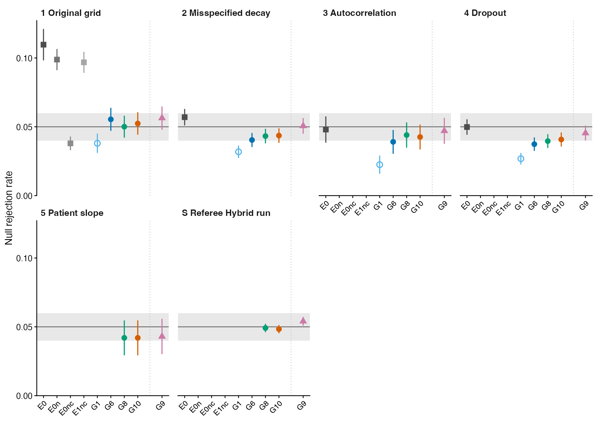
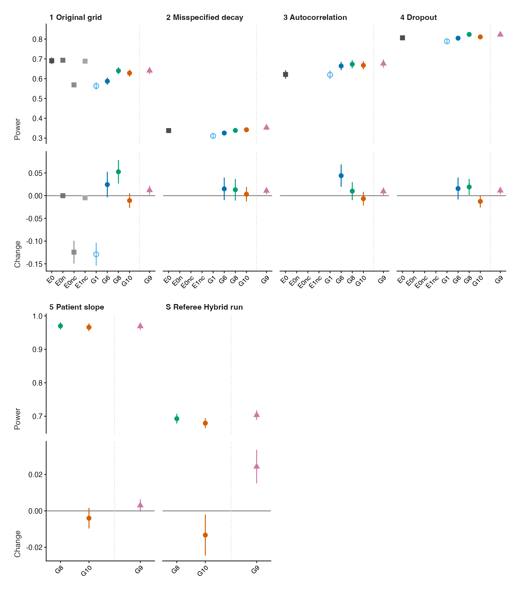
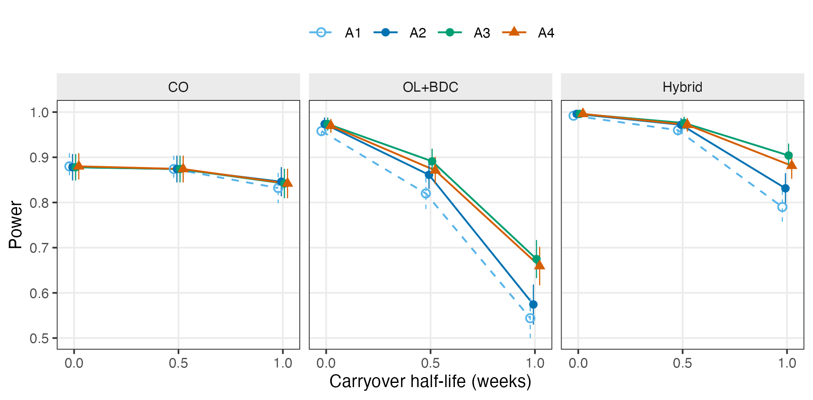
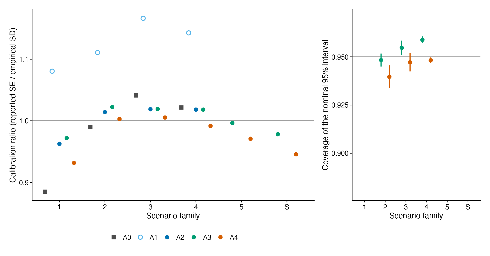
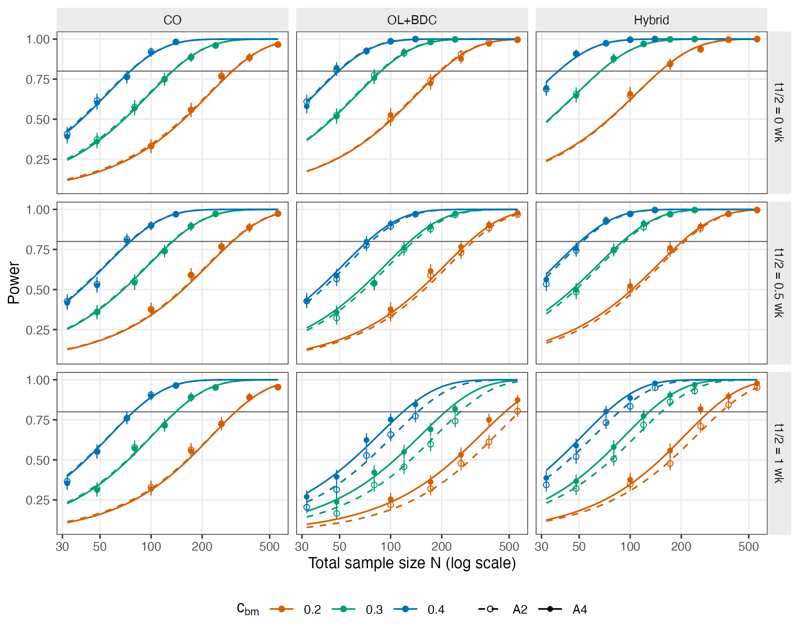

<!--
  Summary of report.Rmd. Every table and figure of the paper, in its
  order, with the same captions. GENERATED: do not edit summary.Rmd.
  Edit summary-template.Rmd and run
    Rscript analysis/report/02-carryover-sensitivity/build-summary.R
  which copies each chunk from report.Rmd by label, so the numbers
  cannot drift. No simulation runs.
-->

```{r setup, include = FALSE}
knitr::opts_chunk$set(
  echo = FALSE,
  warning = FALSE,
  message = FALSE,
  fig.path = "../../figures/02-cache-",
  cache.path = "_cache/"
)
library(tibble)
library(dplyr)
library(tidyr)
library(knitr)
source(here::here(
  'analysis/report/02-carryover-sensitivity/shared-data.R'))
```

# Problem and approach {-}

Aggregated N-of-1 trials pool repeated within-patient on/off contrasts
to validate predictive biomarkers. Drug carryover attenuates the
biomarker-by-treatment interaction. The analyst must decide how to
represent residual exposure, how to obtain a correctly sized test, and
whether the half-life must be known. We ran an exploratory simulation
study under the structure of the recommended DGP, in which the
interaction is a correlation between the biomarker and the drug
response and the biomarker is predictive only. The parameter values
are the simulation core's own set, not the companion paper's (Table
\@ref(tab:tab-params)). An analysis ladder changes one thing per
rung: the starting analysis A0 (rung 0), a binary indicator with
residual AR(1) correlation A1 (rung 1), CR2 inference A2 (rung 2), an
exposure-weighted predictor at the true half-life A3 (rung 3, an
oracle benchmark), and the half-life chosen by AIC on the model
without the interaction A4 (rung 4; G10 in the companion papers). A
biomarker that is also prognostic is the subject of a companion paper
[@pmsimstats_prognostic2026]. Supporting tables S1 to S12 are in the
supplement.

# Simulation design {-}

Table \@ref(tab:tab-families) lists the six scenario families.

```{r tab-families, echo = FALSE}
tab_fam <- tibble::tribble(
  ~Family, ~Scenarios, ~Replicates,
  '1', 'Base 30-cell grid: three designs, $N \\in \\{35, 70\\}$, $c_{bm} \\in \\{0, 0.30, 0.45\\}$, $t_{1/2} \\in \\{0, 0.5, 1\\}$ weeks', '500',
  '2', 'Misspecified half-life ($0.2$, $2$ or $4$ weeks) and decay shape (Weibull $k \\in \\{0.5, 2\\}$), analyzed as exponential', '500',
  '3', 'Serial correlation $\\rho \\in \\{0.5, 0.9\\}$', '500',
  '4', 'Patient-level dropout, completely at random or by baseline severity', '500',
  '5', 'Patient slope variance (SD 0.3 per week), Hybrid, $N = 70$', '1,000',
  'S', 'Hybrid run with independent seeds: A3 and A4, $N \\in \\{35, 70\\}$', '1,000 to 5,000'
)
knitr::kable(tab_fam, booktabs = TRUE, escape = FALSE, linesep = '',
  caption = 'The six scenario families of the ladder comparisons.
    Every biomarker is predictive only. Within a cell every analysis
    is fitted to the same simulated trials; A4 was fitted to the
    stored trials of families 1 to 5 afterward. Family S has
    independent seeds for every cell. the full report
    describes the cells.') |>
  kableExtra::column_spec(2, width = '9.5cm') |>
  kableExtra::kable_styling(font_size = 9)
```

Table \@ref(tab:tab-params) gives the parameter values.

```{r tab-params, echo = FALSE}
## simcore2026 set of simulation-core.R (the driver default under which
## every tracked run of this paper was produced) against the starting
## values of commit 58b32a9 used by the companion paper; both checked by
## 42-check-param-sets.R (referee report 2026-11-08, M2).
pt <- tibble::tribble(
  ~Parameter, ~`This paper`, ~`Companion paper`,
  'Natural history (TV): Gompertz max, rate, displacement',
    '10.99, 0.42, 5', '6.51, 0.35, 5',
  'Placebo response (PB): Gompertz max, rate, displacement',
    '6.51, 0.35, 5', '6.51, 0.35, 5',
  'Drug response (BR): Gompertz max, rate, displacement',
    '10.99, 0.42, 5', '10.99, 0.42, 5',
  'SD of TV, PB, BR', '6, 2, 8', '10, 10, 8',
  'Biomarker: mean, SD', '0, 1', '124.3, 15.4',
  'Baseline severity: mean, SD', '70, 10', '83.1, 18.5',
  'Within-component serial correlation $\\rho$', '0.7', '0.7',
  'Cross-component constant $c_1$', '0.2', '0.2',
  'Biomarker-response correlation $c_{bm}$', '0 to 0.45 by scenario',
    'by scenario')
knitr::kable(pt, booktabs = TRUE, escape = FALSE, linesep = '',
  caption = 'Parameter values of the data-generating process. This
    paper uses the simulation core\'s own set (`simcore2026` in
    `simulation-core.R`). The companion paper\'s recommended DGP uses
    the response and baseline values of the published code with the
    same correlation structure, which is described in the text. The biomarker enters the analysis centered and scaled, so its
    location and scale do not affect the interaction test.') |>
  kableExtra::kable_styling(font_size = 8) |>
  kableExtra::column_spec(1, width = '7cm')
```

Table \@ref(tab:tab-spec-summary) defines the five analyses of the
ladder, A0 to A4.

```{r tab-spec-summary, echo = FALSE}
tex_fix <- function(x) {
  x <- gsub('\\', '\\textbackslash{}', x, fixed = TRUE)
  x <- gsub('{', '\\{', x, fixed = TRUE)
  x <- gsub('}', '\\}', x, fixed = TRUE)
  x <- gsub('~', '$\\sim$', x, fixed = TRUE)
  x <- gsub('%', '\\%', x, fixed = TRUE)
  x
}
## The five rungs, from the ladder CSV (37-ladder-tables-figures.R).
## Formula text that names another analysis by its G code is mapped to
## the A code.
g_to_a_txt <- function(x) {
  for (g in c('G10', 'G8', 'G6', 'G1')) x <- gsub(g, to_a(g), x, fixed = TRUE)
  gsub('\\bE0\\b', 'A0', x, perl = TRUE)
}
stored_code <- c(E0 = 'E0', G1 = 'E1', G6 = 'E1cr2', G8 = 'E2cr2',
                 G10 = 'E7null\\_cr2')
tab_spec <- lad_C |>
  filter(analysis %in% names(stored_code)) |>
  mutate(ord = match(analysis, names(stored_code))) |>
  arrange(ord) |>
  transmute(Analysis = to_a(analysis), Rung = rung,
            Companion = analysis, Stored = stored_code[analysis],
            Formula = tex_fix(g_to_a_txt(formula)),
            Inference = tex_fix(inference),
            Assumptions = tex_fix(assumes))
stopifnot(nrow(tab_spec) == 5, identical(tab_spec$Analysis, a_order))
knitr::kable(tab_spec, booktabs = TRUE, escape = FALSE, linesep = '',
  col.names = c('Analysis', 'Rung', 'Code in companion papers',
                'Stored code', 'Formula', 'Inference', 'Assumptions'),
  caption = 'The five analyses of the ladder. Each rung changes one
    thing from the one before, except the step from A0 to A1. A3 uses
    the true half-life and is an oracle benchmark, not a candidate
    analysis. The companion papers and earlier drafts use the codes in
    the third column; the data files use the stored codes. Sx is the
    symptom score, bm the biomarker, Db the binary on-drug indicator,
    Dbc the exposure-weighted predictor and De the design expectancy.
    Every analysis has a patient random intercept.') |>
  kableExtra::column_spec(1, width = '1.1cm') |>
  kableExtra::column_spec(2, width = '0.8cm') |>
  kableExtra::column_spec(3, width = '1.5cm') |>
  kableExtra::column_spec(4, width = '1.5cm') |>
  kableExtra::column_spec(5, width = '4.0cm') |>
  kableExtra::column_spec(6, width = '2.8cm') |>
  kableExtra::column_spec(7, width = '3.4cm') |>
  kableExtra::kable_styling(font_size = 8, latex_options = 'scale_down')

```

# Results {-}

## The ladder at a glance {-}

```{r ladder-captions, echo = FALSE}
cap_fig1 <- paste0(
  'The size ladder. Each panel is one scenario family (Table ',
  '\\ref{tab:tab-families}). The vertical axis is the null rejection ',
  'rate pooled over the null cells of the family, weighted by ',
  'replicates. The horizontal axis lists the analyses in rung order, ',
  'A0 to A4. Bars are 2 $\\times$ the Monte Carlo standard error. ',
  'The shaded band is 0.04 to 0.06, the two-standard-error band for ',
  'roughly 2,000 replicates. It is a fixed tolerance around 0.05 and ',
  'not a test. An analysis that was not fitted in a family has no ',
  'point.')
cap_fig2 <- paste0(
  'The power ladder. Each panel is one scenario family. A0 is ',
  'omitted because its test is liberal; its size is in Figure ',
  '\\ref{fig:fig-ladder-size}. The upper ',
  'part of a panel is the power at the reference alternative, pooled ',
  'within the family and weighted by replicates. The lower part is ',
  'the paired change in power from the preceding rung on the same ',
  'trials. The horizontal axis is in rung order as in Figure ',
  '\\ref{fig:fig-ladder-size}. Each row shares one vertical scale ',
  'across all families, so heights can be compared between panels. ',
  'The open circle marks A1, which uses the working-covariance ',
  'standard error; filled circles use CR2. Families 5 and S fitted ',
  'A3 and A4 only. Bars are 2 $\\times$ the Monte Carlo ',
  'standard error, and the paired standard error for the changes. ',
  'Paired standard errors are conservative because cells within a ',
  'job share random-number streams.')
cap_fig3 <- paste0(
  'Calibration and coverage. Left: the calibration ratio, the mean ',
  'reported standard error divided by the empirical standard ',
  'deviation of the estimates, averaged without weights over the ',
  'cells of each scenario family, by analysis. A value of one is ',
  'calibrated and a value above one is conservative. Right: the ',
  'coverage of the nominal 95 percent interval of A3 and A4 in ',
  'families 2 to 4, as the mean of the cell lower bounds and upper ',
  'bounds. The bars span the two bounds. The coverage bounds are ',
  'not Monte Carlo intervals. Families 1, 5 and S have no coverage ',
  'output.')
```

Figure \@ref(fig:fig-ladder-size) gives size by family.

```{r fig-ladder-size, echo = FALSE, fig.cap = cap_fig1, out.width = '100%'}

```

```{r glance-size-numbers, echo = FALSE}
e0_sz <- fam_size('E0')
g10_sz <- fam_size('G10')
g8_sz <- fam_size('G8')
e0_out <- sum(e0_sz > 0.06 | e0_sz < 0.04)
g10_in <- sum(g10_sz >= 0.04 & g10_sz <= 0.06)
g8_in <- sum(g8_sz >= 0.04 & g8_sz <= 0.06)
```

A4 lies in the 0.04 to 0.06 band in `r g10_in` of `r length(g10_sz)`
families; A0 lies outside it in `r e0_out` of `r length(e0_sz)`.
Figure \@ref(fig:fig-ladder-power) gives power and the paired change
at each step.

```{r fig-ladder-power, echo = FALSE, fig.cap = cap_fig2, out.width = '100%'}

```

Table \@ref(tab:tab-ladder-inc) gives the paired increments. In the
base grid, choosing the half-life on the model without the
interaction changes power against the oracle by
`r fs3(inc('G8>G10'))` (paired SE `r f3(inc('G8>G10', w = 'power_se'))`).

```{r tab-ladder-inc, echo = FALSE}
## The four core steps of the ladder only.
A_ord <- lad_A |>
  filter(kind == 'core') |>
  mutate(ord = match(to, c('G1', 'G6', 'G8', 'G10'))) |>
  arrange(ord)
stopifnot(nrow(A_ord) == 4, !anyNA(A_ord$ord))
A_rows <- do.call(rbind, lapply(seq_len(nrow(A_ord)), function(i) {
  r <- A_ord[i, ]
  data.frame(
    Step = c(sprintf('%s to %s', to_a(r$from), to_a(r$to)), ''),
    Measure = c('Size', 'Power'),
    rbind(unlist(r[paste0('family', fam_ids, '_size')]),
          if (r$from == 'E0') rep('--', length(fam_ids)) else
            unlist(r[paste0('family', fam_ids, '_power')])),
    stringsAsFactors = FALSE, check.names = FALSE)
}))
names(A_rows)[2 + seq_along(fam_ids)] <- fam_ids
knitr::kable(A_rows, booktabs = TRUE, escape = FALSE, linesep = '',
  row.names = FALSE,
  caption = 'Paired increments along the ladder. Each cell is the
    later analysis minus the earlier one, with its paired standard
    error in parentheses, for size (pooled null rejection rate) and
    power (pooled reference alternative), by scenario family. A dash
    means the step has no data in that family. The standard errors
    are conservative because cells within a job share random-number
    streams. The step from A0 to A1 changes three things at once; its
    power change is not shown because A0 is liberal.') |>
  kableExtra::add_header_above(c(' ' = 2,
                                 'Scenario family' = length(fam_ids))) |>
  kableExtra::kable_styling(font_size = 7,
                            latex_options = 'scale_down')

```

## Rungs 0 to 2: residual correlation and CR2 inference {-}

A0 is liberal under CO and OL+BDC (Table S1), and its missing
residual correlation accounts for the whole inflation (Table S2). The
working-covariance test of A1 is conservative; CR2 (A2) restores
nominal size (Table S3). Figures \@ref(fig:fig-hendrickson-a) and
\@ref(fig:fig-hendrickson-b) give power for the five analyses on the
corrected grid.

```{r fig-hendrickson-a, echo = FALSE, fig.cap = "Power by trial design (columns), $N$ (row blocks) and analysis (rows within block) across $c_{bm} \\in \\{0, 0.30, 0.45\\}$ at $t_{1/2} = 1.0$ weeks, exponential DGP, corrected simulation code ($n_{sim} = 500$). The $c_{bm} = 0$ column is Type I error. A4 was fitted afterward to the same simulated trials. A0 is omitted because its test is liberal; its size is in Figure \\ref{fig:fig-ladder-size} and Table S1.", out.width = "95%"}
knitr::include_graphics("../../figures/02-heatmap-ladder-a.pdf")
```

```{r fig-hendrickson-b, echo = FALSE, fig.cap = "Power across $t_{1/2} \\in \\{0, 0.5, 1.0\\}$ weeks at $c_{bm} = 0.45$, exponential DGP, corrected simulation code ($n_{sim} = 500$).", out.width = "95%"}
knitr::include_graphics("../../figures/02-heatmap-ladder-b.pdf")
```

```{r stage3-numbers, echo = FALSE}
hy <- s27 |> filter(design == 'Hybrid', c_bm == 0.45)
p_hy <- function(m, n, h) hy$reject[hy$method == m & hy$N == n & hy$t1half == h]
## Change in power from adding CR2, by design, over the alternative
## cells of the 30-cell grid.
cr2_pair <- c(E1 = 'E1cr2', E2 = 'E2cr2')
cr2_gain <- s27 |> filter(c_bm > 0, method %in% c(names(cr2_pair), cr2_pair)) |>
  mutate(base = ifelse(method %in% cr2_pair,
                       names(cr2_pair)[match(method, cr2_pair)], method),
         cr2 = method %in% cr2_pair) |>
  select(design, N, c_bm, t1half, base, cr2, reject) |>
  pivot_wider(names_from = cr2, values_from = reject, names_prefix = 'cr2_') |>
  mutate(gain = cr2_TRUE - cr2_FALSE) |>
  group_by(design) |>
  summarise(mean_gain = mean(gain), min_gain = min(gain), .groups = 'drop')
cg <- function(d, w) cr2_gain[[w]][cr2_gain$design == d]
```

## Rung 3: exposure weighting {-}

```{r ref-cell-compute, echo = FALSE}
a27 <- readRDS(here::here(
  'analysis/data/carryover-sensitivity/tier1-g-vs-f-e0/all.rds')) |>
  bind_rows(a27_g10)
ref_lab <- c(E1 = 'G1', E1cr2 = 'G6', E2 = 'G3', E2cr2 = 'G8',
             E7 = 'G4', E7cr2 = 'G9', E0 = 'E0', E7null_cr2 = 'G10')
theta_true <- -0.45 * 8
cell27 <- a27 |>
  filter(method %in% names(ref_lab), design %in% c('CO', 'OLBDC', 'Hybrid'),
         converged, !is.na(p_value)) |>
  group_by(design, N, c_bm, t1half, method) |>
  summarise(n = n(), reject = mean(p_value < 0.05),
            mean_est = mean(estimate), emp_sd = sd(estimate),
            mean_se = mean(std_error), .groups = 'drop') |>
  mutate(mcse = sqrt(reject * (1 - reject) / n),
         kappa = mean_se / emp_sd)
nonconv27 <- a27 |>
  filter(method %in% names(ref_lab)) |>
  group_by(design, N, c_bm, t1half, method) |>
  summarise(nonconv = mean(!converged | is.na(p_value)), .groups = 'drop')
cell27 <- left_join(cell27, nonconv27,
                    by = c('design', 'N', 'c_bm', 't1half', 'method'))
## The per-replicate rejection rates must reproduce the stored summary.
chk27 <- inner_join(cell27, s27 |> select(design, N, c_bm, t1half, method,
                                          reject_s = reject),
                    by = c('design', 'N', 'c_bm', 't1half', 'method'))
stopifnot(nrow(chk27) == nrow(cell27),
          max(abs(chk27$reject - chk27$reject_s)) < 1e-9)
c27 <- function(d, m, h, cb = 0.45, nn = 70) {
  x <- cell27 |> filter(design == d, method == m, t1half == h,
                        c_bm == cb, N == nn)
  stopifnot(nrow(x) == 1)
  x
}
## Paired contrast of two analyses on the same replicates.
pair27 <- function(d, mA, mB, hh, cb = 0.45, nn = 70) {
  x <- a27 |>
    filter(design == d, N == nn, c_bm == cb, t1half == hh,
           method %in% c(mA, mB), converged, !is.na(p_value)) |>
    mutate(rej = p_value < 0.05) |>
    select(rep, method, rej) |>
    pivot_wider(names_from = method, values_from = rej) |>
    na.omit()
  dd <- as.numeric(x[[mA]]) - as.numeric(x[[mB]])
  list(diff = mean(dd), se = sd(dd) / sqrt(length(dd)),
       only_a = sum(x[[mA]] & !x[[mB]]), only_b = sum(!x[[mA]] & x[[mB]]))
}
```

Table \@ref(tab:tab-ref-cell) gives the reference cell and Figure
\@ref(fig:fig-power-by-half-life) power against the half-life.

```{r tab-ref-cell, echo = FALSE}
ref_tab <- lapply(c(0, 0.5, 1), function(h) {
  lapply(c('E0', 'E1', 'E1cr2', 'E2cr2', 'E7null_cr2'), function(m) {
    x <- c27('Hybrid', m, h)
    nul <- cell27 |> filter(design == 'Hybrid', method == m, c_bm == 0,
                            t1half == h, N == 70)
    est <- m %in% c('E2cr2', 'E7null_cr2')
    data.frame(
      `$t_{1/2}$` = sprintf('%.1f', h), Analysis = to_a(m),
      Power = if (m == 'E0') '--' else sprintf('%.3f (%.3f)', x$reject, x$mcse),
      `Type I` = if (nrow(nul) == 1) sprintf('%.3f (%.3f)', nul$reject, nul$mcse) else '--',
      `Empirical SD` = if (m == 'E0') '--' else sprintf('%.2f', x$emp_sd),
      `Mean SE` = if (m == 'E0') '--' else sprintf('%.2f', x$mean_se),
      `$\\kappa$` = if (m == 'E0') '--' else sprintf('%.2f', x$kappa),
      Bias = if (est) sprintf('%+.2f', x$mean_est - theta_true) else '--',
      `Non-conv` = sprintf('%.3f', x$nonconv),
      check.names = FALSE, stringsAsFactors = FALSE)
  })
}) |> unlist(recursive = FALSE) |> bind_rows()
ref_tab <- ref_tab |>
  mutate(order_a = match(Analysis, a_order),
         order_h = as.numeric(`$t_{1/2}$`)) |>
  arrange(order_h, order_a) |>
  select(-order_a, -order_h)
ref_tab$`$t_{1/2}$`[duplicated(ref_tab$`$t_{1/2}$`)] <- ''
knitr::kable(ref_tab, booktabs = TRUE, escape = FALSE, linesep = '',
  caption = 'Reference cell on the corrected 30-cell grid (job 27:
    Hybrid, $N = 70$, $c_{bm} = 0.45$, exponential decay, 500
    replicates, every analysis fitted to the same trials; A4 fitted
    afterward to the same trials). Power is
    the rejection rate of $H_0: \\beta_{bm:X} = 0$ at $\\alpha =
    0.05$ with its Monte Carlo standard error. Type I is the
    rejection rate in the null cell of the same design and $N$. That
    cell exists only at $t_{1/2} = 1$ week. Empirical SD is the
    standard deviation of the point estimates and Mean SE the mean
    reported standard error. $\\kappa$ is their ratio. Bias is the mean
    estimate minus $\\theta = -c_{bm} \\cdot 8 = -3.6$ and is shown
    only for the exposure-weighted analyses A3 and A4. A1 and A2
    estimate the coefficient of the binary indicator, which is a
    different quantity. A0 is shown for size only, because its test is
    liberal and its power is not comparable. A1
    uses the working-covariance standard error; A2, A3 and A4 use CR2.
    Non-conv is the fraction of fits that did not converge or gave
    no $p$-value.') |>
  kableExtra::kable_styling(font_size = 8, latex_options = 'scale_down')
```

```{r fig-power-by-half-life, echo = FALSE, fig.cap = 'Power against carryover half-life by analysis and design (job 27: $N = 70$, $c_{bm} = 0.45$, exponential decay, 500 replicates). A0 is omitted because its test is liberal. The analyses are A1 (binary indicator, working-covariance standard error); A2 (binary indicator, CR2); A3 (exposure-weighted at the true half-life, CR2); and A4 (exposure-weighted at the half-life chosen by AIC without the interaction, CR2), fitted afterward to the same trials. Points at each half-life are offset horizontally for legibility. Bars are 2 $\\times$ the Monte Carlo standard error.', out.width = '100%'}

```

```{r rung3-numbers, echo = FALSE}
## Job 26 (full factorial): decay-form comparison of G3 against G1.
sl <- grid |> filter(dgp_arch == 'mvn',
                     carryover_form %in% c('exponential', 'weibull'),
                     !(carryover_form == 'weibull' & weibull_shape == 1),
                     spec %in% c('E1', 'E2'))
w_cmp <- sl |>
  select(design, N, c_bm, t1half, carryover_form, weibull_shape, spec,
         power) |>
  pivot_wider(names_from = spec, values_from = power)
g3_below <- w_cmp |> filter(c_bm > 0, E2 < E1)
g3_min_diff <- min(w_cmp$E2[w_cmp$c_bm > 0] - w_cmp$E1[w_cmp$c_bm > 0])
w1 <- grid |> filter(dgp_arch == 'mvn', spec %in% c('E1', 'E2'),
                     (carryover_form == 'exponential') |
                       (carryover_form == 'weibull' & weibull_shape == 1)) |>
  select(design, N, c_bm, t1half, carryover_form, spec, power) |>
  pivot_wider(names_from = carryover_form, values_from = power)
twin_max <- max(abs(w1$weibull - w1$exponential))
null_mean <- grid |>
  filter(dgp_arch == 'mvn', carryover_form == 'exponential', c_bm == 0,
         spec %in% c('E1', 'E2')) |>
  summarise(m = mean(power), lo = min(power), hi = max(power))
## Job 26: relative loss of G1 from t1/2 = 0, by design, across N and c_bm.
rl <- grid |> filter(dgp_arch == 'mvn', carryover_form == 'exponential',
                     spec == 'E1', c_bm > 0) |>
  select(design, N, c_bm, t1half, power) |>
  pivot_wider(names_from = t1half, values_from = power, names_prefix = 'h') |>
  mutate(loss1 = 1 - h1 / h0, loss05 = 1 - h0.5 / h0) |>
  group_by(design) |>
  summarise(lo1 = min(loss1), hi1 = max(loss1),
            lo05 = min(loss05), hi05 = max(loss05), .groups = 'drop')
rl_txt <- function(d, h) {
  r <- rl[rl$design == d, ]
  ## Round first so that a small gain prints as 0, not -0.
  p <- function(x) sprintf('%.0f%%', round(100 * x) + 0)
  if (h == 1) paste(p(r$lo1), 'to', p(r$hi1))
  else paste(p(r$lo05), 'to', p(r$hi05))
}
pr_hy_g8_g6 <- pair27('Hybrid', 'E2cr2', 'E1cr2', 1)
pr_hy_g3_g1 <- pair27('Hybrid', 'E2', 'E1', 1)
## Share of G6's loss from t1/2 = 0 to 1 week that G8 recovers, job 27,
## c_bm = 0.45 (referee report 2026-11-08, M1).
rec27 <- expand.grid(design = c('Hybrid', 'OLBDC'), nn = c(35, 70),
                     stringsAsFactors = FALSE)
rec27$loss <- mapply(function(d, n) c27(d, 'E1cr2', 0, nn = n)$reject -
                       c27(d, 'E1cr2', 1, nn = n)$reject,
                     rec27$design, rec27$nn)
rec27$gain <- mapply(function(d, n) c27(d, 'E2cr2', 1, nn = n)$reject -
                       c27(d, 'E1cr2', 1, nn = n)$reject,
                     rec27$design, rec27$nn)
rec27$share <- rec27$gain / rec27$loss
stopifnot(all(rec27$share < 0.5))
rec_txt <- function(d) {
  r <- rec27[rec27$design == d, ]
  sprintf('%.0f%% to %.0f%%', 100 * min(r$share), 100 * max(r$share))
}
```

Exposure weighting recovers only part of the loss. At a one-week
half-life A3 recovers `r rec_txt('Hybrid')` of A2's loss under Hybrid
and `r rec_txt('OLBDC')` under OL+BDC. A3 uses the true half-life and
decay form, so the rest has to be met by the design.

## Rung 4: choosing the half-life {-}

```{r stage3-variants-numbers, echo = FALSE}
if (has_rv) {
  dN <- function(m) rvNp |> filter(method == m, is.na(h_fixed)) |>
    pull(diff_vs_g8)
  sN <- function(m) rvNp |> filter(method == m, is.na(h_fixed)) |>
    pull(paired_se)
  pA <- function(m) rvA |> filter(method == m) |>
    arrange(t1half, c_bm, N) |> pull(reject)
  g8A <- rvA |> filter(method == 'E2cr2') |> arrange(t1half, c_bm, N)
  dA <- function(m) pA(m) - g8A$reject
  kA <- function(m) range(rvA$kappa[rvA$method == m])
  ## The text says A4 is within one paired SE of A3 at every null cell
  ## and below A3 at every alternative cell of family S.
  stopifnot(all(abs(dN('E7null_cr2')) <= sN('E7null_cr2')),
            all(dA('E7null_cr2') < 0))
}
```

Pooled by family, A4 changes power against the oracle A3 by
`r inc_rng('G8>G10', 'power_diff')` and size by
`r inc_rng('G8>G10', 'size_diff')`. The selection does not recover the
half-life (Table S4). In the Hybrid run with independent seeds A4
differs from A3 under the null by
`r if (has_rv) sprintf('%+.4f', min(dN('E7null_cr2')))` to
`r if (has_rv) sprintf('%+.4f', max(dN('E7null_cr2')))` (Tables S5
and S6).

## Stress scenarios {-}

The misspecification cells and scenario grids are in Tables S7 to S10.
Table \@ref(tab:stage4-dropout) imposes monotone dropout.

```{r stage4-dropout, echo = FALSE}
sD <- sgf |>
  filter(sub == 'A1-dropout', dropout_per == 'patient') |>
  mutate(Method = to_a(method))
dtab <- sD |>
  filter(method %in% focus) |>
  mutate(part = ifelse(c_bm == 0, 'null', 'alt')) |>
  arrange(N, dropout_mech, dropout_rate) |>
  mutate(Cell = sprintf('%s %.1f, $N = %d$', dropout_mech,
                        dropout_rate, N)) |>
  select(Cell, part, Method, reject) |>
  pivot_wider(names_from = c(part, Method), values_from = reject) |>
  select(Cell, all_of(paste0('null_', a_order)),
         all_of(paste0('alt_', setdiff(a_order, 'A0')))) |>
  mutate(across(-Cell, fmt3))
stopifnot(nrow(dtab) == 12)
knitr::kable(dtab, booktabs = TRUE, escape = FALSE,
  col.names = c('Dropout (rate, $N$)', a_order, setdiff(a_order, 'A0')),
  caption = 'Type I error and power under monotone dropout
    (Hybrid, $t_{1/2} = 0.5$ week; the rate is the fraction of
    patients with an incomplete series; $n_{sim} = 500$; band $[0.031,
    0.069]$). A4 was fitted afterward to the same trials. A0 has no
    power column because its test is liberal.') |>
  kableExtra::add_header_above(
    c(' ' = 1, 'Type I error' = 5, 'Power, $c_{bm} = 0.45$' = 4),
    escape = FALSE) |>
  kableExtra::kable_styling(font_size = 8, latex_options = 'scale_down')

```

```{r stage4-dropout-numbers, echo = FALSE}
dn <- function(d, m, alt) d |>
  filter(method == m, if (alt) c_bm > 0 else c_bm == 0)
g10n <- dn(sD, 'E7null_cr2', FALSE); g10a <- dn(sD, 'E7null_cr2', TRUE)
g1n <- dn(sD, 'E1', FALSE); g1a <- dn(sD, 'E1', TRUE)
e0n <- dn(sD, 'E0', FALSE)
vs <- function(x, y) x$reject - y$reject[match(x$cell_id, y$cell_id)]
gap_g1 <- vs(g10a, g1a)
## No-dropout reference: the same Hybrid cell (c_bm 0.45, t1/2 0.5 week)
## in the independent-seed run of block A, which has no prognostic
## pathway. The comparison is unpaired.
ref_g10 <- rvA |> filter(method == 'E7null_cr2', c_bm == 0.45, t1half == 0.5)
r35 <- ref_g10$reject[ref_g10$N == 35]; r70 <- ref_g10$reject[ref_g10$N == 70]
stopifnot(length(r35) == 1, length(r70) == 1)
in_band <- function(x) sum(x >= 0.031 & x <= 0.069)
sO <- sgf |> filter(sub == 'A1-dropout', dropout_per == 'occasion')
## A4 was not fitted to the per-occasion cells; A3 is reported.
o3n <- dn(sO, 'E2cr2', FALSE); o3a <- dn(sO, 'E2cr2', TRUE)
o1a <- dn(sO, 'E1', TRUE)
## Mean kappa at alternative cells by method and N, across the
## patient-level dropout block and the scenario grids.
kap <- sgf |>
  filter(c_bm > 0, sub %in% c('A1-dropout', 'B1-shape', 'B2-halflife', 'B4-rho'),
         !(sub == 'A1-dropout' & dropout_per == 'occasion'),
         method %in% c('E1cr2', 'E2cr2', 'E7null_cr2')) |>
  group_by(method, N) |>
  summarise(k = mean(kappa), kmin = min(kappa), .groups = 'drop')
kp <- function(m, n, w = 'k') kap[[w]][kap$method == m & kap$N == n]
```

The A4 Type I error under dropout is `r fmt3(min(g10n$reject))` to
`r fmt3(max(g10n$reject))`. The heavy-missingness case and the
patient-specific linear trend are in Tables S11 and S12.

## Calibration and coverage {-}

Figure \@ref(fig:fig-ladder-calibration) gives the calibration ratio
and Table \@ref(tab:stage3-coverage) the coverage of A3 and A4.

```{r fig-ladder-calibration, echo = FALSE, fig.cap = cap_fig3, out.width = '100%'}

```

```{r calib-numbers, echo = FALSE}
kr <- function(a) lad_fam |> filter(analysis == a, quantity == 'kappa') |>
  pull(value)
cvr <- function(a) lad_fam |> filter(analysis == a, quantity == 'coverage',
                                     family %in% c('2', '3', '4')) |>
  pull(value)
```

```{r stage3-coverage, echo = FALSE}
if (file.exists(file.path(rr_dir, 'm3-coverage.csv'))) {
  ## The stored summary rows also pool the prognostic C1 cells, which
  ## belong to the companion paper, and the per-occasion dropout cells
  ## of job 31 (A1-dropout without the -pt suffix), the heavy-missingness
  ## case, so the summary is recomputed here.
  m3c <- read.csv(file.path(rr_dir, 'm3-coverage.csv')) |>
    filter(level == 'cell', dgp_arch == 'mvn', sub != 'C1-ladder',
           !(sub == 'A1-dropout' & !grepl('-pt$', cell_id))) |>
    group_by(method, N) |>
    summarise(cells = n(), lo = mean(coverage_lower),
              hi = mean(coverage_upper), mn = min(coverage_lower),
              .groups = 'drop')
  ## G10 from the per-replicate refits of 41-run-g10-backfill.R, same
  ## method, same cells (43-g10-coverage.R; referee report 2026-11-08,
  ## M5).
  m5c <- read.csv(file.path(rr_dir, 'm5-coverage-g10.csv')) |>
    filter(level == 'cell', method == 'G10') |>
    group_by(method, N) |>
    summarise(cells = n(), lo = mean(coverage_lower),
              hi = mean(coverage_upper), mn = min(coverage_lower),
              .groups = 'drop')
  stopifnot(identical(sort(unique(m5c$cells)), sort(unique(m3c$cells))))
  m3c <- bind_rows(m3c, m5c) |>
    arrange(match(method, c('G8', 'G10', 'G9')), N)
  m3c_g10 <- m3c |> filter(method == 'G10')
  m3c <- m3c |>
    filter(method %in% c('G8', 'G10')) |>
    transmute(Method = to_a(method), `$N$` = N, Cells = cells,
              `Mean coverage (lower, upper)` = sprintf('%.3f, %.3f', lo, hi),
              `Minimum (lower)` = sprintf('%.3f', mn))
  knitr::kable(m3c, booktabs = TRUE, escape = FALSE, linesep = '',
    caption = 'Coverage of the nominal 95 percent CR2 interval for A3
      and A4 over the predictive-only alternative cells of the
      supplementary study without heavy missingness, on the
      calibrated scale ($\\theta = -c_{bm}\\sigma_{BR}$). The
      Satterthwaite degrees of freedom are not stored per replicate
      and were recovered from the stored $t$ and $p$ where $|t| \\ge
      0.5$; the remaining replicates are classified as covering, not
      covering, or ambiguous, which gives the lower and upper bounds.
      A3 from `34-referee-reanalysis.R`, A4 from
      `43-g10-coverage.R`.') |>
    kableExtra::kable_styling(font_size = 9)
}
```

## Which analysis to use {-}

Table \@ref(tab:tab-ladder-score) scores the analyses over the
families.

```{r tab-ladder-score, echo = FALSE}
tex_cell <- function(x) {
  x <- gsub('%', ' percent', x, fixed = TRUE)
  x <- gsub(' | ', ', ', x, fixed = TRUE)
  x <- gsub('t1/2=', '$t_{1/2}$ = ', x, fixed = TRUE)
  x <- gsub('cbm=', '$c_{bm}$ = ', x, fixed = TRUE)
  x <- gsub('rho=', '$\\rho$ = ', x, fixed = TRUE)
  x <- gsub('N=', '$N$ = ', x, fixed = TRUE)
  x <- gsub('k=', '$k$ = ', x, fixed = TRUE)
  x <- gsub('(^|, )t=', '\\1$t_{1/2}$ = ', x)
  x
}
lad_B2 <- lad_B |>
  filter(analysis %in% c('E0', 'G1', 'G6', 'G8', 'G10')) |>
  arrange(match(analysis, c('E0', 'G1', 'G6', 'G8', 'G10'))) |>
  transmute(
    Analysis = to_a(analysis),
    `Families in band` = size_in_band,
    `Smallest size` = sprintf('%.3f', min_size),
    `Largest size (cell)` = sprintf('%.3f (%s)', max_size,
                                    tex_cell(max_size_cell)),
    `Power, percent of A4` = ifelse(is.na(mean_power_pct_of_g10) |
                                      analysis == 'E0', '--',
      sprintf('%.1f', mean_power_pct_of_g10)),
    `Worst family loss, points (family)` = ifelse(
      analysis == 'E0', '--', ifelse(is.na(worst_family), '0',
      sprintf('%.1f (%s)', worst_family_power_loss_pp, worst_family))),
    `Worst cell loss, points (cell)` = ifelse(
      analysis == 'E0', '--', ifelse(is.na(worst_cell), '0',
      sprintf('%.1f (%s)', worst_cell_power_loss_pp, tex_cell(worst_cell)))),
    Coverage = ifelse(is.na(coverage_mean), '--',
                      sprintf('%.3f', coverage_mean)))
knitr::kable(lad_B2, booktabs = TRUE, escape = FALSE, linesep = '',
  caption = 'Scoreboard of the analyses over the scenario families.
    Families in band counts the families whose pooled null rejection
    rate lies in 0.04 to 0.06, out of the families in which the
    analysis was fitted; it is descriptive and does not separate the
    analyses (Table \\ref{tab:tab-size-equiv} compares size with the
    oracle directly). Smallest and largest size are cell-level
    null rejection rates. Power is the mean over families of the
    pooled power as a percent of A4 in the same family. The worst
    power loss is against A4 in points of power, by family and by
    cell; a negative value is a gain. Coverage is the mean of the
    nominal 95 percent interval over families with coverage output
    (A3 and A4 only). A dash means not available; the power columns of
    A0 are dashed because its test is liberal. A4 is the reference, so
    its losses are zero.') |>
  kableExtra::column_spec(1, width = '1.2cm') |>
  kableExtra::column_spec(2, width = '1.1cm') |>
  kableExtra::column_spec(3, width = '1.0cm') |>
  kableExtra::column_spec(4, width = '3.1cm') |>
  kableExtra::column_spec(5, width = '1.2cm') |>
  kableExtra::column_spec(6, width = '1.5cm') |>
  kableExtra::column_spec(7, width = '3.1cm') |>
  kableExtra::column_spec(8, width = '1.2cm') |>
  kableExtra::kable_styling(font_size = 7)
```

```{r which-numbers, echo = FALSE}
bv <- function(a, col) lad_B[[col]][lad_B$analysis == a]
## Equivalence of G10's size to the oracle G8 (referee report
## 2026-11-08, M6): paired difference per family with a 90 percent
## interval, which is the two one-sided tests at the 5 percent level.
## The paired SE is the replicate-weighted mean of cell SEs, an upper
## bound, so the interval is conservative. The margin of 0.01 was
## chosen after the results were seen.
eq_margin <- 0.01
eq <- lad_An |>
  filter(step_id == 'G8>G10') |>
  select(step_id, family, size_diff, size_se) |>
  mutate(lo = size_diff - qnorm(0.95) * size_se,
         hi = size_diff + qnorm(0.95) * size_se,
         equiv = lo > -eq_margin & hi < eq_margin)
eq10 <- eq |> filter(step_id == 'G8>G10')
stopifnot(nrow(eq10) == 6, eq10$equiv[eq10$family == 'S'])
fam_ord <- c('S', '1', '2', '3', '4', '5')
g8_low <- lad_fam |> filter(analysis == 'G8', quantity == 'size') |>
  slice_min(value, n = 1)
## The text says G10 is in band everywhere and G8 misses once.
stopifnot(bv('G10', 'families_size_in_band') == 6,
          bv('G8', 'families_size_in_band') == 5)
```

The band counts do not separate the analyses. Table
\@ref(tab:tab-size-equiv) compares the size of A4 with the oracle's
directly.

```{r tab-size-equiv, echo = FALSE}
te <- eq10 |>
  arrange(match(family, fam_ord)) |>
  mutate(size_diff = ifelse(abs(size_diff) < 1e-9, 0, size_diff)) |>
  transmute(
    Family = ifelse(family == '5', '5 (one cell)',
                    ifelse(family == 'S', 'S (independent seeds)', family)),
    `A4 $-$ A3` = sprintf('%+.4f', size_diff),
    `Paired SE` = sprintf('%.4f', size_se),
    `90\\% interval` = sprintf('%+.4f to %+.4f', lo, hi),
    `Within $\\pm 0.01$` = ifelse(equiv, 'yes', 'no'))
knitr::kable(te, booktabs = TRUE, escape = FALSE, linesep = '',
  caption = 'Size of A4 against the oracle A3, by family: the paired
    difference in null rejection rate on the same trials, its paired
    standard error, and the 90 percent interval. An interval inside
    $\\pm 0.01$ is equivalence by two one-sided tests at the 5 percent
    level. The paired SE is the replicate-weighted mean of the cell
    SEs, an upper bound, so the interval is conservative. The margin
    was chosen after the results were seen. Family S has
    independent seeds per cell; the cells of families 2 to 4 share
    random-number streams.') |>
  kableExtra::kable_styling(font_size = 8)
```

## Sample size for A4 {-}

Table \@ref(tab:tab-sample-size) gives the total $N$ for 80 percent
power of A4, and Figure \@ref(fig:fig-sample-size) the power curves
under this paper's parameter set. At a 1-week half-life the binary
indicator (A2) needs `r ssr('Hybrid', 1)` percent more patients than
A4 in the Hybrid design. Under the starting values of the companion
paper the required $N$ is roughly twice as large, and it depends
strongly on the serial correlation (Table S13 of the supplement).

```{r tab-sample-size, echo = FALSE}
ss_tab <- ss_n80 |>
  filter(analysis == 'A4', c_bm %in% c(0.2, 0.3, 0.4)) |>
  mutate(cell = sprintf('%d (%d--%d)', as.integer(ceiling(N80)),
                        as.integer(ceiling(N80_lo)),
                        as.integer(ceiling(N80_hi))),
         col = sprintf('%s_%.1f', params, c_bm)) |>
  select(design, t1half, col, cell) |>
  pivot_wider(names_from = col, values_from = cell) |>
  arrange(match(design, c('CO', 'OLBDC', 'Hybrid')), t1half) |>
  mutate(design = design_lab[design], t1half = sprintf('%.1f', t1half)) |>
  select(design, t1half, simcore2026_0.2, simcore2026_0.3,
         simcore2026_0.4, published_0.2, published_0.3, published_0.4)
stopifnot(nrow(ss_tab) == 9, !anyNA(ss_tab))
ss_tab$design[duplicated(ss_tab$design)] <- ''
knitr::kable(ss_tab, booktabs = TRUE, escape = FALSE, linesep = '',
  col.names = c('Design', '$t_{1/2}$', '0.2', '0.3', '0.4', '0.2', '0.3',
                '0.4'),
  caption = paste0('Total $N$ for 80 percent power of A4 at $\\alpha =
    0.05$, with a 95 percent Monte Carlo interval, by design, carryover
    half-life (weeks) and $c_{bm}$, under the parameter set of this
    paper and under the starting values of the companion paper. From
    a probit curve in $c_{bm}\\sqrt{N}$ fitted to five values of $N$ per
    $c_{bm}$, ', ss_reps, ' replicates each; the interval does not
    include the approximation of the curve model (about 6 percent).
    $\\rho = 0.7$, exponential decay, complete data, predictive-only
    biomarker.')) |>
  kableExtra::add_header_above(c(' ' = 2, 'This paper, $c_{bm}$' = 3,
                                 'Starting values, $c_{bm}$' = 3),
                               escape = FALSE) |>
  kableExtra::kable_styling(font_size = 8, latex_options = 'scale_down')
```

```{r fig-sample-size, echo = FALSE, fig.cap = 'Power of A4 (filled points, solid lines) and A2 (open points, dashed lines) against total $N$ under the parameter set of this paper, by design (columns) and carryover half-life (rows), for $c_{bm} \\in \\{0.2, 0.3, 0.4\\}$. Points are simulated rejection rates (500 replicates) with 2 $\\times$ the Monte Carlo standard error; lines are the fitted probit curves in $c_{bm}\\sqrt{N}$. The horizontal line is 80 percent power. The same figure under the starting values is Figure S1.', out.width = '100%'}

```

# Recommendation {-}

For a Hybrid trial with a biomarker known to be predictive only, at
$N \le 70$, use A4: the exposure-weighted predictor with the
half-life chosen by AIC on the model without the interaction,
refitted by REML with the interaction and tested with CR2. Its size is
equivalent to the oracle's within $\pm 0.01$ in the run with
independent seeds and in `r sum(eq10$equiv) - 1` of the other five
families. In the Hybrid cells it gains
`r sprintf('%.1f', 100 * hy_d_mean)` points of power over A2 on
average, up to `r sprintf('%.1f', 100 * hy_max)` at long half-lives,
and is behind by at most `r sprintf('%.1f', -100 * hy_min)` point in
`r hy_below` cells.

Whether a biomarker is also prognostic is rarely known before a
trial. For a biomarker of unknown role the default is the analysis of
the companion paper [@pmsimstats_prognostic2026], which shares A4's
exposure-weighted predictor, half-life rule and CR2 test. The
recommendation is conditional on the correlation encoding, on one
parameter set and on one design.

# References {-}
