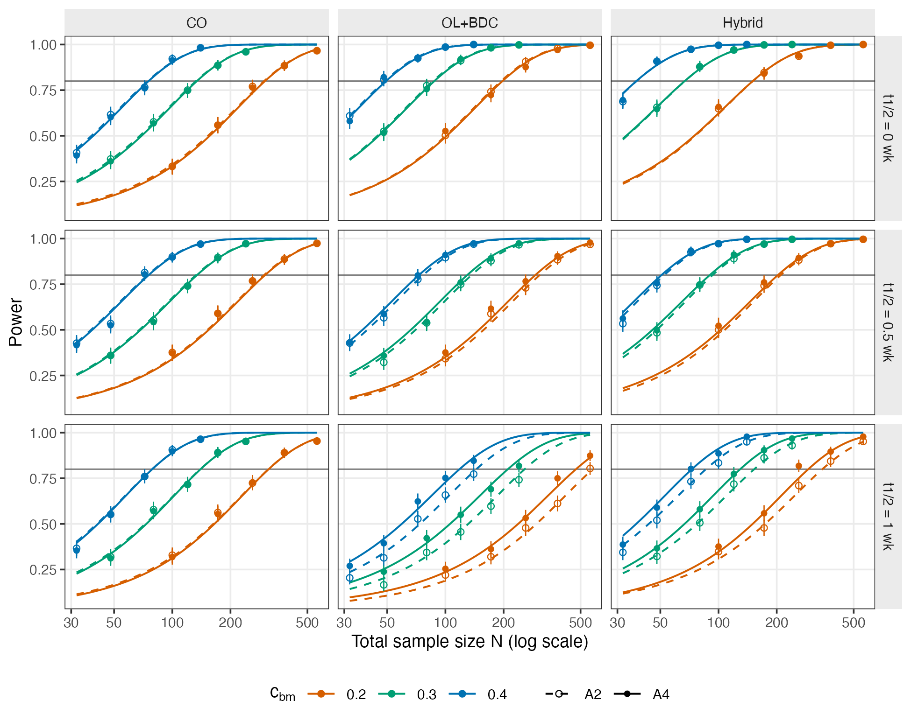

```{r setup, include = FALSE}
knitr::opts_chunk$set(
  echo = FALSE,
  warning = FALSE,
  message = FALSE,
  fig.path = "../../figures/02-supp-",
  cache.path = "_cache_supp/"
)
library(tibble)
library(dplyr)
library(tidyr)
library(knitr)
source(here::here(
  'analysis/report/02-carryover-sensitivity/shared-data.R'))
```

This supplement gives the tables that support the main text but are
not needed to follow it. The analyses are labeled A0 to A4 as in the
definition table of the main text: A0 is the starting analysis, A1
the binary indicator with the working-covariance standard error, A2
the binary indicator with the cluster-robust standard error (CR2), A3
the exposure-weighted predictor at the true half-life with CR2 (an
oracle), and A4 the exposure-weighted predictor at the half-life
chosen by AIC on the model without the interaction, with CR2. The
companion papers call A4 G10. The scenario families are those of the
main text. Every table is computed from stored simulation output by
the same code as the main text (`shared-data.R`).

# Rung 0 to rung 1: the starting analysis

Table \@ref(tab:stage3-null) gives Type I error at the six null
cells of the base grid. Table \@ref(tab:iso-table) separates the
three differences between A0 and A1.

```{r stage3-null, echo = FALSE}
st3 <- s27 |>
  filter(c_bm == 0,
         method %in% c('E0', 'E1', 'E1cr2', 'E2cr2', 'E7null_cr2')) |>
  mutate(Design = design_lab[design], Method = to_a(method)) |>
  select(Design, N, Method, reject) |>
  pivot_wider(names_from = Method, values_from = reject) |>
  arrange(match(Design, design_lab), N) |>
  select(Design, N, all_of(a_order)) |>
  mutate(across(-c(Design, N), fmt3))
knitr::kable(st3, booktabs = TRUE, escape = FALSE,
  col.names = c('Design', '$N$', a_order),
  caption = 'Type I error of the five analyses at the six null cells
    of the corrected grid ($c_{bm} = 0$, $t_{1/2} = 1$ week,
    exponential DGP, $n_{sim} = 500$). Two-MCSE band around 0.05:
    $[0.031, 0.069]$.') |>
  kableExtra::kable_styling(font_size = 9)
```

```{r iso-table, echo = FALSE}
iso_pow <- iso_rw |>
  filter(c_bm == 0.45, t1half == 1) |>
  pivot_longer(all_of(names(iso_lab)), names_to = 'method',
               values_to = 'rej') |>
  filter(!is.na(rej)) |>
  group_by(design, method) |>
  summarise(p = mean(rej), n = n(), .groups = 'drop') |>
  mutate(mcse = sqrt(p * (1 - p) / n),
         val = sprintf('%.3f (%.3f)', p, mcse),
         Quantity = 'Power')
iso_kap <- iso |>
  filter(c_bm == 0) |>
  group_by(design, method) |>
  summarise(val = sprintf('%.2f', mean(kappa)), .groups = 'drop') |>
  mutate(Quantity = '$\\kappa$ under the null')
iso_tab <- bind_rows(
  iso_null |> mutate(val = sprintf('%.3f (%.3f)', p, mcse),
                     Quantity = 'Type I error'),
  iso_kap, iso_pow) |>
  mutate(Design = design_lab[design],
         Method = factor(iso_lab[as.character(method)],
                         levels = unname(iso_lab))) |>
  select(Design, Quantity, Method, val) |>
  pivot_wider(names_from = Method, values_from = val) |>
  select(Design, Quantity, all_of(unname(iso_lab))) |>
  arrange(match(Design, design_lab),
          match(Quantity, c('Type I error', '$\\kappa$ under the null',
                            'Power')))
knitr::kable(iso_tab, booktabs = TRUE, escape = FALSE, linesep = '',
  caption = 'Isolation of the three differences between A0 and A1
    (simrun job 42, 1,000 replicates per cell, $t_{1/2} = 1$ week,
    pooled over $N \\in \\{35, 70\\}$, Monte Carlo standard error in
    parentheses). A0 is the starting analysis. E0n refits it with
    nlme and no residual correlation. E0nc adds corCAR1 to E0n. E1nc
    uses the A1 formula with nlme and no residual correlation, that
    is, without the expectancy term and without the exclusion rule.
    A1 is E1nc with corCAR1. Power is at $c_{bm} = 0.45$. The
    calibration ratio $\\kappa$ is the mean reported standard error over
    the empirical standard deviation, averaged over the two sample
    sizes. Under CO the expectancy term is absent from A0 because
    expectancy is constant, so E0n and E1nc are the same model.') |>
  kableExtra::kable_styling(font_size = 9)
```

# Rung 2: the cluster-robust standard error

Table \@ref(tab:tab-type1-cr2) compares the working-covariance and
cluster-robust standard errors of each regressor at four Hybrid null
cells with 2,000 replicates each.

```{r tab-type1-cr2, echo = FALSE}
## One row per regressor: the working-covariance (WC) fit and the CR2
## fit of the same model. A4 is fitted with CR2 only.
pair <- c(E1 = 'E1cr2', E2 = 'E2cr2', E7null = 'E7null_cr2')
reg_lab <- c(E1 = 'Binary indicator (A1, A2)',
             E2 = 'Exposure-weighted, true $t_{1/2}$ (A3)',
             E7null = 'Exposure-weighted, selected $t_{1/2}$ (A4)')
a2 <- sgf |> filter(sub == 'A2-size')
tab <- a2 |> filter(method %in% pair) |>
  transmute(t1half, N, method = names(pair)[match(method, pair)],
            k_cr2 = kappa, t1_cr2 = reject) |>
  left_join(a2 |> filter(method %in% names(pair)) |>
              select(t1half, N, method, k_mod = kappa, t1_mod = reject),
            by = c('t1half', 'N', 'method')) |>
  arrange(t1half, N, match(method, names(pair))) |>
  transmute(`$t_{1/2}$` = sprintf('%.1f', t1half), `$N$` = N,
            Regressor = reg_lab[method],
            `$\\kappa$ WC` = ifelse(is.na(k_mod), '--',
                                    sprintf('%.2f', k_mod)),
            `Type I WC`    = fmt3(t1_mod),
            `$\\kappa$ CR2` = sprintf('%.2f', k_cr2),
            `Type I CR2`   = fmt3(t1_cr2))
stopifnot(nrow(tab) == 12)
knitr::kable(tab, booktabs = TRUE, escape = FALSE,
  caption = 'Conservatism of the working-covariance interaction
    test and its cluster-robust correction at four Hybrid null cells
    ($c_{bm} = 0$, exponential DGP, corrected simulation code,
    2{,}000 replicates each). Each row fits one regressor with the
    working-covariance standard error (WC) and with the cluster-robust
    standard error (CR2). The binary row is A1 under WC and A2 under
    CR2; the CR2 columns of the other rows are A3 and A4. A4 is fitted
    with CR2 only. $\\kappa$ is the calibration ratio of the main text; $\\kappa > 1$ is a conservative test.
    Two-MCSE band around 0.05: $[0.040, 0.060]$.') |>
  kableExtra::kable_styling(font_size = 9)
```

# Rung 4: choosing the half-life

Table \@ref(tab:stage3-selection) gives the half-life that A4
selected. Tables \@ref(tab:stage3-variants-null) and
\@ref(tab:stage3-variants-alt) compare A4 with the oracle A3 in the
Hybrid run with independent seeds.

```{r stage3-selection, echo = FALSE}
knitr::kable(m9 |>
    transmute(`True $t_{1/2}$` = true_t1half, `$N$` = N, `$n$` = n,
              `0.25` = sprintf('%.2f', p_0.25), `0.5` = sprintf('%.2f', p_0.5),
              `1` = sprintf('%.2f', p_1), `2` = sprintf('%.2f', p_2)),
  booktabs = TRUE, escape = FALSE, linesep = '',
  caption = 'Share of replicates in which A4 selected each candidate
    half-life (weeks), Hybrid design, pooled over the predictive-only
    cells of the base grid and the supplementary study at the given
    true half-life and $N$ (null and alternative cells together).') |>
  kableExtra::add_header_above(c(' ' = 3, 'Selected half-life' = 4)) |>
  kableExtra::kable_styling(font_size = 9)

```

```{r stage3-variants-null, echo = FALSE}
if (has_rv) {
  tN <- rvN |>
    filter(method %in% rv_tab_m) |>
    mutate(Method = to_a(method),
           Cell = sprintf('$t_{1/2} = %.1f$, $N = %d$', t1half, N)) |>
    left_join(rvNp |> filter(is.na(h_fixed)) |>
                transmute(cell_id, method, diff_vs_g8),
              by = c('cell_id', 'method')) |>
    arrange(t1half, N, match(Method, a_order)) |>
    transmute(Cell, Method, Rejection = sprintf('%.4f', reject),
              `Paired diff. vs A3` = ifelse(method == 'E2cr2', '--',
                                            sprintf('%+.4f', diff_vs_g8)),
              `$\\kappa$` = sprintf('%.2f', kappa))
  stopifnot(nrow(tN) == 8)
  tN$Cell[duplicated(tN$Cell)] <- ''
  knitr::kable(tN, booktabs = TRUE, escape = FALSE, linesep = '',
    caption = 'Hybrid run with independent seeds (family S): null
      rejection rate ($c_{bm} = 0$) of A3, the oracle at the true
      half-life, and A4 in four Hybrid null cells, 5{,}000 replicates
      each (MCSE about 0.003), with the paired per-replicate
      difference of A4 against A3 (paired SE 0.0015 to 0.0028) and the
      calibration ratio.') |>
    kableExtra::kable_styling(font_size = 8)
}

```

```{r stage3-variants-alt, echo = FALSE}
if (has_rv) {
  tA <- rvA |>
    filter(method %in% rv_tab_m) |>
    mutate(Method = to_a(method)) |>
    select(t1half, N, c_bm, Method, reject, kappa) |>
    pivot_wider(names_from = Method, values_from = c(reject, kappa)) |>
    arrange(t1half, c_bm, N) |>
    transmute(t1half, N, c_bm,
              A3 = fmt3(reject_A3), A4 = fmt3(reject_A4),
              d = sprintf('%+.3f', reject_A4 - reject_A3),
              k3 = sprintf('%.2f', kappa_A3), k4 = sprintf('%.2f', kappa_A4))
  stopifnot(nrow(tA) == 8)
  knitr::kable(tA, booktabs = TRUE, escape = FALSE, linesep = '',
    col.names = c('$t_{1/2}$', '$N$', '$c_{bm}$', 'A3', 'A4',
                  'A4 $-$ A3', 'A3', 'A4'),
    caption = 'Hybrid run with independent seeds (family S): power and
      calibration ratio of A3 and A4 at eight Hybrid alternative cells,
      1{,}000 replicates each (MCSE of power at most 0.016).') |>
    kableExtra::add_header_above(c(' ' = 3, 'Power' = 3,
                                   '$\\\\kappa$' = 2), escape = FALSE) |>
    kableExtra::kable_styling(font_size = 9)
}

```

# Stress scenarios

Tables \@ref(tab:stage4-null) and \@ref(tab:stage4-alt) give the
single-cell scenarios of the scenario job. Tables
\@ref(tab:stage4-grid-null) and \@ref(tab:stage4-grid-alt) give the
scenario grids of the supplementary study.

```{r stage4-null, echo = FALSE}
st4_tab <- function(lab) {
  s21 |>
    filter(method %in% focus, cell %in% names(lab)) |>
    ## Under parameter set 1 A4 is in the run itself; under set 2 the
    ## backfill supplies it for the misspecification cells.
    bind_rows(bf_gvf |> filter(cell %in% names(lab)) |>
                anti_join(s21, by = c('cell', 'method'))) |>
    mutate(Cell = lab[cell], Method = to_a(method)) |>
    select(Cell, Method, reject) |>
    pivot_wider(names_from = Method, values_from = reject) |>
    mutate(o = match(Cell, lab)) |> arrange(o) |>
    select(Cell, all_of(focus_cols)) |>
    mutate(across(-Cell, fmt3))
}
knitr::kable(st4_tab(null_lab), booktabs = TRUE, escape = FALSE,
  caption = 'Type I error ($c_{bm} = 0$) at four null scenarios on
    Hybrid ($N = 70$, $t_{1/2} = 0.5$ week unless stated; OL+BDC row is
    that design), $n_{sim} = 500$, same trial for every specification
    each replicate. A4 was fitted in every cell. Two-MCSE band around
    0.05: $[0.031, 0.069]$.') |>
  kableExtra::kable_styling(font_size = 9)
```

```{r stage4-alt, echo = FALSE}
knitr::kable(st4_tab(alt_lab) |> select(-A0), booktabs = TRUE,
  escape = FALSE,
  caption = 'Power at five alternative scenarios (same cells and
    $n_{sim}$ as the null table). A2 and A3 are the equal-size
    comparators. A0 is omitted because its test is liberal and its
    power is not comparable.') |>
  kableExtra::kable_styling(font_size = 9)
```

```{r stage4-grid-null, echo = FALSE}
knitr::kable(grid_tab(sB |> filter(c_bm == 0)), booktabs = TRUE,
  escape = FALSE,
  col.names = c('Scenario', '$N$', focus_cols),
  caption = 'Scenario grids: Type I error ($c_{bm} = 0$) on
    Hybrid at $N \\in \\{35, 70\\}$ under a Weibull decay analyzed as
    exponential, a true half-life below, at the boundary of and above
    A4\'s candidate grid, and two autocorrelations ($t_{1/2} = 0.5$ week and $\\rho = 0.7$ unless
    stated; $n_{sim} = 500$; band $[0.031, 0.069]$).') |>
  kableExtra::kable_styling(font_size = 9)
```

```{r stage4-grid-alt, echo = FALSE}
knitr::kable(grid_tab(sB |> filter(c_bm == alt_level[sub]) |>
                        mutate(level = sprintf('%s, $c_{bm} = %.2f$',
                                               level, c_bm))) |>
    select(-A0),
  booktabs = TRUE, escape = FALSE,
  col.names = c('Scenario', '$N$', setdiff(focus_cols, 'A0')),
  caption = 'Scenario grids: power at one alternative per
    scenario (same cells and $n_{sim}$ as the null table; $c_{bm} =
    0.30$ for the autocorrelation rows because 0.45 is infeasible at
    $\\rho = 0.9$). A0 is omitted because its test is liberal.') |>
  kableExtra::kable_styling(font_size = 9)
```

# Heavy missingness

Table \@ref(tab:heavy-missing) gives the dispersion of the estimates
in the heavy-missingness stress case.

```{r heavy-missing, echo = FALSE}
if (file.exists(file.path(rr_dir, 'm10-heavy-missingness.csv'))) {
  ## The stored file uses display G codes; A4 was not fitted to these
  ## cells (the G10 backfill excludes the per-occasion dropout cells).
  hm_codes <- c('E0', 'G1', 'G6', 'G8')
  m10 <- read.csv(file.path(rr_dir, 'm10-heavy-missingness.csv')) |>
    filter(method %in% hm_codes) |>
    arrange(c_bm, match(method, hm_codes)) |>
    transmute(Cell = ifelse(c_bm == 0, 'null', '$c_{bm} = 0.45$'),
              Method = to_a(method),
              `SD of estimates` = sprintf('%.1f', sd_est),
              `MAD-based SD` = sprintf('%.1f', mad_sd_est),
              `Max $|\\hat\\beta|$` = sprintf('%.0f', max_abs_est),
              `$\\kappa$` = sprintf('%.2f', kappa),
              `Robust $\\kappa$` = sprintf('%.2f', robust_kappa),
              `Rejection` = sprintf('%.3f', reject))
  stopifnot(nrow(m10) == 8)
  m10$Cell[duplicated(m10$Cell)] <- ''
  knitr::kable(m10, booktabs = TRUE, escape = FALSE, linesep = '',
    caption = 'Heavy-missingness stress case (per-occasion MCAR 0.3,
      $N = 35$, 500 replicates): dispersion of the interaction
      estimates on the calibrated scale and the calibration ratio on
      the conventional scale ($\\kappa$, mean SE over SD) and a robust
      one (median SE over 1.4826 times the median absolute
      deviation). A4 was not fitted to these cells. From
      `34-referee-reanalysis.R`.') |>
    kableExtra::kable_styling(font_size = 9)
}

```

# Patient slope variance

Table \@ref(tab:stage5-slope) gives A3 and A4 under a
patient-specific linear trend in the natural-history component.

```{r stage5-slope, echo = FALSE}
if (has_rv) {
  bf_S <- bf_all |>
    filter(source == 'rvS', method == 'E7null_cr2') |>
    group_by(cell_id) |>
    summarise(mean_est = mean(estimate, na.rm = TRUE), .groups = 'drop') |>
    left_join(bf_sum |> filter(source == 'rvS', method == 'E7null_cr2'),
              by = 'cell_id')
  tS <- bind_rows(rvS |> filter(method == 'E2cr2'), bf_S) |>
    mutate(Method = to_a(method),
           Cell = ifelse(c_bm == 0, 'null ($c_{bm} = 0$)', '$c_{bm} = 0.45$')) |>
    arrange(c_bm, match(Method, a_order)) |>
    transmute(Cell, Method, Rejection = sprintf('%.3f (%.3f)', reject, mcse),
              `Mean estimate` = sprintf('%+.2f', mean_est),
              `$\\kappa$` = sprintf('%.2f', kappa))
  stopifnot(nrow(tS) == 4)
  tS$Cell[duplicated(tS$Cell)] <- ''
  knitr::kable(tS, booktabs = TRUE, escape = FALSE, linesep = '',
    caption = 'Patient slope variance (family 5): rejection rate
      (MCSE), mean interaction estimate and calibration ratio of A3
      and A4 under a patient-specific linear trend in the
      natural-history component (SD 0.3 outcome units per week),
      Hybrid, $N = 70$, $t_{1/2} = 0.5$ week, 1{,}000 replicates. A4
      was added to the same trials in a repeat run. The true value at the
      alternative is $-3.6$.') |>
    kableExtra::kable_styling(font_size = 9)
}

```

# Sample size for A4

Table \@ref(tab:ss-rho) gives the total $N$ for 80 percent power of A4
in the Hybrid design at three values of the serial correlation, from
runs made with the companion paper's simulation code under
parameter set 1; the companion paper does not report these runs. Table
\@ref(tab:ss-a2) gives the total $N$ for A2, the binary indicator with
CR2, from the same runs as the A4 table of the main text, under both
parameter sets. Table
\@ref(tab:ss-e9) gives the power of A4 at the sample size of the
companion paper's closed-form rule. Figure
\@ref(fig:fig-sample-size-set2) gives the power curves of the
main text under parameter set 2.

```{r ss-rho, echo = FALSE}
## Companion paper, 19-g9-planning-and-fig4b.R block N (starting
## values; rho 0.7 at commit c195cd4 and later, rho 0.5 joe job 12 and
## rho 0.9 julia job 3 / joe job 13). The c_bm grid differs by rho
## because the feasible c_bm falls as rho rises.
rho_root <- here::here('analysis/data/quick-sim/carryover-closed-form',
                       'published-planning')
rho_tab <- bind_rows(lapply(c(0.5, 0.7, 0.9), function(r) {
  f <- file.path(rho_root, if (r == 0.7) 'block-N' else
                   file.path(sprintf('rho%.1f', r), 'block-N'), 'n80-g10.csv')
  read.csv(f) |> mutate(rho = r)
})) |>
  mutate(cell = ifelse(extrapolated | is.na(N80_G), '--',
                       as.character(ceiling(N80_G))),
         c_bm = sprintf('%.2f', c_bm)) |>
  select(rho, t_half, c_bm, cell) |>
  pivot_wider(names_from = c_bm, values_from = cell, values_fill = '') |>
  arrange(rho, t_half)
rho_tab <- rho_tab[, c('rho', 't_half', sort(setdiff(names(rho_tab),
                                                       c('rho', 't_half'))))]
rho_tab$rho <- ifelse(duplicated(rho_tab$rho), '', sprintf('%.1f', rho_tab$rho))
knitr::kable(rho_tab, booktabs = TRUE, escape = FALSE, linesep = '',
  col.names = c('$\\rho$', '$t_{1/2}$', names(rho_tab)[-(1:2)]),
  caption = 'Total $N$ for 80 percent power of A4 in the Hybrid design
    by serial correlation $\\rho$, carryover half-life (weeks) and
    $c_{bm}$ (columns), under parameter set 1, from runs made with
    the companion paper\'s simulation code (six or seven values of $N$
    per cell, a probit curve
    on $\\sqrt{N}$ per cell). The grid of $c_{bm}$ differs by $\\rho$
    because the largest feasible $c_{bm}$ falls as $\\rho$ rises; a
    blank cell was not simulated.') |>
  kableExtra::add_header_above(c(' ' = 2, '$c_{bm}$' = ncol(rho_tab) - 2),
                               escape = FALSE) |>
  kableExtra::kable_styling(font_size = 9)
```

```{r ss-a2, echo = FALSE}
## A2 (binary indicator with CR2) from the same runs and curve model as
## the A4 table of the main text (47-sample-size-curves.R).
ss_tab_a2 <- ss_n80 |>
  filter(analysis == 'A2', c_bm %in% c(0.2, 0.3, 0.4)) |>
  mutate(cell = sprintf('%s (%s--%s)', bigm(ceiling(N80)),
                        bigm(ceiling(N80_lo)), bigm(ceiling(N80_hi))),
         col = sprintf('%s_%.1f', params, c_bm)) |>
  select(design, t1half, col, cell) |>
  pivot_wider(names_from = col, values_from = cell) |>
  arrange(match(design, c('CO', 'OLBDC', 'Hybrid')), t1half) |>
  mutate(design = design_lab[design], t1half = sprintf('%.1f', t1half)) |>
  select(design, t1half, published_0.2, published_0.3, published_0.4,
         simcore2026_0.2, simcore2026_0.3, simcore2026_0.4)
stopifnot(nrow(ss_tab_a2) == 9, !anyNA(ss_tab_a2))
ss_tab_a2$design[duplicated(ss_tab_a2$design)] <- ''
knitr::kable(ss_tab_a2, booktabs = TRUE, escape = FALSE, linesep = '',
  col.names = c('Design', '$t_{1/2}$', '0.2', '0.3', '0.4', '0.2', '0.3',
                '0.4'),
  caption = 'Total $N$ for 80 percent power of A2, the binary indicator
    with CR2, at $\\alpha = 0.05$, with a 95 percent Monte Carlo
    interval, by design, carryover half-life (weeks) and $c_{bm}$,
    under parameter sets 1 and 2 (Table 1 of the main text). Same runs, curve model and
    conditions as the A4 table of the main text, so the two tables can
    be compared cell by cell.') |>
  kableExtra::add_header_above(c(' ' = 2, 'Parameter set 1, $c_{bm}$' = 3,
                                 'Parameter set 2, $c_{bm}$' = 3),
                               escape = FALSE) |>
  kableExtra::kable_styling(font_size = 8, latex_options = 'scale_down')
```

```{r ss-e9, echo = FALSE}
## A4 power at the closed-form N; e9_g10 is built in shared-data.R.
e9_tab <- e9_g10 |>
  mutate(cell = ifelse(capped,
                       sprintf('%.3f (%d)$^a$', power, as.integer(N)),
                       sprintf('%.3f (%d)', power, as.integer(N))),
         c_bm = sprintf('%.2f', c_bm)) |>
  select(design, t_half, c_bm, cell) |>
  pivot_wider(names_from = c_bm, values_from = cell) |>
  arrange(match(design, c('CO', 'OL+BDC', 'Hybrid')), t_half) |>
  mutate(t_half = sprintf('%.1f', t_half))
stopifnot(nrow(e9_tab) == 9, !anyNA(e9_tab))
e9_tab$design[duplicated(e9_tab$design)] <- ''
knitr::kable(e9_tab, booktabs = TRUE, escape = FALSE, linesep = '',
  col.names = c('Design', '$t_{1/2}$', names(e9_tab)[-(1:2)]),
  caption = 'Power of A4 at the total $N$ given by the closed-form
    paired-difference rule of the companion paper for 80 percent power
    (in parentheses), by design, carryover half-life (weeks) and
    $c_{bm}$ (columns), under parameter set 1 at $\\rho = 0.7$.
    Runs made with the companion paper\'s simulation code, 1{,}000
    replicates per cell (Monte Carlo SE at most 0.016).
    $^a$The closed-form $N$ exceeded 400 and the cell was run at
    $N = 400$, so its power is not at the rule\'s $N$.') |>
  kableExtra::add_header_above(c(' ' = 2, '$c_{bm}$' = ncol(e9_tab) - 2),
                               escape = FALSE) |>
  kableExtra::kable_styling(font_size = 9)
```

```{r fig-sample-size-set2, echo = FALSE, fig.cap = 'Power of A4 (filled points, solid lines) and A2 (open points, dashed lines) against total $N$ under parameter set 2, as the sample-size figure of the main text. The horizontal line is 80 percent power.', out.width = '100%'}

```

# Size-adjusted power

Table \@ref(tab:sap-table) compares all five analyses at the same
size. Each analysis is tested at the empirical 5 percent quantile of
its own null $p$-values, so the liberal A0 can be compared with the
others.

```{r sap-table, echo = FALSE}
## sap and sap_pair are built in shared-data.R from
## 50-size-adjusted-power.R.
sap_tab <- sap |>
  mutate(cell = sprintf('%.3f (%.3f)', power_adj, power_adj_se)) |>
  select(design, N, c_bm, analysis, cell) |>
  pivot_wider(names_from = analysis, values_from = cell) |>
  left_join(sap_pair |> filter(vs == 'A0') |>
              transmute(design, N, c_bm,
                        d = sprintf('%+.3f (%.3f)', diff, se)),
            by = c('design', 'N', 'c_bm')) |>
  arrange(match(design, c('CO', 'OLBDC', 'Hybrid')), N, c_bm) |>
  mutate(design = design_lab[design], c_bm = sprintf('%.2f', c_bm)) |>
  select(design, N, c_bm, A0, A1, A2, A3, A4, d)
stopifnot(nrow(sap_tab) == 12, !anyNA(sap_tab))
sap_tab$design[duplicated(sap_tab$design)] <- ''
knitr::kable(sap_tab, booktabs = TRUE, escape = FALSE, linesep = '',
  col.names = c('Design', '$N$', '$c_{bm}$', 'A0', 'A1', 'A2', 'A3',
                'A4', 'A4 $-$ A0'),
  caption = 'Size-adjusted power of the five analyses on the 30-cell
    grid at $t_{1/2} = 1$ week, with a bootstrap standard error in
    parentheses. For each analysis, design and $N$ the critical value
    is the empirical 5 percent quantile of the $p$-values in the null
    cell (500 replicates); size-adjusted power is the share of the 500
    alternative replicates at or below it. The last column is the
    paired difference of A4 and A0 on the same trials. The bootstrap
    (2,000 resamples) resamples the null and alternative replicates
    jointly across analyses, so it includes the error of the
    estimated critical values. From `50-size-adjusted-power.R`.') |>
  kableExtra::kable_styling(font_size = 8, latex_options = 'scale_down')
```

# Size at large sample sizes

Table \@ref(tab:ss-null) checks the size of A4 and A2 at the sample
sizes of the sample-size study. Every other size check of the paper is
at $N = 35$ or 70.

```{r ss-null, echo = FALSE}
## ssnull is built in shared-data.R from 46-run-sample-size.R --null.
null_tab <- ssnull |>
  mutate(cell = sprintf('%.3f', reject),
         col = sprintf('%s_%s', analysis, ifelse(t1half == 0, 't0', 't1'))) |>
  select(params, design, N, col, cell) |>
  pivot_wider(names_from = col, values_from = cell) |>
  arrange(match(params, c('published', 'simcore2026')),
          match(design, c('CO', 'OLBDC', 'Hybrid')), N) |>
  mutate(params = ifelse(params == 'published', 'Set 1', 'Set 2'),
         design = design_lab[design], N = bigm(N)) |>
  select(params, design, N, A4_t0, A4_t1, A2_t0, A2_t1)
stopifnot(nrow(null_tab) == 15, !anyNA(null_tab))
null_tab$params[duplicated(null_tab$params)] <- ''
knitr::kable(null_tab, booktabs = TRUE, escape = FALSE, linesep = '',
  col.names = c('Parameter set', 'Design', '$N$', '0', '1', '0', '1'),
  caption = 'Type I error of A4 and A2 at the larger sample sizes of
    the sample-size study, by parameter set, design, $N$ and true
    carryover half-life (0 or 1 week). $c_{bm} = 0$, exponential
    decay, complete data, 1,000 replicates per cell; two-MCSE band
    around 0.05: $[0.036, 0.064]$. Non-convergence was at most 0.3
    percent. From `46-run-sample-size.R` in its null mode.') |>
  kableExtra::add_header_above(c(' ' = 3, 'A4, $t_{1/2}$' = 2,
                                 'A2, $t_{1/2}$' = 2), escape = FALSE) |>
  kableExtra::kable_styling(font_size = 9)
```

# Sensitivity to the parameter set

Table \@ref(tab:sens-params) repeats the ladder of the main text under
parameter set 2, the simulation core's own values (Table 1 of the main
text). Every run of the scenario families was made under both sets
over the same grid. Set 2 has a placebo-response SD a fifth
as large and smaller natural-history and baseline variances.

```{r sens-params, echo = FALSE}
## sens is built in shared-data.R from the ladder output of both sets.
sens_tab <- sens |>
  mutate(v = sprintf('%.3f', value)) |>
  select(params, family, quantity, a, v) |>
  pivot_wider(names_from = params, values_from = v) |>
  mutate(cell = sprintf('%s (%s)', published, simcore2026)) |>
  select(family, quantity, a, cell) |>
  pivot_wider(names_from = a, values_from = cell, values_fill = '--') |>
  arrange(match(family, fam_ids), match(quantity, c('size', 'power'))) |>
  mutate(quantity = ifelse(quantity == 'size', 'Size', 'Power'))
sens_tab <- sens_tab[, c('family', 'quantity', 'A0', 'A1', 'A2', 'A3', 'A4')]
stopifnot(nrow(sens_tab) == 2 * length(fam_ids))
sens_tab$family[duplicated(sens_tab$family)] <- ''
knitr::kable(sens_tab, booktabs = TRUE, escape = FALSE, linesep = '',
  col.names = c('Family', 'Measure', 'A0', 'A1', 'A2', 'A3', 'A4'),
  caption = 'Size (pooled null rejection rate) and power (pooled
    reference alternative) of the five analyses by scenario family,
    under parameter set 1 and, in parentheses, parameter set 2. The
    set 1 values are those of the ladder figures of the main text. A
    dash means the analysis was not fitted in that family. From
    `37-ladder-tables-figures.R` run under each set.') |>
  kableExtra::kable_styling(font_size = 8, latex_options = 'scale_down')
```

Power is lower under parameter set 1 in every family and analysis, at
`r sprintf('%.2f to %.2f', sens_pw_ratio[1], sens_pw_ratio[2])` times
its value under set 2, presumably because the response components
vary more.
Apart from A0, size differs between the sets by at most
`r sprintf('%.3f', sens_sz_max)`. A0 is the exception. In families
2 to 4 it is more liberal under set 1. The order of A1 to A4 by power
is the same under both sets in every family, except that A2 and A4
change places in families 3 and 4, where they differ by less than
their Monte Carlo error.
