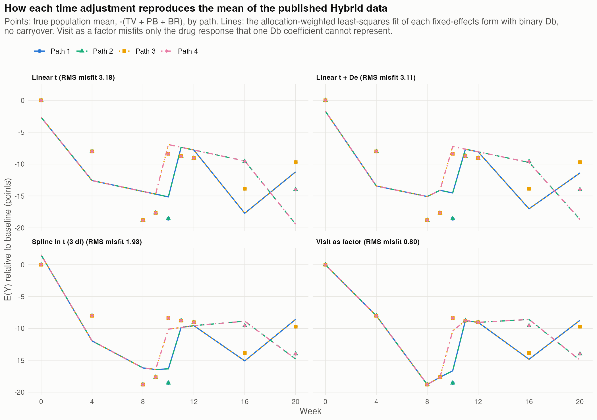
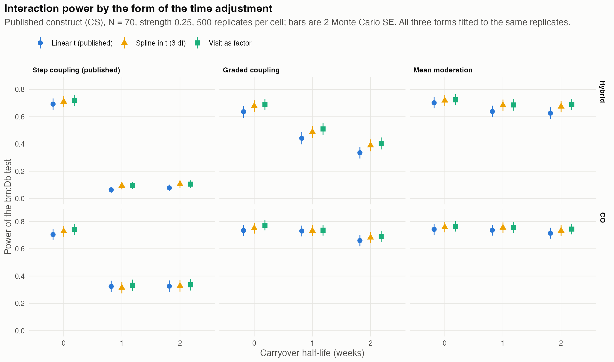

# Replacing the Linear Time Term in the Analysis of the Hybrid N-of-1 Design: Advantages and Disadvantages of a Flexible Time Adjustment {.unlisted .unnumbered}
*2026-10-03 17:17 PDT*

**Author.** pmsimstats team

**Purpose.** The published analysis of Hendrickson et al. [1] adjusts
for symptom change unrelated to the drug with one linear term in time,
`t`. This paper weighs replacing it with a more flexible adjustment: a
spline in time, visit as a factor, or terms tied to the trial's
expectancy phases. It draws on the Monte Carlo results of `docs/40`,
Section 9 (script `07-time-adjustment.R`: 27,000 fits on alternative
cells and 12,000 on null cells, all converged) and on the population-mean
calculations of the same paper.

(Updated 2026-10-09: results at $t_{1/2} > 0$ now use anchored
carryover; see `docs/53`. Values changed by at most 0.008 in rejection
rates and 0.53 points in the drug coefficient $\beta_D$ (the
interaction estimates by at most 0.0003); conclusions unchanged.)

```{=latex}
\clearpage
\tableofcontents
\listoftables
\listoffigures
\clearpage
```

## Notation index and glossary

Notation follows `analysis/report/NOTATION.md` and `docs/40`. Symbols
marked *local* are defined here. (Notation, 2026-10-09: the
linear-time slope $\beta_t$ is now $\beta_T$, as in `docs/56` and the
compendium.)

| Symbol | Meaning | Status |
|----------------|----------------------------------------|----------|
| $Y_{it}$ | symptom score (code `Sx`) | canonical |
| $TV$, $PB$, $BR$ | natural-course, expectancy and drug responses | canonical |
| $w_t$ | calendar week of visit $t$ (code `t`) | canonical |
| $\eta_t$ | design expectancy: 1 open label, 0.5 blinded, 0 at baseline (code `e`, regressor `De`); written $e_t$ before 2026-10-07 | canonical |
| $D_{it}$ | binary drug state (code `Db`) | canonical |
| $\beta_D$, $\beta_{bm:D}$ | drug main effect; biomarker-by-drug interaction | canonical |
| $f(t)$ | the time adjustment: $\beta_T w_t$, a spline, or visit effects $\mu_t$ | local |
| $\beta_T$, $\mu_t$, $\beta_\eta$ | linear-time slope (written $\beta_t$ before 2026-10-09); visit effect; expectancy coefficient | canonical |
| $t_{1/2}$ | carryover half-life (weeks) | canonical |
| $N$ | total sample size across paths | canonical |
| $\rho$ | within-component AR(1) correlation per week (configuration C) | canonical |

Table: Notation index and glossary of symbols used in this document

- **Linear time.** $f(t) = \beta_T w_t$, the published adjustment.
- **Spline.** A natural cubic spline in $w_t$, here with 3 degrees of
  freedom (`ns(t, df = 3)`).
- **Visit as factor.** One free mean per visit, $\mu_t$
  (`factor(t)`).
- **Expectancy term.** $\beta_\eta \eta_t$ (`De`), present in the published
  code but switched off for the publication.
- **Size.** The rejection rate when there is no interaction (Type I
  error); nominally 0.05.

## 1. Summary

1. **The linear term stands in for two curves and a step.** The
   non-drug mean is a sigmoid natural-course curve plus an expectancy
   curve that halves at week 9, when blinding begins. A straight line
   leaves a root-mean-square misfit of 3.2 points in the population mean
   of the Hybrid design. A spline leaves 1.9 and visit effects 0.8
   (Section 2).
2. **For the interaction, flexibility buys nothing in bias.** In every
   cell the three adjustments give the same mean interaction estimate,
   within 0.0009, because the biomarker is unrelated to the non-drug
   components (Section 4).
3. **For the drug main effect, flexibility removes a bias of about 2
   points.** Linear time credits the open-label expectancy to the drug.
   Visit effects replace this with a randomized estimate from the
   between-path comparisons, at about 1.5 times the standard deviation
   (Section 4).
4. **In Hybrid, the flexible adjustments are anticonservative under the
   published random-intercept covariance.** Under one-week carryover the
   Type I error is 0.075 (spline) and 0.080 (visit factor), against
   0.056 for linear time. Their higher power, 0.02 to 0.07, is partly
   this inflation. In the crossover all three hold their size, and the
   flexible forms gain 0.01 to 0.04 (Section 4).
5. **The flexible adjustment and the working covariance have to be
   chosen together.** A random intercept misrepresents the outcome
   covariance. The flexible adjustments remove the mean misfit that, on
   our working explanation, had been masking that error. Visit effects
   paired with an unstructured covariance, the MMRM convention, are the
   natural form, but their size in this design has not yet been tested
   (Sections 5 and 7).
6. **Recommendation.** For the interaction test, keep linear time under
   the published covariance, or move to visit effects only together
   with an unstructured covariance and a size check. For the drug main
   effect, use visit effects or add the expectancy term (Section 8).

**Update (2026-10-07).** The size check of point 5 has been made
(`docs/45`, Section 4.4). In the same cell (CS construct, Hybrid,
$t_{1/2} = 1$, 500 null replicates, MCSE 0.0097), the excess recurs
under model-based inference (`cs-Satt`: 0.054 linear, 0.070 spline,
0.072 visit factor) and under the unstructured covariance with
Kenward-Roger (0.056, 0.068, 0.072), is smaller with baseline as a
covariate (0.056, 0.060, 0.064), and is absent under CR2 (`cs-CR2`
0.058 and 0.058; `csh-CR2` 0.060 and 0.060, linear and visit factor).
Seen in two separate simulation runs with the same direction and size,
the excess is real for model-based and Kenward-Roger inference.
`docs/45` calls this evidence "weak" because the eight-cell mean size
is unchanged; that reading is corrected here, since an excess confined
to the carryover cell is still an excess. The unstructured covariance
therefore does not license visit effects, and recommendation 2 of
Section 8 is withdrawn: a flexible time adjustment should be paired
with CR2 inference. The project's current primary analysis, F1 of
`docs/46` and `docs/49`, uses linear time with CR2 inference and adds
the expectancy term `De` with its biomarker interaction.

## 2. What the time term has to absorb

The published model is `Sx ~ bm + Db + t + bm*Db + (1|ptID)` (`docs/40`,
Section 8). Its time term must absorb the part of the mean that does
not depend on the drug state. In the Hybrid design that part is the
same in every path, because all paths share the visit schedule and the
blinding pattern (`docs/40`, Section 3):

| Week | 4 | 8 | 9 | 10 | 11 | 12 | 16 | 20 |
|----------------|-----|-----|-----|-----|-----|-----|-----|-----|
| $TV$ | 1.86 | 4.79 | 5.24 | 5.59 | 5.85 | 6.03 | 6.39 | 6.48 |
| $PB$ | 1.86 | 4.79 | 2.62 | 2.79 | 2.92 | 3.02 | 3.19 | 3.24 |
| $TV + PB$ | 3.73 | 9.58 | 7.86 | 8.38 | 8.77 | 9.05 | 9.58 | 9.72 |

Table: Population means of $TV$, $PB$ and their sum by week, common to all paths

(Corrected 2026-10-08: the week-4 sum was given as 3.72, the sum of the
rounded components; the exact value is 3.73.)

The sum rises steeply to week 8, falls by 1.7 points at week 9 when
expectancy halves, and then flattens. No straight line follows that.

A time adjustment also absorbs the part of the drug response that one
`Db` coefficient cannot represent at visits where every path is in the
same drug state. At weeks 4, 8 and 9 every path is on drug, with a drug
response that rises from 4.3 to 9.8 on the Gompertz curve. A flexible
adjustment takes up that rise; linear time cannot. This is why the
choice changes the drug coefficient so much (Section 4).

**Root-mean-square misfit of the population mean** (allocation-weighted
least squares with `Db` in the model, no carryover; verified, `docs/40`,
Figure 7):

| Time adjustment | Linear | Linear + `De` | Spline (3 df) | Visit factor |
|-----------------|--------|--------|--------|--------|
| Misfit (points) | 3.18 | 3.11 | 1.93 | 0.80 |

Table: Misfit of each time adjustment to the population means, Hybrid design, no carryover

What visit effects still miss is the drug response itself, which
varies from 4.3 to 10.2 across visits while `Db` is one number.

## 3. The options

| Adjustment | Parameters (Hybrid) | Absorbs | Identifies $\beta_D$ from |
|------------------------|--------|------------------------|------------------------|
| Linear `t` | 1 | the overall slope | all on-off contrasts, within and between paths |
| Linear `t` + `De` | 2 | slope and the expectancy step | as above |
| Spline, `ns(t, 3)` | 3 | smooth curves, not the step | as above |
| Visit factor | 8 | everything common to all paths at a visit | between-path contrasts at weeks 10, 16, 20 only |
| Phase indicators | 2 or more | level shifts between open label, blinded discontinuation and crossover | within-phase contrasts |
| Random slope on `t` | 2 variance terms | participant-specific linear trends | as for linear `t` |

Table: Time adjustment options with parameter counts, what each absorbs, and identifying contrasts

The published code already offers two of these: `useDE = TRUE` adds the
expectancy term, and `t_random_slope = TRUE` adds a random slope on
time. Neither was used for the publication (`58b32a9` vignette 1, line
350).

## 4. Evidence

All results are for the published compound-symmetry construct with
$N = 70$ and the published allocation, fitted with `lmer` and a random
intercept. Interaction strength is 0.25 in the alternative cells, with
500 replicates per alternative cell and 1000 per null cell (`docs/40`,
Section 9).

**The interaction estimate does not depend on the adjustment.** The
three mean estimates of $\beta_{bm:D}$ agree to within 0.0009 in every
cell. In Hybrid their empirical SDs agree too (graded coupling,
$t_{1/2} = 0$: 0.0562, 0.0559, 0.0558). The biomarker is unrelated to
$TV$ and $PB$, so misfit of the time term adds noise to the on-off
contrast but no bias, and it does not even add measurable noise to the
estimate.

**The drug effect depends heavily on it** (Hybrid, graded coupling):

| Adjustment | Limit, $t_{1/2} = 0$ | Simulated mean (SD) | Limit, $t_{1/2} = 1$ | Simulated mean (SD) |
|--------------------|----------|------------------|----------|------------------|
| Linear `t` | $-8.21$ | $-8.16$ (0.86) | $-6.38$ | $-6.31$ (0.84) |
| Linear `t` + `De` | $-7.28$ | not run | $-4.81$ | not run |
| Spline | $-6.22$ | $-6.02$ (0.99) | $-3.67$ | $-3.50$ (0.94) |
| Visit factor | $-6.25$ | $-5.99$ (1.27) | $-4.49$ | $-4.28$ (1.19) |

Table: Drug effect limits and simulated means by time adjustment, Hybrid design, graded coupling

'Limit' is the value each model converges to, computed from the
population means. In the crossover, where expectancy is constant, the
three adjustments agree within 0.5 points.

**Power and size of the interaction test:**

| Design | Cell | Linear `t` | Spline | Visit factor |
|--------|----------------------------|--------|--------|--------|
| Hybrid | null, $t_{1/2} = 0$ | 0.049 | 0.055 | 0.059 |
| Hybrid | null, $t_{1/2} = 1$ | 0.056 | 0.075 | 0.080 |
| Hybrid | graded, $t_{1/2} = 0$ | 0.636 | 0.678 | 0.690 |
| Hybrid | graded, $t_{1/2} = 1$ | 0.442 | 0.488 | 0.510 |
| Hybrid | mean moderation, $t_{1/2} = 2$ | 0.626 | 0.674 | 0.690 |
| CO | null, $t_{1/2} = 0$ | 0.052 | 0.040 | 0.044 |
| CO | null, $t_{1/2} = 1$ | 0.042 | 0.040 | 0.039 |
| CO | graded, $t_{1/2} = 0$ | 0.734 | 0.750 | 0.772 |

Table: Power and size of the interaction test by design, cell and time adjustment

Monte Carlo SEs are about 0.007 for the null rates and 0.021 for power.
The power, size and drug-effect figures of this section were checked
against `analysis/data/quick-sim/carryover-closed-form/time-adjustment/`
(`summary-reps500.csv`, `summary-reps1000-null.csv`; verified
2026-10-07).





## 5. Advantages of a flexible time adjustment

1. **It removes the confounding of the drug effect with expectancy.**
   Linear time overstates the drug effect by about 2 points in Hybrid,
   because the open-label visits are both on drug and at full
   expectancy, and a line cannot follow the drop at week 9. Visit
   effects remove the confounding entirely. Adding `De` removes half to
   four fifths of it (Section 4; "two thirds" before the 2026-10-09
   anchored-carryover update, as in `docs/40`).
2. **It gives a randomized drug estimate.** With visit effects, the drug
   effect rests on comparisons between paths at the same visit (weeks
   10, 16, 20). Those comparisons are protected by the randomization of
   paths rather than by a model of the time trend. This also makes the
   analysis robust to the trend's shape, which is unknown in a real
   trial (`docs/31`, Section 4, on why natural history rarely follows a
   line).
3. **It matches the MMRM convention.** Visit as a factor with an
   unstructured covariance is the standard analysis of a longitudinal
   trial with fixed visits, and period effects are a first-order
   concern in within-participant designs [3]. Reviewers recognize it, and it can be
   specified without choosing a functional form.
4. **It improves the crossover analysis.** In CO the flexible
   adjustments hold their size and gain 0.01 to 0.04 in power, partly
   from a genuine reduction in the estimate's variability (SD 0.0487
   against 0.0462 for graded coupling at $t_{1/2} = 0$).
5. **It costs few parameters.** Seven extra parameters for visit effects
   against 630 observations at $N = 70$, or two for a 3-df spline.

## 6. Disadvantages of a flexible time adjustment

1. **Under the published covariance it inflates the Type I error in
   Hybrid.** Spline and visit effects reject 7.5% and 8.0% of null
   trials under one-week carryover, about 3.6 and 4.3 Monte Carlo SEs
   above nominal (MCSE 0.0069 at a true rate of 0.05; the earlier "3 and
   3.5" used the SE at the observed rates), against 5.6% for linear
   time (Section 4 table; updated 2026-10-09 to the anchored-carryover
   rerun, previously 7.3%, 8.0% and 5.8%). Without carryover the excess is within about one SE. The
   excess was later reproduced, and shown to vanish under CR2 (see the
   update after Section 1). The cause is not established. On our
   working explanation (inferred, not tested), the random intercept
   misrepresents the outcome covariance: the baseline row has no noise
   of its own, and the variance falls at blinding (`docs/40`,
   Section 6). The mean misfit left by linear time inflates its residual
   variance enough to offset this, and the flexible adjustments remove
   that offset.
2. **Its power gains in Hybrid are not clean.** The estimates are no
   less variable than linear time's, yet they reject more often. Their
   model-based SEs are therefore smaller, consistent with the size
   inflation. No size-adjusted comparison has been made.
3. **Visit effects weaken the drug estimate.** Identified only by the
   between-path comparisons, the drug effect's SD rises from 0.86 to
   1.27 in Hybrid. With a single path the drug state and the visit
   effects are completely aliased and the drug effect cannot be
   estimated. With fixed allocation, every path must be represented.
4. **A spline cannot follow the expectancy step.** A smooth curve
   through the week-9 drop absorbs part of it into the drug effect.
   Under carryover the spline's drug effect falls below the visit-factor
   value ($-3.67$ against $-4.49$ in the limit at $t_{1/2} = 1$).
   Splines also need a choice of degrees of freedom or knots, which
   should be fixed rather than tuned to the data.
5. **It does not help the interaction estimate.** In this construct the
   interaction is already unbiased under linear time. A flexible
   adjustment protects the interaction only if the biomarker is related
   to the time trend, for example a severity biomarker that predicts
   regression to the mean. Then any misfit of the trend loads onto
   $\beta_{bm:D}$. The construct has no such link (`docs/31`,
   Section 18.1), so the simulations cannot show that benefit.
6. **Visit effects need fixed visits.** In a real trial with visit
   windows, timing varies around the nominal week. Visit effects then
   absorb the nominal visit, and the within-window timing is ignored. A
   spline in actual time handles this better.

## 7. Interplay with the covariance and the baseline coding

The flexible time adjustment cannot be judged on its own. Three choices
interact:

- **Covariance.** The random intercept implies compound symmetry, which
  the outcome does not have, even under the compound-symmetry construct
  (`docs/40`, Section 6). An unstructured covariance (`us` in `mmrm`)
  represents any phase structure. The anticonservatism of Section 6 may
  disappear under it; that is the main open question. *Answered
  (2026-10-07):* it does not; with Kenward-Roger the excess persists
  (`docs/45`, Section 4.4; see the update after Section 1).
- **Baseline coding.** The baseline row is the worst-fitting row of the
  covariance and has the most leverage on a linear trend. With visit
  effects, baseline has its own mean and does not inform the drug
  contrast. Baseline as a covariate (`docs/41`) removes the row
  altogether.
- **Expectancy term.** `De` is a one-parameter step that captures most
  of what linear time misses in the drug effect. It has a moderate
  correlation with `Db` (0.59) and a variance inflation of 1.5
  (`docs/40`, Section 8). The paper's concern about collinearity [1]
  does not rule it out at $N = 70$.

The coherent combination is the MMRM: visit effects, an unstructured
covariance, and baseline as a covariate or as a cLDA row. Each part
removes one misspecification, and none is known to cause the size
problem of Section 6. Whether the combination holds its size in the
Hybrid design is what the paused covariance study
(`08-covariance-study.R`) is designed to show. *Update (2026-10-07):*
that study is complete (`docs/45`). With visit effects, the unstructured
covariance and Kenward-Roger reject 0.072 in the Hybrid carryover cell,
and 0.064 with baseline as a covariate; the combination does not hold
its size there.

## 8. Recommendation and open questions

**For the interaction test:**

1. Under the published random-intercept covariance, keep linear time.
   It holds its size in this construct (0.049 and 0.056), and the
   flexible forms' extra power is partly inflation.
2. Move to visit effects only together with an unstructured covariance,
   and verify the size by simulation first. With 70 participants and 45
   covariance parameters, use small-sample degrees of freedom
   (Kenward-Roger [2] or Satterthwaite) for the test. *Withdrawn
   (2026-10-07):* the verification failed (0.072 with Kenward-Roger in
   the Hybrid carryover cell, `docs/45`, Section 4.4). If a flexible time
   adjustment is required, pair it with CR2 inference about a
   parsimonious working covariance, which was nominal in that cell. The
   unstructured model with Kenward-Roger also failed the stress test of
   `docs/46` with linear time (pooled 0.057; 0.087 at $N = 35$).

**For the drug main effect:**

3. Use visit effects, or at least add `De`. Linear time alone overstates
   the drug effect by about 2 points in Hybrid. Report which estimand is
   used, since the drug effect varies across visits and each adjustment
   weights it differently.

**Open questions:**

- Does an unstructured covariance remove the anticonservatism of visit
  effects in Hybrid, and does baseline as a covariate help further?
  *Answered (2026-10-07; `docs/45`, Section 4.4):* no, and only
  partly (0.064); CR2 removes it.
- How do the adjustments compare under an AR(1) construct (configuration
  C, at $\rho = 0.8$ in `docs/36`), where the published analysis is itself anticonservative without a
  serial-correlation term (`docs/36`, Section 6.8)?
- What is the power of each adjustment at matched size?
- Does a random slope on time (`t_random_slope = TRUE`) behave like a
  flexible fixed adjustment? It was not tested.

## 9. Limitations and evidence status

- **One construct.** All simulations use the published compound-symmetry
  construct with strength 0.25 (verified). Under AR(1) data the size
  results may differ.
- **One covariance in the evidence.** All fits in Section 4 use a random
  intercept. The comparison with unstructured covariance is the subject
  of the paused study and is not reported here (since reported in
  `docs/45`; see the update after Section 1).
- **The mechanism of the anticonservatism is inferred.** It has not been
  tested by refitting with a heteroscedastic or unstructured covariance.
  The later refits (`docs/45`) show that `cs` with model-based
  inference and `us` with Kenward-Roger do not remove it and CR2 does,
  which argues against a purely covariance-structure explanation; the
  mechanism remains untested.
- **No size-adjusted power** in this document. `docs/45` (Section 5)
  reports size-adjusted power for linear time only.
- **Phase indicators and random slopes are described, not simulated.**
  Paper 06's phase-augmented model, with phase-by-drug interactions, is
  a different question (attribution, `docs/31`, Section 11) and is not
  evidence about the time adjustment.

## 10. References

1. Hendrickson RC, Thomas RG, Schork NJ, Raskind MA. Optimizing
   aggregated N-of-1 trial designs for predictive biomarker validation:
   statistical methods and theoretical findings. *Frontiers in Digital
   Health* 2020; 2:13. doi:10.3389/fdgth.2020.00013.
2. Kenward MG, Roger JH. Small sample inference for fixed effects from
   restricted maximum likelihood. *Biometrics* 1997; 53(3):983-997.
   doi:10.2307/2533558.
3. Senn S. *Cross-over Trials in Clinical Research*, 2nd edition.
   Chichester: Wiley, 2002. (Period effects and time trends in
   within-participant designs.)
