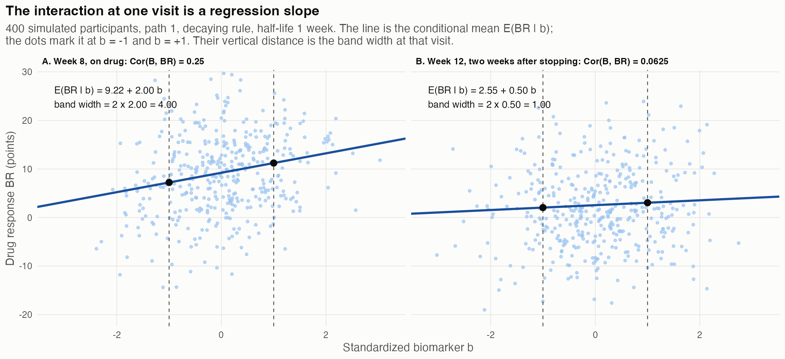
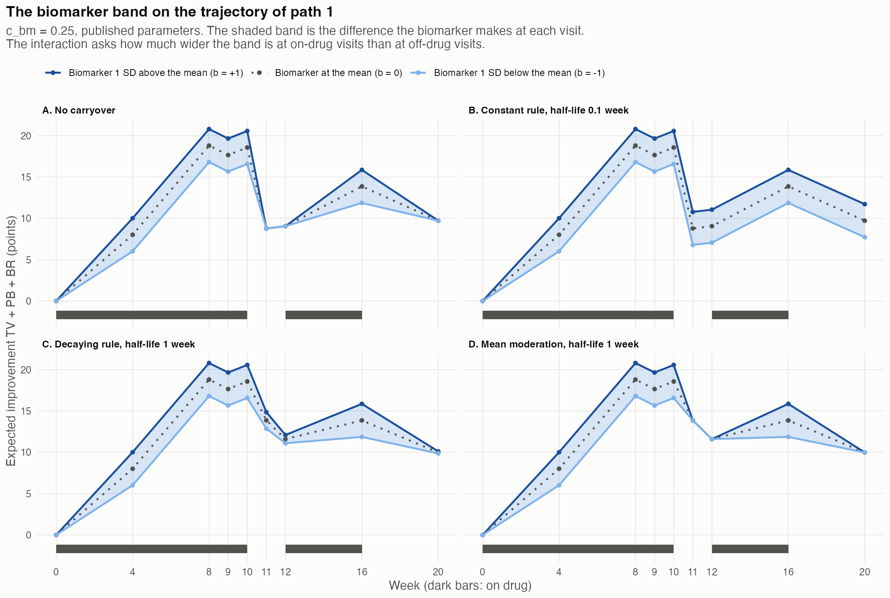
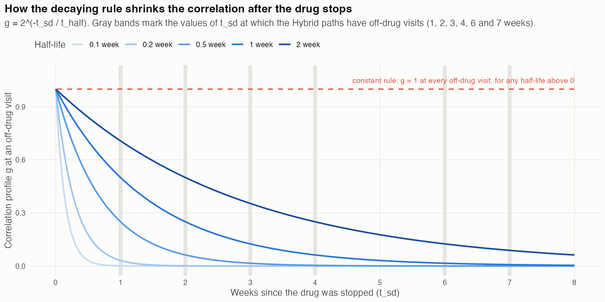
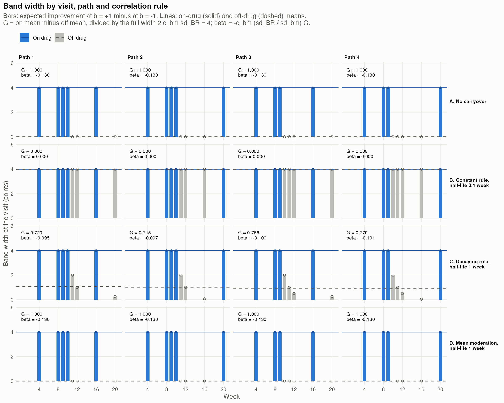
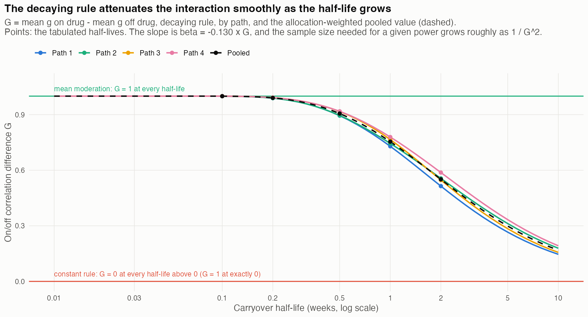
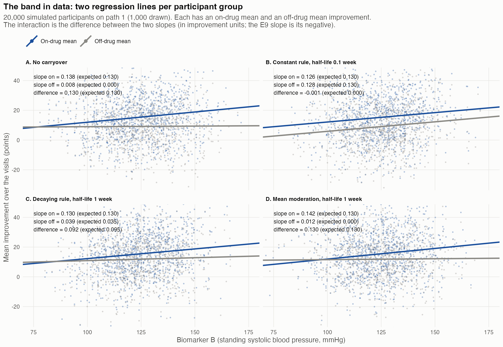
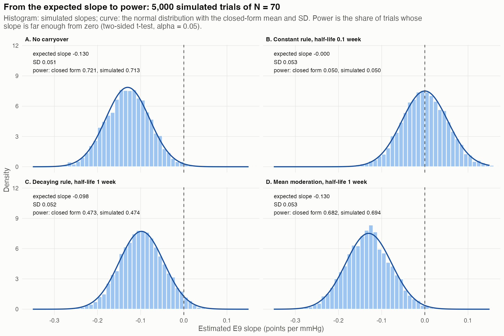
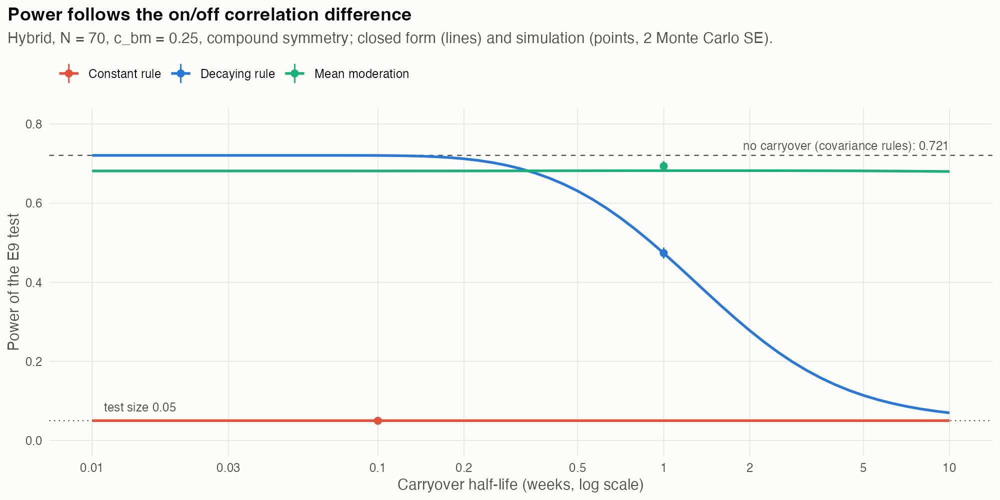

# The Interaction Estimand as a Difference in Band Width: A Tutorial {.unlisted .unnumbered}
*2026-11-11 09:19 PST*

**Author.** pmsimstats team

**Audience.** Undergraduate statistics students who have taken a
course in probability and one in linear regression. You should know
what a mean, a variance, a correlation, a regression slope and a
$t$-test are. You do not need to know mixed models. Every other idea
is introduced where it is needed.

**Purpose.** This tutorial expands Section 5 of `docs/40` (the
Hendrickson Hybrid design primer). That section shows that the
biomarker-by-drug interaction, the quantity a predictive-biomarker
trial tries to detect, can be drawn as a band: the gap between the
expected outcomes of participants with high and with low biomarker
values. The interaction is how much wider the band is when
participants are on drug than when they are off drug. Here we derive
that statement from the multivariate normal distribution, work it
through every path of the design, and follow it to the power of a
test. Figure 5 and Table 9 of `docs/40` are expanded into Figures 4
and 5 and Tables 3 to 5 below.

**How the numbers were obtained.** Every number in this tutorial was
computed by the script `03-band-width-tutorial.R` in
`analysis/scripts/quick-sim/hybrid-design-primer/` (Section 15) from
the published construct
(compound symmetry within components, $\rho_{cs} = 0.8$, the
parameters of Hendrickson's code at commit `58b32a9`) with carryover
anchored at the last on-drug mean (`docs/53`). The script stops
unless its closed-form values reproduce Table 9 of `docs/40` and the
closed-form E9 power of `docs/37`, Section 5, and it checks the
closed forms against 5,000 simulated trials per scenario (Section 11).
The study is exploratory.

```{=latex}
\clearpage
\tableofcontents
\listoftables
\listoffigures
\clearpage
```

## Notation index and glossary

Notation follows `analysis/report/NOTATION.md`. Symbols marked *local*
are defined here only.

| Symbol | Meaning | Status |
|----------|----------------------------------------|------|
| $i$, $t$, $q$ | participant, visit and path indices | canonical |
| $N$, $n_q$ | total sample size (70) and the number on path $q$ (18, 18, 17, 17) | canonical |
| $\varpi_q$ | allocation share $n_q/N$ | local |
| $Y_{it}$ | symptom score; lower is better | canonical |
| $\mathrm{BL}_i$ | baseline symptom score | canonical |
| $BR_{it}$, $PB_{it}$, $TV_{it}$ | drug, expectancy and natural-course responses (improvements) | canonical |
| $B_i$ | biomarker, standing systolic blood pressure (mmHg) | canonical |
| $b_i$ | standardized biomarker, $(B_i - \mu_{bm})/\sigma_{bm}$ | canonical |
| $\mu_{bm}$, $\sigma_{bm}$ | biomarker mean (124.33) and SD (15.36) | canonical |
| $\sigma_{BR}$ | SD of the drug response (8) | canonical |
| $c_{bm}$ | biomarker-response correlation on drug (0.25 throughout) | canonical |
| $\beta_{bm}$ | mean-moderation strength | canonical |
| $g_t$ | correlation profile: $\mathrm{Cor}(B_i, BR_{it}) = c_{bm}\,g_t$ | canonical |
| $t_{sd}$ | weeks since the drug was last stopped | canonical |
| $t_{1/2}$ | carryover half-life (weeks) | canonical |
| $W_t$ | band width at visit $t$ | local |
| $\bar g_{\text{on}}$, $\bar g_{\text{off}}$ | mean of $g_t$ over a path's on-drug and off-drug visits | canonical |
| $\mathcal G$ | on/off correlation difference, $\bar g_{\text{on}} - \bar g_{\text{off}}$ | canonical |
| $\Delta_i$ | E9 contrast: mean $Y$ on drug minus mean $Y$ off drug | canonical |
| $\beta_{bm:D}$ | interaction slope, the estimand | canonical |
| $V_q$, $\sigma^2_{\Delta,q}$ | variance of $\Delta$ on path $q$, and its variance given $B$ | local |

Table: Notation index

**Sign convention.** The three responses are improvements and are
subtracted from baseline, $Y_{it} = \mathrm{BL}_i - (TV_{it} + PB_{it} +
BR_{it})$. A larger drug response lowers $Y$. Interaction slopes are
therefore negative when higher biomarker values predict more benefit.

### Glossary

- **Path.** One sequence of drug states through the trial. The Hybrid
  design has four.
- **Band.** At one visit, the vertical gap between the expected
  improvement of a participant one SD above the biomarker mean and
  that of a participant one SD below it.
- **Correlation profile $g_t$.** The share of the full
  biomarker-response correlation $c_{bm}$ present at visit $t$.
  NOTATION.md calls it the coupling profile.
- **Constant rule.** After the first exposure, $g_t = 1$ at every
  visit at which the mean drug response is not zero. It is the rule in
  Hendrickson's code (NOTATION.md: step coupling).
- **Decaying rule.** $g_t = 1$ on drug, $2^{-t_{sd}/t_{1/2}}$ off drug
  after exposure, and 0 before any exposure. It is the rule of paper
  01's recommended data-generating process (NOTATION.md: graded
  coupling).
- **Covariance moderation and mean moderation.** Two ways to build the
  interaction into simulated data. Covariance moderation sets the
  correlation between $B$ and $BR$ (both rules above). Mean moderation
  adds $\beta_{bm}\sigma_{BR}b_i$ to the drug response at on-drug
  visits.
- **E9.** The paired-difference statistic of `docs/37`: each
  participant's on-drug mean minus off-drug mean of $Y$, regressed on
  the biomarker. The baseline visit is not used.
- **Power.** The probability that a test rejects the null hypothesis
  of no interaction when an interaction is present.

## 1. Summary

1. **At one visit the interaction is a regression slope.** For a
   bivariate normal pair, the conditional mean of one variable is a
   straight line in the other. The drug response at visit $t$ rises
   by $c_{bm}g_t\sigma_{BR}$ points per SD of biomarker, so the band
   at that visit is $W_t = 2c_{bm}\sigma_{BR}g_t$ points wide: 4 points
   at full correlation (Section 3, Figure 1).
2. **Only the drug response moves with the biomarker.** The
   expectancy and natural-course responses and baseline are
   uncorrelated with the biomarker, so they shift the band up and down
   but do not change its width (Section 4, Figure 2).
3. **The estimand is a difference in band width.** The E9 slope has
   expectation
   $\beta_{bm:D} = -(\bar W_{\text{on}} - \bar W_{\text{off}})/(2\sigma_{bm})
   = -0.130\,\mathcal G$ points per mmHg (Section 5).
4. **The correlation rule decides the off-drug band.** Under the
   constant rule any carryover keeps the band fully open off drug, so
   $\mathcal G = 0$ and the estimand is exactly zero. Under the
   decaying rule the band narrows as the drug effect fades; at a
   one-week half-life $\mathcal G$ is 0.73 to 0.78 by path (Sections 6
   to 8, Figure 4, Table 4).
5. **$\mathcal G$ falls smoothly and strictly with the half-life**
   under the decaying rule, from 1 toward 0. The sample size needed for
   a given power grows roughly as $1/\mathcal G^2$: about 1.8 times at a
   one-week half-life and 3.3 times at two weeks (Section 9, Figure 5,
   Table 5).
6. **The same expected slope does not mean the same power.** Under
   covariance moderation the biomarker explains part of the existing
   variation of the contrast. Under mean moderation it adds new
   variation and then explains it. At the same expected slope,
   $-0.130$, power at $N = 70$ is 0.721 and 0.682 (Section 11, Table
   6).

## 2. The question and the design

Hendrickson et al. [1] planned a trial of prazosin for posttraumatic
stress disorder. The question was whether standing systolic blood
pressure at baseline predicts how much a participant improves on
prazosin. A predictor of the size of a treatment effect is a
predictive biomarker, and the quantity that measures it is a
biomarker-by-treatment interaction.

The trial used the Hybrid design (`docs/40`, Section 2): 8 weeks of
open-label drug, a 4-week blinded discontinuation block in which the
drug stops after week 9 or after week 10, and a blinded two-period
crossover. There are eight post-baseline visits, at weeks 4, 8, 9, 10,
11, 12, 16 and 20. Two randomizations give four paths (Table 2).

| Path | $n_q$ | On drug at weeks | Off drug at weeks ($t_{sd}$ in weeks) |
|------|-----|---------------------|------------------------------|
| 1 | 18 | 4, 8, 9, 10, 16 | 11 (1), 12 (2), 20 (4) |
| 2 | 18 | 4, 8, 9, 10, 20 | 11 (1), 12 (2), 16 (6) |
| 3 | 17 | 4, 8, 9, 16 | 10 (1), 11 (2), 12 (3), 20 (4) |
| 4 | 17 | 4, 8, 9, 20 | 10 (1), 11 (2), 12 (3), 16 (7) |

Table: On-drug and off-drug visits of the four Hybrid paths

Every participant is observed both on and off drug. Each participant
therefore supplies a within-person comparison, and the interaction
becomes a question about how those comparisons vary with the
biomarker. The rest of this tutorial makes that sentence exact.

## 3. One visit: the bivariate normal

Fix one visit $t$ and consider two quantities for a participant: the
standardized biomarker $b$ and the drug response $BR_t$. In the
simulation they are jointly normal, with

$$
\mathrm{E}(b) = 0,\quad \mathrm{Var}(b) = 1,\quad
\mathrm{E}(BR_t) = \mu_t,\quad \mathrm{Var}(BR_t) = \sigma_{BR}^2,\quad
\mathrm{Cor}(b, BR_t) = c_{bm}\,g_t .
$$

**The conditional mean is a straight line.** For any jointly normal
pair $(X, Y)$,

$$
\mathrm{E}(Y \mid X = x) = \mu_Y + \frac{\mathrm{Cov}(X, Y)}{\mathrm{Var}(X)}\,(x - \mu_X).
$$

The proof takes three lines. Let $\gamma = \mathrm{Cov}(X, Y)/\mathrm{Var}(X)$
and define the residual $e = Y - \mu_Y - \gamma(X - \mu_X)$. Then
$\mathrm{Cov}(e, X) = \mathrm{Cov}(Y, X) - \gamma\,\mathrm{Var}(X)
= 0$. Because
$e$ and $X$ are jointly normal, zero covariance implies independence,
so $\mathrm{E}(e \mid X) = \mathrm{E}(e) = 0$, which is the result. (Without
normality the same line is the best *linear* predictor, but it need
not be the conditional mean.)

Applied to our pair, $\mathrm{Cov}(b, BR_t) = c_{bm}g_t\sigma_{BR}$ and
$\mathrm{Var}(b) = 1$, so

$$
\mathrm{E}(BR_t \mid b) = \mu_t + c_{bm}\,g_t\,\sigma_{BR}\,b .
$$

The slope $c_{bm}g_t\sigma_{BR}$ is in points per SD of biomarker. A
participant one SD above the mean expects $c_{bm}g_t\sigma_{BR}$ more
improvement than an average participant, and one SD below expects that
much less. The **band width** at visit $t$ is the distance between
them:

$$
W_t = \mathrm{E}(BR_t \mid b = 1) - \mathrm{E}(BR_t \mid b = -1)
= 2\,c_{bm}\,\sigma_{BR}\,g_t .
$$

With $c_{bm} = 0.25$ and $\sigma_{BR} = 8$, the full width
($g_t = 1$) is $2 \times 0.25 \times 8 = 4$ points.



Figure 1 shows this for two visits of path 1 under the decaying rule
with a one-week half-life. At week 8 the participant is on drug and
$g_t = 1$: the line rises 2 points per SD and the band is 4 points
wide. At week 12 the drug stopped two weeks earlier, $g_t = 2^{-2} =
0.25$, the correlation is $0.25 \times 0.25 = 0.0625$, and the band is
1 point wide. The scatter around each line is wide. A correlation of
0.25 explains only $0.25^2 = 6\%$ of the variance of the drug response
at a visit. The interaction is a small signal, which is why its power
is a question at all.

## 4. Many visits: the band on the trajectory

A participant contributes 26 jointly normal quantities: the
biomarker, baseline, and $TV$, $PB$ and $BR$ at each of the eight
visits. Their correlations with each other are many (`docs/40`,
Section 6), but the conditional mean of each one given $b$ depends
only on its own covariance with $b$. This follows from the
multivariate normal: for a normal vector $(X, Y_1, \ldots, Y_k)$, each
$\mathrm{E}(Y_j \mid X)$ is given by the bivariate formula of Section 3
applied to the pair $(X, Y_j)$. The correlations among the $Y_j$
matter for variances, which Section 11 takes up, and not for
conditional means.

In the published construct the biomarker is correlated with $BR_t$
and with nothing else. Baseline, $TV_t$ and $PB_t$ have zero
covariance with $b$, so their conditional means equal their
unconditional means. The expected total improvement at visit $t$ is

$$
\mathrm{E}(TV_t + PB_t + BR_t \mid b)
= \underbrace{\mathrm{E}(TV_t) + \mathrm{E}(PB_t) + \mu_t}_{\text{the trajectory at } b = 0}
\;+\; c_{bm}\,g_t\,\sigma_{BR}\,b .
$$

Only the last term depends on the biomarker. Expectancy and natural
course raise and lower the whole band together, visit by visit; they
do not change its width.



Figure 2 draws the band for path 1 under four scenarios used
throughout:

- **A. No carryover.** The band is 4 points wide at the five on-drug
  visits and closes completely at the three off-drug visits.
- **B. Constant rule, half-life 0.1 week.** The mean drug response
  after stopping is tiny (0.1% of its last on-drug value after one
  week), but it is not zero. The constant rule therefore keeps
  $g_t = 1$, and the band stays fully open off drug.
- **C. Decaying rule, half-life 1 week.** The band narrows after the
  drug stops: 2 points one week later, 1 point after two weeks and
  0.25 point after four.
- **D. Mean moderation, half-life 1 week.** The shift
  $\beta_{bm}\sigma_{BR}b$ is added only at on-drug visits. The band
  closes as soon as the drug stops, whatever the half-life, although
  the mean drug response still decays slowly (the middle line).

In every panel the on-drug band is the same. The scenarios differ only
off drug. That is the whole story of the interaction under carryover.

## 5. From the band to one number: the E9 contrast

A test needs one number per participant. The E9 statistic of
`docs/37` takes, for participant $i$ on path $q$,

$$
\Delta_i = \frac{1}{n_{\text{on}}}\sum_{t\,\text{on}} Y_{it}
 \;-\; \frac{1}{n_{\text{off}}}\sum_{t\,\text{off}} Y_{it},
$$

the mean symptom score on drug minus the mean off drug over the eight
post-baseline visits, and regresses $\Delta_i$ on $B_i$. It is a
two-stage analysis of the kind taught as summary measures: reduce each
participant's repeated measurements to one contrast, then regress the
contrasts on a covariate.

**The expected contrast.** Baseline cancels, because it appears in
both means with weight 1. By linearity of expectation and Section 4,

$$
\mathrm{E}(\Delta_i \mid b_i) = \text{const}
 - c_{bm}\,\sigma_{BR}\,\bigl(\bar g_{\text{on}} - \bar g_{\text{off}}\bigr)\,b_i ,
$$

where the constant collects the expected $TV$, $PB$ and $BR$ terms
and $\bar g_{\text{on}}$, $\bar g_{\text{off}}$ are the means of $g_t$
over the path's on-drug and off-drug visits. Converting to the raw
biomarker with $b_i = (B_i - \mu_{bm})/\sigma_{bm}$ gives the slope of
$\mathrm{E}(\Delta \mid B)$ in points per mmHg:

$$
\beta_{bm:D} = -\,c_{bm}\,\frac{\sigma_{BR}}{\sigma_{bm}}\,\mathcal G,
\qquad \mathcal G = \bar g_{\text{on}} - \bar g_{\text{off}} .
$$

**The same slope, written with the band.** Since
$W_t = 2c_{bm}\sigma_{BR}g_t$, the mean band widths are
$\bar W_{\text{on}} = 2c_{bm}\sigma_{BR}\bar g_{\text{on}}$ and
$\bar W_{\text{off}} = 2c_{bm}\sigma_{BR}\bar g_{\text{off}}$, and

$$
\beta_{bm:D} = -\,\frac{\bar W_{\text{on}} - \bar W_{\text{off}}}{2\,\sigma_{bm}} .
$$

The numerator is how much wider the band is on drug than off drug. The
denominator converts "per 2 SD of biomarker" (the band compares $b =
+1$ with $b = -1$) into "per mmHg". This is the statement of
`docs/40`, Section 5, now derived.

**The numbers.** With the parameters above,
$c_{bm}\sigma_{BR}/\sigma_{bm} = 0.25 \times 8/15.36 = 0.130$, so
$\beta_{bm:D} = -0.130\,\mathcal G$ points per mmHg. Without carryover,
$\mathcal G = 1$: a participant whose blood pressure is 10 mmHg higher
has an on-minus-off contrast 1.30 points lower, that is, 1.30 more
points of improvement on drug relative to off drug.

Table 3 works path 1 through visit by visit.

| Week | State | $t_{sd}$ | A: none | B: constant, 0.1 | C: decaying, 1 | D: mean, 1 |
|------|-------|-------|------|------|------|------|
| 4 | on | 0 | 4 | 4 | 4 | 4 |
| 8 | on | 0 | 4 | 4 | 4 | 4 |
| 9 | on | 0 | 4 | 4 | 4 | 4 |
| 10 | on | 0 | 4 | 4 | 4 | 4 |
| 11 | off | 1 | 0 | 4 | 2 | 0 |
| 12 | off | 2 | 0 | 4 | 1 | 0 |
| 16 | on | 0 | 4 | 4 | 4 | 4 |
| 20 | off | 4 | 0 | 4 | 0.25 | 0 |
| $\bar W_{\text{on}}$ | | | 4 | 4 | 4 | 4 |
| $\bar W_{\text{off}}$ | | | 0 | 4 | 1.083 | 0 |
| $\bar W_{\text{on}} - \bar W_{\text{off}}$ | | | 4 | 0 | 2.917 | 4 |
| $\mathcal G$ | | | 1 | 0 | 0.729 | 1 |
| $\beta_{bm:D}$ | | | $-0.130$ | 0 | $-0.095$ | $-0.130$ |

Table: Band width $W_t$ (points) at each visit of path 1 under the
four scenarios, and the resulting slope

For scenario C, for example, $\bar W_{\text{off}} = (2 + 1 + 0.25)/3 =
1.083$, the difference is $4 - 1.083 = 2.917$, and
$\beta_{bm:D} = -2.917/(2 \times 15.36) = -0.095$.

## 6. The three ways to set the off-drug band

The on-drug band is the same in every scenario: $g_t = 1$ on drug. All
the action is in $g_t$ off drug.

**Decaying rule.** $g_t = 2^{-t_{sd}/t_{1/2}}$ off drug after
exposure. The biomarker predicts the size of the drug effect, so as
the effect fades the biomarker should predict less (paper 01, Stage
2). Figure 3 shows the profile for five half-lives, with the values of
$t_{sd}$ at which the Hybrid paths actually have off-drug visits.
Because every off-drug visit is at least one week after stopping, a
short half-life leaves almost nothing: at $t_{1/2} = 0.1$ week,
$g_t \le 2^{-10} < 0.001$.



**Constant rule.** $g_t = 1$ wherever the mean drug response is not
zero. With any positive half-life the mean is positive at every visit
after the first exposure, so $g_t = 1$ at every off-drug visit, and
$\bar g_{\text{off}} = 1 = \bar g_{\text{on}}$. The band is equally
wide on and off drug, and $\mathcal G = 0$ exactly. The constant rule
is the decaying rule in the limit $t_{1/2} \to \infty$, applied at every
positive half-life. It therefore jumps: $\mathcal G = 1$ at
$t_{1/2} = 0$ and $\mathcal G = 0$ at $t_{1/2} = 0.01$. (Below about
0.007 week the mean drug response underflows to exactly zero in
double-precision arithmetic, and the constant rule then behaves as if
there were no carryover; this is an artifact of the computer, not of
the rule; `docs/37`.)

**Mean moderation.** Here the biomarker shifts the drug response
directly, $BR_t + \beta_{bm}\sigma_{BR}b$ at on-drug visits, and the
correlation row stays zero. The band is $2\beta_{bm}\sigma_{BR}$ wide on
drug and closed off drug at every half-life, so $\mathcal G = 1$ and
the slope is $-\beta_{bm}\sigma_{BR}/\sigma_{bm}$. At $\beta_{bm} = 0.25$ it
equals the no-carryover slope of covariance moderation, $-0.130$.
Mean moderation describes a biomarker that acts only while the drug
is taken, even if the drug's effect on the mean lingers. Paper 01
shows that, conditional on the biomarker, covariance moderation is a
mean-term form with a smaller residual variance (its Discussion, "The
correlation encoding of the interaction"), and it does not claim
either form is preferable. Section 11 shows the variance difference
at work.

## 7. Figure 5 of `docs/40`, for every path

Figure 5 of `docs/40` showed the band width visit by visit for path 1.
Figure 4 repeats it for all four paths. Rows are the four scenarios;
columns are the paths. Blue bars are on-drug visits, gray bars
off-drug visits; the solid and dashed lines are their means; the text
gives $\mathcal G$ and $\beta_{bm:D}$.



How to read it:

- **Rows A and D** look alike: blue bars at 4, no gray bars, so
  $\mathcal G = 1$ in every path. They differ in how the data are
  generated (Section 11), not in the expected slope.
- **Row B** has gray bars as tall as the blue ones in every path. The
  solid and dashed lines coincide at 4, and the slope is zero. No
  analysis can detect an interaction that is not there, which is why
  the power that Hendrickson et al. reported under carryover collapsed
  (`docs/37`, `docs/55`).
- **Row C** is the informative one. The gray bars step down after each
  discontinuation: 2, 1, 0.5, 0.25 points one to four weeks after
  stopping. A path whose off-drug visits lie further from a
  discontinuation has shorter gray bars, a lower dashed line and a
  larger $\mathcal G$.

## 8. Table 9 of `docs/40`, expanded

Table 9 of `docs/40` listed the per-path slopes. Table 4 adds the
quantities that produce them and the pooled value.

| Scenario | Quantity | Path 1 | Path 2 | Path 3 | Path 4 | Pooled |
|-------------|---------|--------|--------|--------|--------|--------|
| A. No carryover | $\bar g_{\text{off}}$ | 0 | 0 | 0 | 0 | |
| | $\mathcal G$ | 1 | 1 | 1 | 1 | 1 |
| | $\beta_{bm:D}$ | $-0.130$ | $-0.130$ | $-0.130$ | $-0.130$ | $-0.130$ |
| B. Constant rule, 0.1 week | $\bar g_{\text{off}}$ | 1 | 1 | 1 | 1 | |
| | $\mathcal G$ | 0 | 0 | 0 | 0 | 0 |
| | $\beta_{bm:D}$ | 0 | 0 | 0 | 0 | 0 |
| C. Decaying rule, 1 week | $\bar g_{\text{off}}$ | 0.271 | 0.255 | 0.234 | 0.221 | |
| | $\mathcal G$ | 0.729 | 0.745 | 0.766 | 0.779 | 0.754 |
| | $\beta_{bm:D}$ | $-0.095$ | $-0.097$ | $-0.100$ | $-0.101$ | $-0.098$ |
| D. Mean moderation, 1 week | $\bar g_{\text{off}}$ | 0 | 0 | 0 | 0 | |
| | $\mathcal G$ | 1 | 1 | 1 | 1 | 1 |
| | $\beta_{bm:D}$ | $-0.130$ | $-0.130$ | $-0.130$ | $-0.130$ | $-0.130$ |

Table: Per-path and pooled E9 quantities by scenario
($c_{bm} = 0.25$; under mean moderation $\bar g$ is the on-drug
indicator)

**A worked example: path 4, scenario C.** The off-drug visits are at
$t_{sd} = 1, 2, 3, 7$ weeks (Table 2). With $t_{1/2} = 1$,

$$
\bar g_{\text{off}} = \tfrac14\bigl(2^{-1} + 2^{-2} + 2^{-3} + 2^{-7}\bigr)
= \tfrac14(0.5 + 0.25 + 0.125 + 0.0078) = 0.221,
$$

so $\mathcal G = 0.779$ and $\beta_{bm:D} = -0.130 \times 0.779 = -0.101$.
Path 1 has three off-drug visits at $t_{sd} = 1, 2, 4$, giving
$\bar g_{\text{off}} = (0.5 + 0.25 + 0.0625)/3 = 0.271$. Path 4 does
better because its fourth off-drug visit, seven weeks after stopping,
contributes almost nothing to the off-drug band and pulls the average
down.

**Why the pooled slope is a weighted average.** E9 fits one line
through all 70 participants with a common intercept. Suppose, within
path $q$, $\mathrm{E}(\Delta \mid B, q) = \mu_q + \beta_q(B - \mu_{bm})$, and
the biomarker has the same distribution on every path, as it does
under randomization. By the law of total covariance,

$$
\mathrm{Cov}(\Delta, B) = \sum_q \varpi_q\,\mathrm{Cov}(\Delta, B \mid q)
 + \mathrm{Cov}\bigl(\mathrm{E}(\Delta \mid q), \mathrm{E}(B \mid q)\bigr)
 = \sum_q \varpi_q\,\beta_q\,\sigma_{bm}^2 + 0,
$$

because $\mathrm{E}(B \mid q) = \mu_{bm}$ on every path. Dividing by
$\mathrm{Var}(B) = \sigma_{bm}^2$, the pooled slope converges to
$\bar\beta = \sum_q \varpi_q\beta_q$. For scenario C,
$(18 \times 0.0949 + 18 \times 0.0970 + 17 \times 0.0997 + 17 \times
0.1015)/70 = 0.0982$, with a minus sign. The differences between the
path means $\mu_q$ do not bias the slope; they add to its variance
(Section 11).

## 9. The half-life

Under the decaying rule, $\bar g_{\text{off}}$ on path $q$ is an
explicit function of the half-life:

$$
\bar g_{\text{off}}(t_{1/2}) = \frac{1}{n_{\text{off}}}
\sum_{t\,\text{off}} 2^{-t_{sd,t}/t_{1/2}} ,
\qquad \mathcal G(t_{1/2}) = 1 - \bar g_{\text{off}}(t_{1/2}).
$$

**Three properties follow from calculus.**

1. *Strictly decreasing.* Each term has derivative
   $\frac{d}{dt_{1/2}}2^{-s/t_{1/2}} = 2^{-s/t_{1/2}}\,\ln 2\,s/t_{1/2}^2 > 0$
   for $s > 0$, so $\bar g_{\text{off}}$ increases and $\mathcal G$
   decreases strictly with the half-life (paper 01, Appendix A.3).
2. *Flat near zero.* Every off-drug visit has $s \ge 1$, so
   $\bar g_{\text{off}} \le 2^{-1/t_{1/2}}$, which goes to zero faster
   than any power of $t_{1/2}$. At the pharmacological half-lives of
   prazosin, 0.1 to 0.2 week, $\mathcal G$ is within about 0.01 of 1.
3. *Constant rule at infinity.* As $t_{1/2} \to \infty$ every term
   tends to 1, so $\mathcal G \to 0$, the value the constant rule takes
   at every positive half-life.



Figure 5 plots $\mathcal G$ against the half-life on a log scale, and
Table 5 tabulates it.

| $t_{1/2}$ (weeks) | Path 1 | Path 2 | Path 3 | Path 4 | Pooled $\mathcal G$ | Pooled $\beta_{bm:D}$ | $1/\mathcal G^2$ | Power, $N = 70$ |
|------|------|------|------|------|------|------|------|------|
| 0.1 | 1.000 | 1.000 | 1.000 | 1.000 | 1.000 | $-0.130$ | 1.00 | 0.721 |
| 0.2 | 0.989 | 0.989 | 0.992 | 0.992 | 0.991 | $-0.129$ | 1.02 | 0.712 |
| 0.5 | 0.895 | 0.896 | 0.917 | 0.918 | 0.906 | $-0.118$ | 1.22 | 0.631 |
| 1 | 0.729 | 0.745 | 0.766 | 0.779 | 0.754 | $-0.098$ | 1.76 | 0.473 |
| 2 | 0.514 | 0.556 | 0.547 | 0.588 | 0.551 | $-0.072$ | 3.30 | 0.278 |

Table: On/off correlation difference $\mathcal G$ by path and
half-life under the decaying rule, with the pooled slope, the
approximate sample-size factor and the closed-form E9 power

**Why the sample size scales as $1/\mathcal G^2$.** Section 11 shows
that the test statistic is approximately normal with mean
$|\bar\beta|\,\sigma_{bm}\sqrt{N - 3}/\sigma_{\text{res}}$, where
$\sigma_{\text{res}}$ is the residual SD of the contrast. Power is fixed
when that mean is fixed. Since $\bar\beta$ is proportional to
$\mathcal G$, holding power constant requires $N - 3$ proportional to
$\sigma_{\text{res}}^2/\mathcal G^2$. The residual SD changes little with
$\mathcal G$ (6.38 to 6.50 points between scenarios A and C), so to a
good approximation the sample size scales as $1/\mathcal G^2$. A trial
planned for 70 participants without carryover needs about
$70 \times 1.76 \approx 123$ for the same power at a one-week
half-life. The ordering of the paths is not fixed: path 2 overtakes
path 3 between one and two weeks. At short half-lives path 3's
off-drug visits three and four weeks after stopping carry almost no
correlation and dilute its off-drug mean. At longer half-lives they
still carry some, while path 2's only late visit, six weeks after
stopping, carries little.

```{=latex}
\clearpage
```

## 10. What the band looks like in data

A band is a statement about expectations. Figure 6 shows how it
appears in simulated data. For 20,000 participants on path 1, each
participant's mean improvement over the on-drug visits and over the
off-drug visits is plotted against the biomarker, with a least-squares
line through each cloud.



The expected slope of each line is $0.130\,\bar g$ points per mmHg:
$0.130$ on drug in every scenario, and $0.130\,\bar g_{\text{off}}$ off
drug. The interaction is the **difference between the two slopes**.
In panel A the off-drug line is flat and the lines diverge; in panel B
they are parallel; in panel C the off-drug line rises at about a
quarter of the on-drug slope (expected 0.035 against 0.130). The
fitted slopes in the figure agree with their expectations to within
sampling error (Monte Carlo SE about 0.006).

**The link to a regression with an interaction term.** Suppose one
fits $Y_{it} = \beta_0 + \beta_B B_i + \beta_D D_{it}
+ \beta_{bm:D} B_i D_{it} + \text{error}$, with $D_{it} = 1$ on drug and 0 off. The slope of $Y$ on
$B$ is $\beta_B$ at off-drug visits and $\beta_B + \beta_{bm:D}$ at
on-drug visits, so $\beta_{bm:D}$ is the difference between the two
slopes of Figure 6, with the sign reversed because $Y$ falls as
improvement rises. That is why the published mixed-model analysis and
E9 target the same quantity. They weight the visits differently, so
their estimates are not identical; `docs/37`, Section 6, compares
them.

## 11. From the expected slope to power

The expected slope says what a test is looking for. Whether it finds
it depends also on the noise.

**The variance of the contrast.** $\Delta_i$ is a fixed linear
combination $a^\top X_i$ of the participant's 26 normal quantities, so
$V_q = \mathrm{Var}(\Delta_i) = a^\top\Sigma a$, with $\Sigma$ their
covariance
matrix. Under covariance moderation the biomarker row of $\Sigma$ does
not enter $a^\top\Sigma a$ (the contrast does not contain $B$), so $V_q$
does not depend on $c_{bm}$: it is 44.13 on paths 1 and 2 and 45.02 on
paths 3 and 4 (compound-symmetry construct). The **residual variance**
of the contrast given the biomarker is

$$
\sigma^2_{\Delta,q} = V_q - \beta_q^2\,\sigma_{bm}^2
 = V_q - \bigl(c_{bm}\sigma_{BR}\mathcal G_q\bigr)^2
 = V_q - 4\,\mathcal G_q^2 .
$$

In words, the biomarker explains part of the variation the contrast
already has. Under mean moderation the shift adds
$-c_{bm}\sigma_{BR}b_i$ to every contrast, so the variance grows to
$V_q + 4$, and the biomarker then explains exactly the part it added:
the residual variance stays at $V_q$. Table 6 shows the consequence on
path 1.

| Scenario | $\mathrm{Var}(\Delta)$ | Slope $\times\,\sigma_{bm}$ | Residual variance | $\mathrm{Cor}(\Delta, B)$ |
|----------------|------|------|------|------|
| A. No carryover | 44.13 | $-2.00$ | 40.13 | $-0.301$ |
| B. Constant rule, 0.1 week | 44.13 | 0 | 44.13 | 0 |
| C. Decaying rule, 1 week | 44.13 | $-1.46$ | 42.01 | $-0.219$ |
| D. Mean moderation, 1 week | 48.13 | $-2.00$ | 44.13 | $-0.288$ |

Table: Variance of the E9 contrast on path 1, compound-symmetry construct

Scenarios A and D have the same expected slope, but A's residual
variance is 4 points smaller. That is the whole reason covariance
moderation gives more power than mean moderation at the same slope
(0.721 against 0.682).

**The sampling distribution of the slope.** Conditional on the
biomarker values, the least-squares slope is normal with variance
$\sigma^2_{\text{res}}/\sum_i (B_i - \bar B)^2$. Averaging over the
biomarker values gives, for the pooled E9 slope (`docs/37`, Section
4.4),

$$
\mathrm{SE}(\hat\beta) \approx \frac{\sigma_{\text{res}}}{\sigma_{bm}\sqrt{N - 3}},
\qquad
\sigma^2_{\text{res}} = \sum_q \varpi_q\Bigl[\sigma^2_{\Delta,q}
 + (\mu_q - \bar\mu)^2 + \sigma_{bm}^2(\beta_q - \bar\beta)^2\Bigr].
$$

The second and third terms are the price of pooling paths with
different means and slopes under one intercept; in the Hybrid design
they are below 1% of the total.

**Power.** A two-sided test at level $\alpha = 0.05$ rejects when
$|\hat\beta|/\widehat{\mathrm{SE}}$ exceeds about 1.96. With
$z = |\bar\beta|/\mathrm{SE}$,

$$
\text{power} \approx \Phi(z - 1.96) + \Phi(-z - 1.96).
$$

For scenario A, $\sigma_{\text{res}} = 6.376$, so
$\mathrm{SE} = 6.376/(15.36\sqrt{67}) = 0.0507$, $z = 0.130/0.0507 = 2.57$,
and power is about $\Phi(0.61) = 0.73$. The exact calculation of
`docs/37` replaces the normal by the noncentral $t$ distribution on
$N - 2$ degrees of freedom and averages over the biomarker's
sum of squares; it gives 0.721.



Figure 7 shows the simulated sampling distributions. Under the
constant rule (panel B) the distribution is centered on zero and the
test rejects 5% of the time: carryover under that rule turns the
trial into a null trial. Table 7 compares the closed forms with the
simulation.

| Scenario | Expected slope | SD, closed form | Simulated mean | Simulated SD | Power, exact | Power, normal approx. | Power, simulated (MCSE) |
|-------------|------|------|------|------|------|------|------|
| A. No carryover | $-0.1302$ | 0.0507 | $-0.1297$ | 0.0515 | 0.721 | 0.728 | 0.713 (0.006) |
| B. Constant rule, 0.1 | 0 | 0.0532 | $-0.0004$ | 0.0535 | 0.050 | 0.050 | 0.050 (0.003) |
| C. Decaying rule, 1 | $-0.0982$ | 0.0517 | $-0.0971$ | 0.0512 | 0.473 | 0.476 | 0.474 (0.007) |
| D. Mean moderation, 1 | $-0.1302$ | 0.0531 | $-0.1314$ | 0.0531 | 0.682 | 0.689 | 0.694 (0.007) |

Table: Closed form against simulation, pooled E9, Hybrid,
$N = 70$, 5,000 trials per scenario

Every simulated mean and power lies within 2 Monte Carlo SE of the
closed form (largest discrepancy 1.7 SE, scenario D power).



Figure 8 completes the chain. Under the decaying rule power follows
$\mathcal G$: flat through the pharmacological half-lives, then falling
to 0.473 at one week and 0.278 at two. Under the constant rule it is
the test size at every positive half-life. Under mean moderation it
does not depend on the half-life.

## 12. Common misreadings

- **"Under the constant rule carryover weakens the interaction."** It
  removes it. The drug effect one week after stopping is 0.1% of its
  on-drug value at $t_{1/2} = 0.1$, yet the band is fully open. The
  loss is a property of the rule, not of carryover (paper 01, Stage 2).
- **"The band width is the drug effect."** It is not. The band is the
  difference the biomarker makes. The drug effect is the height of the
  trajectory above the off-drug trajectory; it can be large while the
  band is narrow, and under mean moderation off drug the mean can be
  positive while the band is closed (Figure 2, panel D).
- **"The published analysis kept some power, so the interaction was
  partly there."** That analysis counts baseline as an off-drug visit.
  At baseline $g = 0$, so baseline alone keeps a small difference:
  $\beta = -0.130/(n_{\text{off}} + 1)$ per path, pooled $-0.029$ and power
  0.081 for the corresponding statistic E9b (`docs/37`, Section 5).
  Among the post-baseline visits there is no interaction.
- **"Equal expected slopes mean equal power."** Not across ways of
  generating the data (Table 6).

## 13. Exercises

1. Under the decaying rule with $t_{1/2} = 0.5$ week, compute
   $\bar g_{\text{off}}$, $\mathcal G$ and $\beta_{bm:D}$ for path 3.
2. With $c_{bm} = 0.20$ and no carryover, how wide is the band at an
   on-drug visit, and what is $\beta_{bm:D}$?
3. Explain in two sentences why the constant rule gives $\mathcal G =
   1$ at $t_{1/2} = 0$ but $\mathcal G = 0$ at $t_{1/2} = 0.001$.
4. A colleague plans for 80% power at $N = 90$ assuming no carryover.
   Using Table 5, roughly how many participants are needed if the
   half-life is 0.5 week?
5. Suppose the biomarker were also correlated with the natural-course
   response $TV$ at every visit. Would the band width change? Would
   the E9 slope change? (Hint: Section 4, and which visits $TV$
   contributes to.)

**Answers.** (1) The off-drug visits are at $t_{sd} = 1, 2, 3, 4$, so
$g = 2^{-2}, 2^{-4}, 2^{-6}, 2^{-8} = 0.25, 0.0625, 0.0156, 0.0039$,
$\bar g_{\text{off}} = 0.083$, $\mathcal G = 0.917$ and $\beta_{bm:D} =
-0.130 \times 0.917 = -0.119$ (Table 5 gives 0.917 for path 3).
(2) $W = 2 \times 0.20 \times 8 = 3.2$ points;
$\beta_{bm:D} = -0.20 \times 8/15.36 = -0.104$. (3) At $t_{1/2} = 0$ the
mean drug response off drug is exactly zero, so the constant rule
sets $g = 0$ there; at any positive half-life the mean is positive,
however small, so $g = 1$. (4) $90 \times 1.22 \approx 110$. (5) The
total band would widen at every visit by the same amount, because
$TV$ enters on and off drug alike. If $TV$'s correlation with the
biomarker were the same at every visit, it would cancel from the
on-minus-off contrast and leave the E9 slope unchanged; if it grew
over the trial, as natural course does, it would not cancel, and the
E9 slope would be biased. This is the prognostic-biomarker problem of
paper 01, Stage 6, and `docs/48`.

## 14. Scope and limitations

- **Expectations hold for any correlation structure; variances do
  not.** Sections 3 to 9 use only the correlation of the biomarker
  with the drug response, so they hold under compound symmetry, under
  the separable AR(1) form of paper 01's recommended process, or any
  other valid structure. The variances, residual SDs and power of
  Sections 9 and 11 are for the compound-symmetry construct of the
  published process. Under separable AR(1) they differ (paper 01,
  Table rhostage).
- **E9 is a teaching statistic.** It has a closed form, which is why
  it is used here. Paper 01 plans with E9 and checks the result against
  the mixed-model analysis G10 by simulation; paper 02 recommends the
  analysis. Neither is derived here.
- **Feasibility.** At $c_{bm} = 0.25$ every correlation matrix in this
  tutorial is positive definite (the script checks), but under
  compound symmetry without carryover the bound is 0.256, close to
  0.25. Larger values of $c_{bm}$ are not feasible in that construct
  (`docs/34`, `docs/36`; paper 01, Stage 1).
- **The half-life of the correlation equals the carryover half-life**
  under the decaying rule as defined. If the biomarker's predictive
  value faded at a different rate from the drug's effect on the mean,
  the formulas still hold with that rate in $g_t$.
- **One effect size, one design.** All numbers are for the Hybrid
  design, $N = 70$ and $c_{bm} = 0.25$.

## 15. Reproducibility

```bash
Rscript analysis/scripts/quick-sim/hybrid-design-primer/\
03-band-width-tutorial.R
```

Run from the repository root. The script reads the published
construct from `04-power-simulation.R` in
`analysis/scripts/quick-sim/hendrickson-problems/`, writes Figures 1
to 8 to `docs/figures/76-fig*.png`, and writes its tables to the
directory `band-width/` in
`analysis/data/quick-sim/hybrid-design-primer/`. The
simulated trials are cached in `mc-e9-reps5000.csv` (seeds 7601 to
7604); delete the file to rerun them. The script stops unless it
reproduces Table 9 of `docs/40`, the closed-form E9 power of `docs/37`
(0.721, 0.050, 0.473, 0.682) and the simulation within 3 Monte Carlo
SE.

## 16. References

1. Hendrickson RC, Thomas RG, Schork NJ, Raskind MA. Optimizing
   aggregated N-of-1 trial designs for predictive biomarker
   validation: statistical methods and theoretical findings.
   *Frontiers in Digital Health* 2020; 2:13.
   doi:10.3389/fdgth.2020.00013. Code:
   `github.com/rchendrickson/pmsimstats`, commit `58b32a9`.
2. Casella G, Berger RL. *Statistical Inference*, 2nd ed. Pacific
   Grove, CA: Duxbury; 2002. (The bivariate normal and its conditional
   distributions.)
3. pmsimstats team. `docs/37`: closed-form power of the
   paired-difference statistic under carryover.
4. pmsimstats team. `docs/40`: the Hendrickson Hybrid design primer.
5. pmsimstats team. Paper 01:
   `analysis/report/01-dgp-mean-moderation-vs-mvn/report.Rmd`.
